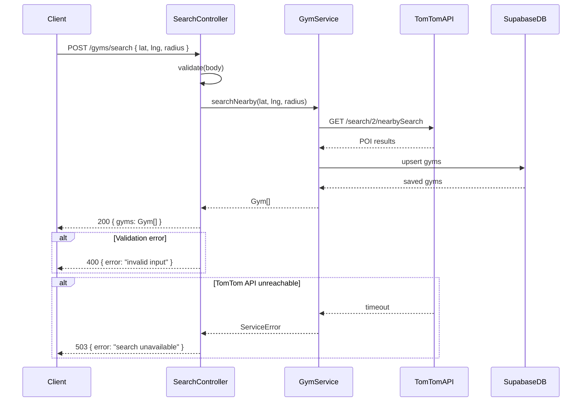

# Doc Building Blocks

Canonical format reference for reusable spec sections. Sub-agents must read this file and follow these formats exactly when generating spec content. Report which building blocks you used in your output.

Every section heading, emoji marker, and table structure defined here must be copied verbatim into the spec — do not invent alternate formats.

---

## Building Blocks Index

| Block | Emoji | Trigger |
|-------|-------|---------|
| [Inbound Flow Diagram](#inbound-flow-diagram) | 🔀 | New or updated endpoint, queue job, scheduled job, CLI command |
| [Wireframe Diagram](#wireframe-diagram) | 📐 | New or updated page, layout group, or dialog |
| [External Payload Schema](#external-payload-schema) | 🔗 | Any external API, webhook, or queue payload with unknown schema |
| [Keyboard Shortcuts](#keyboard-shortcuts) | ⌨️ | New or updated UI view |

---

## Inbound Flow Diagram

**When to generate:** For every new or updated entry point — controller endpoint, queue job, scheduled job, or CLI command. One diagram per distinct use case. Never combine unrelated flows in a single diagram.

### Section Heading Format

```
#### 🔀 Inbound Flow — [HTTP Method] /path/to/endpoint
#### 🔀 Inbound Flow — Queue Job: [JobName]
#### 🔀 Inbound Flow — Scheduled Job: [JobName]
#### 🔀 Inbound Flow — CLI: [command name]
```

### Diagram Format

Use a Mermaid `sequenceDiagram`. Show the full call graph from entry point through services, repositories, and external calls. Include both the happy path and the primary error path.

````markdown
#### 🔀 Inbound Flow — POST /gyms/search


````

### Rules

- Start with the external caller (Client, Scheduler, Queue, CLI Runner).
- Name every participant after its actual class or module — no generic names like `Backend` or `Server`.
- Use `-->>` for responses, `->>` for requests.
- Include `alt` blocks for the primary error path.
- Do not show internal implementation details like variable assignments — only cross-boundary calls.

---

## Wireframe Diagram

**When to generate:** For every new or updated page, layout group, or dialog. One diagram per view. Never combine multiple views in a single diagram.

### Section Heading Format

```
#### 📐 Wireframe — [ScreenName]
#### 📐 Wireframe — [DialogName] Dialog
#### 📐 Wireframe — [LayoutName] Layout
```

### Diagram Format

Use ASCII art for the layout, followed by a component tree on the next line.

````markdown
#### 📐 Wireframe — GymSearchScreen

```
┌─────────────────────────────────────┐
│  [← Back]        Search Gyms        │
├─────────────────────────────────────┤
│  🔍 [ Search input                ] │
│  [Filter ▾]  [Radius ▾]  [Open now] │
├─────────────────────────────────────┤
│  ┌───────────────────────────────┐  │
│  │  MapView                      │  │
│  │   · GymMarker  · GymMarker    │  │
│  └───────────────────────────────┘  │
├─────────────────────────────────────┤
│  ── GymCard ───────────────────── ↑ │
│     Name · Distance · Rating        │
│  ── GymCard ──────────────────────  │
│     Name · Distance · Rating        │
└─────────────────────────────────────┘
```

**Component tree:**
GymSearchScreen
├── Header (← Back, title)
├── SearchBar
├── FilterBar (FilterDropdown, RadiusDropdown, OpenNowToggle)
├── MapView
│   └── GymMarker[]
└── GymList
    └── GymCard[]
````

### Rules

- Use box-drawing characters (`┌ ─ ┐ │ ├ ┤ └ ┘`) for the outer shell.
- Label every UI zone inside the box (input fields, buttons, lists, maps).
- Use `[ Button ]` for tappable buttons and `[ input field ]` for text inputs.
- Use `▾` to indicate dropdowns.
- Always follow the ASCII art with a **Component tree** block showing the full hierarchy from the top-level screen or dialog down to shared UI primitives.
- Component tree uses `├──` / `└──` indentation. Append `[]` for list/array components (e.g., `GymCard[]`).

### Dialog Variant

````markdown
#### 📐 Wireframe — EditProfileDialog

```
┌──────────────────────────────┐
│  Edit Profile            [✕] │
├──────────────────────────────┤
│  Avatar                      │
│  [  Profile photo  ] [Edit]  │
│                              │
│  Name                        │
│  [ ________________________] │
│                              │
│  Bio                         │
│  [ ________________________] │
│  [ ________________________] │
│                              │
│  [Cancel]         [Save ✓ ] │
└──────────────────────────────┘
```

**Component tree:**
EditProfileDialog
├── DialogHeader (title, CloseButton)
├── AvatarUpload (AvatarPreview, EditButton)
├── FormField — name (TextInput)
├── FormField — bio (TextareaInput)
└── DialogFooter (CancelButton, SaveButton)
````

---

## External Payload Schema

**When to generate:** For every external API, webhook, or queue payload integrated into the spec where the schema is not already documented in the codebase. Never guess or infer schema fields — always request both a real sample and official documentation from the user.

### Section Heading Format

```
#### 🔗 External Payload — [System]: [Endpoint or Event Name]
```

### Block Format

````markdown
#### 🔗 External Payload — TomTom: Nearby Search Response

**Documentation:** [TomTom Search API v2 — Nearby Search](https://developer.tomtom.com/search-api/documentation/search-service/nearby-search)

**Sample real response:**
```json
{
  "summary": { "totalResults": 2, "offset": 0 },
  "results": [
    {
      "id": "840DR5V2H80",
      "score": 2.5,
      "dist": 312.4,
      "poi": {
        "name": "Planet Fitness",
        "categorySet": [{ "id": 7319 }],
        "categories": ["gym"],
        "openingHours": { "mode": "nextSevenDays", "timeRanges": [] }
      },
      "address": {
        "freeformAddress": "123 Main St, Austin, TX 78701",
        "countryCode": "US"
      },
      "position": { "lat": 30.2672, "lon": -97.7431 }
    }
  ]
}
```

**Schema notes:**
- `id` — stable identifier; use `dataSources.poiDetails.id` if present, fall back to top-level `id`.
- `openingHours.timeRanges` — may be empty even when the POI is open. Do not infer status from an empty array.
- `score` — relevance score, not a rating. Do not display to users as a quality indicator.
````

### Rules

- Always include both the documentation link and a real sample — never just one.
- Annotate any fields that are surprising, optional, nullable, or version-dependent in **Schema notes**.
- If the user has not yet provided the sample or documentation link, add an ❓ open question to the Open Questions section and do not create the schema block yet.

---

## Keyboard Shortcuts

**When to generate:** For every new or updated UI view. See the full conventions in `Skill.md` under *Keyboard Shortcuts for Web App UI*.

### Section Heading Format

```
#### ⌨️ Keyboard Shortcuts — [ScreenName or "Global"]
```

### Table Format

```markdown
#### ⌨️ Keyboard Shortcuts — GymSearchScreen

| Shortcut | Action | Scope |
|----------|--------|-------|
| / | Focus search input | Page level |
| ↑ / ↓ | Navigate gym list | List focus |
| Enter | Open selected gym | List focus |
| Cmd/Ctrl K | Open command palette | Global |
| Escape | Deselect / close panel | Page level |
| ? | Show keyboard shortcut help | Global (not in input) |
```

### Scope Values

| Scope | Meaning |
|-------|---------|
| `Global` | Active anywhere in the app |
| `Page level` | Active only on this specific screen |
| `List focus` | Active only when the list has keyboard focus |
| `Dialog` | Active only while the dialog is open |
| `Component level` | Active within a specific focused component |
