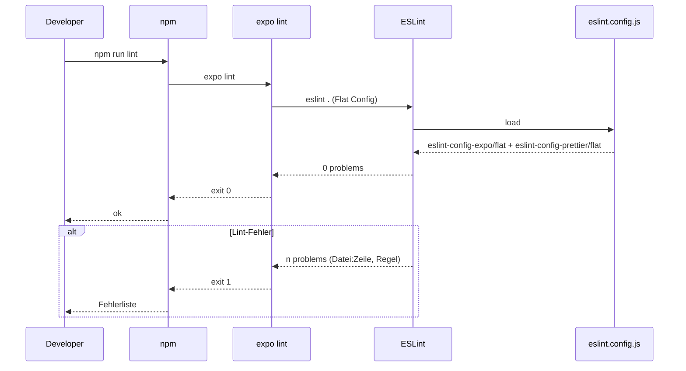
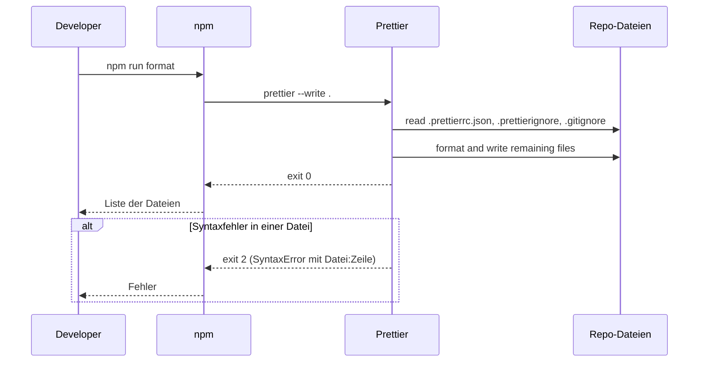
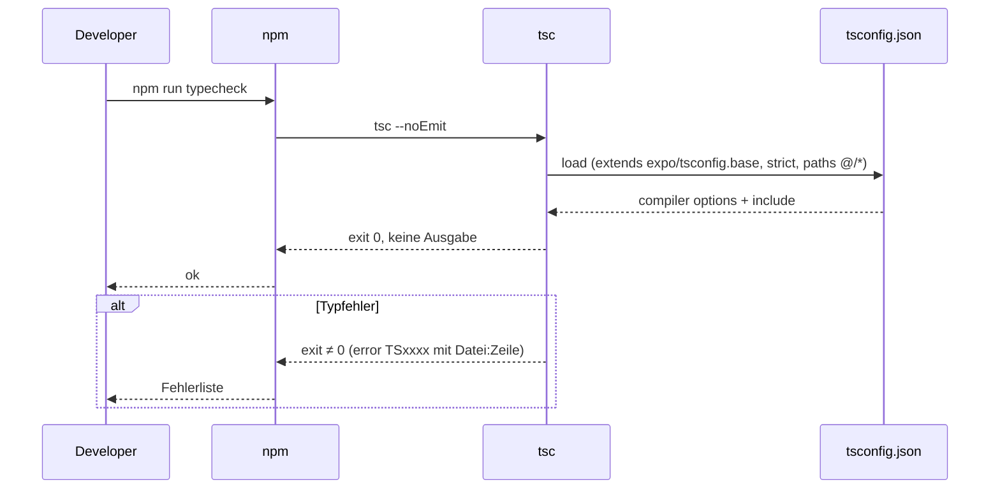
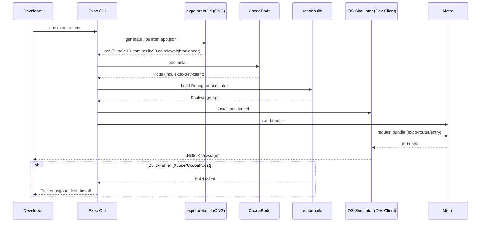
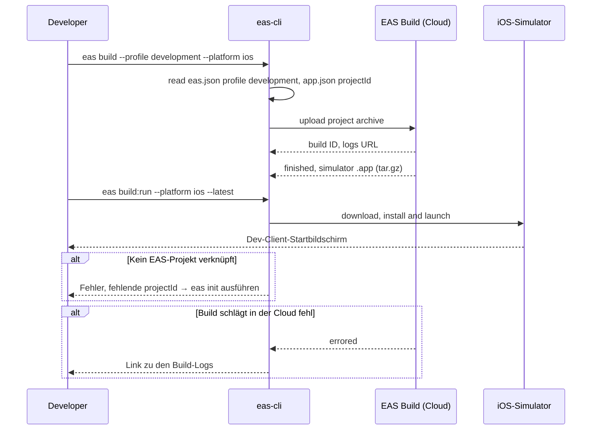
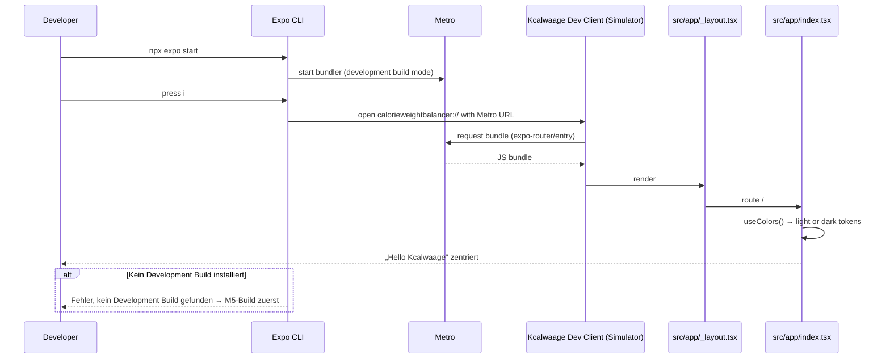

# Expo-Grundgerüst (Branch `setup`)

## Overview

Dieses Paket legt im Branch `setup` das technische Grundgerüst der Kcalwaage-App an: eine Expo-App (TypeScript, Expo Router) im Repo-Root, vorbereitet für einen Development Build (`expo-dev-client`, `eas.json`), mit ESLint und Prettier, den Skripten `lint`, `format` und `typecheck`, einer Startseite mit zentriertem „Hello Kcalwaage“ (schwarz auf weiß, im Dark Mode invertiert) und einem README-Abschnitt „Setup“. Es ist die Basis für alle weiteren Schritte des Langzeitplans und deckt einen Teil von Plan-Schritt 1 („Repo und Projekt anlegen“) ab. Betroffen sind Projektkonfiguration (`package.json`, `app.json`, `eas.json`, `tsconfig.json`, Lint- und Format-Konfiguration), die erste Route unter `src/app/`, Farb-Tokens unter `src/theme/` und das README.

**Ursprüngliche Anforderung (wörtlich):**

> Lies CLAUDE.md. Arbeite im brach setup und richte darin das Grundgerüst ein:
> - Expo-App (TypeScript, Expo Router) im Repo-Root, vorbereitet für einen Development Build (expo-dev-client, eas.json mit Profil "development" für iOS Simulator und Gerät). HealthKit und das Widget kommen noch nicht rein.
> - ESLint (eslint-config-expo) und Prettier, aufeinander abgestimmt (eslint-config-prettier), dazu die Skripte "lint", "format" und "typecheck" in package.json.
> - Eine Startseite, die zentriert "Hello Kcalwaage" zeigt, schwarz auf weiß und im Dark Mode invertiert.
> - Ein kurzer README-Abschnitt "Setup", der beschreibt, wie man installiert und startet.
> Fertig ist es, wenn `npx expo start` die Hello-Seite zeigt und lint, typecheck und format ohne Fehler laufen. Danach in kleinen Commits committen und einen PR gegen main öffnen.

**Abnahmekriterien:**

- `npx expo start` zeigt die Hello-Seite (im installierten Development Build, siehe Key Decision 3).
- `npm run lint`, `npm run typecheck` und `npm run format` laufen ohne Fehler.
- Die Arbeit liegt in kleinen Commits auf `setup`, und ein PR gegen `main` ist geöffnet.

**Ausdrücklich nicht enthalten:** HealthKit (`@kingstinct/react-native-healthkit`) und das Widget (`targets/widget/`, `@bacons/apple-targets`). Ebenfalls nicht Teil dieses Auftrags, laut Langzeitplan aber später fällig: App Group, HealthKit-Berechtigung, Unit-Tests und CI (Schritt 1), Zweisprachigkeit DE/EN und Navigation mit drei Screens (Schritt 2), App-Icon (Schritt 10).

## Key Decisions

| # | Decision | Rationale | Alternatives Considered |
|---|----------|-----------|-------------------------|
| 1 | `eas.json` enthält nur das Profil `development` für den iOS-Simulator (`developmentClient: true`, `distribution: "internal"`, `ios.simulator: true`) | Entscheidung Julius 2026-10-12. Ein einzelnes Profil kann nicht Simulator und Gerät zugleich bedienen (`ios.simulator: true` erzeugt eine `.app`, die nicht aufs iPhone geht). Gerätebuilds brauchen den bezahlten Apple Developer Account und registrierte Geräte; das Geräteprofil kommt, sobald der Account aktiv ist | `development` (Gerät) + `development-simulator`; `development` (Simulator) + `development-device` |
| 2 | Bundle-ID `com.scully98.calorieweightbalancer` | Entscheidung Julius 2026-10-12. Unabhängig vom Arbeitstitel „Kcalwaage“ (Markenprüfung offen), passt zu Repo und Expo-Account `scully98`. Nach Registrierung in App Store Connect nicht mehr änderbar, für Nutzer unsichtbar | `com.scully98.kcalwaage`, `de.juliusfocke.kcalwaage` |
| 3 | Development Build für die Abnahme auf zwei Wegen: lokal mit `npx expo run:ios` und zusätzlich `eas init` + EAS-Cloud-Build mit Profil `development` | Entscheidung Julius 2026-10-12 („Beides“). Mit `expo-dev-client` zeigt `npx expo start` die Seite nur in einem installierten Development Build; Expo Go ist laut CLAUDE.md ausgeschlossen. Lokal für schnelle Abnahme (Xcode 26.6, CocoaPods 1.16.2 und iPhone-Simulatoren sind vorhanden), EAS-Build als Nachweis, dass `eas.json` funktioniert | nur lokal; nur EAS |
| 4 | Repo vor dem ersten `npm install` aus OneDrive nach `~/Documents/CalorieWeightBalancer` verschoben | Entscheidung Julius 2026-10-12, Verschieben erledigt am 2026-10-12. `node_modules` (zehntausende Dateien) und der generierte `ios/`-Ordner würden sonst synchronisiert; das bremst und kann Metro und Xcode mit Dateisperren stören. `~/Documents` selbst wird nicht synchronisiert (iCloud „Schreibtisch & Dokumente“ aus, OneDrive liegt nur im Unterordner `~/Documents/OneDrive`) | in OneDrive bleiben; `~/dev/CalorieWeightBalancer` |
| 5 | Basis ist das Template `blank-typescript@sdk-57`, Expo Router wird von Hand ergänzt; nicht das `default`-Template | Das Default-Template bringt Tabs, Beispielkomponenten, Reanimated, Gesture Handler, Web, `@expo/ui` und Glass Effect mit, die man sofort wieder löschen müsste; Ziel ist eine leichte App | `default` + `npm run reset-project` |
| 6 | Routen unter `src/app/`, Pfad-Alias `@/*` → `./src/*`, `experiments.typedRoutes: true` | Konvention des aktuellen SDK-57-Default-Templates; hält den Repo-Root frei für Konfiguration und später `targets/widget/` | `app/` im Root |
| 7 | Nur iOS: `"platforms": ["ios"]`, `ios.supportsTablet: false`, keine Android- und Web-Konfiguration und keine Android-/Web-Assets aus dem Template | CLAUDE.md: V1 nur iPhone | Android-/Web-Teile des Templates behalten |
| 8 | Dark Mode über `userInterfaceStyle: "automatic"` + `useColorScheme()`; Farben ausschließlich über Tokens in `src/theme/colors.ts` (`foreground`, `background`, `accent`, `plus`, `minus`, je `light`/`dark`) | CLAUDE.md: Farben von Anfang an über wenige Tokens (Vordergrund, Hintergrund, Akzent, Plus, Minus), damit V2 sie für App und Widget wählbar machen kann. Ohne `automatic` bleibt die App unter iOS immer hell | Farben direkt im Screen hart codieren |
| 9 | ESLint als Flat Config (`eslint.config.js`) mit `eslint-config-expo/flat`, `eslint-config-prettier/flat` als letztes Element; Prettier läuft separat, kein `eslint-plugin-prettier` | Vorgabe „aufeinander abgestimmt (eslint-config-prettier)“: ESLint-Regeln, die mit Prettier kollidieren, werden abgeschaltet; Lint und Formatierung bleiben getrennte Schritte | zusätzlich `eslint-plugin-prettier` (Variante aus der Expo-Doku) |
| 10 | Skripte: `lint` = `expo lint`, `format` = `prettier --write .`, `typecheck` = `tsc --noEmit` | Expo-Konvention (`expo lint` steht so im SDK-57-Template) bzw. Standard | `eslint .`; `prettier --check .` als `format` |
| 11 | Prettier-Optionen: nur `singleQuote: true`, sonst Prettier-Defaults | Entspricht dem Stil der Expo-Templates; minimale Konfiguration | reine Prettier-Defaults; eigener Stil |
| 12 | Versionen über `npx expo install` (Stand heute: `expo` ~57.0.27, `react-native` 0.86.3, `react` 19.2.3, `typescript` ~6.0.3, `expo-dev-client` 57.0.19) | Expo wählt zum SDK passende Versionen | Versionen von Hand setzen |
| 13 | `package.json`: `"private": true`, `"license": "PolyForm-Noncommercial-1.0.0"` | Lizenz laut CLAUDE.md; `private` verhindert versehentliches npm-Publish | — |
| 14 | Display-Name `Kcalwaage`; `slug` und `scheme` `calorieweightbalancer` | Name ist Arbeitstitel; der `slug` wird mit `eas init` zum Expo-Projekt `@scully98/calorieweightbalancer` und lässt sich danach nicht ohne Weiteres umbenennen | `slug` `kcalwaage` |
| 15 | Native Ordner per Continuous Native Generation: `/ios` und `/android` bleiben in `.gitignore` | Template-Standard; `@bacons/apple-targets` (Widget, Schritt 9) erzeugt sein Target beim Prebuild | `ios/` einchecken |
| 16 | README-Abschnitt „Setup“ auf Englisch | Öffentliches Repo; CLAUDE.md: Code und Commit-Messages auf Englisch | Deutsch |

## Implementation Details

### Milestone Map

| Milestone | Delivers | 🟢 Add | 🟠 Change | 🔴 Delete | Depends On |
|-----------|----------|--------|-----------|-----------|------------|
| M1 — Vorbereitung | Spec committet, Repo unter `~/Documents/CalorieWeightBalancer` | 1 | 0 | 0 | — |
| M2 — Expo-Grundgerüst | Expo SDK 57 mit TypeScript im Repo-Root | 8 | 0 | 0 | M1 |
| M3 — ESLint & Prettier | Lint-/Format-Konfiguration, Skripte `lint`, `format`, `typecheck` | 3 | 2 | 0 | M2 |
| M4 — Expo Router & Hello-Seite | Route `/` mit „Hello Kcalwaage“, Farb-Tokens, Dark Mode | 4 | 4 | 2 | M3 |
| M5 — Development Build & EAS | `expo-dev-client`, `eas.json`, EAS-Projekt, lokaler und Cloud-Build | 1 | 3 | 0 | M4 |
| M6 — README „Setup“ | Installations- und Startanleitung | 0 | 1 | 0 | M5 |
| M7 — Abnahme & PR | Checks grün, Push, PR gegen `main` | 0 | 1 | 0 | M6 |

```
🟢 Add   🟠 Change   🔴 Delete
```

#### Commit-Plan

Ein Commit pro Milestone (M5 zwei), Messages auf Englisch, jede endet mit `Co-Authored-By: Claude Opus 5.5 <noreply@anthropic.com>`.

| Milestone | Commit-Message |
|-----------|----------------|
| M1 | `docs: add implementation spec for Expo scaffold` |
| M2 | `chore: scaffold Expo app from blank TypeScript template` |
| M3 | `chore: add ESLint, Prettier and lint/format/typecheck scripts` |
| M4 | `feat: add Expo Router with Hello Kcalwaage screen` |
| M5 | `chore: add expo-dev-client and EAS development profile` |
| M5 | `chore: link EAS project` |
| M6 | `docs: add setup section to README` |
| M7 | `docs: mark Expo scaffold spec as done` |

---

### ✅ Milestone 1 — Vorbereitung

> Die Spec liegt im Repo, und das Repo liegt außerhalb von OneDrive, bevor `node_modules` entsteht.

**Depends on:** none

#### File Changes

| Color | File | Action |
|-------|------|--------|
| 🟢 | `docs/specs/2026-10-12-expo-app-scaffold.md` | Diese Spec |

#### To-Dos

- ✅ Commit this spec on `setup` (`125f0f8`)
- ✅ Push the spec commit to `origin/setup`
- ✅ Move the repo out of OneDrive to `~/Documents/CalorieWeightBalancer`
- ✅ Reopen VS Code and Claude Code in the new path and check out `setup`
- ✅ Verify `git status` is clean and `git log` shows the spec commit

#### Notes / Constraints

> Das Verschieben macht Julius selbst: Die laufende VS-Code- und Claude-Code-Sitzung hat das Repo als Arbeitsverzeichnis. Wird statt `mv` frisch geklont, muss die Spec vorher gepusht sein. Ab hier gelten alle Pfade relativ zum neuen Repo-Root `~/Documents/CalorieWeightBalancer`.

---

### ✅ Milestone 2 — Expo-Grundgerüst

> Ein lauffähiges Expo-SDK-57-Projekt mit TypeScript liegt im Repo-Root, ohne die bestehenden Dateien anzutasten.

**Depends on:** Milestone 1

#### File Changes

| Color | File | Action |
|-------|------|--------|
| 🟢 | `package.json` | Aus Template; `name` `calorieweightbalancer`, `"private": true`, `"license": "PolyForm-Noncommercial-1.0.0"` |
| 🟢 | `package-lock.json` | Durch `npm install` |
| 🟢 | `app.json` | Aus Template; Name, slug, iOS-only, Bundle-ID (Endstand siehe M5) |
| 🟢 | `tsconfig.json` | Aus Template (`extends: expo/tsconfig.base`, `strict: true`) |
| 🟢 | `.gitignore` | Aus Template-Datei `gitignore`; enthält `/ios`, `/android`, `.expo/`, `expo-env.d.ts` |
| 🟢 | `index.ts` | Template-Einstieg (wird in M4 durch `expo-router/entry` ersetzt) |
| 🟢 | `App.tsx` | Template-Komponente (wird in M4 gelöscht) |
| 🟢 | `assets/icon.png` | Platzhalter-Icon aus Template bis Plan-Schritt 10 |

#### To-Dos

- ✅ Create the template in a temporary folder outside the repo: `npx create-expo-app@latest <tmp>/kcal-scaffold --template blank-typescript@sdk-57 --no-install`
- ✅ Copy the template files into the repo root without overwriting `README.md`, `LICENSE.md`, `CLAUDE.md`, `.claude/`, `docs/` _(nur die acht Dateien aus der Tabelle; Template-Extras `AGENTS.md`, `.claude/settings.json` und `assets/splash-icon.png` nicht übernommen)_
- ✅ Remove the template `LICENSE` (0BSD), Android icons and `favicon.png` before committing _(Template-`LICENSE` ist MIT, nicht 0BSD; nicht kopiert)_
- ✅ Update `package.json`: `name`, `private`, `license`; keep scripts `start` and `ios`, drop `android` and `web`
- ✅ Update `app.json`: `name` `Kcalwaage`, `slug` `calorieweightbalancer`, `platforms: ["ios"]`, `ios.supportsTablet: false`, `ios.bundleIdentifier` `com.scully98.calorieweightbalancer`, `userInterfaceStyle: "automatic"`; remove `android` and `web` blocks
- ✅ Run `npm install` _(Typecheck grün; `npm audit` siehe Concerns-Log Nr. 9)_
- ✅ Commit (`chore: scaffold Expo app from blank TypeScript template`)

#### Notes / Constraints

> `create-expo-app` legt kein Projekt in einem nicht leeren Ordner an, daher der Umweg über einen temporären Ordner. Die Template-Datei heißt `gitignore` ohne Punkt, wenn man sie aus dem Paket kopiert; `create-expo-app` benennt sie selbst um. Das Template-`LICENSE` (0BSD) darf nicht ins Repo, es gilt `LICENSE.md` (PolyForm Noncommercial 1.0.0). Nach diesem Commit startet das Projekt bereits, zeigt aber noch den Template-Text.

---

### ✅ Milestone 3 — ESLint & Prettier

> Lint, Formatierung und Typprüfung sind eingerichtet, bevor eigener Code entsteht, damit jeder folgende Commit schon sauber formatiert ist.

**Depends on:** Milestone 2

#### File Changes

| Color | File | Action |
|-------|------|--------|
| 🟢 | `eslint.config.js` | Flat Config: `eslint-config-expo/flat`, `{ ignores: ['dist/*'] }`, `eslint-config-prettier/flat` als letztes Element |
| 🟢 | `.prettierrc.json` | `{ "singleQuote": true }` |
| 🟢 | `.prettierignore` | `package-lock.json`, `.claude/`, `CLAUDE.md`, `LICENSE.md`, `docs/specs/` |
| 🟠 | `package.json` | devDependencies `eslint`, `eslint-config-expo`, `prettier`, `eslint-config-prettier`; Skripte `lint`, `format`, `typecheck` |
| 🟠 | `package-lock.json` | Neue devDependencies |

#### To-Dos

- ✅ Install dev tools: `npx expo install eslint eslint-config-expo prettier eslint-config-prettier -- --save-dev` _(`expo install` legte `eslint-config-expo` unter `dependencies` ab; von Hand nach `devDependencies` verschoben)_
- ✅ Create `eslint.config.js` with Expo flat config and `eslint-config-prettier/flat` last
- ✅ Create `.prettierrc.json` and `.prettierignore`
- ✅ Add scripts `"lint": "expo lint"`, `"format": "prettier --write ."`, `"typecheck": "tsc --noEmit"`
- ✅ Run `npm run format`, `npm run lint`, `npm run typecheck`; all exit 0 _(Prettier ergänzte nur den fehlenden Zeilenumbruch am Ende von `README.md`)_
- ✅ Commit (`chore: add ESLint, Prettier and lint/format/typecheck scripts`)

#### Notes / Constraints

> Prettier 3 liest `.gitignore` automatisch mit, `node_modules`, `/ios`, `.expo/` müssen also nicht in `.prettierignore`. Ausgenommen werden Dateien, die nicht von Prettier umgebrochen werden sollen: das Lockfile, Julius' Kontext- und Lizenzdateien, die Claude-Skills und die Specs (deren Tabellen und Häkchen werden von `/implement-spec` gepflegt). `expo lint` legt bei fehlender Konfiguration selbst eine an und fragt dabei interaktiv; deshalb `eslint.config.js` vor dem ersten `npm run lint` anlegen.

#### 🔀 Inbound Flow — CLI: npm run lint



#### 🔀 Inbound Flow — CLI: npm run format



#### 🔀 Inbound Flow — CLI: npm run typecheck



---

### ✅ Milestone 4 — Expo Router & Hello-Seite

> Die App startet über Expo Router auf der Route `/`, die zentriert „Hello Kcalwaage“ zeigt, schwarz auf weiß und im Dark Mode weiß auf schwarz.

**Depends on:** Milestone 3

#### File Changes

| Color | File | Action |
|-------|------|--------|
| 🟢 | `src/theme/colors.ts` | Farb-Tokens `foreground`, `background`, `accent`, `plus`, `minus` für `light` und `dark` |
| 🟢 | `src/theme/use-colors.ts` | Hook: `useColorScheme()` → Token-Satz (`dark` → dark, sonst light) |
| 🟢 | `src/app/_layout.tsx` | Root-Layout: `ThemeProvider` mit Token-Hintergrund, `Stack` ohne Header, `StatusBar style="auto"` |
| 🟢 | `src/app/index.tsx` | HelloScreen: zentrierter Text „Hello Kcalwaage“ in Token-Farben |
| 🟠 | `package.json` | `"main": "expo-router/entry"`; Dependencies von Expo Router |
| 🟠 | `package-lock.json` | Neue Dependencies |
| 🟠 | `app.json` | `scheme` `calorieweightbalancer`, `plugins: ["expo-router"]`, `experiments.typedRoutes: true` |
| 🟠 | `tsconfig.json` | `paths` `@/*` → `./src/*`; `include` um `.expo/types/**/*.ts` und `expo-env.d.ts` |
| 🔴 | `index.ts` | Ersetzt durch `expo-router/entry` |
| 🔴 | `App.tsx` | Ersetzt durch `src/app/index.tsx` |

#### To-Dos

- ✅ Install Expo Router: `npx expo install expo-router expo-linking expo-constants react-native-safe-area-context react-native-screens`
- ✅ Set `"main": "expo-router/entry"` and remove `index.ts` and `App.tsx`
- ✅ Add `scheme`, `expo-router` plugin and `typedRoutes` to `app.json`
- ✅ Add the `@/*` path alias and the Expo type includes to `tsconfig.json`
- ✅ Create color tokens in `src/theme/colors.ts`: light `foreground #000000`, `background #FFFFFF`; dark inverted; `accent`, `plus`, `minus` equal `foreground` in V1
- ✅ Create `src/theme/use-colors.ts`
- ✅ Create `src/app/_layout.tsx` with `ThemeProvider` (navigation background from the `background` token), `Stack` with `headerShown: false` and `StatusBar style="auto"`
- ✅ Create `src/app/index.tsx`: full-screen `View` with `background` token, centered `Text` „Hello Kcalwaage“ in `foreground` token, system font, Dynamic Type left on
- ✅ Run `npm run format`, `npm run lint`, `npm run typecheck`; all exit 0 _(zusätzlich `npx expo export --platform ios`: Bundle baut; `expo-doctor` 21/21)_
- ✅ Commit (`feat: add Expo Router with Hello Kcalwaage screen`)

#### Notes / Constraints

> V1 hat keine Akzentfarbe; Plus und Minus werden in der App später über Vorzeichen, Balkenrichtung und Beschriftung unterschieden, nicht über Rot/Grün. Die Tokens `accent`, `plus`, `minus` existieren trotzdem schon, damit V2 sie wählbar machen kann. Kein Farbwert darf direkt im Screen stehen. Der Text „Hello Kcalwaage“ ist in beiden Sprachen gleich und braucht noch keine Übersetzung. `allowFontScaling` nicht abschalten (Dynamic Type). Ohne `ThemeProvider` mit Token-Hintergrund würde der Navigationscontainer im Dark Mode hell durchblitzen.

#### 📐 Wireframe — HelloScreen

```
┌─────────────────────────────────────┐
│ 9:41                         ▮▮▮ ▭  │  StatusBar (style="auto")
├─────────────────────────────────────┤
│                                     │
│                                     │
│                                     │
│                                     │
│           Hello Kcalwaage           │  Text, Token foreground
│                                     │
│                                     │
│                                     │
│                                     │
└─────────────────────────────────────┘
Light: #000000 auf #FFFFFF  ·  Dark: #FFFFFF auf #000000
```

**Component tree:**
RootLayout (`src/app/_layout.tsx`)
└── ThemeProvider (expo-router, Hintergrund aus Token `background`)
    ├── Stack (`headerShown: false`)
    │   └── HelloScreen (`src/app/index.tsx`)
    │       └── View (flex 1, zentriert, Token `background`)
    │           └── Text „Hello Kcalwaage“ (Token `foreground`, Systemschrift, Dynamic Type)
    └── StatusBar (expo-status-bar, `style="auto"`)

#### ⌨️ Keyboard Shortcuts — HelloScreen

Die App selbst hat keine Tastaturkürzel: reine Touch-App fürs iPhone, keine Web-Version, die Seite hat keine Aktionen. Für die Abnahme relevant sind nur die vorhandenen Entwickler-Kürzel von Expo und dem iOS-Simulator; neue Kürzel werden nicht angelegt.

| Shortcut | Action | Scope |
|----------|--------|-------|
| i | Development Build im iOS-Simulator öffnen | Global (nur Entwicklung, Terminal von `npx expo start`) |
| r | App neu laden | Global (nur Entwicklung, Terminal von `npx expo start`) |
| m | Dev-Menü öffnen | Global (nur Entwicklung, Terminal von `npx expo start`) |
| Cmd D | Dev-Menü öffnen | Global (nur Entwicklung, iOS-Simulator) |
| Cmd Shift A | Hell/Dunkel umschalten (Dark-Mode-Prüfung) | Global (nur Entwicklung, iOS-Simulator) |

---

### Milestone 5 — Development Build & EAS

> Die App läuft als Development Build im Simulator, lokal gebaut und per EAS gebaut, und `npx expo start` zeigt darin die Hello-Seite.

**Depends on:** Milestone 4

#### File Changes

| Color | File | Action |
|-------|------|--------|
| 🟢 | `eas.json` | Profil `development` für den iOS-Simulator |
| 🟠 | `package.json` | Dependency `expo-dev-client` |
| 🟠 | `package-lock.json` | Neue Dependency |
| 🟠 | `app.json` | `owner` `scully98` und `extra.eas.projectId` durch `eas init` |

#### To-Dos

- 🔲 Install `expo-dev-client`: `npx expo install expo-dev-client`
- 🔲 Create `eas.json` (see snippet below)
- 🔲 Commit (`chore: add expo-dev-client and EAS development profile`)
- 🔲 Build and launch locally: `npx expo run:ios` (iPhone simulator, e.g. iPhone 16 Pro); confirm „Hello Kcalwaage“ in light and dark appearance
- 🔲 Link the EAS project: `npx eas-cli@latest init` (creates `@scully98/calorieweightbalancer` on expo.dev, writes `owner` and `extra.eas.projectId`)
- 🔲 Commit (`chore: link EAS project`)
- 🔲 Run the cloud build: `npx eas-cli@latest build --profile development --platform ios`
- 🔲 Install and launch the EAS build: `npx eas-cli@latest build:run --platform ios --latest`
- 🔲 Run `npx expo start`, press `i`, and confirm the Hello page in the development build (acceptance criterion)

#### Notes / Constraints

> Endstand `eas.json`; `cli.version` auf die installierte eas-cli-Version setzen (heute 24.12.1):
>
> ```json
> {
>   "cli": { "version": ">= 24.12.1", "appVersionSource": "remote" },
>   "build": {
>     "development": {
>       "developmentClient": true,
>       "distribution": "internal",
>       "ios": { "simulator": true }
>     }
>   }
> }
> ```
>
> Endstand `app.json`:
>
> ```json
> {
>   "expo": {
>     "name": "Kcalwaage",
>     "slug": "calorieweightbalancer",
>     "owner": "scully98",
>     "scheme": "calorieweightbalancer",
>     "version": "1.0.0",
>     "orientation": "portrait",
>     "icon": "./assets/icon.png",
>     "userInterfaceStyle": "automatic",
>     "platforms": ["ios"],
>     "ios": {
>       "supportsTablet": false,
>       "bundleIdentifier": "com.scully98.calorieweightbalancer"
>     },
>     "plugins": ["expo-router"],
>     "experiments": { "typedRoutes": true },
>     "extra": { "eas": { "projectId": "<von eas init>" } }
>   }
> }
> ```
>
> Kein Geräteprofil (Key Decision 1). Simulator-Builds brauchen keine Apple-Credentials. `npx expo run:ios` erzeugt `/ios` lokal (gitignored, CNG). Der Expo-Login `scully98` ist auf dem Mac aktiv. `eas init` legt ein Projekt im Expo-Account an und der EAS-Build verbraucht Kontingent des Expo-Plans; beides hat Julius mit „Beides“ freigegeben. Ein Gerätebuild kommt mit dem Apple Developer Account als eigenes Profil.

#### 🔀 Inbound Flow — CLI: npx expo run:ios



#### 🔀 Inbound Flow — CLI: eas build --profile development --platform ios



#### 🔀 Inbound Flow — CLI: npx expo start



---

### Milestone 6 — README „Setup“

> Ein kurzer Abschnitt „Setup“ beschreibt, wie man installiert und startet.

**Depends on:** Milestone 5

#### File Changes

| Color | File | Action |
|-------|------|--------|
| 🟠 | `README.md` | Abschnitt `## Setup` unter der bestehenden Überschrift |

#### To-Dos

- 🔲 Document prerequisites: Node.js LTS (tested with 22.16.0) and npm; macOS with Xcode and CocoaPods for local builds; Expo account and `eas-cli` (via `npx eas-cli@latest`) for cloud builds
- 🔲 Document install: `npm install`
- 🔲 Document the development build: `npx expo run:ios` (local) or `eas build --profile development --platform ios` plus `eas build:run --platform ios --latest` (cloud, simulator); rebuild after native dependency changes
- 🔲 Document start: `npx expo start`, then `i`; note that Expo Go is not supported
- 🔲 Document scripts `npm run lint`, `npm run format`, `npm run typecheck`
- 🔲 Commit (`docs: add setup section to README`)

#### Notes / Constraints

> Kurz halten (Vorgabe „kurzer README-Abschnitt“), Englisch (Key Decision 16). Keine Doku über HealthKit oder Widget.

---

### Milestone 7 — Abnahme & PR

> Alle Abnahmekriterien sind geprüft, `setup` ist gepusht und ein PR gegen `main` ist offen.

**Depends on:** Milestone 6

#### File Changes

| Color | File | Action |
|-------|------|--------|
| 🟠 | `docs/specs/2026-10-12-expo-app-scaffold.md` | To-dos auf ✅ setzen |

#### To-Dos

- 🔲 Run `npm run lint`, `npm run typecheck`, `npm run format`; all exit 0 and `git status` stays clean afterwards
- 🔲 Delete `.expo/` and `expo-env.d.ts`, then run `npm run typecheck` again (fresh-clone case)
- 🔲 Confirm `npx expo start` shows the Hello page in light and dark appearance
- 🔲 Mark this spec's to-dos as done and commit (`docs: mark Expo scaffold spec as done`)
- 🔲 Push `setup` to `origin`
- 🔲 Julius: open a PR `setup` → `main` on github.com titled `Set up Expo app scaffold` with summary, key decisions (simulator-only profile, bundle ID), test steps, and the closing line `🤖 Generated with [Claude Code](https://claude.com/claude-code)`

#### Notes / Constraints

> Den PR öffnet Julius selbst über die GitHub-Weboberfläche (Concerns-Log Nr. 8). Der PR enthält auch den bereits vorhandenen Commit `24a803b claude skills` (CLAUDE.md, `.claude/`), siehe Concerns-Log Nr. 5. `expo-env.d.ts` und `.expo/types` (typed routes) entstehen erst durch `npx expo start`; `typecheck` muss auch ohne sie grün sein, damit es später in CI läuft.

---

## Open Questions

| # | Question | Owner | Impact if Unresolved |
|---|----------|-------|----------------------|
| — | Keine offenen Fragen | — | — |

## Concerns & Decisions Log

| # | Type | Concern | Resolution |
|---|------|---------|------------|
| 1 | ⚠️ Concern | Anforderung „eas.json mit Profil "development" für iOS Simulator und Gerät“: Ein einzelnes EAS-Profil kann nicht beides bauen (`ios.simulator: true` erzeugt eine `.app`, die nicht aufs Gerät geht) | Nur `development` für den Simulator; Geräteprofil später, wenn der Apple Developer Account aktiv ist — Julius 2026-10-12 |
| 2 | ⚠️ Concern | „Fertig, wenn `npx expo start` die Hello-Seite zeigt“: Mit `expo-dev-client` geht das nur mit installiertem Development Build; Expo Go ist laut CLAUDE.md ausgeschlossen | Lokal `npx expo run:ios` und zusätzlich `eas init` + EAS-Simulator-Build — Julius 2026-10-12 |
| 3 | 💡 Alternative | Repo liegt in OneDrive; `node_modules` und `ios/` würden synchronisiert (Last, Dateisperren für Metro/Xcode) | Repo vor `npm install` verschieben — Julius 2026-10-12; verschoben nach `~/Documents/CalorieWeightBalancer` (statt Vorschlag `~/dev/`) — Julius 2026-10-12 |
| 4 | ⚠️ Concern | Bundle-ID ist nach Registrierung in App Store Connect nicht mehr änderbar, der Name „Kcalwaage“ ist nur Arbeitstitel | `com.scully98.calorieweightbalancer` — Julius 2026-10-12 |
| 5 | ⚠️ Concern | Der PR gegen `main` enthält auch den Commit `24a803b claude skills` mit CLAUDE.md inklusive Abschnitt „Recht und Geschäft“ (Nebentätigkeitsklausel, geplante zweite kostenpflichtige App, Gewerbe). Das Repo ist öffentlich, `setup` ist schon auf `origin` gepusht | Open — Julius entscheidet, ob dieser Abschnitt öffentlich in `main` landen soll |
| 6 | 💡 Alternative | CI und Tests gehören laut Plan zu Schritt 1 („Lint und Tests in CI“), sind aber nicht Teil dieses Auftrags. Für die spätere CI wäre ein Skript `format:check` (`prettier --check .`) nötig, weil `format` Dateien schreibt statt zu prüfen | Open — Vorschlag: `format:check` schon in M3 mit anlegen, CI und Tests in einer eigenen Spec |
| 7 | ⚠️ Concern | `typecheck` auf frischem Klon: `expo-env.d.ts` und `.expo/types` (typed routes) sind gitignored und entstehen erst durch `npx expo start` | Abgesichert durch To-do in M7 (Typecheck ohne diese Dateien) |
| 8 | ⚠️ Concern | `gh` ist nicht angemeldet (`gh auth status`: not logged in), der PR in M7 lässt sich nicht per CLI öffnen | Julius öffnet den PR selbst über die GitHub-Weboberfläche; Claude pusht nur — Julius 2026-10-12 |
| 9 | ⚠️ Concern | `npm audit` nach M2: 22 Funde (7 moderat, 15 hoch), alle transitiv in Expo-Build-Werkzeugen (`braces`, `node-forge`, `uuid`), nicht im App-Bundle. `npm audit fix --force` würde auf `expo@44` zurückstufen | Nicht behoben; bei Expo-Patch-Releases `npx expo install --fix` ausführen — Claude 2026-10-12 |
