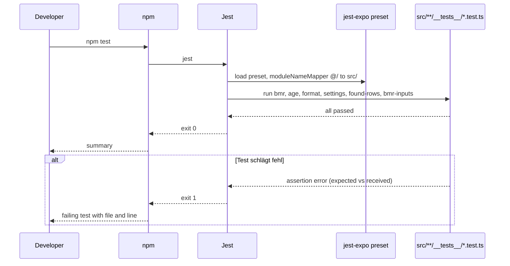
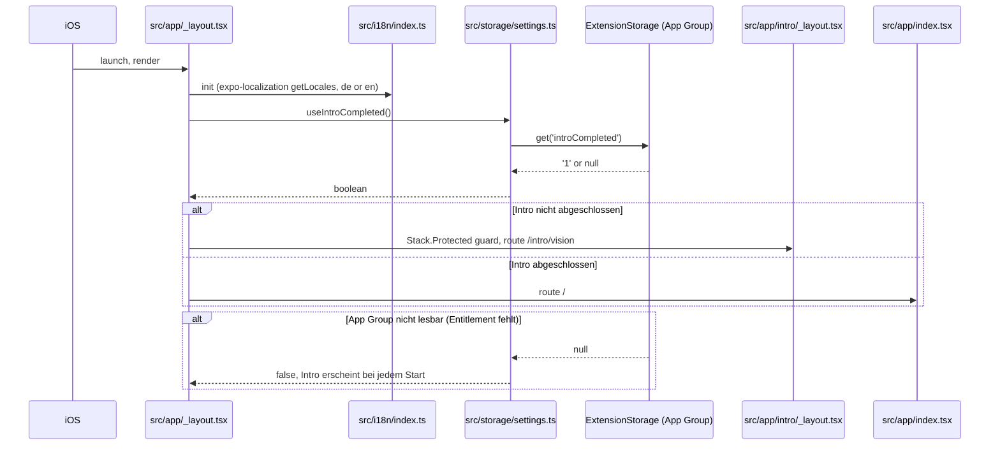
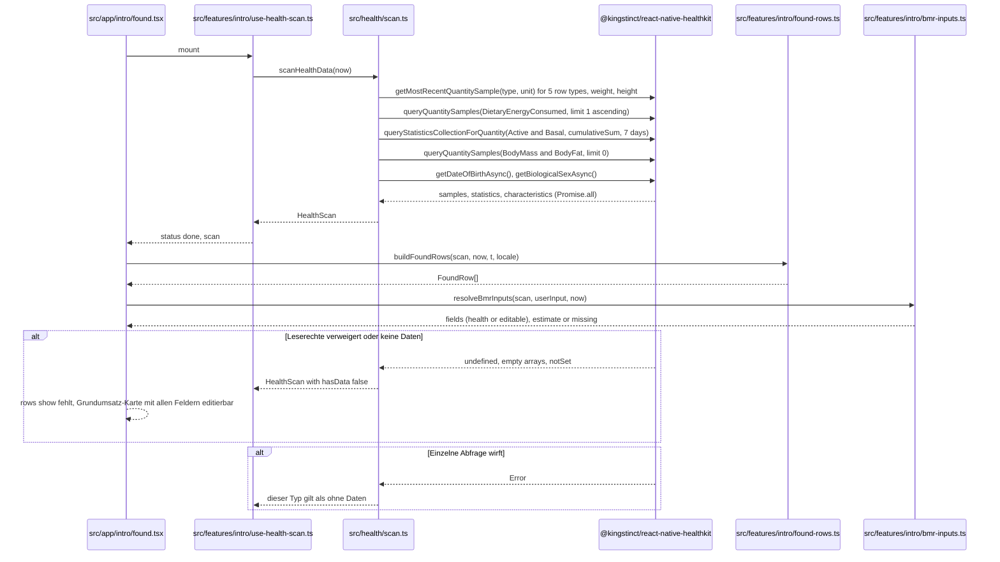
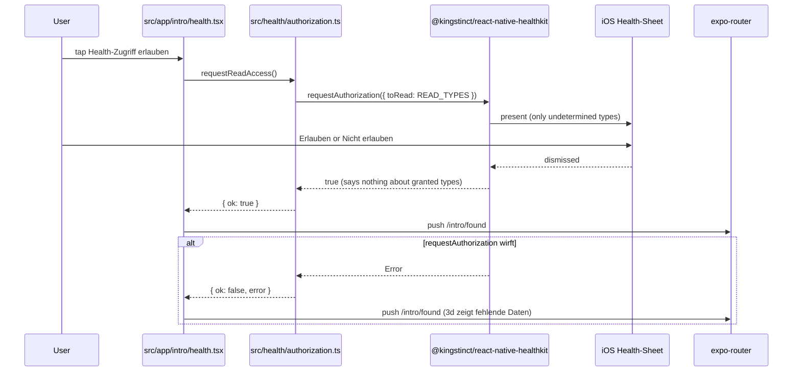
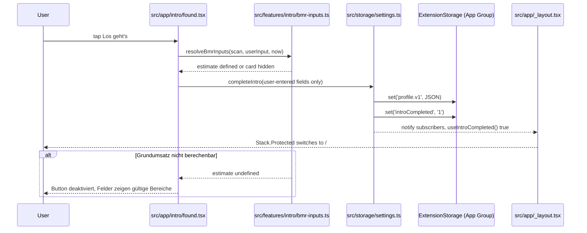
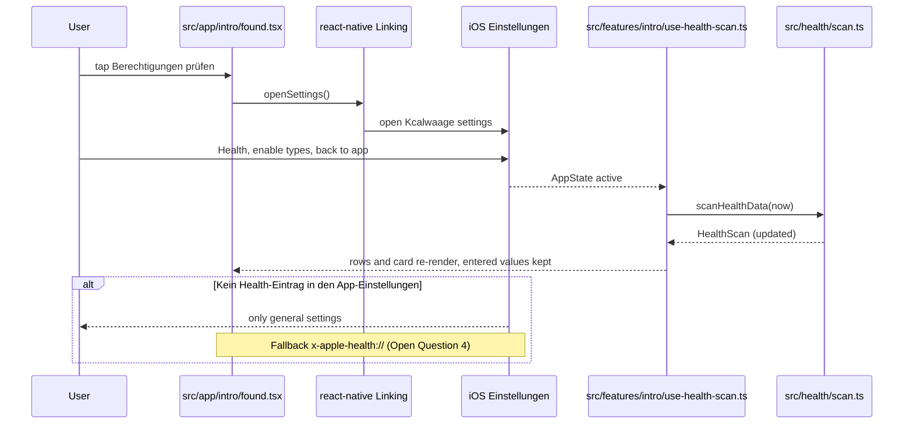

# Intro-Seiten (Branch `feature/intro-screens`)

## Overview

Dieses Paket baut die vier Intro-Seiten der Kcalwaage-App nach Julius' Wireframe (3a–3d) und deckt damit Plan-Schritt 3 („Intro-Seiten: Was die App macht, Datenschutz in einem Satz, Hinweis ‚Keine medizinische Beratung‘, Anfrage der HealthKit-Leserechte“) ab, dazu die Teile aus Schritt 1 und 2, die das Intro braucht: HealthKit-Berechtigung, App Group, Farb-Token `muted`, Typografie, wiederverwendbare Komponenten und Zweisprachigkeit (DE/EN). Die Seiten erklären die Idee der App (3a, 3b), fragen die Health-Leserechte an (3c) und zeigen, welche Daten tatsächlich ankommen, inklusive einmaliger Grundumsatz-Schätzung nach Mifflin-St Jeor, wenn Ruheenergie fehlt (3d). Betroffen sind Projektkonfiguration (`package.json`, `app.json`), native Module (HealthKit, App-Group-Speicher, Lokalisierung), Theme, i18n, neue Komponenten unter `src/components/`, ein Rechenbaustein unter `src/core/` mit Jest-Tests, HealthKit-Zugriff unter `src/health/`, Speicher unter `src/storage/` und die Routen unter `src/app/`.

**Ursprüngliche Anforderung (wörtlich):**

> erstelle diese intro pages aus dem wireframe.
> verwende simple color tokens, wiederverwendbare components
> wenn es wegen dem apple developer account noch nicht mgölich ist die healthkit sache abzufragen, dann lass diesen punkt erstmal weg
> erstelle einen neuen feature branch von dem origin/setup branch der noch nicht in main gemerged ist

**Wireframe-Inhalte (wörtlich, inkl. Annotationen):**

| Seite | Inhalt laut Wireframe |
|-------|-----------------------|
| 3a „Schritt 1 · Vision: wahres Kalorienziel“ | Seitenanzeige ▬○○○ (1. aktiv), rechts „Überspringen“. Titel „Du zählst. Du trackst. Und nichts passiert?“. Text „Oft liegt's an kleinen Abweichungen: Etiketten, Portionen und Uhren schätzen daneben – jeden Tag ein bisschen.“ Karte mit drei Zeilen „Kalorien“ (gefüllter Balken), „Verbrauch“ (umrandeter Balken), „Gewicht“ (gestrichelter Balken), Trennlinie, „↓ über Wochen ins Verhältnis gesetzt“, „dein wahres Ziel ≈ 2.180 kcal“. Fußtext „Kcalwaage rechnet die Fehlertoleranz heraus, damit du weißt, wo du wirklich stehst.“ Button „Weiter“ (gefüllt). |
| 3b „Schritt 2 · Vision: Big Picture“ | Seitenanzeige ○▬○○ (2. aktiv), rechts „Überspringen“. Titel „Ein schlechter Tag zerstört keinen Monat.“. Text „Raus aus dem Alles-oder-nichts. Sieh, was über Wochen zusammenkommt – in kcal und kg Fett.“ Raster aus 3 × 10 Kästchen: gefüllt, ein schraffiertes (Reihe 2, Spalte 3), zwei gestrichelte (Reihe 1, Spalte 6 und Reihe 3, Spalte 2). Legende „■ Minus-Tag“, „▣ Pizza-Abend“, „□ kein Eintrag“. Karte „30 Tage zusammen“, groß „−0,8 kg“, darunter „Fett eingespart ≈ −6.200 kcal (theoretisch)“. Fußtext „Der Pizza-Abend? Nach 3 Tagen ausgeglichen. Tage ohne Eintrag kannst du neutral zählen.“ Button „Weiter“. |
| 3c „Schritt 3 · Welche Daten & warum“ | Seitenanzeige ○○▬○ (3. aktiv), kein „Überspringen“. Titel „Ohne deine Health-Daten geht nichts“. Text „Kcalwaage misst selbst nichts. Sie rechnet deine Apple-Health-Werte auf und bereitet sie übersichtlich auf – lokal, nur lesend, nichts verlässt dein iPhone.“ Liste (oben durchgezogene Linie, dazwischen gestrichelt): „Nahrungsenergie – was rein geht“, „Ruhe- & Aktivenergie – was raus geht“, „Gewicht – Abgleich Waage“, „Körperfett, Magermasse – Fett vs. Muskel“, „Größe, Alter, Geschlecht – Grundumsatz schätzen“. Gestrichelte Box „Wichtig vorab“: „· Yazio, MyFitnessPal & Co. müssen in ihren Einstellungen mit Apple Health synchronisieren.“, „· Deine Waage-App ebenso.“, „· Apple Watch liefert den Verbrauch am genauesten.“ Button „Health-Zugriff erlauben“, darunter „Öffnet den iOS-Dialog · Keine medizinische Beratung“. Annotation: „→ danach System-Sheet von Apple Health (nicht gestaltbar).“ |
| 3d „Schritt 4 · Gefundene Daten + Schätzung“ | Seitenanzeige ○○○▬ (4. aktiv), kein „Überspringen“. Titel „Das haben wir gefunden“. Text „iOS verrät nicht, was du abgelehnt hast – wir zeigen, was tatsächlich ankommt.“ Liste mit Status-Icons: ✓ „Nahrung“ – „Yazio · seit 3. Mär“, ✓ „Aktivenergie“ – „iPhone · täglich“, ✓ „Gewicht“ – „Waage · 14 Messungen“, gestrichelter Kreis „Ruheenergie“ – „fehlt → schätzen“, gestrichelter Kreis „Körperfett“ – „optional“. Karte „Für deinen Grundumsatz brauchen wir noch etwas“, „Wir schätzen ihn einmalig nach Mifflin-St Jeor. Kein tägliches Eintragen.“, Zeilen „Gewicht 82,4 kg · Health“, „Alter 34 · Health“, „Größe 182 cm“ (unterstrichenes Eingabefeld), „Geschlecht [m \| w]“ (m ausgewählt), Trennlinie, „Grundumsatz ≈ 1.800 kcal“ mit Badge „GESCHÄTZT“. Buttons „Berechtigungen prüfen“ (umrandet) und „Los geht's“ (gefüllt). Annotation: „Nur fehlende Felder sind editierbar. Sobald Health Ruheenergie liefert, ersetzt sie die Schätzung.“ |

Wireframe-Datei: `/private/tmp/claude-501/-Users-danakrolls-Documents-CalorieWeightBalancer/a72e3056-4e01-4284-b8dc-47c7823d510f/images/1.png` (temporär; der handschriftliche Wireframe-Font ist Wireframe-Stil, die App nutzt laut CLAUDE.md die Systemschrift).

**Abnahmekriterien:**

- Frische Installation im iOS-Simulator startet auf 3a; „Weiter“ führt 3a → 3b → 3c; „Überspringen“ auf 3a und 3b führt zu 3c.
- „Health-Zugriff erlauben“ auf 3c öffnet den iOS-Health-Dialog mit den neun Lesetypen (Key Decision 13), danach erscheint 3d.
- 3d zeigt die im Simulator eingetragenen Health-Testdaten nach den Regeln aus Key Decision 9; fehlende Typen erscheinen als fehlend; die Grundumsatz-Karte erscheint nur, wenn Ruheenergie fehlt, und nur fehlende Felder sind editierbar. Beispiel aus dem Wireframe: 82,4 kg, 182 cm, 34 Jahre, m → „≈ 1.800 kcal“.
- „Los geht's“ speichert die eingegebenen Werte in der App Group und öffnet `/`; ein Neustart der App landet direkt auf `/`.
- Hell und Dunkel, Deutsch und Englisch, größte Dynamic-Type-Stufe bedienbar (Inhalt scrollt, Buttons erreichbar).
- Farben ausschließlich über Tokens, alle vier Seiten nutzen dieselben Komponenten (`IntroLayout`, `Button`, `Card`, `AppText`, …).
- `npm run lint`, `npm run typecheck`, `npm run format` und `npm test` laufen ohne Fehler.

**Ausdrücklich nicht enthalten:** Bilanz-Screen, Navigation mit drei Screens (Plan-Schritt 2), Rechenkern über Grundumsatz/Alter/Formatierung hinaus (Schritt 5), Einstellungen-Screen zum späteren Ändern von Größe/Geschlecht (Schritt 6), Widget-Target (`targets/widget/`) und HealthKit-Hintergrundzustellung (Schritt 9), Gerätebuilds (brauchen den bezahlten Apple Developer Account), CI.

## Key Decisions

| # | Decision | Rationale | Alternatives Considered |
|---|----------|-----------|-------------------------|
| 1 | Die HealthKit-Anfrage ist Teil dieses Pakets | Julius' Bedingung „wenn es wegen dem apple developer account noch nicht möglich ist … lass diesen punkt erstmal weg“ trifft nicht zu: Spike am 2026-10-12 (lokaler Release-Build `npx expo run:ios`, iPhone-16-Pro-Simulator iOS 18.3, `@kingstinct/react-native-healthkit` 16.1.0, eigene Bundle-ID, danach gelöscht) zeigte den iOS-Dialog „Health-Zugriff“ ohne bezahlten Account. Entitlement `com.apple.developer.healthkit` wurde vom Config-Plugin gesetzt. Gerätebuilds brauchen weiterhin den Account | HealthKit weglassen und 3c/3d mit Platzhaltern bauen |
| 2 | Einstellungen jetzt schon in der App Group `group.com.scully98.calorieweightbalancer`, Zugriff über `ExtensionStorage` aus `@bacons/apple-targets` 5.0.0 | Entscheidung Julius 2026-10-12. Entspricht CLAUDE.md („Einstellungen lokal in einer App Group“). Spike am 2026-10-12 (lokaler Build, Simulator) bestätigt: Wert landet im gemeinsamen App-Group-Container (`…/Containers/Shared/AppGroup/…/Library/Preferences/group….plist`) und wird zurückgelesen. `@bacons/apple-targets` ist ohnehin für das Widget (Schritt 9) gesetzt, `ExtensionStorage.reloadWidget()` deckt später `WidgetCenter.reloadAllTimelines()` ab. API ist synchron (`set`, `get`, `remove`) | AsyncStorage hinter eigenem Modul; `expo-sqlite/kv-store` |
| 3 | Zweisprachigkeit mit `i18next` + `react-i18next`, Gerätesprache über `expo-localization`; `de` und `en`, Fallback `en` | Entscheidung Julius 2026-10-12. Versionen exakt gepinnt auf Releases, die mindestens 14 Tage alt sind: `i18next` 26.4.2 (2026-09-03), `react-i18next` 17.0.15 (2026-09-21); 26.4.4 erschien am 2026-10-12 | Eigenes Wörterbuch mit `t()`-Hook; erst nur Deutsch |
| 4 | Texte von 3a an V1 angepasst: kein „wahres Ziel“, sondern eine ehrliche Spanne (Wortlaut siehe Milestone 7, Notes) | Entscheidung Julius 2026-10-12. „dein wahres Ziel ≈ 2.180 kcal“ und „rechnet die Fehlertoleranz heraus“ versprechen den empirischen Erhaltungsbedarf (laut Feature-Spec V2) bzw. Zielkalorien (ausdrücklich nicht in V1); V1 zeigt mit Toleranzen eine Spanne. Grafik bleibt | Wortlaut wie im Wireframe; Erhaltungsbedarf nach V1 holen |
| 5 | Geschlecht auf 3d als Segmente „m \| w \| keine Angabe“, nichts vorausgewählt; „keine Angabe“ rechnet mit s = −78; kommt aus Health „andere“ (`BiologicalSex.other`), gilt der Wert als vorhanden (Anzeige „andere · Health“, nicht editierbar) und rechnet ebenfalls mit −78 | Entscheidung Julius 2026-10-12. Feature-Spec: „Ist kein Geschlecht hinterlegt und will der Nutzer keins angeben, nimmt die App den Mittelwert s = −78.“ Wireframe zeigt nur „m \| w“ | Nur m \| w, leer = Mittelwert; m \| w als Pflichtfeld |
| 6 | Test-Runner `jest-expo` ~57.0.5 (SDK-57-Version) mit `@types/jest`, Skript `test`; Grundumsatz, Alter, Formatierung und Fundlisten-Regeln mit Unit-Tests | Entscheidung Julius 2026-10-12. CLAUDE.md: Rechenkern als reines TypeScript-Modul mit Unit-Tests; Mifflin-St Jeor gehört laut Feature-Spec zum Rechenmodell. CI bleibt eigener Schritt | Reine Funktionen ohne Tests; `node --test` |
| 7 | Vier eigene Routen in einem Stack unter `src/app/intro/`: `vision` (3a), `big-picture` (3b), `health` (3c), `found` (3d) | Entscheidung Julius 2026-10-12. „Weiter“ schiebt die nächste Seite rein, Zurück-Wischen vom linken Rand geht zurück; 3d ist erst nach dem Health-Dialog erreichbar; keine zusätzliche Bibliothek; VoiceOver und Dynamic Type unproblematisch | Horizontaler Pager; eine Route mit Schritt als State |
| 8 | Sechstes Farb-Token `muted` für Nebentext, gestrichelte Trennlinien und deaktivierte Zustände: hell `#6E6E6E`, dunkel `#A0A0A0` | Entscheidung Julius 2026-10-12. Anforderung „simple color tokens“; `#6E6E6E` auf `#FFFFFF` hat Kontrast ≈ 5,1:1 (WCAG AA), `#A0A0A0` auf `#000000` ≈ 8,0:1. Fester Hex-Wert, damit das SwiftUI-Widget später denselben Wert lesen kann. `accent`, `plus`, `minus` bleiben unverändert | Kein Grau; `foreground` mit Deckkraft |
| 9 | Detailtexte der Fundliste auf 3d pro Typ wie im Wireframe: Nahrung „‹Quelle› · seit ‹erster Eintrag›“; Aktiv- und Ruheenergie „‹Quelle› · täglich“, wenn an allen 7 letzten vollen Tagen Werte da sind, sonst „‹Quelle› · an n von 7 Tagen“; Gewicht und Körperfett „‹Quelle› · ‹n› Messungen“. Quelle ist die des neuesten Werts; Apple-Geräte heißen „iPhone“ bzw. „Apple Watch“ statt des persönlichen Gerätenamens | Entscheidung Julius 2026-10-12. „seit“ entspricht dem späteren Zeitraum „seit Trackingbeginn“; „täglich“ verrät Lücken beim Verbrauch; der Gerätename („Julius' iPhone“) wäre persönlich und passt nicht zum Wireframe („iPhone“) | Einheitlich nach Art; nur die Quelle |
| 10 | Echte HealthKit-Beispieldaten werden während der Umsetzung im Simulator erhoben (Testwerte in der Health-App des Simulators) und als 🔗-Block in diese Spec übernommen | Entscheidung Julius 2026-10-12. Quelle ist dann „Health“; echte Drittanbieter-Namen (Yazio, Waage-App) sehen wir erst mit TestFlight | Auszug aus Julius' Health-Export; beides |
| 11 | `@kingstinct/react-native-healthkit` exakt auf 16.0.0 (2026-09-18), `react-native-nitro-modules` exakt auf 0.37.1 (2026-08-27) | Beide mindestens 14 Tage alt. Der Spike lief mit 16.1.0 (2026-10-07); die genutzte API (`requestAuthorization`, `getMostRecentQuantitySample`, `queryQuantitySamples`, `queryStatisticsCollectionForQuantity`, `getBiologicalSexAsync`, `getDateOfBirthAsync`) ist in 16.0.0 identisch typisiert. Siehe Concerns-Log Nr. 7 | 16.1.0 (im Spike getestet) |
| 12 | HealthKit-Plugin-Optionen: `NSHealthShareUsageDescription` (lokalisiert, siehe M2), `NSHealthUpdateUsageDescription: false`, `background: false` | Nur Leserechte (CLAUDE.md), daher keine Update-Beschreibung. Das Background-Delivery-Entitlement kommt erst mit Schritt 9 (Plugin-Default wäre `true`) | Plugin ohne Optionen |
| 13 | Angefragte Lesetypen: `HKQuantityTypeIdentifierDietaryEnergyConsumed`, `…BasalEnergyBurned`, `…ActiveEnergyBurned`, `…BodyMass`, `…BodyFatPercentage`, `…LeanBodyMass`, `…Height`, `HKCharacteristicTypeIdentifierDateOfBirth`, `…BiologicalSex`. Kein `menstrualFlow` | Die sechs V1-Typen aus CLAUDE.md plus Größe, Geburtsdatum und Geschlecht für Mifflin-St Jeor (Feature-Spec, Abschnitt HealthKit-Daten; Wireframe 3c „Größe, Alter, Geschlecht – Grundumsatz schätzen“). Periode ist V2. iOS zeigt Typen, die schon beantwortet wurden, nicht erneut | Alle Typen inkl. Periode jetzt anfragen |
| 14 | Intro-Weiche über `Stack.Protected` im Root-Layout; Zustand `introCompleted` liegt in der App Group und wird synchron per `useSyncExternalStore` gelesen | `ExtensionStorage.get` ist synchron, damit kein Flackern beim Start und kein Ladebildschirm. Wechselt der Zustand („Los geht's“, Dev-Reset), leitet Expo Router selbst um | `<Redirect>` in `index.tsx`; React-Context mit Provider |
| 15 | „Überspringen“ auf 3a und 3b führt zu 3c, nicht aus dem Intro heraus | Vorschlag Claude. 3c und 3d haben im Wireframe kein „Überspringen“, und ohne Health-Daten funktioniert die App nicht („Ohne deine Health-Daten geht nichts“) | Intro komplett überspringen |
| 16 | „Berechtigungen prüfen“ öffnet die iOS-Einstellungen der App (`Linking.openSettings()`); kommt die App zurück in den Vordergrund, sucht 3d erneut | Vorschlag Claude. iOS zeigt den Health-Dialog für bereits beantwortete Typen nicht noch einmal; Änderungen gehen nur über Einstellungen bzw. die Health-App. Ob dort der Eintrag „Health“ erscheint, wird in M9 geprüft (Open Question 4) | `x-apple-health://` (öffnet die Health-App) |
| 17 | Fehlt Ruheenergie, ist „Los geht's“ erst aktiv, wenn der Grundumsatz berechenbar ist (Gewicht, Alter, Größe vorhanden; Geschlecht m, w, keine Angabe oder aus Health). Ohne Karte ist der Button immer aktiv | Vorschlag Claude. Ohne Ruheenergie und ohne Schätzung wäre jede Bilanz um rund 1.500–2.000 kcal pro Tag falsch. Fehlende Nahrung oder fehlendes Gewicht blockieren nicht; 3d zeigt sie als „fehlt“ | Button immer aktiv, fehlende Werte später in den Einstellungen |
| 18 | Gespeichert werden nur die Werte, die der Nutzer auf 3d eingibt (Profil `profile.v1`: `heightCm`, `sex`, `weightKg` + `weightRecordedOn`, `ageYears` + `ageRecordedOn`) und das Flag `introCompleted`; keine Kopien von HealthKit-Daten | Feature-Spec: „Was dort fehlt, fragt sie einmal ab und speichert es lokal.“ Datensparsamkeit und Richtlinie 5.1.3 (Concerns-Log Nr. 8). Gewicht und Alter tragen ein Datum, damit der Rechenkern später das Alter am jeweiligen Tag ableiten kann | Alle Profilwerte inkl. Health-Werte speichern |
| 19 | Einheiten in V1 nur metrisch (kg, cm, kcal), auch auf Englisch; Zahlen und Daten über `Intl` in der App-Sprache (`de`: „1.800“, „−0,8“; `en`: „1,800“, „−0.8“); Minuszeichen U+2212, Plus mit „+“ | Rechenmodell arbeitet in kg und kcal; Design: Vorzeichen klar beschriftet. HealthKit liefert in der angefragten Einheit (`kg`, `cm`, `kcal`) | Pfund/Fuß für Englisch |
| 20 | Grundumsatz auf 3d auf 10 kcal gerundet mit „≈“ angezeigt (1.796,5 → „≈ 1.800 kcal“) | Wireframe-Beispiel 10 · 82,4 + 6,25 · 182 − 5 · 34 + 5 = 1.796,5 ergibt „≈ 1.800 kcal“; Scheingenauigkeit vermeiden | Auf 1 kcal; auf 50 kcal |
| 21 | Status-Icons, Balken, Tagesraster und Schraffur aus `View`s, ohne `react-native-svg` und ohne `expo-symbols` | Keine weitere native Abhängigkeit für einfache Formen; RN unterstützt `borderStyle: 'dashed'`; Schraffur = gedrehte Linien in einem Kästchen mit `overflow: 'hidden'` | `react-native-svg` (kommt evtl. mit dem Chart, Schritt 7); SF Symbols über `expo-symbols` |
| 22 | Nach „Los geht's“ öffnet die App `/` (bisherige Hello-Seite als Platzhalter bis zum Bilanz-Screen); im Development Build zeigt `/` zusätzlich einen Button „Reset intro (dev)“ (nur `__DEV__`, nicht übersetzt) | Ermöglicht wiederholtes Testen ohne Neuinstallation | App neu installieren zum Testen |
| 23 | Englische Texte sind Vorschläge von Claude; Julius prüft sie (Open Question 5) | Wireframe ist nur deutsch | — |
| 24 | Eingabegrenzen auf 3d: Größe 100–250 cm (ganzzahlig), Gewicht 30–300 kg (eine Nachkommastelle, Komma oder Punkt), Alter 15–100 Jahre (ganzzahlig); Werte außerhalb gelten als fehlend, das Feld zeigt den gültigen Bereich in `muted` | Vorschlag Claude; Mifflin-St Jeor ist für Erwachsene validiert, die Grenzen fangen Tippfehler ab | Keine Grenzen |
| 25 | Komponenten-Dateien in kebab-case (`src/components/app-text.tsx`), Komponenten in PascalCase | Folgt `src/theme/use-colors.ts` und der Konvention des SDK-57-Templates | PascalCase-Dateinamen |
| 26 | PR `feature/intro-screens` → `setup`, solange `setup` nicht in `main` ist; Julius öffnet ihn über die GitHub-Weboberfläche | Anforderung: Branch von `origin/setup`, das noch nicht in `main` gemerged ist. `gh` ist nicht angemeldet (Expo-Spec, Concerns-Log Nr. 8) | PR gegen `main` (enthielte dann auch alle `setup`-Commits) |

## Implementation Details

### Milestone Map

| Milestone | Delivers | 🟢 Add | 🟠 Change | 🔴 Delete | Depends On |
|-----------|----------|--------|-----------|-----------|------------|
| M1 — Vorbereitung | Branch `feature/intro-screens`, Spec committet | 1 | 0 | 0 | — |
| M2 — Native Abhängigkeiten & App-Konfiguration | HealthKit, App Group, Lokalisierung im Development Build | 2 | 3 | 0 | M1 |
| M3 — Design-Grundlagen & i18n | Token `muted`, Typografie, Abstände, i18next DE/EN | 6 | 4 | 0 | M2 |
| M4 — Rechenbausteine & Jest | Grundumsatz, Alter, Formatierung mit Unit-Tests | 6 | 3 | 0 | M3 |
| M5 — Wiederverwendbare Komponenten | 11 UI-Bausteine | 11 | 0 | 0 | M3 |
| M6 — App-Group-Speicher | Einstellungen und Profil in der App Group, Tests | 3 | 0 | 0 | M2, M4 |
| M7 — Intro-Routing, Seiten 3a & 3b | Intro-Weiche, `IntroLayout`, Vision und Big Picture | 6 | 4 | 0 | M5, M6 |
| M8 — HealthKit-Anbindung fürs Intro | Leserechte, Daten-Scan, Fundlisten-Regeln | 6 | 3 | 0 | M2, M4 |
| M9 — Seiten 3c & 3d | Health-Anfrage, Fundliste, Grundumsatz-Karte | 6 | 2 | 0 | M7, M8 |
| M10 — Abnahme & PR | Checks, Simulator-Durchlauf, Push | 0 | 1 | 0 | M9 |

```
🟢 Add   🟠 Change   🔴 Delete
```

#### Commit-Plan

Ein Commit pro Milestone, Messages auf Englisch, jede endet mit `Co-Authored-By: Claude Opus 5.5 <noreply@anthropic.com>`.

| Milestone | Commit-Message |
|-----------|----------------|
| M1 | `docs: add implementation spec for intro screens` |
| M2 | `chore: add HealthKit, App Group and localization native setup` |
| M3 | `feat: add muted token, typography and i18n setup` |
| M4 | `feat: add resting energy estimate, formatting helpers and Jest` |
| M5 | `feat: add reusable UI components` |
| M6 | `feat: add App Group settings storage` |
| M7 | `feat: add intro routing with vision and big picture screens` |
| M8 | `feat: add HealthKit read access and intro data scan` |
| M9 | `feat: add Health access and found data intro screens` |
| M10 | `docs: mark intro screens spec as done` |

---

### ✅ Milestone 1 — Vorbereitung

> Der Feature-Branch steht auf `origin/setup`, und die Spec liegt darin.

**Depends on:** none

#### File Changes

| Color | File | Action |
|-------|------|--------|
| 🟢 | `docs/specs/2026-10-12-intro-screens.md` | Diese Spec |

#### To-Dos

- ✅ Create branch `feature/intro-screens` from `origin/setup` without upstream tracking (`git switch --no-track -c feature/intro-screens origin/setup`) _(2026-10-12 bei der Spec-Erstellung, Basis `d3a479f`)_
- ✅ Commit this spec (`docs: add implementation spec for intro screens`) _(von Julius committet als `488ad97` „intro screen spec“; danach `origin/main` in den Branch gemergt (`3ce23bf`), weil `setup` per PR #1 in `main` ist)_

#### Notes / Constraints

> `setup` ist lokal und auf `origin` identisch (`d3a479f`). Ohne `--no-track` würde `git push` versuchen, nach `setup` zu pushen. Die beiden Spikes (HealthKit, App Group) liefen in Wegwerf-Worktrees im Scratchpad mit eigenen Bundle-IDs; Worktrees, Simulator-Apps und DerivedData sind gelöscht, der Arbeitsbaum war danach sauber.

---

### ✅ Milestone 2 — Native Abhängigkeiten & App-Konfiguration

> Alle nativen Teile, die das Intro braucht, sind installiert und konfiguriert, damit der Development Build nur einmal neu gebaut werden muss.

**Depends on:** Milestone 1

#### File Changes

| Color | File | Action |
|-------|------|--------|
| 🟢 | `src/i18n/native/de.json` | iOS-Systemtexte Deutsch (`NSHealthShareUsageDescription`, `CFBundleDisplayName`) |
| 🟢 | `src/i18n/native/en.json` | iOS-Systemtexte Englisch |
| 🟠 | `package.json` | Dependencies `@kingstinct/react-native-healthkit`, `react-native-nitro-modules`, `@bacons/apple-targets`, `expo-localization` |
| 🟠 | `package-lock.json` | Neue Dependencies |
| 🟠 | `app.json` | Plugins, App-Group-Entitlement, `locales` |

#### To-Dos

- ✅ Install HealthKit with exact versions: `npx expo install @kingstinct/react-native-healthkit@16.0.0 react-native-nitro-modules@0.37.1`, then make both exact (no `^`) in `package.json` _(`expo install` hat beide schon exakt eingetragen)_
- ✅ Install `npx expo install @bacons/apple-targets@5.0.0 expo-localization` (`expo-localization` resolves to ~57.0.2); make `@bacons/apple-targets` exact _(`expo-localization` 57.0.2; `expo install` warnt „Expo config is missing required ios.appleTeamId“, siehe Concerns-Log Nr. 18)_
- ✅ Add the HealthKit plugin to `app.json`: `["@kingstinct/react-native-healthkit", { "NSHealthShareUsageDescription": "<English text from the table below>", "NSHealthUpdateUsageDescription": false, "background": false }]`
- ✅ Add `"@bacons/apple-targets"` to `plugins` (no `targets/` folder yet; the plugin does nothing without targets)
- ✅ Add `"ios.entitlements": { "com.apple.security.application-groups": ["group.com.scully98.calorieweightbalancer"] }`
- ✅ Add `expo-localization` to `plugins` with supported locales `de` and `en` for iOS (per-app language in iOS Settings), following the SDK 57 docs for the exact option name _(Option `supportedLocales: { ios: ['de', 'en'] }` setzt `CFBundleLocalizations`)_
- ✅ Create `src/i18n/native/de.json` and `en.json` and reference them in `"locales"` in `app.json` (SDK 57 format per Expo localization guide) _(Format `{ "ios": { … } }` laut `ExpoConfig.locales`; erzeugt `de.lproj`/`en.lproj/InfoPlist.strings`)_
- ✅ Run `npx expo prebuild --clean --platform ios`, then check `ios/Kcalwaage/Kcalwaage.entitlements` contains `com.apple.developer.healthkit` and `com.apple.security.application-groups`, and `Info.plist` contains `NSHealthShareUsageDescription` but no `NSHealthUpdateUsageDescription` _(alles vorhanden, `NSHealthUpdateUsageDescription` fehlt wie gewollt)_
- ✅ Build and launch locally with `npx expo run:ios`; Hello page still appears _(Debug-Build 0 Fehler, installiert; das JS lief im Dev-Client (Metro-Log), die Sichtprüfung verdeckte ein iOS-Dialog, siehe Concerns-Log Nr. 19; Sichtprüfungen ab M7 mit Release-Builds)_
- ✅ Run `npx expo-doctor` and note warnings (esp. `@bacons/apple-targets` pulling `@expo/prebuild-config` ~55, Concerns-Log Nr. 12) _(20/21: nur neuere Expo-Patch-Versionen (`expo` 57.0.29, `expo-router` 57.0.27 u. a.), nicht Teil dieses Pakets; keine Warnung zu `@bacons/apple-targets`)_
- ✅ Run `npm run lint`, `npm run typecheck`, `npm run format`; all exit 0
- ✅ Commit (`chore: add HealthKit, App Group and localization native setup`)

#### Notes / Constraints

> iOS-Systemtexte (Vorschlag, Englisch prüft Julius):
>
> | Key | DE | EN |
> |-----|----|----|
> | `NSHealthShareUsageDescription` | Kcalwaage liest Nahrungs-, Ruhe- und Aktivenergie, Gewicht, Körperfett, Magermasse, Größe, Alter und Geschlecht, um deine Kalorienbilanz zu berechnen. Die Daten bleiben auf deinem iPhone. | Kcalwaage reads dietary, resting and active energy, weight, body fat, lean body mass, height, age and sex to calculate your calorie balance. Your data stays on your iPhone. |
> | `CFBundleDisplayName` | Kcalwaage | Kcalwaage |
>
> `prebuild --clean` löscht `/ios` (gitignored, CNG) und kann das Skript `ios` in `package.json` erneut setzen (Expo-Spec, Concerns-Log Nr. 11); das ist bereits `expo run:ios`. Nach diesem Milestone muss jeder Development Build neu gebaut werden (lokal oder EAS), sonst fehlen die nativen Module. Beobachtung aus dem Spike: Der iOS-Dialog sagt „… möchte auf deine Gesundheitsdaten zugreifen und sie aktualisieren“, obwohl nur gelesen wird; das ist der Standardtext von iOS und nicht gestaltbar. Die App Group muss beim späteren Gerätebuild (bezahlter Account) im Apple-Developer-Portal registriert werden; EAS synchronisiert Capabilities dann automatisch.

---

### ✅ Milestone 3 — Design-Grundlagen & i18n

> Farben, Schrift, Abstände und Übersetzungen stehen als kleine, wiederverwendbare Bausteine bereit, bevor Komponenten entstehen.

**Depends on:** Milestone 2

#### File Changes

| Color | File | Action |
|-------|------|--------|
| 🟢 | `src/theme/typography.ts` | Textstile `title`, `body`, `bodyStrong`, `secondary`, `caption`, `number`, `numberLarge` |
| 🟢 | `src/theme/spacing.ts` | Abstände, Radien, Linienstärken |
| 🟢 | `src/i18n/index.ts` | i18next-Initialisierung, Spracherkennung, `formatLocale()` |
| 🟢 | `src/i18n/locales/de.ts` | Deutsche Texte; ihr Objekttyp (ohne `as const`) ist der Typ aller Sprachen |
| 🟢 | `src/i18n/locales/en.ts` | Englische Texte, gleicher Typ wie `de` |
| 🟢 | `src/i18n/i18next.d.ts` | `CustomTypeOptions` für typisierte Keys |
| 🟠 | `src/theme/colors.ts` | Token `muted` in Typ, `light`, `dark` |
| 🟠 | `src/app/_layout.tsx` | `import '@/i18n'` vor dem Rendern |
| 🟠 | `package.json` | `i18next`, `react-i18next` |
| 🟠 | `package-lock.json` | Neue Dependencies |

#### To-Dos

- ✅ Add token `muted` to `ColorTokens`, light `#6E6E6E`, dark `#A0A0A0`; update the comment in `colors.ts` (muted = secondary text, dashed lines, disabled)
- ✅ Create `src/theme/typography.ts` with iOS text-style sizes at the default content size: `title` 28/34 bold, `body` 17/22, `bodyStrong` 17/22 semibold, `secondary` 15/20, `caption` 12/16, `number` 28/34 bold with `fontVariant: ['tabular-nums']`, `numberLarge` 48/56 bold tabular; system font only, no `fontFamily`
- ✅ Create `src/theme/spacing.ts`: `space` 4/8/12/16/24/32, `radius.card` 16, `radius.pill` 999, `border.thick` 2, `border.thin` 1
- ✅ Install `npm install --save-exact i18next@26.4.2 react-i18next@17.0.15` _(dazu `intl-pluralrules` 2.0.1, siehe letzter To-do)_
- ✅ Create `src/i18n/index.ts`: `i18next.use(initReactI18next).init({ resources: { de, en }, lng: <device language via getLocales()[0].languageCode, 'de' if it starts with de, else 'en'>, fallbackLng: 'en', supportedLngs: ['de', 'en'], interpolation: { escapeValue: false } })`; export `formatLocale()` returning `de-DE` or `en-US` for `Intl` _(eigene Instanz über `createInstance()` statt Default-Import, wegen der Lint-Regel `import/no-named-as-default-member`; `initAsync: false`, damit die Texte beim ersten Render da sind; Export `i18n`)_
- ✅ Create `src/i18n/locales/de.ts` with keys `common.next`, `common.skip` and the intro namespace skeleton; `en.ts` typed as `typeof de` (no `as const` in `de.ts`, so values stay `string`) so missing keys fail typecheck _(dazu `common.stepOf` für die Seitenanzeige)_
- ✅ Create `src/i18n/i18next.d.ts` declaring `CustomTypeOptions` with `resources: { translation: typeof de }`
- ✅ Import `@/i18n` in `src/app/_layout.tsx`
- ✅ Check in the development build whether `Intl.PluralRules` exists on Hermes (log `typeof Intl.PluralRules` and `new Intl.PluralRules('de').select(1)`); if missing, add the `intl-pluralrules` polyfill (a release at least 14 days old) imported first in `src/i18n/index.ts`, and document the result here _(Ergebnis: fehlt in Hermes; `intl-pluralrules` 2.0.1 eingebunden (Concerns-Log Nr. 20). `Intl.NumberFormat` und `Intl.DateTimeFormat` sind vorhanden: „1.800“, „3. März“)_
- ✅ Run `npm run lint`, `npm run typecheck`, `npm run format`; all exit 0
- ✅ Commit (`feat: add muted token, typography and i18n setup`)

#### Notes / Constraints

> Dynamic Type: React Native skaliert `fontSize` mit der iOS-Textgröße, solange `allowFontScaling` nicht abgeschaltet ist; das bleibt so. Die Zahlen aus `typography.ts` sind die Basisgrößen der iOS-Textstile (Large Content Size „L“). Kein Farbwert außerhalb von `colors.ts`. i18next nutzt für Plurale (`_one`/`_other`, z. B. „1 Messung“ / „14 Messungen“) `Intl.PluralRules`. Die Sprache folgt dem Gerät bzw. der App-Sprache aus den iOS-Einstellungen; einen Sprachschalter in der App gibt es nicht.

---

### ✅ Milestone 4 — Rechenbausteine & Jest

> Die reinen Funktionen für Grundumsatz, Alter und Zahlenformat sind unabhängig von React und HealthKit und mit Unit-Tests abgesichert.

**Depends on:** Milestone 3

#### File Changes

| Color | File | Action |
|-------|------|--------|
| 🟢 | `src/core/bmr.ts` | `estimateRestingEnergy()`, `SEX_CONSTANT` |
| 🟢 | `src/core/age.ts` | `ageInYears(dateOfBirth, on)` |
| 🟢 | `src/core/format.ts` | `formatNumber`, `formatSigned`, `formatApproxKcal`, `parseLocaleNumber` |
| 🟢 | `src/core/__tests__/bmr.test.ts` | Tests Grundumsatz |
| 🟢 | `src/core/__tests__/age.test.ts` | Tests Alter |
| 🟢 | `src/core/__tests__/format.test.ts` | Tests Formatierung und Parsing |
| 🟠 | `package.json` | devDependencies `jest-expo`, `jest`, `@types/jest`; Skript `test`; `jest`-Konfiguration |
| 🟠 | `package-lock.json` | Neue devDependencies |
| 🟠 | `README.md` | `npm test` in der Liste „Checks“ |

#### To-Dos

- ✅ Install `npx expo install jest-expo jest @types/jest -- --save-dev` (move to `devDependencies` by hand if `expo install` puts them under `dependencies`, as happened with `eslint-config-expo`) _(`jest-expo` 57.0.6, `jest` 29.7, `@types/jest` 29.5.14; wieder unter `dependencies` gelandet, von Hand verschoben)_
- ✅ Add `"test": "jest"` and `"jest": { "preset": "jest-expo", "moduleNameMapper": { "^@/(.*)$": "<rootDir>/src/$1" } }` to `package.json`
- ✅ Create `src/core/bmr.ts`: `type Sex = 'male' | 'female' | 'unspecified'`; `SEX_CONSTANT = { male: 5, female: -161, unspecified: -78 }`; `estimateRestingEnergy({ weightKg, heightCm, ageYears, sex })` = `10 · weightKg + 6.25 · heightCm − 5 · ageYears + SEX_CONSTANT[sex]` in kcal/day, unrounded
- ✅ Create `src/core/age.ts`: `ageInYears(dateOfBirth: Date, on: Date)` in full years, birthday counts from that day
- ✅ Create `src/core/format.ts`: `formatNumber(value, locale, fractionDigits)`, `formatSigned(value, locale, fractionDigits)` with `+` for positive and U+2212 for negative, `formatApproxKcal(value, locale)` rounding to 10 kcal (`≈ 1.800 kcal`), `parseLocaleNumber(text)` accepting `,` and `.` as decimal separator, returning `undefined` for invalid input
- ✅ Test `estimateRestingEnergy`: 82.4 kg / 182 cm / 34 y / male = 1796.5; female = 1630.5; unspecified = 1713.5
- ✅ Test `ageInYears`: day before birthday, on birthday, 29 February birth date in a non-leap year
- ✅ Test formatting: `formatApproxKcal(1796.5, 'de-DE')` = `≈ 1.800 kcal`, `formatSigned(-0.8, 'de-DE', 1)` = `−0,8`, `formatSigned(-6200, 'en-US', 0)` = `−6,200`, `formatSigned(800, 'de-DE', 0)` = `+800`; `parseLocaleNumber('82,4')` = 82.4, `parseLocaleNumber('abc')` = undefined _(zusätzlich: Null nach Rundung ohne Vorzeichen, `+1.200`, `8,2,4` und `-5` ungültig)_
- ✅ Add `npm test` to the "Checks" list in `README.md`
- ✅ Run `npm test`, `npm run lint`, `npm run typecheck`, `npm run format`; all exit 0
- ✅ Commit (`feat: add resting energy estimate, formatting helpers and Jest`)
- ✅ 🆕 Add `"types": ["jest"]` to `tsconfig.json` _(TypeScript 6 lädt `@types/*` nicht mehr automatisch, sonst kennt `tsc` `describe`/`it`/`expect` nicht)_

#### Notes / Constraints

> Formel laut Feature-Spec: R = 10 · Gewicht (kg) + 6,25 · Größe (cm) − 5 · Alter + s, s = +5 (m), −161 (w), −78 ohne Angabe. Diese Funktionen sind der Anfang des Rechenkerns (Schritt 5) und dürfen nichts aus `react-native`, `expo-*` oder HealthKit importieren. Der Rechenkern rechnet später pro Tag mit dem Gewicht an oder vor diesem Tag und dem Alter am jeweiligen Tag; das Intro zeigt nur eine aktuelle Schätzung. Ob `Intl` in Node (Jest) und Hermes dieselben Trennzeichen liefert, prüft der Test in Node; den Hermes-Fall deckt die Sichtprüfung in M10 ab.

#### 🔀 Inbound Flow — CLI: npm test



---

### ✅ Milestone 5 — Wiederverwendbare Komponenten

> Alle UI-Bausteine der vier Seiten existieren einmal, lesen Farben nur über `useColors()` und Schrift nur über `typography.ts`.

**Depends on:** Milestone 3

#### File Changes

| Color | File | Action |
|-------|------|--------|
| 🟢 | `src/components/app-text.tsx` | `AppText` mit `variant` (Textstile aus M3) und `tone` (`foreground` \| `muted` \| `inverse`) |
| 🟢 | `src/components/button.tsx` | `Button` mit `variant` `primary` (gefüllt) \| `secondary` (umrandet), `disabled` |
| 🟢 | `src/components/link-button.tsx` | `LinkButton`: reiner Text-Button (z. B. „Überspringen“) |
| 🟢 | `src/components/card.tsx` | `Card` mit `variant` `solid` \| `dashed` |
| 🟢 | `src/components/divider.tsx` | `Divider` mit `variant` `solid` \| `dashed` |
| 🟢 | `src/components/page-indicator.tsx` | `PageIndicator` (`count`, `index`) |
| 🟢 | `src/components/info-row.tsx` | `InfoRow`: Label links, Detail rechts (`muted`), optional `children` statt Detail |
| 🟢 | `src/components/status-row.tsx` | `StatusRow` mit `StatusIcon` (`found` \| `missing`), Label, Detail |
| 🟢 | `src/components/segmented-control.tsx` | `SegmentedControl` (`options`, `value`, `onChange`) in Token-Farben |
| 🟢 | `src/components/number-field.tsx` | `NumberField` (unterstrichen, Einheit rechts, `keyboardType`, `onChangeValue`) |
| 🟢 | `src/components/badge.tsx` | `Badge`: kleine umrandete Großbuchstaben (z. B. „GESCHÄTZT“) |

#### To-Dos

- ✅ Create `AppText` wrapping `Text` with `variant` and `tone`; never sets `allowFontScaling={false}`
- ✅ Create `Button`: min height 52, full width, pill radius; `primary` = background `foreground`, text `background`; `secondary` = border `border.thick` in `foreground`, text `foreground`; `disabled` = colors from `muted`; `accessibilityRole="button"`, `accessibilityState={{ disabled }}`
- ✅ Create `LinkButton`: `AppText variant="secondary" tone="muted"`, hit slop 12, `accessibilityRole="button"`
- ✅ Create `Card`: border `border.thick` in `foreground`, radius `radius.card`, padding `space` 16; `dashed` uses `borderStyle: 'dashed'`
- ✅ Create `Divider`: `solid` = `border.thin` in `foreground`; `dashed` = dashed `border.thin` in `muted` _(gestrichelt als oben abgeschnittene gestrichelte Box, weil iOS gestrichelte Rahmen nur ringsum zeichnet)_
- ✅ Create `PageIndicator`: active step = pill 24 × 10 filled `foreground`, others = circle 10 × 10 outlined `foreground`; one accessibility element with label "Schritt 2 von 4" / "Step 2 of 4" _(Label kommt als Prop aus `common.stepOf`)_
- ✅ Create `InfoRow`: row with label (`body`) left and detail (`secondary`, `muted`) right, wraps to two lines at large text sizes; optional `children` replace the detail (for inputs)
- ✅ Create `StatusRow` and `StatusIcon`: `found` = filled circle `foreground` with "✓" in `background`; `missing` = dashed circle outline `foreground`; icon size follows the label font size; accessibility label combines label, status and detail (e.g. "Nahrung, gefunden, Yazio, seit 3. März") _(Icon-Größe 22 pt × `fontScale`; Accessibility-Label kommt als Prop)_
- ✅ Create `SegmentedControl`: outlined pill container, selected segment filled `foreground` with `background` text, `accessibilityRole="radiogroup"` / `"radio"` with `checked` state; allows no selection (`value: undefined`) _(Rahmen mit `radius.card` statt Pille, damit drei Segmente bei großer Schrift umbrechen können)_
- ✅ Create `NumberField`: `TextInput` with underline `border.thick` in `foreground`, unit label right, right-aligned text, `keyboardType` `number-pad` or `decimal-pad`, parses via `parseLocaleNumber`, optional `hint` shown in `muted` below when invalid _(bleibt textgesteuert (`value`, `onChangeText`); Parsen mit `parseLocaleNumber` und Grenzen prüft `resolveBmrInputs` (M9), das Feld zeigt `hint`, wenn `invalid`)_
- ✅ Create `Badge`: border `border.thin` `foreground`, `caption` uppercase, small radius
- ✅ Run `npm run lint`, `npm run typecheck`, `npm run format`; all exit 0
- ✅ Commit (`feat: add reusable UI components`)

#### Notes / Constraints

> Komponenten kennen keine Texte (alles über Props) und keine Intro-Logik; Intro-spezifische Teile (`IntroLayout`, Illustrationen, Fundliste, Grundumsatz-Karte) liegen unter `src/features/intro/components/`. Kein Rot/Grün, kein `accent` in V1. Mindest-Tippfläche 44 × 44 pt. Es gibt bewusst keinen Storybook-Katalog; die Komponenten werden über die Intro-Seiten im Simulator geprüft.

---

### ✅ Milestone 6 — App-Group-Speicher

> Intro-Status und Profilwerte liegen in der App Group und sind synchron lesbar, mit Tests für Serialisierung und Fehlerfälle.

**Depends on:** Milestone 2, Milestone 4

#### File Changes

| Color | File | Action |
|-------|------|--------|
| 🟢 | `src/storage/app-group.ts` | `APP_GROUP = 'group.com.scully98.calorieweightbalancer'`, eine `ExtensionStorage`-Instanz |
| 🟢 | `src/storage/settings.ts` | `useIntroCompleted()`, `completeIntro(profile)`, `getProfile()`, `resetIntro()` |
| 🟢 | `src/storage/__tests__/settings.test.ts` | Tests mit gemocktem `@bacons/apple-targets` |

#### To-Dos

- ✅ Create `src/storage/app-group.ts` exporting `APP_GROUP` and `appGroupStorage = new ExtensionStorage(APP_GROUP)`
- ✅ Create `src/storage/settings.ts` with keys `introCompleted` (`'1'` or absent) and `profile.v1` (JSON string of `StoredProfile = { heightCm?: number; sex?: Sex; weightKg?: number; weightRecordedOn?: string; ageYears?: number; ageRecordedOn?: string }`, dates as `YYYY-MM-DD`)
- ✅ Implement `useIntroCompleted()` with `useSyncExternalStore` (subscribe list inside the module, snapshot from `appGroupStorage.get('introCompleted') === '1'`) _(Abo-Funktion als `subscribeToSettings` exportiert, damit Tests sie nutzen können; dazu `isIntroCompleted()`)_
- ✅ Implement `completeIntro(profile: StoredProfile)`: write `profile.v1` (only defined fields), then `introCompleted`, then notify subscribers
- ✅ Implement `getProfile()`: parse `profile.v1`, return `{}` for missing or invalid JSON
- ✅ Implement `resetIntro()`: remove both keys, notify subscribers (used only by the dev button)
- ✅ Test with `jest.mock('@bacons/apple-targets')` (in-memory map): round trip, invalid JSON → `{}`, reset clears both keys, subscribers are notified _(5 Tests, zusätzlich JSON-Array `[1,2]` → `{}`)_
- ✅ Run `npm test`, `npm run lint`, `npm run typecheck`, `npm run format`; all exit 0
- ✅ Commit (`feat: add App Group settings storage`)

#### Notes / Constraints

> `ExtensionStorage.get` liefert für Strings den String, für fehlende Keys `null` (siehe Swift-Modul `ExtensionStorageModule.get`). Fehlt das App-Group-Entitlement, schreibt `UserDefaults(suiteName:)` nicht in den gemeinsamen Container; das Intro würde dann nach jedem Start wieder erscheinen. Der Speicher kennt keine HealthKit-Werte (Key Decision 18). Später (Schritt 6, 9) kommen Zeitraum, Toleranzen und der Widget-Datensatz in dieselbe App Group.

---

### Milestone 7 — Intro-Routing, Seiten 3a & 3b

> Die App startet ohne abgeschlossenes Intro auf 3a, und die beiden Vision-Seiten sind fertig.

**Depends on:** Milestone 5, Milestone 6

#### File Changes

| Color | File | Action |
|-------|------|--------|
| 🟢 | `src/app/intro/_layout.tsx` | Stack fürs Intro, `headerShown: false`, `initialRouteName: 'vision'`, Zurück-Geste an |
| 🟢 | `src/app/intro/vision.tsx` | Seite 3a |
| 🟢 | `src/app/intro/big-picture.tsx` | Seite 3b |
| 🟢 | `src/features/intro/components/intro-layout.tsx` | `IntroLayout`: Kopf (Seitenanzeige, optional „Überspringen“), scrollender Inhalt, fester Fuß |
| 🟢 | `src/features/intro/components/balance-bars-illustration.tsx` | Karte 3a: drei Balken (gefüllt, umrandet, gestrichelt) |
| 🟢 | `src/features/intro/components/month-grid-illustration.tsx` | Raster 3b mit `DayCell` (`minus` \| `pizza` \| `empty`) und Legende |
| 🟠 | `src/app/_layout.tsx` | `Stack.Protected` für `index` und `intro` je nach `useIntroCompleted()` |
| 🟠 | `src/app/index.tsx` | Dev-Button „Reset intro (dev)“ nur bei `__DEV__` |
| 🟠 | `src/i18n/locales/de.ts` | Texte 3a, 3b |
| 🟠 | `src/i18n/locales/en.ts` | Texte 3a, 3b |

#### To-Dos

- 🔲 Update `src/app/_layout.tsx`: `<Stack.Protected guard={introCompleted}>` around `index`, `<Stack.Protected guard={!introCompleted}>` around `intro`; keep `ThemeProvider` and `StatusBar`
- 🔲 Create `src/app/intro/_layout.tsx` with a `Stack` (`headerShown: false`, `gestureEnabled: true`) and initial route `vision`; verify the guard redirect lands on `/intro/vision` (fallback: `<Redirect href="/intro/vision" />` in the guard branch)
- 🔲 Create `IntroLayout` (props `step`, `onSkip?`, `footer`, `children`): `SafeAreaView` (top, bottom) in `background`; header row with `PageIndicator count={4}` and optional `LinkButton` "Überspringen"; `ScrollView` with `keyboardDismissMode="interactive"` for title, text and content; footer outside the scroll view with the buttons; `KeyboardAvoidingView` (`behavior="padding"`) so inputs stay visible
- 🔲 Create `BalanceBarsIllustration`: `Card` with rows "Kalorien" (bar filled `foreground`), "Verbrauch" (bar outlined), "Gewicht" (bar dashed), `Divider`, "↓ über Wochen ins Verhältnis gesetzt", result label, result value (`number`), sign caption; one accessibility label for the whole card
- 🔲 Create `MonthGridIllustration`: 30 `DayCell`s in 3 rows of 10, square via `aspectRatio: 1`, gap 6; `empty` at index 5 and 21 (row-major, 0-based), `pizza` at index 12, all others `minus`; `minus` = filled `foreground`, `empty` = dashed outline, `pizza` = outline with diagonal hatch (rotated 1.5-pt lines in `foreground`, `overflow: 'hidden'`); legend with mini cells "Minus-Tag", "Pizza-Abend", "kein Eintrag"; one accessibility label ("30 Tage: 27 Minus-Tage, ein Pizza-Abend, 2 Tage ohne Eintrag")
- 🔲 Create screen `vision.tsx` (3a) with `step={0}`, skip → `router.push('/intro/health')`, primary button "Weiter" → `router.push('/intro/big-picture')`
- 🔲 Create screen `big-picture.tsx` (3b) with `step={1}`, skip → `router.push('/intro/health')`, grid, result `Card` ("30 Tage zusammen", `numberLarge` "−0,8 kg" via `formatSigned`, "Fett eingespart ≈ −6.200 kcal (theoretisch)"), footer text, "Weiter" → `router.push('/intro/health')`
- 🔲 Add the 3a and 3b texts (table below) to `de.ts` and `en.ts`
- 🔲 Add the `__DEV__`-only button "Reset intro (dev)" to `src/app/index.tsx` calling `resetIntro()`
- 🔲 Check in the simulator: fresh install opens 3a; Weiter/Überspringen/back gesture; light and dark; largest Accessibility text size scrolls; VoiceOver reads page indicator and illustrations as one element each
- 🔲 Run `npm run lint`, `npm run typecheck`, `npm run format`; all exit 0
- 🔲 Commit (`feat: add intro routing with vision and big picture screens`)

#### Notes / Constraints

> Bis M9 zeigt „Weiter“ auf 3b und „Überspringen“ auf eine noch fehlende Route (`/intro/health`, Expo Router zeigt „Unmatched Route“); das betrifft nur den Branch-Zwischenstand. Die Zahlen auf 3a und 3b sind feste Illustrationen, keine Nutzerdaten. Plausibilität 3b: −6.200 kcal ÷ 7.700 kcal/kg ≈ −0,8 kg.
>
> Texte 3a (DE: Wireframe bzw. Vorschlag nach Key Decision 4; EN: Vorschlag):
>
> | Key | DE | EN |
> |-----|----|----|
> | `intro.vision.title` | Du zählst. Du trackst. Und nichts passiert? | You count. You track. And nothing happens? |
> | `intro.vision.body` | Oft liegt's an kleinen Abweichungen: Etiketten, Portionen und Uhren schätzen daneben – jeden Tag ein bisschen. | Often it's the small errors: labels, portions and watches are a little off – every single day. |
> | `intro.vision.calories` | Kalorien | Calories |
> | `intro.vision.burned` | Verbrauch | Burned |
> | `intro.vision.weight` | Gewicht | Weight |
> | `intro.vision.relation` | ↓ über Wochen ins Verhältnis gesetzt | ↓ put into relation over weeks |
> | `intro.vision.resultLabel` | **Vorschlag:** dein Monat, ehrlich gerechnet _(statt „dein wahres Ziel“)_ | your month, honestly calculated |
> | `intro.vision.resultValue` | **Vorschlag:** +800 bis +1.200 kcal _(statt „≈ 2.180 kcal“; Beispiel aus dem Rechenmodell der Feature-Spec)_ | +800 to +1,200 kcal |
> | `intro.vision.resultSign` | **Vorschlag:** Plus = mehr gegessen als verbraucht | Plus = ate more than you burned |
> | `intro.vision.footer` | **Vorschlag:** Kcalwaage rechnet die Fehlertoleranz mit ein und zeigt dir eine ehrliche Spanne statt Scheingenauigkeit – und gleicht sie mit deiner Waage ab. _(statt „rechnet die Fehlertoleranz heraus, damit du weißt, wo du wirklich stehst“)_ | Kcalwaage factors in the margin of error and shows you an honest range instead of false precision – and checks it against your scale. |
> | `common.next` | Weiter | Next |
> | `common.skip` | Überspringen | Skip |
>
> Texte 3b (DE wörtlich aus dem Wireframe; EN: Vorschlag):
>
> | Key | DE | EN |
> |-----|----|----|
> | `intro.bigPicture.title` | Ein schlechter Tag zerstört keinen Monat. | One bad day doesn't ruin a month. |
> | `intro.bigPicture.body` | Raus aus dem Alles-oder-nichts. Sieh, was über Wochen zusammenkommt – in kcal und kg Fett. | Get out of all-or-nothing. See what adds up over weeks – in kcal and kg of fat. |
> | `intro.bigPicture.legendMinus` | Minus-Tag | Deficit day |
> | `intro.bigPicture.legendPizza` | Pizza-Abend | Pizza night |
> | `intro.bigPicture.legendEmpty` | kein Eintrag | no entry |
> | `intro.bigPicture.total` | 30 Tage zusammen | 30 days combined |
> | `intro.bigPicture.fat` | Fett eingespart ≈ {{kcal}} kcal | Fat saved ≈ {{kcal}} kcal |
> | `intro.bigPicture.theoretical` | (theoretisch) | (theoretical) |
> | `intro.bigPicture.footer` | Der Pizza-Abend? Nach 3 Tagen ausgeglichen. Tage ohne Eintrag kannst du neutral zählen. | The pizza night? Balanced out after 3 days. Days without an entry can count as neutral. |

#### 📐 Wireframe — IntroLayout Layout

```
┌─────────────────────────────────────┐
│ ▬ ○ ○ ○                Überspringen │  Header: PageIndicator, LinkButton?
├─────────────────────────────────────┤
│ Titel                               │  ScrollView
│ Text                                │    (keyboardDismissMode
│ ┌─────────────────────────────────┐ │     interactive)
│ │ Inhalt der Seite (children)     │ │
│ └─────────────────────────────────┘ │
│ Fußtext                             │
├─────────────────────────────────────┤
│ [             Button              ] │  Footer (fest, außerhalb
│ Caption                             │    des ScrollView)
└─────────────────────────────────────┘
```

**Component tree:**
IntroLayout (`src/features/intro/components/intro-layout.tsx`)
├── SafeAreaView (Token `background`)
├── KeyboardAvoidingView
│   ├── Header
│   │   ├── PageIndicator
│   │   └── LinkButton (optional, „Überspringen“)
│   ├── ScrollView
│   │   └── children
│   └── Footer
│       └── footer (Button[], AppText caption)

#### 📐 Wireframe — IntroVisionScreen

```
┌─────────────────────────────────────┐
│ ▬ ○ ○ ○                Überspringen │  PageIndicator · LinkButton
├─────────────────────────────────────┤
│ Du zählst. Du trackst.              │  AppText title
│ Und nichts passiert?                │
│                                     │
│ Oft liegt's an kleinen Abweichungen:│  AppText body
│ Etiketten, Portionen und Uhren      │
│ schätzen daneben – jeden Tag ein    │
│ bisschen.                           │
│ ┌─────────────────────────────────┐ │  BalanceBarsIllustration (Card)
│ │ Kalorien    ███████████████████ │ │    Bar filled
│ │ Verbrauch   (─────────────────) │ │    Bar outlined
│ │ Gewicht     ( - - - - - - - - ) │ │    Bar dashed
│ │ ─────────────────────────────── │ │    Divider solid
│ │ ↓ über Wochen ins Verhältnis    │ │
│ │   gesetzt                       │ │
│ │ dein Monat, ehrlich gerechnet   │ │    AppText secondary
│ │ +800 bis +1.200 kcal            │ │    AppText number
│ │ Plus = mehr gegessen als        │ │    AppText caption muted
│ │ verbraucht                      │ │
│ └─────────────────────────────────┘ │
│ Kcalwaage rechnet die Fehlertoleranz│  AppText secondary muted
│ mit ein und zeigt dir eine ehrliche │
│ Spanne statt Scheingenauigkeit – …  │
├─────────────────────────────────────┤
│ [             Weiter              ] │  Button primary
└─────────────────────────────────────┘
```

**Component tree:**
IntroVisionScreen (`src/app/intro/vision.tsx`, Route `/intro/vision`)
└── IntroLayout (step 0, onSkip → `/intro/health`)
    ├── AppText title
    ├── AppText body
    ├── BalanceBarsIllustration
    │   └── Card (solid)
    │       ├── InfoRow[] („Kalorien“, „Verbrauch“, „Gewicht“) mit Bar (filled, outlined, dashed)
    │       ├── Divider (solid)
    │       └── AppText[] (Relation, Ergebnis-Label, Ergebnis-Wert, Vorzeichen-Hinweis)
    ├── AppText secondary (Fußtext)
    └── footer: Button primary „Weiter“ → `/intro/big-picture`

#### 📐 Wireframe — IntroBigPictureScreen

```
┌─────────────────────────────────────┐
│ ○ ▬ ○ ○                Überspringen │  PageIndicator · LinkButton
├─────────────────────────────────────┤
│ Ein schlechter Tag                  │  AppText title
│ zerstört keinen Monat.              │
│                                     │
│ Raus aus dem Alles-oder-nichts.     │  AppText body
│ Sieh, was über Wochen zusammen-     │
│ kommt – in kcal und kg Fett.        │
│                                     │
│ ■ ■ ■ ■ ■ ┆ ■ ■ ■ ■                 │  MonthGridIllustration
│ ■ ■ ▧ ■ ■ ■ ■ ■ ■ ■                 │    DayCell[30]
│ ■ ┆ ■ ■ ■ ■ ■ ■ ■ ■                 │
│ ■ Minus-Tag  ▧ Pizza-Abend          │    Legend
│ ┆ kein Eintrag                      │
│ ┌─────────────────────────────────┐ │  Card solid
│ │ 30 Tage zusammen                │ │    AppText secondary
│ │ −0,8 kg                         │ │    AppText numberLarge
│ │ Fett eingespart ≈ −6.200 kcal   │ │    AppText body
│ │ (theoretisch)                   │ │    AppText caption muted
│ └─────────────────────────────────┘ │
│ Der Pizza-Abend? Nach 3 Tagen aus-  │  AppText secondary muted
│ geglichen. Tage ohne Eintrag kannst │
│ du neutral zählen.                  │
├─────────────────────────────────────┤
│ [             Weiter              ] │  Button primary
└─────────────────────────────────────┘
```

**Component tree:**
IntroBigPictureScreen (`src/app/intro/big-picture.tsx`, Route `/intro/big-picture`)
└── IntroLayout (step 1, onSkip → `/intro/health`)
    ├── AppText title
    ├── AppText body
    ├── MonthGridIllustration
    │   ├── DayCell[] (minus, pizza, empty)
    │   └── Legend (DayCell mini + AppText caption)[]
    ├── Card (solid)
    │   └── AppText[] (secondary, numberLarge, body, caption)
    ├── AppText secondary (Fußtext)
    └── footer: Button primary „Weiter“ → `/intro/health`

#### 🔀 Inbound Flow — App-Start: Intro-Weiche



#### ⌨️ Keyboard Shortcuts — Intro (3a, 3b)

Die App selbst hat keine Tastaturkürzel: reine Touch-App fürs iPhone, keine Web-Version (wie in der Expo-Spec). Navigation läuft über Buttons und die Zurück-Geste. Für die Prüfung relevant sind die vorhandenen Entwickler-Kürzel; neue Kürzel werden nicht angelegt.

| Shortcut | Action | Scope |
|----------|--------|-------|
| r | App neu laden | Global (nur Entwicklung, Terminal von `npx expo start`) |
| Cmd D | Dev-Menü öffnen | Global (nur Entwicklung, iOS-Simulator) |
| Cmd Shift A | Hell/Dunkel umschalten | Global (nur Entwicklung, iOS-Simulator) |

Die Textgröße für die Dynamic-Type-Prüfung wird ohne Kürzel geändert: Einstellungen → Bedienungshilfen → Anzeige & Textgröße → Größerer Text im Simulator oder Xcode → Debug-Leiste → Environment Overrides.

---

### Milestone 8 — HealthKit-Anbindung fürs Intro

> Die App fragt die Leserechte an und ermittelt, welche Daten ankommen, als reine Datenstruktur, die 3d nur noch darstellt.

**Depends on:** Milestone 2, Milestone 4

#### File Changes

| Color | File | Action |
|-------|------|--------|
| 🟢 | `src/health/read-types.ts` | `READ_TYPES` (Key Decision 13) und Einheiten (`kcal`, `kg`, `cm`) |
| 🟢 | `src/health/authorization.ts` | `requestReadAccess()` |
| 🟢 | `src/health/scan.ts` | `scanHealthData(now)` → `HealthScan` |
| 🟢 | `src/features/intro/found-rows.ts` | `buildFoundRows(scan, now, t, locale)` und `sourceLabel(sourceRevision)` (rein) |
| 🟢 | `src/features/intro/__tests__/found-rows.test.ts` | Tests der Regeln aus Key Decision 9 |
| 🟢 | `src/features/intro/use-health-scan.ts` | Hook: Scan beim Mount und bei Rückkehr in den Vordergrund |
| 🟠 | `src/i18n/locales/de.ts` | Detail- und Statustexte 3d |
| 🟠 | `src/i18n/locales/en.ts` | Detail- und Statustexte 3d |
| 🟠 | `docs/specs/2026-10-12-intro-screens.md` | 🔗-Block mit echten Simulator-Daten |

#### To-Dos

- 🔲 Create `src/health/read-types.ts` with the nine identifiers from Key Decision 13
- 🔲 Create `requestReadAccess()`: `requestAuthorization({ toRead: READ_TYPES })`; returns `{ ok: true }` or `{ ok: false, error }` (catches); never throws
- 🔲 Create `scanHealthData(now)` running all queries with `Promise.all`, each wrapped so an error yields "no data" for that type:
  - Every row type: `getMostRecentQuantitySample(id, unit)` → `hasData`, `latestSourceRevision`, `latestValue`
  - Nahrung: `queryQuantitySamples(DietaryEnergyConsumed, { limit: 1, ascending: true, unit: 'kcal' })` → `firstDate` (`startDate`)
  - Aktiv- und Ruheenergie: `queryStatisticsCollectionForQuantity(id, ['cumulativeSum'], startOfToday, { day: 1 }, { unit: 'kcal', filter: { date: { startDate: startOfToday − 7 days, endDate: startOfToday } } })` → `daysWithData` = buckets with `sumQuantity.quantity > 0`
  - Gewicht: `queryQuantitySamples(BodyMass, { limit: 0, unit: 'kg' }).length` → `count`
  - Körperfett: like Gewicht for `BodyFatPercentage`; if none, `LeanBodyMass`; row counts as found if either exists
  - Profile: `getMostRecentQuantitySample(BodyMass, 'kg')`, `getMostRecentQuantitySample(Height, 'cm')`, `getDateOfBirthAsync()`, `getBiologicalSexAsync()`
- 🔲 Create `sourceLabel(sourceRevision)`: `productType` starting with `iPhone` → "iPhone", starting with `Watch` → "Apple Watch", otherwise `source.name`
- 🔲 Create `buildFoundRows()` with fixed row order Nahrung, Aktivenergie, Gewicht, Ruheenergie, Körperfett and the detail rules from Key Decision 9 and the table below; dates via `Intl.DateTimeFormat(locale, { day: 'numeric', month: 'short' })`, with year if not the current year
- 🔲 Test `buildFoundRows` and `sourceLabel`: 7/7 days → "täglich"; 5/7 → "an 5 von 7 Tagen"; 0/7 with older data → "zuletzt am …"; 1 vs 14 measurements (plural); first date this year vs last year; missing rows per type ("fehlt", "fehlt → schätzen", "optional"); `productType` `iPhone15,2` → "iPhone", `Watch6,1` → "Apple Watch", Health app entry → "Health"
- 🔲 Create `useHealthScan()`: runs `scanHealthData(new Date())` on mount and on `AppState` change to `active`; returns `{ status: 'loading' | 'done', scan }`
- 🔲 Enter test data in the simulator's Health app (Nahrungsenergie on several days, Aktivenergie, Gewicht 3×, Größe, Geburtsdatum, Geschlecht; no Ruheenergie), log the raw objects returned by each query once, and add them as 🔗 External Payload block to this milestone (Key Decision 10)
- 🔲 Run `npm test`, `npm run lint`, `npm run typecheck`, `npm run format`; all exit 0
- 🔲 Commit (`feat: add HealthKit read access and intro data scan`)

#### Notes / Constraints

> HealthKit darf erst nach `requestAuthorization` abgefragt werden (laut Bibliotheks-README kann eine Abfrage ohne vorherige Anfrage abstürzen); 3d ist nur über 3c erreichbar. iOS verrät nicht, ob Leserechte verweigert wurden: Verweigerte Typen liefern einfach keine Daten (CLAUDE.md). Summen kommen aus der Statistik-Abfrage (HealthKit dedupliziert iPhone/Watch), nicht aus Rohsamples. `limit: 0` heißt laut Typdefinition „alle Samples“. Fehlt das Geburtsdatum, liefert `getDateOfBirthAsync()` `undefined`; fehlt das Geschlecht, `BiologicalSex.notSet` (0).
>
> Verwendete Typen laut Bibliothek 16.0.0 (`@react-native-healthkit/core`, offizielle TypeScript-Definitionen; echte Beispiel-Objekte folgen per To-do): `BaseObject { uuid, sourceRevision, device?, metadata }`, `BaseSample { startDate: Date, endDate: Date, … }`, `QuantitySample { quantityType, quantity: number, unit: string }`, `SourceRevision { source: { name, bundleIdentifier }, version?, operatingSystemVersion, productType? }`, `QueryStatisticsResponse { sumQuantity?: { unit, quantity }, startDate?, endDate?, sources }`, `BiologicalSex { notSet = 0, female = 1, male = 2, other = 3 }`, `AuthDataTypes { toShare?, toRead? }`, `requestAuthorization(): Promise<boolean>`.
>
> Detail- und Statustexte 3d (DE: Wireframe bzw. Regel aus Key Decision 9; EN: Vorschlag):
>
> | Key | DE | EN |
> |-----|----|----|
> | `intro.found.rows.food` | Nahrung | Food |
> | `intro.found.rows.active` | Aktivenergie | Active energy |
> | `intro.found.rows.weight` | Gewicht | Weight |
> | `intro.found.rows.resting` | Ruheenergie | Resting energy |
> | `intro.found.rows.bodyFat` | Körperfett | Body fat |
> | `intro.found.detail.since` | {{source}} · seit {{date}} | {{source}} · since {{date}} |
> | `intro.found.detail.daily` | {{source}} · täglich | {{source}} · daily |
> | `intro.found.detail.daysOf7` | {{source}} · an {{count}} von 7 Tagen | {{source}} · {{count}} of 7 days |
> | `intro.found.detail.lastOn` | {{source}} · zuletzt am {{date}} | {{source}} · last on {{date}} |
> | `intro.found.detail.measurements_one` | {{source}} · {{count}} Messung | {{source}} · {{count}} measurement |
> | `intro.found.detail.measurements_other` | {{source}} · {{count}} Messungen | {{source}} · {{count}} measurements |
> | `intro.found.detail.missing` | fehlt | missing |
> | `intro.found.detail.missingEstimate` | fehlt → schätzen | missing → estimate |
> | `intro.found.detail.optional` | optional | optional |
> | `intro.found.status.found` | gefunden | found |
> | `intro.found.status.missing` | fehlt | missing |
>
> „zuletzt am“ (Aktiv-/Ruheenergie mit älteren Daten, aber keinem Wert in den letzten 7 Tagen) ist eine Ergänzung von Claude zur Regel aus Key Decision 9, damit nicht „an 0 von 7 Tagen“ dasteht. „Mär“ im Wireframe wird mit `Intl` (de) zu „3. März“; das ist gewollt (Concerns-Log Nr. 13).

#### 🔀 Inbound Flow — 3d: Health-Daten scannen



---

### Milestone 9 — Seiten 3c & 3d

> Die Health-Anfrage und die Fundliste mit Grundumsatz-Schätzung sind fertig; das Intro lässt sich von 3a bis `/` durchlaufen.

**Depends on:** Milestone 7, Milestone 8

#### File Changes

| Color | File | Action |
|-------|------|--------|
| 🟢 | `src/app/intro/health.tsx` | Seite 3c |
| 🟢 | `src/app/intro/found.tsx` | Seite 3d |
| 🟢 | `src/features/intro/components/found-list.tsx` | Liste aus `StatusRow`s |
| 🟢 | `src/features/intro/components/bmr-card.tsx` | Grundumsatz-Karte mit Feldern, Ergebnis, Badge |
| 🟢 | `src/features/intro/bmr-inputs.ts` | `resolveBmrInputs(scan, userInput, now)` (rein): Werte aus Health oder Eingabe, Gültigkeit, Schätzung |
| 🟢 | `src/features/intro/__tests__/bmr-inputs.test.ts` | Tests: nur fehlende Felder editierbar, Grenzen, `other`/`notSet`, Ergebnis |
| 🟠 | `src/i18n/locales/de.ts` | Texte 3c, 3d |
| 🟠 | `src/i18n/locales/en.ts` | Texte 3c, 3d |

#### To-Dos

- 🔲 Create screen `health.tsx` (3c) with `step={2}`, no skip; data list as `InfoRow`s with a solid `Divider` on top and dashed `Divider`s between; dashed `Card` "Wichtig vorab" with three bullet lines; footer: primary `Button` "Health-Zugriff erlauben" and caption "Öffnet den iOS-Dialog · Keine medizinische Beratung"
- 🔲 Wire the 3c button: disable while pending, `await requestReadAccess()`, then `router.push('/intro/found')` in both outcomes (on error 3d explains missing data; log the error in `__DEV__`)
- 🔲 Create `resolveBmrInputs(scan, userInput, now)`: for each of weight, age, height, sex return `{ source: 'health', value }` or `{ source: 'input', value?, valid }`; age from `ageInYears(dateOfBirth, now)`; sex `male`/`female` from Health as is, `other` → `unspecified` shown as "andere", `notSet` → editable; ranges from Key Decision 24; `estimate` = `estimateRestingEnergy()` when all four are present and valid, else `undefined`
- 🔲 Test `resolveBmrInputs`: all from Health (no editable fields), height missing (only height editable), out-of-range height counts as missing, `other` → −78 and not editable, `notSet` + "keine Angabe" → −78, Wireframe example → 1796.5
- 🔲 Create `FoundList` rendering `buildFoundRows()` as `StatusRow`s
- 🔲 Create `BmrCard`: `Card` with title, explanation, four `InfoRow`s (Health value as "‹Wert› · Health" or `NumberField`/`SegmentedControl` "m | w | keine Angabe"), `Divider`, result row "Grundumsatz" + `formatApproxKcal(estimate)` + `Badge` "GESCHÄTZT", or "–" while incomplete
- 🔲 Create screen `found.tsx` (3d) with `step={3}`, no skip; loading state ("Suche Daten …") while `useHealthScan` runs; `FoundList`; `BmrCard` only when the Ruheenergie row is missing; footer with `Button secondary` "Berechtigungen prüfen" and `Button primary` "Los geht's" side by side (stacked at Accessibility text sizes)
- 🔲 Wire "Berechtigungen prüfen" to `Linking.openSettings()`; on return `useHealthScan` re-runs; already entered values stay
- 🔲 Wire "Los geht's": disabled while the card is visible and `estimate` is `undefined` (Key Decision 17); on press call `completeIntro()` with only the user-entered fields (`weightRecordedOn`/`ageRecordedOn` = today), the guard then routes to `/`
- 🔲 Add the 3c and 3d texts (tables below) to `de.ts` and `en.ts`
- 🔲 Check in Settings → Apps → Kcalwaage whether a "Health" entry exists after the request (Open Question 4); if not, switch to `x-apple-health://` and record the decision here
- 🔲 Run `npm test`, `npm run lint`, `npm run typecheck`, `npm run format`; all exit 0
- 🔲 Commit (`feat: add Health access and found data intro screens`)

#### Notes / Constraints

> Nur fehlende Felder sind editierbar (Wireframe-Annotation). „Sobald Health Ruheenergie liefert, ersetzt sie die Schätzung“ (Wireframe-Annotation): Die Karte erscheint nur, wenn Ruheenergie fehlt; die Ersetzung pro Tag macht später der Rechenkern (Feature-Spec, „Fehlende Ruheenergie“). Gespeicherte Eingaben bleiben auch erhalten, wenn später Ruheenergie kommt. `KeyboardAvoidingView` und `keyboardDismissMode="interactive"` aus `IntroLayout` halten die Felder über der Zahlentastatur sichtbar; Tippen außerhalb schließt die Tastatur.
>
> Texte 3c (DE wörtlich aus dem Wireframe; EN: Vorschlag):
>
> | Key | DE | EN |
> |-----|----|----|
> | `intro.health.title` | Ohne deine Health-Daten geht nichts | Nothing works without your Health data |
> | `intro.health.body` | Kcalwaage misst selbst nichts. Sie rechnet deine Apple-Health-Werte auf und bereitet sie übersichtlich auf – lokal, nur lesend, nichts verlässt dein iPhone. | Kcalwaage doesn't measure anything itself. It adds up your Apple Health values and lays them out clearly – locally, read-only, nothing leaves your iPhone. |
> | `intro.health.rows.food` | Nahrungsenergie – was rein geht | Dietary energy – what goes in |
> | `intro.health.rows.burn` | Ruhe- & Aktivenergie – was raus geht | Resting & active energy – what goes out |
> | `intro.health.rows.weight` | Gewicht – Abgleich Waage | Weight – check against the scale |
> | `intro.health.rows.composition` | Körperfett, Magermasse – Fett vs. Muskel | Body fat, lean mass – fat vs. muscle |
> | `intro.health.rows.profile` | Größe, Alter, Geschlecht – Grundumsatz schätzen | Height, age, sex – estimate resting energy |
> | `intro.health.noteTitle` | Wichtig vorab | Good to know |
> | `intro.health.note1` | Yazio, MyFitnessPal & Co. müssen in ihren Einstellungen mit Apple Health synchronisieren. | Yazio, MyFitnessPal & co. need to sync with Apple Health in their settings. |
> | `intro.health.note2` | Deine Waage-App ebenso. | So does your scale app. |
> | `intro.health.note3` | Apple Watch liefert den Verbrauch am genauesten. | Apple Watch measures energy burned most accurately. |
> | `intro.health.allow` | Health-Zugriff erlauben | Allow Health access |
> | `intro.health.caption` | Öffnet den iOS-Dialog · Keine medizinische Beratung | Opens the iOS dialog · Not medical advice |
>
> Die Liste in 3c zeigt Label links und Zweck rechts (`InfoRow`), wie im Wireframe; die Keys oben enthalten beides, getrennt im Code als `label`/`detail`.
>
> Texte 3d (DE wörtlich aus dem Wireframe bzw. ergänzt nach Key Decisions 5, 17; EN: Vorschlag):
>
> | Key | DE | EN |
> |-----|----|----|
> | `intro.found.title` | Das haben wir gefunden | Here's what we found |
> | `intro.found.body` | iOS verrät nicht, was du abgelehnt hast – wir zeigen, was tatsächlich ankommt. | iOS doesn't tell us what you declined – we show what actually arrives. |
> | `intro.found.loading` | Suche Daten … _(Ergänzung)_ | Looking for data … |
> | `intro.found.bmr.title` | Für deinen Grundumsatz brauchen wir noch etwas | We need a little more for your resting energy |
> | `intro.found.bmr.body` | Wir schätzen ihn einmalig nach Mifflin-St Jeor. Kein tägliches Eintragen. | We estimate it once using Mifflin-St Jeor. No daily entries. |
> | `intro.found.bmr.weight` | Gewicht | Weight |
> | `intro.found.bmr.age` | Alter | Age |
> | `intro.found.bmr.height` | Größe | Height |
> | `intro.found.bmr.sex` | Geschlecht | Sex |
> | `intro.found.bmr.fromHealth` | {{value}} · Health | {{value}} · Health |
> | `intro.found.bmr.sexMale` | m | m |
> | `intro.found.bmr.sexFemale` | w | f |
> | `intro.found.bmr.sexUnspecified` | keine Angabe _(Key Decision 5)_ | not specified |
> | `intro.found.bmr.sexOther` | andere _(Key Decision 5)_ | other |
> | `intro.found.bmr.result` | Grundumsatz | Resting energy |
> | `intro.found.bmr.estimated` | GESCHÄTZT | ESTIMATED |
> | `intro.found.bmr.range` | {{min}}–{{max}} {{unit}} _(Ergänzung, Key Decision 24)_ | {{min}}–{{max}} {{unit}} |
> | `intro.found.checkPermissions` | Berechtigungen prüfen | Check permissions |
> | `intro.found.start` | Los geht's | Let's go |

#### 📐 Wireframe — IntroHealthScreen

```
┌─────────────────────────────────────┐
│ ○ ○ ▬ ○                             │  PageIndicator (kein Skip)
├─────────────────────────────────────┤
│ Ohne deine Health-Daten             │  AppText title
│ geht nichts                         │
│                                     │
│ Kcalwaage misst selbst nichts. Sie  │  AppText body
│ rechnet deine Apple-Health-Werte    │
│ auf und bereitet sie übersichtlich  │
│ auf – lokal, nur lesend, nichts     │
│ verlässt dein iPhone.               │
│ ─────────────────────────────────── │  Divider solid
│ Nahrungsenergie       was rein geht │  InfoRow
│ ┄┄┄┄┄┄┄┄┄┄┄┄┄┄┄┄┄┄┄┄┄┄┄┄┄┄┄┄┄┄┄┄┄┄┄ │  Divider dashed
│ Ruhe- & Aktivenergie was raus geht  │  InfoRow
│ ┄┄┄┄┄┄┄┄┄┄┄┄┄┄┄┄┄┄┄┄┄┄┄┄┄┄┄┄┄┄┄┄┄┄┄ │
│ Gewicht              Abgleich Waage │  InfoRow
│ ┄┄┄┄┄┄┄┄┄┄┄┄┄┄┄┄┄┄┄┄┄┄┄┄┄┄┄┄┄┄┄┄┄┄┄ │
│ Körperfett, Magermasse              │  InfoRow (umbrochen)
│                    Fett vs. Muskel  │
│ ┄┄┄┄┄┄┄┄┄┄┄┄┄┄┄┄┄┄┄┄┄┄┄┄┄┄┄┄┄┄┄┄┄┄┄ │
│ Größe, Alter, Geschlecht            │  InfoRow (umbrochen)
│               Grundumsatz schätzen  │
│ ┌┄┄┄┄┄┄┄┄┄┄┄┄┄┄┄┄┄┄┄┄┄┄┄┄┄┄┄┄┄┄┄┄┄┐ │  Card dashed
│ ┆ Wichtig vorab                   ┆ │    AppText bodyStrong
│ ┆ · Yazio, MyFitnessPal & Co.     ┆ │    AppText secondary[]
│ ┆   müssen in ihren Einstellungen ┆ │
│ ┆   mit Apple Health synchroni-   ┆ │
│ ┆   sieren.                       ┆ │
│ ┆ · Deine Waage-App ebenso.       ┆ │
│ ┆ · Apple Watch liefert den Ver-  ┆ │
│ ┆   brauch am genauesten.         ┆ │
│ └┄┄┄┄┄┄┄┄┄┄┄┄┄┄┄┄┄┄┄┄┄┄┄┄┄┄┄┄┄┄┄┄┄┘ │
├─────────────────────────────────────┤
│ [     Health-Zugriff erlauben     ] │  Button primary
│ Öffnet den iOS-Dialog · Keine       │  AppText caption muted
│ medizinische Beratung               │
└─────────────────────────────────────┘
→ danach System-Sheet von Apple Health (nicht gestaltbar)
```

**Component tree:**
IntroHealthScreen (`src/app/intro/health.tsx`, Route `/intro/health`)
└── IntroLayout (step 2, kein onSkip)
    ├── AppText title
    ├── AppText body
    ├── Divider (solid)
    ├── InfoRow[] (5) mit Divider (dashed) dazwischen
    ├── Card (dashed)
    │   ├── AppText bodyStrong „Wichtig vorab“
    │   └── AppText secondary[] (3 Punkte)
    └── footer
        ├── Button primary „Health-Zugriff erlauben“ → requestReadAccess() → `/intro/found`
        └── AppText caption muted

#### 📐 Wireframe — IntroFoundScreen

```
┌─────────────────────────────────────┐
│ ○ ○ ○ ▬                             │  PageIndicator (kein Skip)
├─────────────────────────────────────┤
│ Das haben wir gefunden              │  AppText title
│                                     │
│ iOS verrät nicht, was du abgelehnt  │  AppText secondary
│ hast – wir zeigen, was tatsächlich  │
│ ankommt.                            │
│ (✓) Nahrung      Yazio · seit 3. Mär│  FoundList > StatusRow found
│ (✓) Aktivenergie    iPhone · täglich│  StatusRow found
│ (✓) Gewicht   Waage · 14 Messungen  │  StatusRow found
│ (┆) Ruheenergie   fehlt → schätzen  │  StatusRow missing
│ (┆) Körperfett            optional  │  StatusRow missing
│ ┌─────────────────────────────────┐ │  BmrCard (nur ohne Ruheenergie)
│ │ Für deinen Grundumsatz brauchen │ │    AppText bodyStrong
│ │ wir noch etwas                  │ │
│ │ Wir schätzen ihn einmalig nach  │ │    AppText secondary muted
│ │ Mifflin-St Jeor. Kein tägliches │ │
│ │ Eintragen.                      │ │
│ │ Gewicht        82,4 kg · Health │ │    InfoRow (Health, fest)
│ │ Alter               34 · Health │ │    InfoRow (Health, fest)
│ │ Größe             [ 182     ] cm│ │    InfoRow > NumberField
│ │ Geschlecht [m|w|keine Angabe]   │ │    InfoRow > SegmentedControl
│ │ ─────────────────────────────── │ │    Divider solid
│ │ Grundumsatz       ≈ 1.800 kcal  │ │    AppText body + number
│ │                     [GESCHÄTZT] │ │    Badge
│ └─────────────────────────────────┘ │
├─────────────────────────────────────┤
│ [Berechtigungen prüfen] [Los geht's]│  Button secondary · primary
└─────────────────────────────────────┘
Nur fehlende Felder sind editierbar. Sobald Health Ruheenergie
liefert, ersetzt sie die Schätzung.
```

**Component tree:**
IntroFoundScreen (`src/app/intro/found.tsx`, Route `/intro/found`)
└── IntroLayout (step 3, kein onSkip)
    ├── AppText title
    ├── AppText secondary
    ├── AppText secondary muted „Suche Daten …“ (nur während des Scans)
    ├── FoundList
    │   └── StatusRow[] (5) mit StatusIcon (found, missing)
    ├── BmrCard (nur wenn Ruheenergie fehlt)
    │   └── Card (solid)
    │       ├── AppText bodyStrong, AppText secondary
    │       ├── InfoRow „Gewicht“ (Health-Wert oder NumberField decimal-pad kg)
    │       ├── InfoRow „Alter“ (Health-Wert oder NumberField number-pad Jahre)
    │       ├── InfoRow „Größe“ (Health-Wert oder NumberField number-pad cm)
    │       ├── InfoRow „Geschlecht“ (Health-Wert oder SegmentedControl m, w, keine Angabe)
    │       ├── Divider (solid)
    │       └── InfoRow „Grundumsatz“ (AppText number, Badge „GESCHÄTZT“)
    └── footer
        ├── Button secondary „Berechtigungen prüfen“ → Linking.openSettings()
        └── Button primary „Los geht's“ → completeIntro() → `/`

#### 🔀 Inbound Flow — Tap „Health-Zugriff erlauben“ (3c)



#### 🔀 Inbound Flow — Tap „Los geht's“ (3d)



#### 🔀 Inbound Flow — Tap „Berechtigungen prüfen“ (3d)



#### ⌨️ Keyboard Shortcuts — Intro (3c, 3d)

Keine App-Kürzel (siehe 3a, 3b). Auf 3d gibt es Zahlenfelder; im Simulator kann man mit der Mac-Tastatur tippen.

| Shortcut | Action | Scope |
|----------|--------|-------|
| 0–9 , . | Wert in Gewicht, Alter, Größe eingeben | Component level (fokussiertes `NumberField`, Simulator mit Hardware-Tastatur) |
| Cmd K | Software-Tastatur im Simulator ein/aus | Global (nur Entwicklung, iOS-Simulator) |
| Cmd Shift H | Home (App in den Hintergrund, z. B. für „Berechtigungen prüfen“-Rückkehr) | Global (nur Entwicklung, iOS-Simulator) |

---

### Milestone 10 — Abnahme & PR

> Alle Abnahmekriterien sind im Simulator geprüft, der Branch ist gepusht, und Julius kann den PR öffnen.

**Depends on:** Milestone 9

#### File Changes

| Color | File | Action |
|-------|------|--------|
| 🟠 | `docs/specs/2026-10-12-intro-screens.md` | To-dos auf ✅, Ergebnisse der offenen Fragen |

#### To-Dos

- 🔲 Run `npm test`, `npm run lint`, `npm run typecheck`, `npm run format`; all exit 0 and `git status` stays clean afterwards
- 🔲 Delete `.expo/` and `expo-env.d.ts`, then run `npm run typecheck` again (fresh-clone case, typed routes for `/intro/*`)
- 🔲 Walk through on a fresh simulator install (uninstall first): 3a → 3b → 3c → Health sheet ("Alle aktivieren", "Erlauben") → 3d with the M8 test data → enter height and sex → "≈ … kcal" → "Los geht's" → `/`; relaunch opens `/`
- 🔲 Walk through again after "Reset intro (dev)" with all types denied: 3d shows all rows missing and the card with all fields editable; "Berechtigungen prüfen" opens Settings; enabling a type there and returning updates 3d
- 🔲 Check "Überspringen" on 3a and 3b leads to 3c; back gesture works on every page
- 🔲 Check light and dark, German and English (Simulator language or Settings → Apps → Kcalwaage → Language), largest Accessibility text size, VoiceOver order and labels on all four pages
- 🔲 Check the App Group container holds `introCompleted` and `profile.v1` (`xcrun simctl get_app_container booted com.scully98.calorieweightbalancer group.com.scully98.calorieweightbalancer`)
- 🔲 Run the EAS development build (`npx eas-cli@latest build --profile development --platform ios`, then `build:run --latest`) and check the Health sheet appears there too (Open Question 2); document the result
- 🔲 Mark this spec's to-dos as done and commit (`docs: mark intro screens spec as done`)
- 🔲 Push `feature/intro-screens` to `origin` (`git push -u origin feature/intro-screens`)
- 🔲 Julius: open a PR `feature/intro-screens` → `setup` on github.com titled `Add intro screens` with summary, key decisions (HealthKit and App Group in simulator, i18next, 3a copy, `muted` token), test steps, and the closing line `🤖 Generated with [Claude Code](https://claude.com/claude-code)`

#### Notes / Constraints

> Simulator-Testdaten aus M8 bleiben im Simulator; sie gehören nicht ins Repo. Nach dem Merge von `setup` in `main` den PR auf `main` umstellen (Key Decision 26).

---

## Open Questions

| # | Question | Owner | Impact if Unresolved |
|---|----------|-------|----------------------|
| 1 | ❓ Wie sehen die echten Rückgabe-Objekte von `getMostRecentQuantitySample`, `queryQuantitySamples`, `queryStatisticsCollectionForQuantity` und der Characteristics aus (Felder, Einheiten, `productType`)? Wird per To-do in M8 im Simulator erhoben (Key Decision 10); danach 🔗-Block | Claude (M8) | Detailtexte in 3d könnten auf falschen Feldannahmen beruhen |
| 2 | ❓ Bettet ein EAS-Simulator-Build (`ios.simulator: true`, ohne Apple-Credentials) die Entitlements HealthKit und App Group ein? Geprüft wurde nur der lokale Build | Claude (M10) | Ohne Entitlements kein Health-Dialog und kein gemeinsamer Container im EAS-Build; lokaler Build bleibt Abnahmeweg |
| 3 | ❓ Hat Hermes in RN 0.86 `Intl.PluralRules`? **Beantwortet 2026-10-15: nein, Polyfill `intl-pluralrules` (Concerns-Log Nr. 20)** | Claude (M3) | Ohne Polyfill falsche Pluralformen („14 Messung“) |
| 4 | ❓ Zeigt iOS unter Einstellungen → Apps → Kcalwaage einen Eintrag „Health“, sodass `Linking.openSettings()` für „Berechtigungen prüfen“ reicht? | Claude (M9) | Sonst Fallback `x-apple-health://` |
| 5 | ❓ Passen die englischen Texte (Tabellen in M2, M7, M8, M9) und die vorgeschlagenen DE-Texte für 3a (Key Decision 4)? | Julius | Texte werden vor dem Merge noch einmal angefasst |
| 6 | ❓ Wo lassen sich Größe, Geschlecht usw. später ändern, und was passiert, wenn Ruheenergie nur für einen Teil der Tage existiert (Uhr erst seit Kurzem) und Größe nie abgefragt wurde? | Julius (Spec Schritt 6) | Rechenkern kann ältere Tage ohne Ruheenergie nicht schätzen |
| 7 | ❓ Soll CLAUDE.md in diesem Branch an Feature-Spec und Intro angepasst werden (Grundumsatz-Schätzung statt manueller Eingabe, Typen Größe/Geburtsdatum/Geschlecht, Token `muted`)? Siehe Concerns-Log Nr. 5 | Julius | CLAUDE.md widerspricht dem Code |

## Concerns & Decisions Log

| # | Type | Concern | Resolution |
|---|------|---------|------------|
| 1 | ⚠️ Concern | Julius' Bedingung: HealthKit weglassen, falls ohne Apple Developer Account nicht abfragbar. Webquellen dazu waren nicht eindeutig | Spike 2026-10-12: Health-Dialog erscheint im Simulator ohne bezahlten Account (lokaler Build). HealthKit bleibt drin (Key Decision 1) — Claude 2026-10-12 |
| 2 | ⚠️ Concern | 3a verspricht „dein wahres Ziel ≈ 2.180 kcal“ und „rechnet die Fehlertoleranz heraus“: empirischer Erhaltungsbedarf ist V2, Zielkalorien nicht in V1; Risiko Richtlinie 2.3 | Text an V1 anpassen, Grafik bleibt (Key Decision 4) — Julius 2026-10-12 |
| 3 | ⚠️ Concern | 3b „Der Pizza-Abend? Nach 3 Tagen ausgeglichen.“ berührt das V2-Feature „Wie lange bis ausgeglichen“ | Vorschlag: wörtlich lassen, weil es eine Aussage über das Beispiel ist, kein Funktionsversprechen — Open, Julius bestätigt im Review |
| 4 | ⚠️ Concern | Wireframe zeigt beim Geschlecht nur „m \| w“; Feature-Spec sieht s = −78 ohne Angabe vor; HealthKit kennt „andere“ | „m \| w \| keine Angabe“, „andere“ aus Health → −78 (Key Decision 5) — Julius 2026-10-12 |
| 5 | ⚠️ Concern | CLAUDE.md sagt „Fehlt Ruheenergie (keine Watch): manuell eingegebener Grundumsatz als Ersatz“ und listet Größe, Geburtsdatum, Geschlecht nicht als HealthKit-Typen; Feature-Spec und Wireframe sehen Mifflin-St Jeor mit diesen Typen vor. Laut CLAUDE.md gilt bei Widerspruch die Feature-Spec | Umsetzung nach Feature-Spec und Wireframe — Claude 2026-10-12; Anpassung von CLAUDE.md offen (Open Question 7) |
| 6 | ⚠️ Concern | Wireframe 3c nennt „Körperfett, Magermasse“, 3d hat nur eine Zeile „Körperfett“ | Zeile „Körperfett“ gilt als gefunden, wenn `bodyFatPercentage` oder `leanBodyMass` vorhanden ist — Claude 2026-10-12, Julius kann im Review widersprechen |
| 7 | 💡 Alternative | `@kingstinct/react-native-healthkit` 16.1.0 ist erst 5 Tage alt (2026-10-07), lief aber im Spike; 16.0.0 ist 24 Tage alt und gleich typisiert | Vorschlag 16.0.0 exakt gepinnt (Key Decision 11) — Open, Julius kann 16.1.0 wählen |
| 8 | ⚠️ Concern | App-Group-`UserDefaults` sind Teil von iCloud-Gerätebackups; Richtlinie 5.1.3 verbietet, Health-Daten in iCloud zu speichern | Nur Nutzereingaben (Größe, Geschlecht, ggf. Gewicht/Alter) und das Intro-Flag speichern, keine HealthKit-Kopien (Key Decision 18); in Schritt 11 (Store) erneut bewerten — Open |
| 9 | ⚠️ Concern | `i18next` 26.4.4 erschien am Tag der Spec (2026-10-12), 26.4.3 zwei Tage vorher | Exakt `i18next` 26.4.2 und `react-i18next` 17.0.15 (≥ 14 Tage alt) — Claude 2026-10-12 |
| 10 | ⚠️ Concern | Plan-Schritt 2 (Design-Grundlagen, Navigation mit drei Screens, zweisprachig) ist nicht erledigt; dieses Paket nimmt Tokens, Typografie und i18n vorweg, aber nicht die Drei-Screen-Navigation | Drei-Screen-Navigation bleibt eigener Schritt; `/` ist bis dahin Platzhalter (Key Decision 22) — Claude 2026-10-12 |
| 11 | ⚠️ Concern | Neue native Module (HealthKit, Nitro, ExtensionStorage, Localization): bestehende Development Builds (lokal und EAS-Build `811bf8cb…`) starten den neuen JS-Code nicht mehr | Neu bauen in M2 (lokal) und M10 (EAS) — Claude 2026-10-12 |
| 12 | ⚠️ Concern | `@bacons/apple-targets` 5.0.0 hängt von `@expo/prebuild-config` ~55.0.6 ab, das Projekt ist SDK 57 | Spike-Build lief fehlerfrei; `expo-doctor` in M2 prüfen und Warnungen hier notieren — Claude 2026-10-12 |
| 13 | ⚠️ Concern | Wireframe „seit 3. Mär“; `Intl.DateTimeFormat('de', { month: 'short' })` liefert „3. März“ | `Intl`-Ausgabe übernehmen, keine eigene Monatsliste — Claude 2026-10-12 |
| 14 | ⚠️ Concern | HealthKit-Quellname eines iPhones ist der persönliche Gerätename (z. B. „Julius' iPhone“), Wireframe zeigt „iPhone“ | Apple-Geräte über `productType` als „iPhone“/„Apple Watch“ (Key Decision 9) — Julius 2026-10-12 |
| 15 | 💡 Alternative | Feature-Spec rechnet Ruheenergie pro Tag mit Gewicht und Alter dieses Tages; das Intro zeigt nur eine aktuelle Schätzung | Intro speichert nur Eingaben, die Tageswerte rechnet der Rechenkern (Schritt 5) — Claude 2026-10-12 |
| 16 | ⚠️ Concern | Der iOS-Health-Dialog sagt „zugreifen und sie aktualisieren“, obwohl nur gelesen wird (im Spike beobachtet) | iOS-Standardtext, nicht gestaltbar; `NSHealthUpdateUsageDescription` bleibt weg — Claude 2026-10-12 |
| 17 | ⚠️ Concern | Die `create-spec`-Anleitung verweist auf `docs/references/patterns/docs/specs.md` bzw. `docs/reference/patterns/docs/spec.md`; die Dateien liegen unter `.claude/docs/reference/patterns/docs/specs.md` und `doc-building-blocks.md`. `implement-spec` erwartet Dateinamen `SPEC-<n>-DRAFT-…`, `specs.md` dagegen `YYYY-MM-DD-…` | Gelesen aus `.claude/docs/…`; Dateiname nach `specs.md` wie die Expo-Spec — Open, Julius gleicht die Skills an |
| 18 | ⚠️ Concern | `@bacons/apple-targets` warnt bei jedem `expo install`/`expo start`: „Expo config is missing required ios.appleTeamId property … iOS builds may fail“. Ohne bezahlten Account gibt es keine Team-ID | Für Simulator-Builds ohne Targets folgenlos (Build in M2 fehlerfrei); `ios.appleTeamId` mit dem Developer Account setzen, spätestens in Schritt 9 (Widget) — Claude 2026-10-15 |
| 19 | ⚠️ Concern | `xcrun simctl openurl` auf den Dev-Client-Link zeigt im Simulator den iOS-Dialog „In ‚Kcalwaage‘ öffnen?“; ohne Bedienungshilfen-Recht für `osascript` kann Claude ihn nicht bestätigen, Screenshots bleiben verdeckt | Sichtprüfungen per Release-Build (`npx expo run:ios --configuration Release`, JS eingebettet, kein Metro, kein Deep Link); Simulator-Neustart räumt den Dialog weg — Claude 2026-10-15 |
| 20 | ⚠️ Concern | Hermes in RN 0.86 hat kein `Intl.PluralRules` (Prüfung im Dev-Build: `typeof Intl.PluralRules` = `undefined`); i18next bräuchte es für `_one`/`_other` | Polyfill `intl-pluralrules` 2.0.1 (2023-07-06, ISC, keine Abhängigkeiten) exakt gepinnt, als erster Import in `src/i18n/index.ts`; Open Question 3 damit beantwortet — Claude 2026-10-15 |
