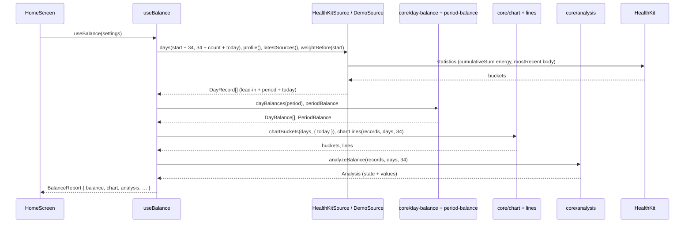

# Rechenkern II: Chart-Serien und Abgleich (P3)

Stand 2026-10-24. Umgesetzt auf Branch `feature/home-page-base` (M1–M6, CI-Run 40116252891 grün). Offen für Julius: Gewicht aus der Waagen-App am iPhone prüfen (M5). Voraussetzung P2 (`docs/specs/2026-10-24-core-period-day-balance.md`) ist umgesetzt.

## Overview

P3 erweitert den Rechenkern in `src/core/` um alles, was Chart und Abgleich-Karte der Homepage brauchen: Balken-Buckets (Tage bis 31 Tage, darüber Wochen als Ø kcal/Tag mit geerbtem Qualitäts-Flag), Linien als Δ kg seit Zeitraumbeginn (Gewicht als 7-Tage-Trend mit Einzelpunkten, Fettmasse als Trend, theoretisches Fett aus der kumulierten Bilanz) und den Abgleich Bilanz gegen Waage nach Hall 2008 mit den Zuständen `ok`, `deviation`, `insufficient` und `weightOnly`. Damit echte Daten ankommen, liest `HealthKitSource` jetzt Gewicht, Körperfett und Magermasse pro Tag, und `useBalance` lädt einen Vorlauf von 34 Tagen für den Trend. Chart und Karte selbst (UI) kommen mit der Homepage. Betroffen: `src/core/`, `src/health/`, `src/dev/demo/`, `src/features/balance/use-balance.ts`, `CLAUDE.md`.

### Ausgangslage: Anforderungen (wörtlich)

> **P3 Rechenkern II: Chart-Serien und Abgleich**
> Inhalt:
> • Buckets: bis 31 Tage Tagesbalken, darüber Wochenbalken als Ø kcal/Tag; Woche erbt das „schlechteste“ Qualitäts-Flag ihrer Tage.
> • Linien als Δ kg seit Zeitraumbeginn: Gewicht (7-Tage-Trend + Einzelpunkte), Fettmasse (Trend), theoretisches Fett (kumulierte Bilanz ÷ 7.700).
> • Abgleich: E = 9400 · ΔFett + 1800 · ΔMager mit Start/Ende als 7-Tage-Mittel; Magermasse aus Gewicht × (1 − KFA), wenn sie fehlt; geschätzter tatsächlicher Verbrauch = (Σ Nahrung − E) ÷ Tage; Tracker-Verbrauch und Differenz.
> • Zustand der Karte: ok (passt gut), deviation, insufficient (unter 21 Tagen oder unter 6 Messungen), weightOnly (keine KFA-Daten). Voraussetzung: P2.
> [ ] Goldener Testfall ergibt „≈ +4.300 kcal gespeichert“, 2.760 und 2.670 kcal/Tag, Differenz +90.
> [ ] 7-T-Zeitraum liefert immer insufficient, mit Anzahl der bisherigen Messungen.
> [ ] 90-T-Szenario liefert 13 oder 14 Wochenbuckets, keine Tagesbuckets.
> [ ] Tage ohne Waage-Messung erzeugen keine Lücke im Trend, aber keinen Einzelpunkt.

Goldener Testfall (aus `CLAUDE.md`, P2): Eingabe 30 Tage, Σ Nahrung 87.000 kcal, Σ Verbrauch 80.000 kcal, Δ Fettmasse +0,4 kg, Δ Magermasse +0,3 kg. Erwartet: „Laut Waage gespeichert 9400 × 0,4 + 1800 × 0,3 = 4.300 kcal“, „Geschätzter tatsächlicher Verbrauch (87.000 − 4.300) ÷ 30 ≈ 2.760 kcal/Tag“, „Tracker / Differenz 2.670 kcal/Tag / +90“.

### Design-Referenz (`BilanzScreen.dc.html`, nachgelesen 2026-10-24)

| Thema | Design |
|---|---|
| Tages-/Wochenbalken | `daily = nD < 60`; Wochen = ISO-Kalenderwochen; eine erste angebrochene Woche mit < 3 Tagen wird an die nächste angehängt; Wochenwert = Σ B ÷ Tage der Woche; Woche „est“, sobald ein Tag unvollständig ist (keine Rangfolge) |
| Heute | Bei Zeitraum bis gestern hängt im Tagesmodus ein gestrichelter Slot „heute, zählt nicht“ an (Tooltip „Heute · bis 14:32 … Zählt nicht mit“) |
| Trend | `trend(i)`: Mittel aller Messungen in Tag i−6 … i; ohne Messung Fenster um 7 Tage erweitern (6, 13, 20, 27, 34 Tage zurück) |
| Linien | Gewicht = Trend − Trend am ersten Tag, Punkte = Messung − Trend am ersten Tag; Fett = Fett-Trend − Start; „Fett laut Bilanz“ = kumulierte B ÷ 7.700; Legende „Linien: 7-Tage-Trend“ |
| Abgleich | `locked = nD < 21 \|\| meas < 6`; E = 9.400 · ΔF + 1.800 · ΔL; tatsächlich = (Σ Aeff − E) ÷ nD; Tracker = Σ V ÷ nD; Anzeige: E auf 100, Verbrauch auf 10 gerundet, Differenz = gerundet − gerundet; ΔKFA in %-Punkten |
| Urteil | passt gut, wenn \|E − B\| ≤ max(10 % · \|B\|, 400); sonst E < B „Waage zeigt weniger Zuwachs …“ (+ „Ein Teil steckt in Magermasse“, wenn ΔL > 0,05 kg) oder „Waage zeigt mehr Zuwachs …“ |
| Ohne KFA | Vergleich „Laut Bilanz ≈ x kg, wenn alles Fett wäre“ gegen „Laut Waage x kg, Gewicht, 7-Tage-Trend“ |
| Gesperrt | Karte sichtbar mit Deckkraft 0,3, Hinweis „Für den Abgleich brauchst du mindestens 21 Tage und 6 Messungen. Bisher: {nD} Tage, {meas} Messungen.“ (bzw. nur Messungen ab 21 Tagen) |

Claude Doc: „Start- und Endwert sind 7-Tage-Mittel bzw. eine Trendgerade, nicht Einzelmessungen, weil Waagen mit Bioimpedanz von Tag zu Tag stark schwanken“; „Ohne Messungen werden die Linien ausgeblendet“; Analyse „unter 21 Tagen oder 6 Messungen sichtbar, aber ausgegraut mit Hinweis ‚zu wenig Messungen‘“.

### Stand im Code (2026-10-24)

| Bereich | Vorhanden | Fehlt für P3 |
|---|---|---|
| Tagesbilanz | `DayBalance` mit B, Flags, `maintenance` (`src/core/day-balance.ts`) | Buckets, kumulierte Bilanz |
| Periode | `PeriodBalance` (`period-balance.ts`); Σ A/R/K ohne Null-Tage | Σ inkl. Null-Tage (A = V) für den Abgleich |
| Körperwerte | `DayRecord.weightKg`, `bodyFatFraction` (0–1), `leanMassKg` | Fett-/Magermasse je Tag, Trend, Abgleich |
| Datum | `src/core/dates.ts` (`startOfDay`, `addDays`, `daysBetween`), `toDateKey`/`fromDateKey` | ISO-Kalenderwoche |
| HealthKit | Energie pro Tag (`queryDailyEnergy`, Statistik-Abfragen), `weightBefore` (P2); Lesezugriff auf `bodyMass`, `bodyFatPercentage`, `leanBodyMass` ist schon angefragt (`READ_TYPES`) | Gewicht, KFA, Magermasse pro Tag in `days()` |
| Demo | Serie mit `weightKg`, `bodyFatFraction`, `leanMassKg` an Messtagen; Szenarien `short7` (4 Messungen), `long90`, `noBodyFat30`, `goodFit30` | — |
| Laden | `useBalance` lädt nur die Tage des Zeitraums | 34 Tage Vorlauf, heutiger Tag für den „heute“-Slot |

## Key Decisions

| # | Decision | Rationale | Alternatives Considered |
|---|----------|-----------|-------------------------|
| 1 | Tagesbalken bis einschließlich 31 Tage, ab 32 Tagen Wochenbalken | Wie die Anforderung. 60 Tagesbalken wären auf 276 pt unter 5 pt breit — Julius 2026-10-24 | Design `nD < 60` |
| 2 | Wochen = ISO-Kalenderwochen (Mo–So); eine erste angebrochene Woche mit < 3 Tagen wird an die nächste angehängt (wie im Design) | Ergibt bei 90 Tagen 13 oder 14 Buckets, je nach Wochentag des Starts (Abnahmekriterium) | Feste 7-Tage-Blöcke ab Zeitraumende |
| 3 | Rangfolge des „schlechtesten“ Flags nach Verzerrung: `lowFood` > `noFood` > `noResting` > `restingEstimated` | „Wenig Nahrung“ zählt voll ins Defizit, ein Null-Tag dagegen neutral — Julius 2026-10-24 | Nach Wirkung auf die Zahl; nur unvollständig ja/nein |
| 4 | Wochen-Bucket: Ø kcal/Tag = Σ B ÷ gezählte Tage der Woche (Null-Tage mit B = 0 zählen, Tage ohne Grundumsatz nicht); dazu Anzahl unvollständiger Tage, Ø Nahrung, Ø Verbrauch, Anzahl Messungen (Tooltip im Design) | Wie das Design (`Σ B ÷ n`), angepasst an P2: nicht gezählte Tage haben kein B | Teiler = alle Kalendertage der Woche |
| 5 | Trend wie im Design: Mittel aller Messungen der letzten 7 Tage (Tag i−6 … i), ohne Messung um je 7 Tage erweitert bis höchstens 34 Tage zurück. Start und Ende des Abgleichs sind dieselben Trendwerte wie im Chart | Design-Text „Start und Ende als 7-Tage-Trend“; Claude Doc „7-Tage-Mittel bzw. Trendgerade“. Chart-Linie am letzten Tag = ΔGewicht/ΔFett der Karte | Mittel der ersten und letzten 7 Tage im Zeitraum; lineare Regression |
| 6 | Abgleich-Urteil wie im Design: `ok`, wenn \|E − B\| ≤ max(10 % · \|B\|, 400 kcal); sonst `deviation` mit Richtung `less` (E < B) oder `more` und Hinweis `leanShare`, wenn ΔMager > 0,05 kg | Julius 2026-10-24 | Schwelle pro Tag (100 kcal); Toleranz-Spanne |
| 7 | Null-Tage im Abgleich wie in der Bilanz: Nahrung = Verbrauch (B = 0), Teiler = gezählte Tage. Damit gilt immer tatsächlich − Tracker = (B − E) ÷ Tage | Karte und Bilanz-Zahl widersprechen sich nie; golden: (7.000 − 4.300) ÷ 30 = +90 — Julius 2026-10-24 | Insufficient bei Null-Tagen; Null-Tage herausrechnen |
| 8 | Umfang: Kern + Health-Daten. `HealthKitSource.days` liefert Gewicht, KFA und Magermasse pro Tag (letzter Wert des Tages); `useBalance` lädt 34 Tage Vorlauf und den heutigen Tag und liefert Chart-Serien und Abgleich im `BalanceReport`. Keine UI | Julius 2026-10-24. Ersetzt P1 Key Decision 8 („bleiben undefined“) und erledigt P2 Open Question 4 | Nur Kern; Kern + Verdrahtung ohne HealthKit |
| 9 | Körperwerte je Messtag: Fett = Gewicht × KFA; Mager = `leanMassKg`, sonst Gewicht × (1 − KFA); ohne KFA, aber mit Gewicht und Magermasse: Fett = Gewicht − Mager. Nur Werte desselben Tages werden kombiniert | CLAUDE.md: „Fehlt leanBodyMass: Magermasse = Gewicht × (1 − KFA), Fett = Gewicht × KFA“. Waagen schreiben Gewicht und KFA zusammen | Werte über Tage hinweg kombinieren |
| 10 | „Messungen“ = Tage mit Gewicht im Zeitraum. `weightOnly`, wenn im Zeitraum weniger als 6 Tage mit Fett- und Magermasse liegen (also auch bei wenigen KFA-Werten, nicht nur bei keinen). Reihenfolge: `insufficient` vor `weightOnly` vor `ok`/`deviation` | Mit 1–5 KFA-Messungen wären Start- und Endtrend oft dieselbe Messung und ΔFett ≈ 0 — bestätigt von Julius 2026-10-24 | `weightOnly` nur bei 0 KFA-Messungen |
| 11 | Beginnen die Messungen erst im Zeitraum, startet die Linie bei der ersten Messung (Bezug = erster definierter Trendwert); davor ist Δ `undefined`. Ohne jede Messung sind die Linien `undefined` (ausgeblendet) | Design hat dafür keinen Fall (Trend wäre NaN) — bestätigt von Julius 2026-10-24 | Linie ganz ausblenden; Trend vorwärts suchen |
| 12 | Der Kern rechnet ungerundet. Die Anzeige rundet wie im Design: E auf 100 kcal, Verbrauch auf 10 kcal, Differenz = gerundet − gerundet | Wie P2 (Key Decision 10). Golden: 4.300, 2.756,7 → 2.760, 2.666,7 → 2.670, Differenz 90 (auch ungerundet 90,0) | Rundung im Kern |
| 13 | Heute-Bucket: Endet der Zeitraum gestern, hängen die Tages-Buckets einen Bucket `today` an (B des laufenden Tages, `counted: false`). Bei Wochenbalken nicht | Wie im Design („heute, zählt nicht“). Der Kern bleibt rein; `useBalance` lädt dafür den heutigen Tag mit | Heute-Slot ganz in der UI berechnen |

## Implementation Details

### Milestone Map

| Milestone | Delivers | 🟢 Add | 🟠 Change | 🔴 Delete | Depends On |
|-----------|----------|--------|-----------|-----------|------------|
| M1 — Körperwerte & Trend | Fett/Mager je Messtag, 7-Tage-Trend mit erweitertem Fenster | 2 | 0 | 0 | — |
| M2 — Balken-Buckets | Tage/Wochen, ISO-Woche, schlechtestes Flag, Heute-Bucket | 2 | 2 | 0 | — |
| M3 — Linien | Δ Gewicht (Trend + Punkte), Δ Fett (Trend), theoretisches Fett | 2 | 0 | 0 | M1 |
| M4 — Abgleich | E, tatsächlicher/Tracker-Verbrauch, Zustände, goldener Testfall | 2 | 3 | 0 | M1 |
| M5 — Körperwerte aus HealthKit | Gewicht, KFA, Magermasse pro Tag in `HealthKitSource.days` | 2 | 2 | 0 | — |
| M6 — Verdrahtung | Vorlauf + heute laden, Serien und Abgleich im `BalanceReport`, Szenario-Tests | 0 | 4 | 0 | M2, M3, M4, M5 |

```
🟢 Add   🟠 Change   🔴 Delete
```

Abnahmekriterien → Milestones:

| Kriterium | Milestone |
|---|---|
| Goldener Testfall: ≈ +4.300 kcal gespeichert, 2.760 und 2.670 kcal/Tag, Differenz +90 | M4 |
| 7-T-Zeitraum immer `insufficient`, mit Anzahl der bisherigen Messungen | M4 (Kern), M6 (`short7`) |
| 90-T-Szenario: 13 oder 14 Wochenbuckets, keine Tagesbuckets | M2 (Kern, alle Wochentage), M6 (`long90`) |
| Tage ohne Waage-Messung: keine Lücke im Trend, kein Einzelpunkt | M1, M3 |

---

### ✅ Milestone 1 — Körperwerte & Trend

> Für jeden Tag stehen Fett- und Magermasse fest, wo gemessen wurde, und es gibt den 7-Tage-Trend, den Linien und Abgleich teilen.

**Depends on:** none

#### File Changes

| Color | File | Action |
|-------|------|--------|
| 🟢 | `src/core/body.ts` | `BodyValues`, `bodyValues(record)`, `trendSeries(records, key)`, `TREND_DAYS`, `TREND_MAX_LOOKBACK_DAYS` |
| 🟢 | `src/core/__tests__/body.test.ts` | Ableitung Fett/Mager, Trendfenster, Erweiterung, keine Lücke |

#### To-Dos

- ✅ Create `bodyValues(record)` → `{ weightKg?, fatKg?, leanKg? }` after Key Decision 9: fat = weight × KFA; lean = `leanMassKg` ?? weight × (1 − KFA); without KFA but with weight and lean: fat = weight − lean; fat/lean `undefined` without weight
- ✅ Create `trendSeries(records, key)` for `key` in `weightKg | fatKg | leanKg` → value per record index: mean of all values in days i−6 … i; without any, widen by 7 days (13, 20, 27, 34 days back); `undefined` beyond 34 days. Records run oldest first, one per day, and include the lead-in before the period
- ✅ Export `TREND_DAYS = 7` and `TREND_MAX_LOOKBACK_DAYS = 34` (design: `span` 6, 13, 20, 27, 34)
- ✅ Test derivation: weight + KFA; weight + KFA + lean (lean wins); weight + lean only; KFA without weight → nothing
- ✅ Test trend: mean of the window; a day without measurement inside a measured stretch gets the window mean (no gap); widening to 13/20/27/34 days; 35 days without measurement → `undefined` _(dazu ein Test für Fett/Mager-Trend über Tage mit und ohne KFA)_
- ✅ Run `npm run lint`, `npm run typecheck`, `npm test`; all exit 0
- ✅ Commit (`feat: derive body composition and 7-day trend`)

```ts
// src/core/body.ts
export type BodyValues = { weightKg?: number; fatKg?: number; leanKg?: number };
export type BodyKey = keyof BodyValues;

export function bodyValues(record: DayRecord): BodyValues;

// Mean of the last 7 days per record, widened by 7 days up to 34 days back.
export function trendSeries(
  records: readonly DayRecord[],
  key: BodyKey,
): (number | undefined)[];
```

#### Notes / Constraints

> - Rein, wie P2: keine Imports aus `@/health`, `@/features`, React.
> - Der Trend läuft über Datensatz-Indizes; die Datensätze sind lückenlos ein Tag je Eintrag (Quelle liefert auch leere Tage), deshalb ist Index-Abstand = Tagesabstand.

---

### ✅ Milestone 2 — Balken-Buckets

> Der Kern liefert die Balken: bis 31 Tage einen je Tag, darüber einen je ISO-Kalenderwoche als Ø kcal/Tag mit dem schlechtesten Flag ihrer Tage.

**Depends on:** none

#### File Changes

| Color | File | Action |
|-------|------|--------|
| 🟢 | `src/core/chart.ts` | `MAX_DAILY_BUCKETS = 31`, `FLAG_SEVERITY`, `worstFlag`, `ChartBucket`, `chartBuckets(days, options)` |
| 🟢 | `src/core/__tests__/chart.test.ts` | Tages-/Wochenmodus, ISO-Wochen, Zusammenlegen, 90 Tage an allen Wochentagen, Flags, Heute |
| 🟠 | `src/core/dates.ts` | `isoWeek(date)` → `{ year, week }` |
| 🟠 | `src/core/__tests__/period.test.ts` | Tests für `isoWeek` (Jahreswechsel: 31.12.2026 = KW 53, 04.01.2027 = KW 1) |

#### To-Dos

- ✅ Add `isoWeek(date)` to `dates.ts` (Thursday rule, like the design's `iso()`), local calendar day _(Tests in `period.test.ts`, 2026 hat 53 Wochen)_
- ✅ Create `FLAG_SEVERITY: DayFlag[] = ['lowFood', 'noFood', 'noResting', 'restingEstimated']` (worst first, Key Decision 3) and `worstFlag(flags)` → first of `FLAG_SEVERITY` present, else `undefined`
- ✅ Create `chartBuckets(days, { today? })` (sketch below): `days.length ≤ 31` → one `day` bucket per day; else `week` buckets _(`measured` als Parallel-Array in den Optionen)_
- ✅ Day bucket: `kcal` = `day.kcal` (undefined when not counted), `maintenance`, `flags`, `worst`
- ✅ Week buckets: group by ISO week; merge a first partial week with < 3 days into the next (design); `avgKcal` = Σ B ÷ counted days (undefined without counted days); `incompleteDays`, `worst` over all days; `avgFoodKcal` and `avgBurnKcal` over counted days with zero days as A = V (Key Decision 7); `measurements` = days with weight _(zusammengelegte erste Woche trägt die KW der vollen Woche (wie im Design); Ø Nahrung/Verbrauch über gezählte Tage mit bekanntem Verbrauch)_
- ✅ Append a `today` bucket (day mode only) when `options.today` is given: `kcal` = today's B from `dayBalances`, `counted: false`
- ✅ Test 7 and 30 days → 7/30 day buckets; 31 days → 31 day buckets; 32 days → week buckets
- ✅ Test 90 days ending on each of the 7 weekdays → always 13 or 14 week buckets, never a day bucket _(Start So → 1 Tag, Sa → 2 Tage angehängt; Fr → 3 Tage bleiben eigene Woche)_
- ✅ Test merging: first week with 1 or 2 days joins the next; with 3 days it stays
- ✅ Test week values: Σ B ÷ counted days incl. a zero day (B = 0), excluding a day without resting energy; `worst` = `lowFood` when the week has `lowFood` and `restingEstimated`; `incompleteDays` counts a day with two flags once
- ✅ Test the today bucket: present in day mode, absent in week mode and without `today`
- ✅ Run `npm run lint`, `npm run typecheck`, `npm test`; all exit 0
- ✅ Commit (`feat: bucket daily balance into day and week bars`)

```ts
// src/core/chart.ts
export const MAX_DAILY_BUCKETS = 31;

export type ChartBucket =
  | {
      kind: 'day';
      date: string;
      // B; undefined when the day doesn't count.
      kcal?: number;
      maintenance: boolean;
      flags: DayFlag[];
      worst?: DayFlag;
      measured: boolean;
      // The running day, shown but not counted.
      today?: boolean;
    }
  | {
      kind: 'week';
      isoWeek: number;
      from: string; // YYYY-MM-DD
      to: string;
      days: number;
      // Ø kcal per counted day.
      avgKcal?: number;
      avgFoodKcal?: number;
      avgBurnKcal?: number;
      incompleteDays: number;
      worst?: DayFlag;
      measurements: number;
    };

export function chartBuckets(
  days: readonly DayBalance[],
  options: { today?: DayBalance; measured?: readonly boolean[] },
): ChartBucket[];
```

#### Notes / Constraints

> - `measured` je Tag kommt aus den `DayRecord`s (Gewicht vorhanden); `chartBuckets` bekommt es als Parallel-Array, damit `DayBalance` aus P2 unverändert bleibt.
> - Die letzte angebrochene Woche wird nicht zusammengelegt (wie im Design).
> - Achsen, Skalen („nice“-Werte) und Beschriftungen („KW 42“, Wochentage) sind UI und kommen mit der Homepage.

---

### ✅ Milestone 3 — Linien

> Für jeden Tag des Zeitraums gibt es Δ kg seit Zeitraumbeginn für Gewicht (Trend und Punkt), Fettmasse (Trend) und theoretisches Fett.

**Depends on:** Milestone 1

#### File Changes

| Color | File | Action |
|-------|------|--------|
| 🟢 | `src/core/lines.ts` | `ChartLines`, `chartLines(records, days, leadInDays)` |
| 🟢 | `src/core/__tests__/lines.test.ts` | Δ seit Start, Punkte nur an Messtagen, keine Lücke, Start mitten im Zeitraum, theoretisches Fett |

#### To-Dos

- ✅ Create `chartLines(records, days, leadInDays)`: `records` = lead-in + period (oldest first), `days` = `DayBalance[]` of the period; per period day:
  - `weightTrend` = weight trend − baseline; `weightPoint` = measured weight − baseline, only on days with a weight measurement
  - `fatTrend` = fat trend − fat baseline
  - `theoreticalFat` = cumulative B up to and including the day ÷ 7.700 (days without B add 0)
- ✅ Baseline = trend on the first period day; if `undefined`, the first defined trend value in the period (Key Decision 11); before it Δ is `undefined` _(Punkte messen gegen denselben Bezug wie die Trendlinie)_
- ✅ Return `hasWeight` / `hasFat` = any defined value in the period (UI hides a line without)
- ✅ Test a 30-day period with measurements every other day: trend defined on every day (no gap), `weightPoint` only on measured days
- ✅ Test baseline from the lead-in: measurement 5 days before the period counts for the first day's trend _(Vorlauf-Messung 5 Tage vor dem Zeitraum zählt an Tag 0 und 1, ab Tag 2 (7 Tage zurück) nicht mehr)_
- ✅ Test first measurement on day 10 without lead-in: Δ `undefined` on days 0–9, 0 on day 10
- ✅ Test no measurements: `hasWeight: false`, all `undefined`; theoretical fat still defined
- ✅ Test theoretical fat: 7.700 kcal over the period → +1,0 kg on the last day; a day without B keeps the value
- ✅ Run `npm run lint`, `npm run typecheck`, `npm test`; all exit 0
- ✅ Commit (`feat: compute weight, fat and theoretical fat lines`)

```ts
// src/core/lines.ts
export type LinePoint = {
  date: string;
  weightTrend?: number; // Δ kg since period start
  weightPoint?: number; // only on days with a weight measurement
  fatTrend?: number;
  theoreticalFat: number; // cumulative B ÷ 7,700
};

export type ChartLines = { points: LinePoint[]; hasWeight: boolean; hasFat: boolean };

export function chartLines(
  records: readonly DayRecord[],
  days: readonly DayBalance[],
  leadInDays: number,
): ChartLines;
```

#### Notes / Constraints

> - Linien gibt es auch im Wochenmodus pro Tag (wie im Design); nur die Balken werden zu Wochen zusammengefasst.
> - Der heutige Tag (wenn nicht im Zeitraum) bekommt keinen Linienpunkt.

---

### ✅ Milestone 4 — Abgleich

> Der Kern vergleicht die Bilanz mit der gemessenen Energieänderung nach Hall 2008 und liefert den Zustand der Karte. Der goldene Testfall ergibt die erwarteten Zahlen.

**Depends on:** Milestone 1

#### File Changes

| Color | File | Action |
|-------|------|--------|
| 🟢 | `src/core/analysis.ts` | `KCAL_PER_KG_FAT_TISSUE = 9400`, `KCAL_PER_KG_LEAN = 1800`, `MIN_ANALYSIS_DAYS = 21`, `MIN_MEASUREMENTS = 6`, `Analysis`, `analyzeBalance(records, days, leadInDays)` |
| 🟢 | `src/core/__tests__/analysis.test.ts` | Zustände, Schwellen, Null-Tage, goldener Testfall |
| 🟠 | `src/core/__fixtures__/golden-30.ts` | Körpermessungen mit Δ Fett +0,4 / Δ Mager +0,3, 7 Tage Vorlauf |
| 🟠 | `src/core/__tests__/golden.test.ts` | Abgleich-Zeilen des goldenen Testfalls |
| 🟠 | `CLAUDE.md` | Rechenmodell: Abgleich-Regeln (Trend, Schwelle, Null-Tage, Zustände), Wochenbalken ab 32 Tagen, Flag-Rangfolge |

#### To-Dos

- ✅ Create `analyzeBalance(records, days, leadInDays)` (sketch below)
- ✅ Count `measurements` = period days with a weight; `compositionMeasurements` = period days with fat and lean
- ✅ `insufficient` when `days < 21` or `measurements < 6`, with `days` and `measurements` (design: „Bisher: {Tage} Tage, {Messungen} Messungen“)
- ✅ `weightOnly` when `compositionMeasurements < 6` (Key Decision 10): `balanceFatKg` = B ÷ 7.700 („wenn alles Fett wäre“) and `weightChangeKg` = weight trend end − start _(auch, wenn sich die Fett-Trends nicht berechnen lassen)_
- ✅ Otherwise ΔFett, ΔMager = trend on the last period day − trend on the first (Key Decision 5); `storedKcal` E = 9.400 · ΔFett + 1.800 · ΔMager; `bodyFatPointsChange` = (fat end ÷ weight end − fat start ÷ weight start) × 100 _(ΔFett/ΔMager = letzter minus erster Trendwert im Zeitraum (wie die Linien))_
- ✅ Sums over counted days, zero days with A = V (Key Decision 7): `foodKcal` (Σ A_eff), `burnKcal` (Σ V); `actualBurnPerDay` = (Σ A_eff − E) ÷ counted days; `trackerBurnPerDay` = Σ V ÷ counted days; `differencePerDay` = actual − tracker
- ✅ `ok` when |E − B| ≤ max(0,1 · |B|, 400), else `deviation` with `direction: 'less' | 'more'` (E < B → less) and `leanShare: ΔMager > 0,05`
- ✅ Keep the computed values also in `insufficient` when they can be computed (`preview`), so the greyed card can show them (design: opacity 0,3)
- ✅ Extend `golden-30.ts`: 7 lead-in days and the 30 days with a measurement every other day; fat 17,6 kg / lean 64,1 kg up to day 6 (and in the lead-in), 18,0 / 64,4 from day 23, linear in between; weight = fat + lean, `bodyFatFraction` = fat ÷ weight; export `GOLDEN_LEAD_IN` _(Messung an geraden Tagen inkl. Vorlauf (−6, −4, −2); Energie-Tage unverändert, P2-Golden-Test liest weiter `GOLDEN_DAYS`)_
- ✅ Test golden case: `state` = `deviation` (`less`), E ≈ 4.300 („≈ +4.300“ with rounding to 100), `actualBurnPerDay` ≈ 2.756,7 → „2.760“, `trackerBurnPerDay` ≈ 2.666,7 → „2.670“, difference „+90“ (rounded − rounded and raw) _(`deviation`/`less`, `leanShare: true`; formatiert „+4.300“, „2.760“, „2.670“, „+90“)_
- ✅ Test that `actual − tracker = (B − E) ÷ days` with a zero day in the period
- ✅ Test 7 days with 4 measurements → `insufficient`, `days: 7`, `measurements: 4`; 7 days with 7 measurements → still `insufficient`
- ✅ Test 21 days with 5 measurements → `insufficient`; with 6 → not
- ✅ Test `weightOnly` without any KFA/lean; and with only 3 composition measurements _(mit 5 statt 3 KFA-Tagen; beides unter 6)_
- ✅ Test the threshold: |E − B| = 400 with B = 1.000 → `ok`; 401 → `deviation`; B = 10.000, |E − B| = 1.000 → `ok` _(statt exakt 400/401 (Gleitkomma) mit 399/401 geprüft, B = 3.000; dazu 10 % bei B = 30.000 und Fälle 180/650/760 kcal Abstand)_
- ✅ Test lean share: ΔMager 0,06 → `leanShare: true`, 0,05 → false
- ✅ Update `CLAUDE.md` Rechenmodell: analysis bullet with trend, threshold, zero days, the four states; Features 7: week bars from 32 days, worst-flag order
- ✅ Run `npm run lint`, `npm run typecheck`, `npm test`; all exit 0
- ✅ Commit (`feat: compare balance with the scale after Hall 2008`)

```ts
// src/core/analysis.ts
export type AnalysisValues = {
  balanceKcal: number;
  balanceFatKg: number;
  fatChangeKg: number;
  leanChangeKg: number;
  bodyFatPointsChange: number;
  storedKcal: number; // E
  foodKcal: number; // Σ A, zero days as A = V
  burnKcal: number; // Σ V
  actualBurnPerDay: number;
  trackerBurnPerDay: number;
  differencePerDay: number;
};

export type Analysis =
  | { state: 'insufficient'; days: number; measurements: number; preview?: AnalysisValues }
  | { state: 'weightOnly'; days: number; measurements: number; balanceFatKg: number; weightChangeKg: number }
  | { state: 'ok'; days: number; measurements: number; values: AnalysisValues }
  | {
      state: 'deviation';
      days: number;
      measurements: number;
      values: AnalysisValues;
      direction: 'less' | 'more';
      leanShare: boolean;
    };

export function analyzeBalance(
  records: readonly DayRecord[],
  days: readonly DayBalance[],
  leadInDays: number,
): Analysis;
```

#### Notes / Constraints

> - Golden: Bei Δ Fett/Mager aus Gleitkomma-Werten `toBeCloseTo`; formatiert mit `formatKcal(Math.round(E / 100) * 100)` → „+4.300“ und `formatNumber(Math.round(x / 10) * 10)` → „2.760“, „2.670“, Differenz „+90“.
> - Die Fixture lässt Σ Nahrung/Verbrauch und die P2-Erwartungen unverändert; nur Körperwerte und Vorlauf kommen dazu.
> - Texte der Urteile (Design) sind UI und kommen mit der Homepage; der Kern liefert nur Zustand, Richtung und `leanShare`.

---

### ✅ Milestone 5 — Körperwerte aus HealthKit

> `HealthKitSource.days` liefert Gewicht, Körperfett und Magermasse als letzten Wert jedes Tages.

**Depends on:** none

#### File Changes

| Color | File | Action |
|-------|------|--------|
| 🟢 | `src/health/daily-body.ts` | `queryDailyBody(start, days)`: Statistik-Abfrage `mostRecent` pro Tag für `bodyMass` (kg), `bodyFatPercentage` (%), `leanBodyMass` (kg) |
| 🟢 | `src/health/__tests__/daily-body.test.ts` | Mapping auf Datum, fehlende Tage, Fehler → leer |
| 🟠 | `src/health/healthkit-source.ts` | `days()` führt Energie und Körperwerte zusammen; Kommentar „Weight … stay undefined“ entfernen |
| 🟠 | `src/health/__fixtures__/fake-statistics.ts` | Buckets mit `mostRecentQuantity` |

#### To-Dos

- ✅ Create `queryDailyBody(start, days)` with `queryStatisticsCollectionForQuantity(type, ['mostRecent'], start, { day: 1 }, { unit, filter })` per type; map `bucket.mostRecentQuantity?.quantity` to the local day; units `kg`, `%` (HealthKit gives 0–1), `kg`; failures → no values (`safe`)
- ✅ Check in the library types that `mostRecentQuantity` is on the statistics result and the unit string for percent is `'%'` _(`QueryStatisticsResponse.mostRecentQuantity` und Einheit `'%'` in den Typen von 16.0.0 vorhanden)_
- ✅ Merge into `healthKitSource.days`: `{ ...energy, weightKg, bodyFatFraction, leanMassKg }` by date key _(nur definierte Werte werden übernommen, Datensätze ohne Messung bleiben ohne Körper-Schlüssel)_
- ✅ Extend `fake-statistics.ts` so tests can return `mostRecentQuantity` buckets _(`mostRecentQuantity` = gleicher Wert wie `sumQuantity`)_
- ✅ Test: values land on their local day (also across DST), days without bucket stay `undefined`, a failing query leaves energy values intact _(in `daily-body.test.ts`, inkl. 25-Stunden-Tag 25.10.2026)_
- ✅ Run `npm run lint`, `npm run typecheck`, `npm test`; all exit 0
- 🔲 Check on the iPhone (Julius): a weight from the scale app shows up on its day (needs the data page or a dev log until the homepage exists) _(offen für Julius: braucht echte Health-Daten am Gerät)_
- ✅ Commit (`feat: read daily weight and body composition from HealthKit`)

#### Notes / Constraints

> - Statistik-Abfragen statt Rohsamples, wie bei der Energie (CLAUDE.md): `mostRecent` dedupliziert mehrere Quellen pro Tag.
> - Leserechte für `bodyMass`, `bodyFatPercentage`, `leanBodyMass` werden schon im Intro angefragt (`READ_TYPES`); keine neue Berechtigung.
> - Datenschutz bleibt unverändert: nur lesen, nur lokal.

---

### ✅ Milestone 6 — Verdrahtung

> `useBalance` lädt den Vorlauf und den heutigen Tag und liefert Buckets, Linien und Abgleich im `BalanceReport`. Die Demo-Szenarien bestätigen die Abnahmekriterien.

**Depends on:** Milestone 2, Milestone 3, Milestone 4, Milestone 5

#### File Changes

| Color | File | Action |
|-------|------|--------|
| 🟠 | `src/features/balance/use-balance.ts` | `source.days(start − 34, 34 + count (+1 für heute))`; `chart: { buckets, lines }`, `analysis` im `BalanceReport` |
| 🟠 | `src/features/balance/__tests__/data-rows.test.ts` | Test-Helfer um `chart` und `analysis` ergänzt _(statt `demo-source.ts`: Vorlauf vor dem Serienanfang liefert schon leere Tage, keine Änderung nötig)_ |
| 🟠 | `src/dev/demo/__tests__/scenarios.test.ts` | `short7` → `insufficient` (7 Tage, 4 Messungen); `long90` → 13 oder 14 Wochen; `noBodyFat30` → `weightOnly`; `normal30` → `deviation`, `goodFit30` → `ok` |
| 🟠 | `docs/specs/2026-10-24-core-period-day-balance.md` | Open Question 4 als erledigt markieren (Gewicht pro Tag kommt mit P3) |

#### To-Dos

- ✅ Load `records = source.days(addDays(start, −34), 34 + count + (includeToday ? 0 : 1))` in one call; split into lead-in, period and today _(der heutige Tag wird nur geladen, wenn der Zeitraum gestern endet (bei „Eigener“ mit früherem Ende kein Heute-Balken, wie im Design))_
- ✅ Keep `dayBalances` on the period records only (P2 numbers unchanged); compute today's `DayBalance` separately for the today bucket
- ✅ Keep `weightBefore(start)` for the resting estimate (weights older than the lead-in); pass the lead-in's last weight when present _(`weightBefore` unverändert; der Heute-Tag schätzt mit der letzten Messung im Zeitraum)_
- ✅ Add `chart: { buckets: chartBuckets(...), lines: chartLines(...) }` and `analysis: analyzeBalance(...)` to `BalanceReport` _(`loadBalance` für die Szenario-Tests exportiert)_
- ✅ Test `short7` → `insufficient` with `days: 7`, `measurements: 4`
- ✅ Test `long90` for several `now` dates (7 weekdays) → 13 or 14 week buckets, no day bucket
- ✅ Test `noBodyFat30` → `weightOnly`; `goodFit30` → `ok`; `normal30` → state and E (≈ 4.300 ± noise, record the value) _(`normal30` → `deviation`/`less`, E gerundet 4.200 (Design-Rauschen um 4.300); dazu Test: 30 Tagesbalken + Heute, Trend an allen 30 Tagen)_
- ✅ Mark P2 Open Question 4 as resolved
- ✅ Check in the simulator that 1a still shows +7.000 kcal / +0,9 kg (no regression) _(per Deep Link: 1a weiterhin +7.000 kcal / +0,9 kg)_
- ✅ Run `npm run lint`, `npm run typecheck`, `npm run test:coverage`, `npm run check:release-bundle`; all exit 0 _(dazu `npm run check:release-bundle`)_
- ✅ Commit (`feat: load chart series and analysis with the balance`)

#### Notes / Constraints

> - Vorlauf: 34 Tage = längstes Trendfenster (Key Decision 5). Für „Alles“ beginnt der Zeitraum am ersten Datenpunkt; der Vorlauf ist dann leer, das ist erwartet.
> - Kein neuer Screen, keine UI. Chart und Abgleich-Karte kommen mit der Homepage und lesen `report.chart` und `report.analysis`.

Datenfluss beim Laden des Bilanz-Tabs (kein neuer Einstiegspunkt, daher ohne 🔀-Überschrift):



#### ⌨️ Keyboard Shortcuts

Keine UI in P3, keine Kürzel.

---

## Open Questions

| # | Question | Owner | Impact if Unresolved |
|---|----------|-------|----------------------|
| 1 | ✅ ~~Key Decision 10: `weightOnly` auch bei 1–5 KFA-Messungen?~~ Ja — Julius 2026-10-24 | Julius | erledigt |
| 2 | ✅ ~~Key Decision 11: Linie beginnt bei der ersten Messung im Zeitraum?~~ Ja — Julius 2026-10-24 | Julius | erledigt |
| 3 | ✅ ~~Zählen für „6 Messungen“ Tage mit Gewicht?~~ Ja, wie im Design — Julius 2026-10-24 | Julius | erledigt |

## Concerns & Decisions Log

| # | Type | Concern | Resolution |
|---|------|---------|------------|
| 1 | ⚠️ Concern | Anforderung „bis 31 Tage Tagesbalken“ vs. Design `nD < 60` | Bis 31 Tage täglich (Key Decision 1) — Julius 2026-10-24 |
| 2 | ⚠️ Concern | „Schlechtestes“ Flag braucht eine Rangfolge; das Design kennt nur „unvollständig“ | Nach Verzerrung: wenig Nahrung > ohne Nahrung > ohne Grundumsatz > geschätzt (Key Decision 3) — Julius 2026-10-24 |
| 3 | ⚠️ Concern | Grenze zwischen `ok` und `deviation` nicht in der Anforderung | Design-Regel max(10 %, 400 kcal) (Key Decision 6) — Julius 2026-10-24 |
| 4 | ⚠️ Concern | P2 lässt Null-Tage aus den Summen, E deckt aber den ganzen Zeitraum ab | Null-Tage mit A = V wie in der Bilanz, Teiler gezählte Tage (Key Decision 7) — Julius 2026-10-24 |
| 5 | 💡 Alternative | `weightOnly` laut Anforderung nur „keine KFA-Daten“; mit wenigen KFA-Werten wäre ΔFett aber Rauschen | Auch unter 6 KFA-Messungen (Key Decision 10) — Julius 2026-10-24 |
| 6 | 💡 Alternative | Trend am Start undefiniert, wenn erste Messung im Zeitraum liegt (Design: NaN) | Bezug = erster Trendwert (Key Decision 11) — Julius 2026-10-24 |
| 7 | ⚠️ Concern | `HealthKitSource` liefert keine Körperwerte pro Tag (P1 Key Decision 8); ohne sie zeigt die echte App immer „zu wenig Messungen“ | P3 liest sie per `mostRecent`-Statistik (M5, Key Decision 8) — Julius 2026-10-24 |
| 8 | ⚠️ Concern | Trend am Zeitraumstart braucht Messungen vor dem Zeitraum; `useBalance` lädt bisher nur den Zeitraum | 34 Tage Vorlauf (M6) |
| 9 | ⚠️ Concern | Die Demo-Serie hat 120 Tage; bei 90 T + 34 Tage Vorlauf (124) fehlen die ersten 4 Tage | Erwartet: leere Tage, der Trend erweitert sein Fenster (M6 prüft `demo-source`) |
