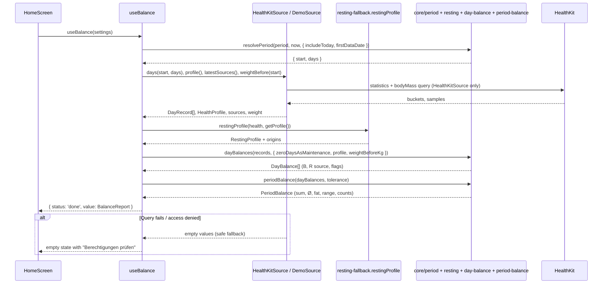
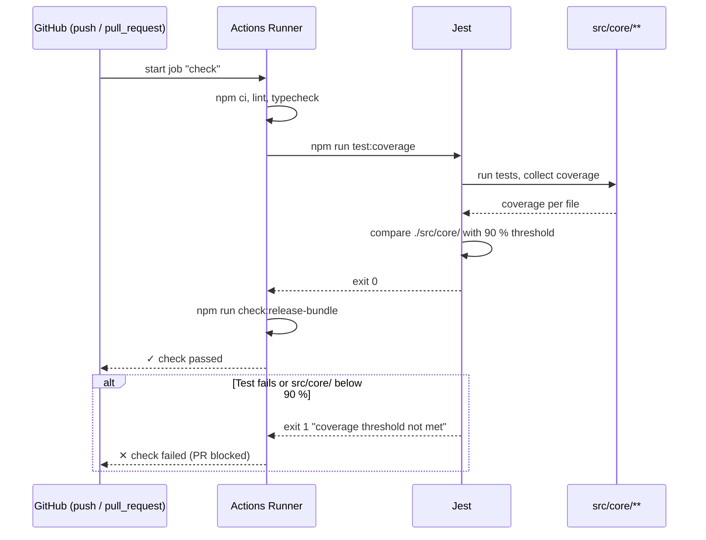

# Rechenkern I: Zeitraum, Tagesbilanz, Periodenbilanz (P2)

Stand 2026-10-24. In Umsetzung auf Branch `feature/home-page-base`. Voraussetzung P1 (`docs/specs/2026-10-24-foundation-demo-data.md`) ist umgesetzt.

## Overview

P2 baut den Rechenkern in `src/core/` als reines TypeScript-Modul ohne React und HealthKit. Er löst den Zeitraum auf, rechnet pro Tag die Bilanz B = A − (R + K) mit Ersatz-Grundumsatz nach Mifflin-St Jeor, kennzeichnet die Datenqualität je Tag und fasst den Zeitraum zusammen: Summe, Ø pro Tag, theoretisches Fett und Spanne mit Toleranz. Der neue Kern ersetzt die heutige Logik in `src/core/balance.ts` (Median-Fallback `typicalResting`, `periodBreakdown`). `useBalance`, Bilanz-Seite und Daten-Seite steigen darauf um. Betroffen: `src/core/`, `src/health/source.ts` und beide Quellen, `src/features/balance/`, i18n, Jest-Konfiguration, CI, `CLAUDE.md`.

### Ausgangslage: Anforderungen (wörtlich)

> **P2 Rechenkern I: Zeitraum, Tagesbilanz, Periodenbilanz**
> Inhalt: reines TS-Modul core/, ohne React und HealthKit.
> • Zeitraum auflösen: 7/30/60/90 T, Alles (ab erstem Tag mit Daten), Eigener; heute standardmäßig raus; Kalendertage in lokaler Zeitzone.
> • Tagesbilanz B = A − (R + K); fehlt R, Mifflin-St Jeor mit letztem Gewicht an/vor dem Tag, Tag als „geschätzt“ markiert.
> • Null-Tage-Schalter: Tag ohne Nahrung zählt mit B = 0.
> • Datenqualität je Tag: vollständig, Grundumsatz geschätzt, ohne Nahrung, auffällig wenig Nahrung (A < 50 % von R + K).
> • Periode: Summe, Ø pro Tag, theoretisches Fett (÷ 7.700), Spanne mit Toleranz auf Zeitraumsummen. Voraussetzung: P1.
> [ ] Goldener Testfall (unten) ergibt exakt die Design-Zahlen.
> [ ] Tests für Sommer-/Winterzeitwechsel, Zeitraum über Monatsgrenze, „heute einbeziehen“ an/aus.
> [ ] Ein Tag kann mehrere Qualitäts-Flags haben; Zählung „24 von 30 vollständig“ stimmt dann trotzdem.
> [ ] Toleranz 0 % ergibt Spanne mit min = max = Einzelwert.
> [ ] Testabdeckung des Moduls ≥ 90 %.

### Goldener Testfall (wörtlich, von Julius 2026-10-24)

> Die Zahlen aus dem Design-Prompt passen zusammen, wenn man diese 30 Tage annimmt. Das ist der erste Test in P2 und P3 und gehört in die CLAUDE.md.

**Eingabe (30 Tage)**

| Wert | |
|---|---|
| Σ Nahrung A | 87.000 kcal (2.900/Tag) |
| Σ Verbrauch V = R + K | 80.000 kcal (2.667/Tag) |
| Toleranz Nahrung / Verbrauch | 5 % / 10 % |
| Δ Fettmasse / Δ Magermasse | +0,4 kg / +0,3 kg |

**Erwartetes Ergebnis**

| Wert | |
|---|---|
| Bilanz | +7.000 kcal, Ø +233 kcal/Tag |
| Fett theoretisch | ≈ +0,9 kg |
| Spanne mit Toleranz | +2.650 bis +19.350 kcal, ≈ +0,3 bis +2,5 kg |
| Laut Waage gespeichert | 9400 × 0,4 + 1800 × 0,3 = 4.300 kcal |
| Geschätzter tatsächlicher Verbrauch | (87.000 − 4.300) ÷ 30 ≈ 2.760 kcal/Tag |
| Tracker / Differenz | 2.670 kcal/Tag / +90 |

Nachgerechnet: 87.000 × 0,95 − 80.000 = 2.650; 87.000 × 1,05 − 80.000 × 0,9 = 19.350; 7.000 ÷ 30 = 233,3; 7.000 ÷ 7.700 = 0,909; 2.650 ÷ 7.700 = 0,344; 19.350 ÷ 7.700 = 2,513. P2 prüft die Zeilen bis „Spanne mit Toleranz“. Die letzten drei Zeilen (Abgleich nach Hall 2008) gehören zur Analyse und sind der erste Test in P3. In P2 stehen sie nur in der Fixture und in `CLAUDE.md`.

### Stand im Code (2026-10-24)

| Bereich | Vorhanden | Fehlt für P2 |
|---|---|---|
| Zeitraum | `resolvePeriod` in `src/core/period.ts` (7/30/60/90, `all` ab `firstDataDate`, `custom` geklemmt und getauscht, `includeToday`), Tests inkl. Winterzeit 25.10.2026 | Test Sommerzeit (29.03.2026), expliziter Monatsgrenzen-Test, Liste der Datums-Schlüssel des Zeitraums. `useBalance` reicht `includeToday` noch nicht weiter |
| Tagesbilanz | `periodBreakdown` summiert pro Tag, aber ohne Ergebnis je Tag | `DayBalance` je Tag mit B, Herkunft der Ruheenergie und Flags |
| Fehlende Ruheenergie | `dayRestingKind`: gemessen / hochgerechnet (≥ 6 h) / Fallback / fehlt. Fallback = Median voller Tage (`typicalResting`, ab 7 Tagen), sonst **eine** Mifflin-Zahl mit festem Profilgewicht für alle Tage | Mifflin **pro Tag** mit Gewicht an/vor dem Tag und Alter am Tag; Median entfällt |
| Null-Tage | Tage ohne Nahrung zählen immer als B = 0 (`daysWithoutFood`), werden aus allen Summen ausgelassen | Schalter `zeroDaysAsMaintenance` aus → voller Verbrauch als Defizit |
| Datenqualität | Zähler `restingFallbackDays`, `restingScaledDays`, `daysWithoutActive`, `daysWithoutResting` | Flags je Tag, mehrere pro Tag, „X von N vollständig“, „auffällig wenig Nahrung“ |
| Periode | Summe `kcal`, `fatKgFromKcal` (÷ 7.700) | Ø pro Tag, Spanne mit Toleranz |
| Gewicht | `HealthKitSource.days` liefert `weightKg` nicht (P1, Key Decision 8); `readHealthProfile` liest das neueste Gewicht | Gewicht vor dem Zeitraum |
| Testabdeckung | `src/core/` heute 99 % Statements, 98,8 % Branches; keine Schwelle in Jest/CI | Schwelle ≥ 90 % für `src/core/` in Jest und CI |

## Key Decisions

| # | Decision | Rationale | Alternatives Considered |
|---|----------|-----------|-------------------------|
| 1 | Der goldene Testfall ist der von Julius gelieferte 30-Tage-Fall (Σ A 87.000, Σ V 80.000, Toleranz 5/10) | Er ergibt exakt die Zahlen aus dem Design-Prompt. Er ist auch der erste Test in P3 und kommt in `CLAUDE.md` — Julius 2026-10-24 | Design-Generator `normal30` (Σ A 87.100 inkl. Null-Tag, Σ V 80.100 → Spanne 2.645 bis 19.365, erst gerundet 2.650 bis 19.350) |
| 2 | Null-Tage (Schalter an) gehen weder in Σ A noch in Σ V ein. Sie tragen B = 0 bei, die Toleranz rechnet nur mit echten Einträgen | Die Toleranz soll Messfehler echter Einträge abbilden, nicht die eines angenommenen Erhaltungstags — Julius 2026-10-24. Folge: Die Demo-Spanne in 1c weicht vom Hi-Fi ab (siehe Concerns Nr. 2) | Wie im Design (Null-Tag mit A = V, Toleranz auch darauf); A = V ohne Toleranz |
| 3 | Fehlt R: Mifflin-St Jeor **pro Tag**, Gewicht an/vor dem Tag, Alter am Tag. Der Median voller Tage (`typicalResting`) entfällt | Wie Anforderung und Claude Doc („Gewicht ist die letzte Messung an oder vor diesem Tag, das Alter gilt am jeweiligen Tag“) — Julius 2026-10-24 | Median zuerst, dann Mifflin (heutiger Code) |
| 4 | Teiltage (R für ≥ 6 von 24 h) werden weiter auf 24 h hochgerechnet und gelten als **gemessen**, ohne Flag. Unter 6 h gilt Mifflin mit Flag „Grundumsatz geschätzt“ | Julius 2026-10-24 | Hochgerechnete Teiltage als „geschätzt“ |
| 5 | Gewicht für Mifflin: 1. letzte Messung an/vor dem Tag (auch vor dem Zeitraum), 2. erste Messung danach, 3. Profilgewicht (neuester Health-Wert, sonst eigene Eingabe). `HealthSource` bekommt `weightBefore(date)` | Julius 2026-10-24. Schritt 1 braucht Messungen vor dem Zeitraum, sonst greift er am Rand nicht | Direkt Profilgewicht; Tag zählt nicht |
| 6 | Flags je Tag: `restingEstimated` (Grundumsatz geschätzt), `noFood` (ohne Nahrung), `lowFood` (auffällig wenig Nahrung), **neu** `noResting` (ohne Grundumsatz: weder gemessen noch per Mifflin, z. B. Profil unvollständig). „Vollständig“ = keine Flags. Fehlende Aktivenergie ist **kein** Flag: Der Tag gilt als vollständig und zählt mit K = 0 | Julius 2026-10-24: fehlende Aktivenergie ist normal (Ruhetag ohne Watch), ein Tag ohne jeden Grundumsatz nicht | Zwei neue Flags (auch „ohne Aktivenergie“); nur die vier Flags |
| 7 | P2 umfasst Kern **und** Umstieg: `useBalance`, Bilanz-Seite und Daten-Seite rechnen mit dem neuen Kern, alter Median-Code fällt weg. Einstellungen laufen vorerst mit `DEFAULT_SETTINGS`, die UI dafür kommt mit der Homepage (Schritt 6) | Kein doppelter Rechenweg; die App zeigt sofort die Spec-Logik — Julius 2026-10-24 | Nur Kern, Umstieg mit der Homepage |
| 8 | Flags beschreiben die Daten, unabhängig vom Null-Tage-Schalter. Ein Null-Tag ohne R bekommt `noFood` und `restingEstimated` (oder `noResting`) | Die Sheet-Gruppen „Unvollständige Tage“ zeigen, was in Health fehlt. Die Zählung „X von N vollständig“ zählt jeden Tag nur einmal (Abnahmekriterium) | Bei Null-Tagen nur `noFood` setzen (siehe Open Question 3) |
| 9 | `lowFood`: nur an Tagen mit Nahrung und bekanntem R (gemessen, hochgerechnet oder Mifflin); Bedingung A < 0,5 × (R + K), strikt kleiner, K fehlend = 0 | Ohne R gibt es keinen Verbrauch zum Vergleich; dann steht dort schon `noResting` | A ≤ 50 %; Vergleich nur mit gemessenem R |
| 10 | Der Kern rechnet ungerundet. Gerundet wird erst in der Anzeige (`roundKcal`, `formatSignedKg` …) | Der goldene Testfall geht ungerundet exakt auf. Die Rundung der Spanne (Design: auf 50) entscheidet die Homepage (Open Question 1) | Rundung auf 50 im Kern wie im Design (`r50`) |
| 11 | Ø pro Tag = Summe ÷ gezählte Tage (inkl. Null-Tage mit B = 0, ohne Tage, die nicht zählen). Dasselbe gilt für die Spanne (Ø min/max) | Golden: 7.000 ÷ 30 = 233; Design: `sB / nD`. Beides ist gleich, solange kein Tag `noResting` ohne Null-Tag-Regel hat | Teiler = Kalendertage des Zeitraums |
| 12 | Neue Dateien `resting.ts`, `day-balance.ts`, `period-balance.ts` in `src/core/`; `balance.ts` wird gelöscht | Ein Thema je Datei, wie `period.ts`, `bmr.ts`, `age.ts`. Die Namen `PeriodBalance`/`periodBalance` werden mit neuer Form frei | `balance.ts` umbauen |
| 13 | Abdeckung: `coverageThreshold` für das Verzeichnis `./src/core/` (90 % Statements, Branches, Functions, Lines) und CI-Schritt `npm test -- --coverage` | Prüfbar statt einmalig gemessen. Ein Verzeichnispfad wird als Summe gewertet, `settings.ts` (nur Konstante) bricht die Schwelle nicht | Glob je Datei; nur lokal messen |

## Implementation Details

### Milestone Map

| Milestone | Delivers | 🟢 Add | 🟠 Change | 🔴 Delete | Depends On |
|-----------|----------|--------|-----------|-----------|------------|
| M1 — Zeitraum | Datums-Schlüssel des Zeitraums, Tests Sommer-/Winterzeit, Monatsgrenze, heute an/aus | 0 | 2 | 0 | — |
| M2 — Ruheenergie pro Tag | Gemessen / hochgerechnet / Quelle / Mifflin pro Tag mit Gewicht an/vor dem Tag und Alter am Tag | 2 | 0 | 0 | — |
| M3 — Tagesbilanz & Flags | `DayBalance` je Tag, Null-Tage-Schalter, vier Flags | 2 | 0 | 0 | M2 |
| M4 — Periodenbilanz & Spanne | Summe, Ø, Fett, Spanne, Zählung „X von N vollständig“, goldener Testfall, `CLAUDE.md` | 4 | 1 | 0 | M3 |
| M5 — Umstieg | `weightBefore` in beiden Quellen, `useBalance` mit Settings, Seiten und Texte auf den neuen Kern, alter Kern weg | 0 | 16 | 2 | M1, M4 |
| M6 — Abdeckungs-Schwelle | `coverageThreshold` ≥ 90 % für `src/core/`, CI-Schritt | 0 | 2 | 0 | M5 |

```
🟢 Add   🟠 Change   🔴 Delete
```

Abnahmekriterien → Milestones:

| Kriterium | Milestone |
|---|---|
| Goldener Testfall ergibt exakt die Design-Zahlen | M4 |
| Tests Sommer-/Winterzeit, Monatsgrenze, „heute einbeziehen“ an/aus | M1 (Zeitraum), M3 (Tage über den Zeitwechsel) |
| Mehrere Flags pro Tag, „24 von 30 vollständig“ stimmt trotzdem | M3, M4 |
| Toleranz 0 % → min = max = Einzelwert | M4 |
| Testabdeckung des Moduls ≥ 90 % | M6 |

---

### ✅ Milestone 1 — Zeitraum

> `resolvePeriod` ist schon da. M1 ergänzt die Liste der Kalendertage und die Tests, die das Abnahmekriterium verlangt.

**Depends on:** none

#### File Changes

| Color | File | Action |
|-------|------|--------|
| 🟠 | `src/core/period.ts` | `periodDateKeys(resolved)` → `string[]` (YYYY-MM-DD, lokal, alle Tage des Zeitraums) |
| 🟠 | `src/core/__tests__/period.test.ts` | Tests Sommerzeit, Monatsgrenze, heute an/aus je Zeitraumart, `periodDateKeys` |

#### To-Dos

- ✅ dd `periodDateKeys({ start, days })`: one local date key per day via `addDays` + `toDateKey`, so a 23- or 25-hour day never skips or repeats a key
- ✅ est spring DST: today = 31 Mar 2026 12:00 (clocks went forward on 29 Mar), 7 days → first `2026-03-24`, last `2026-03-30`, 7 keys without gap or duplicate
- ✅ est fall DST with `periodDateKeys`: today = 27 Oct 2026, 7 days → keys `2026-10-20` … `2026-10-26`, `2026-10-25` exactly once (existing test only checks `start` and `days`)
- ✅ est month boundary: 30 days ending 23 Oct → first key `2026-09-24`, keys run through `2026-09-30` → `2026-10-01` without gap; custom `2026-09-28` to `2026-10-03` → 6 days
- ✅ est year boundary: today = 3 Jan 2027, 7 days → `2026-12-27` … `2027-01-02`
- ✅ est „heute einbeziehen“ on/off for every kind: `days` (7/30/60/90), `all` (ends yesterday vs. today; first data today → 0 vs. 1 day), `custom` ending in the future (clamped to yesterday vs. today) _(schon vorhanden für `custom` (Test „clamps a custom period“); neu für `days` (7/30/60/90) und `all`)_
- ✅ est that the time of day of `today` doesn't matter: 00:00:30 and 23:59:30 give the same period
- ✅ un `npm run lint`, `npm run typecheck`, `npm test`; all exit 0
- ✅ ommit (`test: cover DST, month boundary and today in periods`)

#### Notes / Constraints

> - Jest läuft fest in `Europe/Berlin` (`jest.global-setup.js`), damit beide Zeitwechsel prüfbar sind. 2026: Sommerzeit ab 29.03., Winterzeit ab 25.10.
> - „Alles (ab erstem Tag mit Daten)“ beginnt wie heute am ersten Nahrungseintrag (`HealthSource.firstDataDate`). Tage davor hätten ohnehin nur Verbrauch und würden die Bilanz ins Minus ziehen.
> - Verhalten mit „heute einbeziehen“ bleibt wie in P1 umgesetzt: Jeder Zeitraum endet heute statt gestern, „30 T“ sind dann die 30 Tage bis heute.

---

### ✅ Milestone 2 — Ruheenergie pro Tag

> Für jeden Tag steht fest, woher R kommt und wie hoch er ist, inklusive Mifflin-St Jeor mit dem Gewicht an/vor dem Tag und dem Alter am Tag.

**Depends on:** none

#### File Changes

| Color | File | Action |
|-------|------|--------|
| 🟢 | `src/core/resting.ts` | `RestingProfile`, `RestingSource`, `ageOn`, `weightsByDay`, `dayResting`; Konstanten `FULL_DAY_COVERAGE`, `MIN_SCALED_COVERAGE` (aus `balance.ts` übernommen) |
| 🟢 | `src/core/__tests__/resting.test.ts` | Tests aller Herkünfte, Gewichtssuche, Alter |

#### To-Dos

- ✅ reate `RestingProfile` (sketch below): height, sex, date of birth or entered age with date, profile weight; all optional
- ✅ reate `ageOn(profile, day)`: date of birth → `ageInYears(dateOfBirth, day)`; else entered age → `currentAge(ageYears, ageRecordedOn, day)`; else `undefined`
- ✅ reate `weightsByDay(records, weightBeforeKg, profileWeightKg)` → weight per record index: last `weightKg` on or before the day (starting with `weightBeforeKg` from before the period), else the first `weightKg` after the day, else `profileWeightKg`, else `undefined`. One pass forward and one backward, O(n) _(Lücken in den Messungen werden in einem Vorwärts- und einem Rückwärtsdurchlauf gefüllt)_
- ✅ reate `dayResting(record, weightKg, profile, day)` → `{ kcal?: number; source: RestingSource }`:
  - `source`: the source supplies an estimate (`restingEstimated` and `resting` set, demo) → its own value
  - `measured`: `resting` set and coverage ≥ 20/24 (or no coverage given)
  - `scaled`: `resting` set and 6/24 ≤ coverage < 20/24 → `resting / coverage`
  - `formula`: no `resting` or coverage < 6/24, and weight, height, age and sex known → `estimateRestingEnergy` with that day's weight and age
  - `missing`: otherwise, `kcal` undefined
- ✅ xport `isEstimatedResting(source)`: true for `source` and `formula`, false for `measured` and `scaled` (Key Decision 4)
- ✅ est each source; boundaries exactly at 6/24 and 20/24
- ✅ est weight lookup: measurement on the day itself wins; value from before the period; no earlier value → first later one; no measurement at all → profile weight; nothing → `undefined` → `missing` _(Geburtstag am 10.10.: 33 → 34 Jahre, Differenz 5 kcal; eingegebenes Alter mit `ageRecordedOn` 2025-10-01 ergibt ab 01.10.2026 35)_
- ✅ est age on the day: birthday inside the period changes the result by 5 kcal from that day on; entered age with `ageRecordedOn` one year back is one year higher
- ✅ est `sex: 'unspecified'` uses −78 (existing `SEX_CONSTANT`)
- ✅ un `npm run lint`, `npm run typecheck`, `npm test`; all exit 0
- ✅ ommit (`feat: estimate resting energy per day with weight and age of the day`)

```ts
// src/core/resting.ts
export type RestingProfile = {
  heightCm?: number;
  sex?: Sex;
  // From Health; wins over the entered age.
  dateOfBirth?: Date;
  ageYears?: number;
  // YYYY-MM-DD the age was entered on.
  ageRecordedOn?: string;
  // Newest weight from Health, else the entered one; last resort.
  weightKg?: number;
};

// measured: full day · scaled: partial day scaled to 24 h · source: estimate
// supplied by the source · formula: Mifflin-St Jeor · missing: none of these.
export type RestingSource = 'measured' | 'scaled' | 'source' | 'formula' | 'missing';

export function dayResting(
  record: DayEnergy,
  weightKg: number | undefined,
  profile: RestingProfile,
  day: Date,
): { kcal?: number; source: RestingSource };
```

#### Notes / Constraints

> - Rein: keine Imports aus `@/health`, `@/storage`, `@/features` oder React. Das Zusammenführen von Health-Profil und eigener Eingabe bleibt in `src/features/balance/resting-fallback.ts` (M5).
> - Gewicht „an/vor dem Tag“: `DayRecord.weightKg` ist der letzte Wert des Tages, eine Messung am Tag selbst zählt also.
> - `HealthKitSource.days` liefert `weightKg` noch nicht (kommt mit Schritt 4/8). Bis dahin greift in der echten App nur `weightBefore` (letzte Messung vor dem Zeitraum) bzw. das Profilgewicht. Die Logik ist trotzdem vollständig getestet und wirkt in der Demo.
> - Das Profilgewicht ist der neueste Wert, kann also nach dem Tag liegen. Das ist Stufe 3 von Key Decision 5 und nur Notlösung.

---

### Milestone 3 — Tagesbilanz & Flags

> Für jeden Tag des Zeitraums liefert der Kern B, ob der Tag zählt, und seine Qualitäts-Flags. Der Null-Tage-Schalter wirkt hier.

**Depends on:** Milestone 2

#### File Changes

| Color | File | Action |
|-------|------|--------|
| 🟢 | `src/core/day-balance.ts` | `DayFlag`, `DayBalance`, `dayBalances(records, options)`, `isComplete(day)`, `LOW_FOOD_SHARE = 0.5` |
| 🟢 | `src/core/__tests__/day-balance.test.ts` | Tests B, Null-Tage an/aus, Flags, Mehrfach-Flags, Zeitwechsel |

#### To-Dos

- 🔲 Create `DayFlag = 'restingEstimated' | 'noFood' | 'lowFood' | 'noResting'` in this order (= order in the sheet later)
- 🔲 Create `dayBalances(records, { zeroDaysAsMaintenance, profile, weightBeforeKg })` (sketch below); weights via `weightsByDay`, R via `dayResting`, day date via `fromDateKey(record.date)`
- 🔲 Compute B per day:
  - food set and R known → `B = food − (R + K)`, `K = active ?? 0`
  - no food and switch on → `B = 0`, `maintenance: true` (R not needed)
  - no food and switch off and R known → `B = −(R + K)`
  - R unknown (`missing`) and not a zero day → `kcal: undefined`, day doesn't count
- 🔲 Set flags independent of the switch (Key Decision 8): `restingEstimated` if `isEstimatedResting(source)`; `noResting` if source `missing`; `noFood` if no food; `lowFood` if food set, R known and `food < 0.5 × (R + K)`
- 🔲 Keep `activeMissing` per day (data page: „mit 0 gerechnet“); it is no flag (Key Decision 6)
- 🔲 Create `isComplete(day)` = `day.flags.length === 0`
- 🔲 Test B for a normal day, a zero day with switch on (B = 0) and off (B = −(R + K)), a day without active energy (K = 0, complete)
- 🔲 Test `lowFood`: 49,9 % → flag, exactly 50 % → no flag; uses the formula R on estimated days; no `lowFood` without R
- 🔲 Test multiple flags: estimated R + low food on one day → 2 flags, 1 incomplete day; no food + no R → `noFood` + `noResting`; no food + formula R → `noFood` + `restingEstimated`
- 🔲 Test a zero day without R: switch on → counts with B = 0; switch off → doesn't count
- 🔲 Test records across the fall DST change: the 25-hour day keeps its own date and age/weight lookup
- 🔲 Run `npm run lint`, `npm run typecheck`, `npm test`; all exit 0
- 🔲 Commit (`feat: compute daily balance with quality flags`)

```ts
// src/core/day-balance.ts
export type DayFlag = 'restingEstimated' | 'noFood' | 'lowFood' | 'noResting';

export type DayBalance = {
  date: string; // YYYY-MM-DD
  food?: number;
  // Whole-day resting energy, measured, scaled or estimated.
  resting?: number;
  restingSource: RestingSource;
  // 0 when Health has no active energy.
  active: number;
  activeMissing: boolean;
  // B = A − (R + K); 0 for a zero day; undefined when the day doesn't count.
  kcal?: number;
  // No food, counted as maintenance (B = 0).
  maintenance: boolean;
  flags: DayFlag[];
};

export type DayBalanceOptions = {
  zeroDaysAsMaintenance: boolean;
  profile: RestingProfile;
  // Last weight before the first record, from HealthSource.weightBefore.
  weightBeforeKg?: number;
};
```

#### Notes / Constraints

> - Eingabe sind die `DayRecord[]` des aufgelösten Zeitraums in Datumsfolge, wie `HealthSource.days` sie liefert. `dayBalances` sortiert nicht und füllt keine Lücken; das tut die Quelle (ein Datensatz je Tag, auch leer).
> - Heute (bei „heute einbeziehen“) ist ein gewöhnlicher Tag mit den bisherigen Werten. Er wird typischerweise `lowFood` haben; die Markierung im Chart ist UI (Homepage).
> - Im Demo-Szenario `normal30` hat kein Tag mehrere Flags. Nachgerechnet am Generator: Die Regel A < 50 % findet in jedem Fenster (7/30/60/90/120 T) genau die Tage, die das Design als „wenig“ markiert, und keinen geschätzten Tag zusätzlich. Mehrfach-Flags testet M3 deshalb mit eigenen Datensätzen.

---

### Milestone 4 — Periodenbilanz & Spanne

> Der Zeitraum wird zu Summe, Ø pro Tag, theoretischem Fett und Spanne zusammengefasst. Der goldene Testfall und `normal30` ergeben die erwarteten Zahlen.

**Depends on:** Milestone 3

#### File Changes

| Color | File | Action |
|-------|------|--------|
| 🟢 | `src/core/period-balance.ts` | `PeriodBalance`, `periodBalance(days, tolerance)`, `KCAL_PER_KG_FAT`, `fatKgFromKcal` (aus `balance.ts` übernommen) |
| 🟢 | `src/core/__tests__/period-balance.test.ts` | Summen, Ø, Spanne, Toleranz 0 %, Zählung, Null-Tage-Regel der Toleranz |
| 🟢 | `src/core/__fixtures__/golden-30.ts` | Die 30 Tage des goldenen Testfalls als `DayRecord[]` plus Δ Fett/Mager für P3 |
| 🟢 | `src/core/__tests__/golden.test.ts` | Goldener Testfall: Kern → Format, exakte Design-Zahlen |
| 🟠 | `CLAUDE.md` | Abschnitt „Goldener Testfall“ (beide Tabellen wörtlich), Rechenmodell aktualisieren |

#### To-Dos

- 🔲 Create `periodBalance(days, tolerance)` (sketch below)
- 🔲 Sum A, R and K over days that count and are no zero day; a zero day with switch off adds A = 0 and its R + K. So always `kcal = foodKcal − restingKcal − activeKcal`
- 🔲 Leave zero days (switch on) out of Σ A and Σ V (Key Decision 2); they add B = 0 and count in `countedDays`
- 🔲 Compute `avgKcal = kcal / countedDays` (0 without counted days), `fatKg = kcal / 7700`
- 🔲 Compute the range on the period sums, not per day, with tA = `foodPercent / 100`, tV = `burnPercent / 100`, V = Σ R + Σ K: `min = A(1 − tA) − V`, `max = A(1 + tA) − V(1 − tV)`; plus `avgRange` (÷ `countedDays`) and `fatRange` (÷ 7.700)
- 🔲 Count `flagCounts` per flag over all days of the period, `completeDays` = days without flags, `excludedDays` = days that don't count; `restingFormulaDays`, `restingScaledDays`, `daysWithoutActive` only over days in the sums (data page)
- 🔲 Test tolerance 0 %/0 %: `range.min === range.max === kcal` (strict equality, also for `avgRange` and `fatRange`)
- 🔲 Test that one tolerance alone works (food 5 %/burn 0 % and food 0 %/burn 10 %) and that burn only goes down (`max` grows, `min` unchanged)
- 🔲 Test the count: 30 days, 3 × `restingEstimated`, 2 × `lowFood`, 1 × `noFood`, plus one day with `restingEstimated` + `lowFood` → `completeDays` stays `days − days with any flag`, `flagCounts.restingEstimated` counts that day as well
- 🔲 Test that a zero day doesn't widen the range: adding one zero day (switch on) to a period leaves `kcal`, `range.min` and `range.max` unchanged and raises `countedDays` by 1
- 🔲 Create `golden-30.ts`: 30 days from 2026-09-24 to 2026-10-23, `food` 2.900 each (Σ 87.000), `resting` 1.800 each (Σ 54.000), `active` 867 on the first 20 days and 866 on the last 10 (Σ 26.000), so Σ V = 80.000; no weights; export `GOLDEN_TOLERANCE = { foodPercent: 5, burnPercent: 10 }`, `GOLDEN_DELTA = { fatKg: 0.4, leanKg: 0.3 }` and the expected values
- 🔲 Test golden case through `dayBalances` (switch on, empty profile) + `periodBalance`:
  - `kcal` = 7.000, `avgKcal` ≈ 233,33, `fatKg` ≈ 0,909
  - `range` ≈ 2.650 / 19.350 (`toBeCloseTo`, floating point), `fatRange` ≈ 0,344 / 2,513
  - `completeDays` = 30, all `flagCounts` 0
  - formatted (de-DE): `formatKcal(kcal)` „+7.000“, `formatKcal(Math.round(avgKcal))` „+233“, `formatSignedKg(fatKg)` „+0,9“, `formatKcal(Math.round(range.min))` „+2.650“, `formatKcal(Math.round(range.max))` „+19.350“, `formatSignedKg` „+0,3“ / „+2,5“
- 🔲 Test `normal30` from the demo through the new core: `kcal` = 7.000, 24 of 30 complete (3 `restingEstimated`, 2 `lowFood`, 1 `noFood`); tolerance 5/10 → `range` ≈ 2.771,4 / 18.985,8 (Σ A 84.572, Σ V 77.572 without the zero day; design 2.645 / 19.365, see Concerns Nr. 2)
- 🔲 Add section „Goldener Testfall“ to `CLAUDE.md` with both tables verbatim, the note „erster Test in P2 und P3“ and the path of the fixture
- 🔲 Update `CLAUDE.md` Rechenkern bullets: missing R → Mifflin per day (weight on/before the day, age on the day) instead of „manuell eingegebener Grundumsatz“; zero days stay out of the tolerance sums; quality flags incl. A < 50 % of R + K
- 🔲 Run `npm run lint`, `npm run typecheck`, `npm test`; all exit 0
- 🔲 Commit (`feat: summarize period balance with tolerance range`)

```ts
// src/core/period-balance.ts
export type KcalRange = { min: number; max: number };

export type PeriodBalance = {
  // Calendar days of the period.
  days: number;
  // Days in the balance, zero days included.
  countedDays: number;
  // Days left out: no resting energy and no zero day.
  excludedDays: number;
  // Days without any flag („24 von 30 vollständig“).
  completeDays: number;
  // Days per flag; a day with two flags counts in both.
  flagCounts: Record<DayFlag, number>;
  // Sums over counted days except zero days; kcal = food − resting − active.
  foodKcal: number;
  restingKcal: number;
  activeKcal: number;
  // Of those days: resting by formula or source estimate, scaled, without active.
  restingFormulaDays: number;
  restingScaledDays: number;
  daysWithoutActive: number;
  // Plus = ate more than burned.
  kcal: number;
  avgKcal: number;
  // Theoretical, 7,700 kcal per kg of adipose tissue.
  fatKg: number;
  // min = max = kcal at 0 % tolerance.
  range: KcalRange;
  avgRange: KcalRange;
  fatRange: KcalRange;
};

export function periodBalance(
  days: readonly DayBalance[],
  tolerance: Settings['tolerance'],
): PeriodBalance;
```

#### Notes / Constraints

> - „Exakt die Design-Zahlen“ heißt: ungerundet geht der goldene Testfall exakt auf (2.650 / 19.350). Gleitkomma liefert z. B. 82.650,00000000001, deshalb `toBeCloseTo` auf ganze kcal. Formatiert ergibt sich genau „+2.650“ bzw. „+19.350“.
> - Die Abgleich-Zeilen des goldenen Testfalls (4.300 kcal, ≈ 2.760 kcal/Tag, 2.670 / +90) prüft P3. Die Fixture enthält dafür schon `GOLDEN_DELTA`. Tracker 2.670 = 80.000 ÷ 30 = 2.666,7, auf 10 gerundet.
> - Toleranz kommt in Prozent aus `Settings` (0 = aus). Ob die UI Schieber ab 0 % (Design) oder einen Schalter mit Normbereich (CLAUDE.md) zeigt, bleibt P1-Open-Question 5. Der Kern rechnet beides.

---

### Milestone 5 — Umstieg

> Die App rechnet mit dem neuen Kern. Die Quellen liefern das Gewicht vor dem Zeitraum, `useBalance` reicht die Settings durch, Bilanz- und Daten-Seite zeigen dieselben Zahlen aus `PeriodBalance`, und der alte Kern verschwindet.

**Depends on:** Milestone 1, Milestone 4

#### File Changes

| Color | File | Action |
|-------|------|--------|
| 🟠 | `src/health/source.ts` | `weightBefore(date): Promise<number \| undefined>` |
| 🟠 | `src/health/healthkit-source.ts` | `weightBefore`: neueste `bodyMass`-Probe vor `date` (kg), über `safe` |
| 🟠 | `src/health/__tests__/healthkit-source.test.ts` | Test `weightBefore` (Filter, leer → `undefined`) |
| 🟠 | `src/dev/demo/demo-source.ts` | `weightBefore`: letzter `weightKg` der Serie vor `date` |
| 🟠 | `src/dev/demo/__tests__/scenarios.test.ts` | Auf neuen Kern umstellen (+7.000, 24 von 30, Spanne `normal30`), `weightBefore` |
| 🟠 | `src/features/balance/resting-fallback.ts` | `restingProfile(health, stored)` → `RestingProfile` + Herkunft je Wert; Median-/Einzelwert-Funktionen weg |
| 🟠 | `src/features/balance/__tests__/resting-fallback.test.ts` | Tests für `restingProfile` |
| 🟠 | `src/features/balance/use-balance.ts` | `useBalance(settings = DEFAULT_SETTINGS)`; `resolvePeriod` mit `includeToday`; `dayBalances` + `periodBalance`; `BalanceReport` neu |
| 🟠 | `src/features/balance/data-rows.ts` | Liest `PeriodBalance`; Text „mit Median ergänzt“ entfällt; Schätzungs-Zeilen aus `restingProfile` |
| 🟠 | `src/features/balance/__tests__/data-rows.test.ts` | Erwartungen anpassen |
| 🟠 | `src/features/balance/components/balance-page.tsx` | `fatKg`, `flagCounts.noFood`, `excludedDays` statt alter Felder |
| 🟠 | `src/features/balance/components/data-page.tsx` | Karte „Geschätzte Ruheenergie“ bei `restingFormulaDays > 0` |
| 🟠 | `src/features/balance/components/home-screen.tsx` | `settings` statt `period` an `useBalance` |
| 🟠 | `src/i18n/locales/de.ts` | `data.restingTypical*` weg, `data.estimateWeight`, `data.estimateResult` neu |
| 🟠 | `src/i18n/locales/en.ts` | Dieselben Schlüssel |
| 🟠 | `docs/specs/2026-10-21-data-page.md` | Abschnitt Umsetzung auf den neuen Kern (kein Median) |
| 🔴 | `src/core/balance.ts` | Ersetzt durch `resting.ts`, `day-balance.ts`, `period-balance.ts` |
| 🔴 | `src/core/__tests__/balance.test.ts` | Ersetzt durch die Tests aus M2–M4 |

#### To-Dos

- 🔲 Add `weightBefore(date)` to `HealthSource`: newest weight in kg strictly before local midnight `date`, `undefined` if none or unreadable
- 🔲 Implement it in `healthKitSource` with `queryQuantitySamples(QUANTITY.weight, { limit: 1, ascending: false, unit: 'kg', filter: … end date ≤ date })`; look up the exact filter shape in the types of `@kingstinct/react-native-healthkit` 16.0.0 before writing it
- 🔲 Implement it in `createDemoSource`: last series `weightKg` before `date`; `empty` → `undefined`
- 🔲 Replace `fallbackInputs`/`estimateFromInputs`/`restingFallback` with `restingProfile(health, stored)`: Health first, then entered values, like today; returns `RestingProfile` and per value whether it came from Health, plus the shown sex („other“)
- 🔲 Update `useBalance(settings = DEFAULT_SETTINGS)`: `resolvePeriod(settings.period, now, { includeToday, firstDataDate })`; load `days`, `profile`, `latestSources`, `weightBefore(start)` in parallel; `dayBalances` with `zeroDaysAsMaintenance`; `periodBalance` with `settings.tolerance`. Reload key = `JSON.stringify(settings)`
- 🔲 Shape `BalanceReport` as `{ balance: PeriodBalance; days: DayBalance[]; estimate?: { profile, origins, lastWeightKg, avgKcal }; daysWithData; sources }`; `estimate` only when `restingFormulaDays > 0`
- 🔲 Update `balance-page.tsx`: empty state when `flagCounts.noFood === days`; hero from `balance.kcal` and `balance.fatKg` (rounding unchanged); „Tage ohne Eintrag als neutral gezählt“ from the number of maintenance days; „ohne Grundumsatz nicht mitgerechnet“ from `excludedDays`
- 🔲 Update `data-rows.ts`: resting detail „an N Tagen geschätzt“ from `restingFormulaDays`, „N Teiltage hochgerechnet“ from `restingScaledDays`; active detail from `daysWithoutActive`; remove `restingTypical`; „Was ankommt“ unchanged
- 🔲 Update the estimate card on the data page (wireframe below): weight line „letzte Messung an/vor dem Tag · zuletzt 82,4 kg“ (or „Profil“ when only the profile weight was used), height, age today, sex with origin, result „Ø ≈ 1.750 kcal an 3 Tagen“
- 🔲 Remove i18n keys `data.restingTypical_one/_other` (DE/EN), add `data.estimateWeight` and `data.estimateResult` with `{{count}}` plurals
- 🔲 Delete `src/core/balance.ts` and `balance.test.ts`; grep that nothing imports `@/core/balance` any more
- 🔲 Update `scenarios.test.ts` to the new core (numbers from M4) and keep the snapshot unchanged (the series itself doesn't change)
- 🔲 Update the „Umsetzung“ section of `docs/specs/2026-10-21-data-page.md`
- 🔲 Check in the simulator via the gallery: 1a shows +7.000 kcal / +0,9 kg as before; L1 (`gaps30`) shows 3 days „ohne Eintrag neutral“ and on the data page „2 Teiltage hochgerechnet“, „an 3 Tagen ohne Wert, mit 0 gerechnet“
- 🔲 Run `npm run lint`, `npm run typecheck`, `npm test`, `npm run check:release-bundle`; all exit 0
- 🔲 Commit (`refactor: compute balance with the new core`)

#### Notes / Constraints

> - Kein neuer Screen und kein neuer Einstiegspunkt. Settings-UI (Null-Tage, heute, Toleranz) kommt mit der Homepage. Bis dahin wirkt `DEFAULT_SETTINGS`: 30 T, Null-Tage an, ohne heute, Toleranz aus. Das ist dasselbe Verhalten wie heute, bis auf die Ruheenergie.
> - Sichtbare Änderung in der echten App: Tage ohne R bekommen Mifflin pro Tag statt des Medians der vollen Tage. Mit Apple Watch betrifft das nur Tage unter 6 h Tragezeit.
> - `restingEstimated` aus der Demo bleibt erhalten (Quelle `source`), damit `normal30` weiter genau 1.750 an geschätzten Tagen rechnet und +7.000 ergibt.
> - Leere Daten werden weiter mit „Berechtigungen prüfen“ erklärt (iOS verrät verweigerte Leserechte nicht).

Datenfluss beim Laden des Bilanz-Tabs (kein neuer Einstiegspunkt, daher ohne 🔀-Überschrift):



#### 📐 Wireframe — DataPage, Karte „Geschätzte Ruheenergie“

Nur diese Karte ändert sich. Die übrigen Teile der Daten-Seite bleiben, wie sie sind (Spec 2026-10-21).

```
┌─────────────────────────────────────┐
│ Geschätzte Ruheenergie              │  Headline h3
│ Für Tage ohne Messung, nach         │  subline (data.estimateBody)
│ Mifflin-St Jeor                     │
│                                     │
│ Gewicht   je Tag letzte Messung     │  InfoRow (data.estimateWeight)
│           an/vor dem Tag · zuletzt  │
│           82,4 kg aus Health        │
│ Größe     182 cm aus Health         │  InfoRow
│ Alter     34 Jahre, eigene Angabe   │  InfoRow (Alter heute)
│ Geschlecht männlich aus Health      │  InfoRow
│ ─────────────────────────────────── │  Divider
│ Ergebnis  Ø ≈ 1.750 kcal an 3 Tagen │  InfoRow (data.estimateResult)
└─────────────────────────────────────┘
```

**Component tree:**
DataPage
└── Report
    ├── Card „So entsteht deine Bilanz“ (CalcRow[], Divider, Notizen)
    ├── View „Was ankommt“ (StatusRow[])
    └── Card „Geschätzte Ruheenergie“ (nur bei `restingFormulaDays > 0`)
        ├── Headline
        ├── InfoRow[] (Gewicht, Größe, Alter, Geschlecht)
        ├── Divider
        └── InfoRow (Ergebnis)

#### ⌨️ Keyboard Shortcuts

Keine neuen Kürzel: reine Touch-App fürs iPhone. Für die Prüfung gelten die Entwickler-Kürzel aus der P0/P1-Spec (M4): Cmd Shift A (hell/dunkel), Cmd Option + / − (Textgröße), Cmd D (Dev-Menü).

---

### Milestone 6 — Abdeckungs-Schwelle

> Jest bricht ab, wenn `src/core/` unter 90 % Abdeckung fällt, und CI prüft das bei jedem Push.

**Depends on:** Milestone 5

#### File Changes

| Color | File | Action |
|-------|------|--------|
| 🟠 | `package.json` | `jest.coverageThreshold` für `./src/core/`, Skript `test:coverage` |
| 🟠 | `.github/workflows/ci.yml` | `npm run test:coverage` statt `npm test` |

#### To-Dos

- 🔲 Add `"coverageThreshold": { "./src/core/": { "statements": 90, "branches": 90, "functions": 90, "lines": 90 } }` to the Jest config
- 🔲 Add script `"test:coverage": "jest --coverage"`
- 🔲 Check that a directory path aggregates all files in it (Jest docs) and `settings.ts` (only a constant, 0 % statements today) doesn't fail the threshold on its own; if Jest checks per file, add a test that imports `DEFAULT_SETTINGS`
- 🔲 Verify the gate: temporarily skip `period-balance.test.ts`, expect `npm run test:coverage` to fail with „coverage threshold … not met“, then revert
- 🔲 Replace `npm test` with `npm run test:coverage` in `ci.yml`; push and confirm the workflow is green
- 🔲 Run `npm run lint`, `npm run typecheck`, `npm run test:coverage`; all exit 0 and `src/core/` ≥ 90 % in every column
- 🔲 Commit (`ci: require 90 % test coverage for the core`)

#### Notes / Constraints

> - Die Schwelle gilt nur für `src/core/`. Für den Rest des Codes gilt keine Schwelle, die Coverage wird wie bisher über `collectCoverageFrom` erfasst.
> - `__fixtures__` sind schon aus `collectCoverageFrom` ausgenommen; `golden-30.ts` zählt also nicht mit.

#### 🔀 Inbound Flow — CLI: GitHub Actions ci.yml (test:coverage)



---

## Open Questions

| # | Question | Owner | Impact if Unresolved |
|---|----------|-------|----------------------|
| 1 | ❓ Rundung der Spanne in der Anzeige: auf 50 kcal wie im Design (`r50`) oder auf 10 kcal wie die Bilanzzahl heute (`roundKcal`)? Der goldene Testfall stimmt mit beidem | Julius | Betrifft erst die Homepage; der Kern rechnet ungerundet |
| 2 | ❓ Sollen die Hi-Fi-Zahlen von 1c (+2.650 bis +19.350 bei `normal30`) in der Galerie erhalten bleiben? Nach Key Decision 2 zeigt 1c +2.771 bis +18.986 (gerundet +2.750 bis +19.000). Alternativ den Demo-Generator so anpassen, dass 1c ohne Null-Tag wieder passt | Julius | Screenshot-Vergleich 1c mit dem Hi-Fi |
| 3 | ❓ Null-Tag mit geschätztem R: zwei Flags (`noFood` + `restingEstimated`) nach Key Decision 8, oder nur `noFood`, weil R an dem Tag nicht in die Bilanz eingeht? | Julius | Gruppen im Sheet „Unvollständige Tage“ (Homepage); die Zählung „X von N“ ist gleich |
| 4 | ❓ Gewicht pro Tag aus HealthKit (`DayRecord.weightKg`) kommt laut P1 mit Schritt 4/8. Soll es für die Mifflin-Schätzung schon in P2 kommen? Ohne es nimmt die echte App für alle Tage die letzte Messung vor dem Zeitraum | Julius | Genauigkeit der Schätzung bei Gewichtsänderung im Zeitraum |

## Concerns & Decisions Log

| # | Type | Concern | Resolution |
|---|------|---------|------------|
| 1 | ⚠️ Concern | Die Anforderung verweist auf „Goldener Testfall (unten)“, der Testfall fehlte im Text und steht auch nicht im Claude Doc | Julius hat den Testfall nachgereicht (Σ A 87.000, Σ V 80.000, Toleranz 5/10), wörtlich oben übernommen — Julius 2026-10-24 |
| 2 | ⚠️ Concern | Das Design rechnet einen Null-Tag mit A = V und legt die Nahrungs-Toleranz auch darauf. Bei `normal30` ergibt das +2.645 bis +19.365, ohne Null-Tag +2.771 bis +18.986 | Null-Tage bleiben aus Σ A und Σ V (Key Decision 2). Die Abweichung von 1c ist Open Question 2 — Julius 2026-10-24 |
| 3 | ⚠️ Concern | Code und Anforderung widersprechen sich bei fehlendem R: Der Code nimmt den Median voller Tage, danach eine Formel mit festem Profilgewicht. Anforderung und Claude Doc wollen Mifflin pro Tag mit dem Gewicht an/vor dem Tag | Mifflin pro Tag, Median entfällt; Teiltage ≥ 6 h bleiben hochgerechnet und gelten als gemessen (Key Decisions 3, 4) — Julius 2026-10-24 |
| 4 | ⚠️ Concern | „Letztes Gewicht an/vor dem Tag“ gibt es nicht immer (Zeitraum vor der ersten Messung, keine Waage), und `HealthKitSource` liefert `weightKg` pro Tag noch nicht | Kette: an/vor → erste danach → Profilgewicht; `HealthSource.weightBefore` für Messungen vor dem Zeitraum (Key Decision 5). Gewicht pro Tag aus HealthKit: Open Question 4 — Julius 2026-10-24 |
| 5 | ⚠️ Concern | Die vier Flags decken weder Tage ohne Aktivenergie noch Tage ganz ohne R (Mifflin nicht möglich) ab | Neues Flag `noResting`; fehlende Aktivenergie bleibt ohne Flag, der Tag gilt als vollständig (Key Decision 6) — Julius 2026-10-24 |
| 6 | 💡 Alternative | Nur den Kern bauen und den Umstieg mit der Homepage machen | Kern + Umstieg in P2 (Key Decision 7, M5) — Julius 2026-10-24 |
| 7 | ⚠️ Concern | CLAUDE.md sagt bei fehlender Ruheenergie „manuell eingegebener Grundumsatz als Ersatz“. Spec und Code nutzen Mifflin aus Profilwerten | `CLAUDE.md` wird in M4 auf Mifflin pro Tag angepasst (bei Widerspruch gilt die Spec) |
| 8 | ⚠️ Concern | `useBalance` reicht `includeToday` heute nicht an `resolvePeriod` weiter | M5 reicht die ganzen Settings durch |
| 9 | ⚠️ Concern | Die Skill-Anleitung verweist auf `docs/references/patterns/docs/specs.md` und `docs/reference-patterns/docs/spec.md`; die Dateien liegen unter `.claude/docs/reference/patterns/docs/` | Von dort gelesen (`specs.md`, `doc-building-blocks.md`), wie schon in der P0/P1-Spec (dort Concerns Nr. 18) |
| 10 | ⚠️ Concern | „Exakt“ und Gleitkomma: 87.000 × 0,95 ergibt in JS 82.650,00000000001 | Tests vergleichen ungerundete Werte mit `toBeCloseTo` und die formatierten Strings exakt (M4) |
