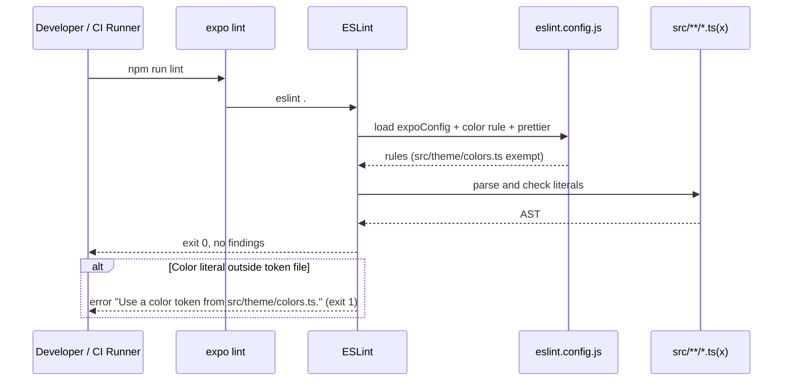
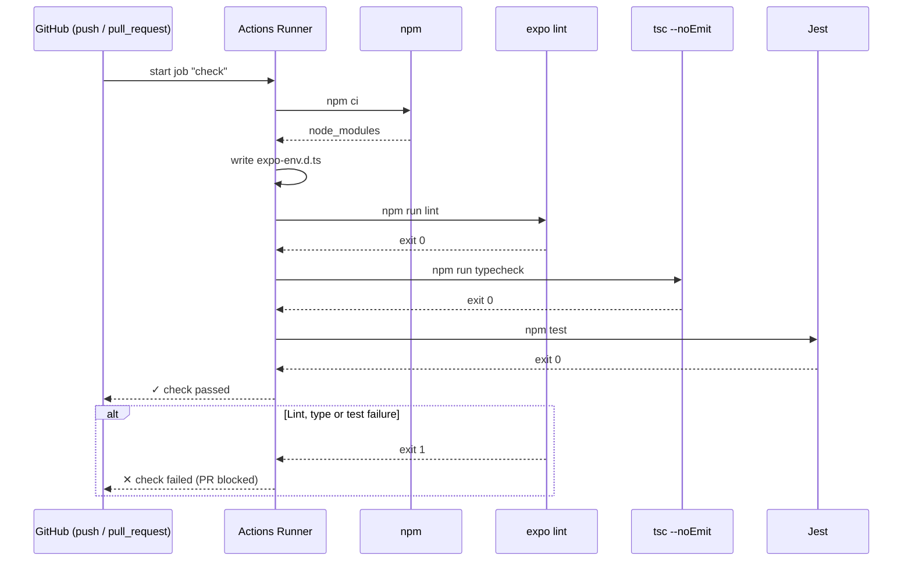
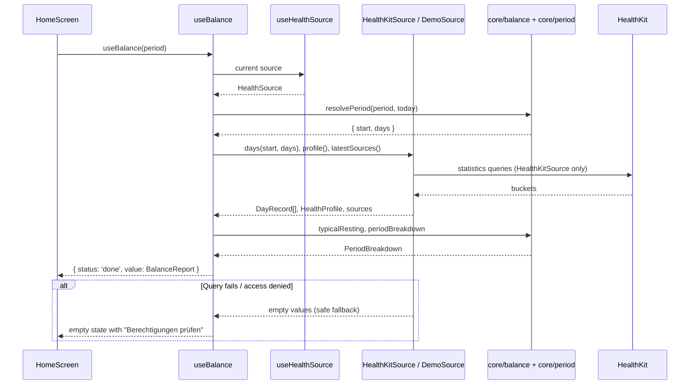
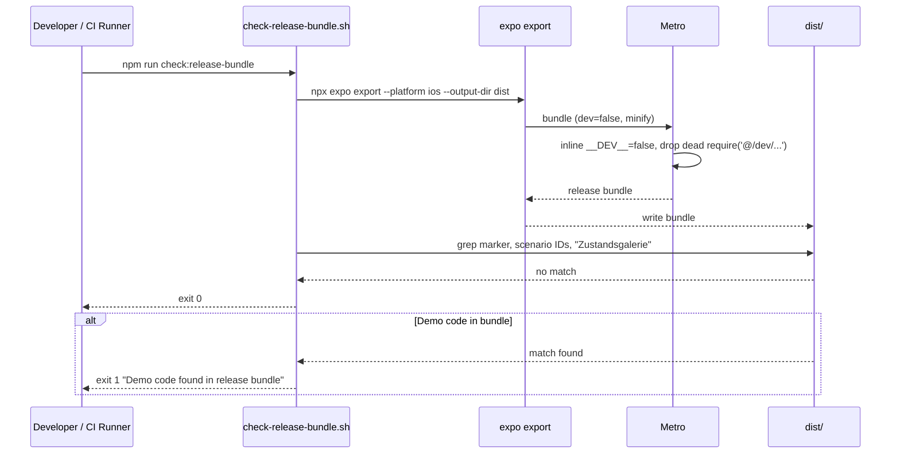

# Fundament, Datenmodell und Zustandsgalerie (P0 + P1)

Stand 2026-10-24. In Arbeit auf Branch `feature/home-page-base`.

## Overview

P0 legt das Fundament fürs Homepage-Design: sechs Farb-Tokens hell und dunkel mit den Werten aus dem Hi-Fi, Text-Varianten mit SF Pro, Tabellenziffern und Dynamic Type, `formatKcal`/`formatKg` je Sprache und eine native Tab-Bar „Bilanz“ und „Einstellungen“. P1 führt das Datenmodell (`DayRecord`, `Period`, `Settings`) und das Interface `HealthSource` ein. Hinter dem Interface liegen die echte `HealthKitSource` und eine `DemoSource` mit festen Szenarien. Eine Zustandsgalerie (nur Development) rendert damit die Homepage für jede Design-Variante. So lässt sich jeder Zustand aus `.claude/design/homepage/` ohne echte Health-Daten nachstellen und mit Screenshots vergleichen. Betroffen: `src/theme/`, `src/components/app-text.tsx`, `src/core/`, `src/health/`, `src/features/balance/`, Routing in `src/app/`, neues `src/dev/`, ESLint, neue GitHub-Actions-CI.

### Ausgangslage: Anforderungen (wörtlich)

> **P0 Fundament: Tokens, Typo, Sprache, Tab-Bar**
> Inhalt: Theme mit den 5 Farb-Tokens, hell und dunkel; Text-Komponenten mit SF Pro, Tabellenziffern und Dynamic Type; i18n DE/EN mit Zahlenformat je Sprache; Tab-Bar „Bilanz“ und „Einstellungen“ mit leeren Screens. Voraussetzung: Expo Dev Build läuft.
> [ ] Keine Farbe im Code außerhalb der Token-Datei (per Lint-Regel oder Grep im CI geprüft).
> [ ] Dark Mode schaltet alle Tokens um, ohne Neustart.
> [ ] formatKcal(7000) ergibt „+7.000“ (de) und „+7,000“ (en); formatKg(0.9) ergibt „0,9“ bzw. „0.9“. Unit-Tests vorhanden.
> [ ] Bei größter Dynamic-Type-Stufe schneidet in Tab-Bar und Beispieltexten nichts ab.

> **P1 Datenmodell, Demo-Daten, Zustandsgalerie**
> Inhalt: Typen DayRecord (Datum, Nahrung, Ruhe, Ruhe geschätzt, Aktiv, Gewicht, KFA, Magermasse, jeweils optional), Period, Settings. Interface HealthSource mit einer DemoSource, die deterministische Szenarien liefert (30 T normal, 90 T, 7 T, Lücken, keine KFA-Daten, leer). Dev-only Screen „Zustandsgalerie“, der die Homepage mit jedem Szenario rendert. Voraussetzung: P0.
> [ ] Jeder der 9 Design-Zustände hat ein Szenario mit Namen.
> [ ] Szenarien sind fest (gleicher Seed, gleiche Zahlen), damit Screenshots vergleichbar bleiben.
> [ ] Galerie und Demo-Daten sind im Release-Build nicht erreichbar.

Design-Referenz: `.claude/design/homepage/Gewichtslinie strukturieren/Kcalwaage Homepage.dc.html` (Varianten 1a–1m) mit der Komponente `BilanzScreen.dc.html` (Layout und Demo-Generator).

### Stand im Code (2026-10-24)

| Bereich | Vorhanden | Fehlt für P0/P1 |
|---|---|---|
| Farb-Tokens | `src/theme/colors.ts`: 6 Tokens (`foreground`, `background`, `muted`, `accent`, `plus`, `minus`), Werte #000/#FFF, `muted` #6E6E6E/#A0A0A0; `useColors()` über `useColorScheme()` | Design-Werte; Lint-Regel. Ein Grep am 2026-10-24 findet keine Farb-Literale außerhalb der Token-Datei |
| Typografie | `src/theme/typography.ts` (iOS Title 1/2, Body, Secondary, Caption, Number, NumberLarge), `AppText` mit `maxFontSizeMultiplier` je Variante | Tabellenziffern nur bei `number*`; Large Title (34), Hero (68), Footnote (13), Caption 2 (11) aus dem Design |
| Zahlen | `formatNumber`, `formatSigned` (U+2212), `roundKcal`, `formatApproxKcal` in `src/core/format.ts`, getestet | `formatKcal`, `formatKg` |
| i18n | i18next DE/EN, `formatLocale()` nimmt das Regions-Tag des Geräts (z. B. de-CH) | Tab-Labels, Texte für „Einstellungen“ |
| Navigation | Root-`Stack` mit `Stack.Protected` (Intro ↔ `index`); `index` = horizontaler Pager Bilanz + Daten-Seite | Tab-Bar |
| Health | `queryDailyEnergy` → `DayEnergy[]` (food, resting, active, restingCoverage), `readHealthProfile`, `latest` | Interface `HealthSource`, `DayRecord` mit Datum, Gewicht, KFA, Magermasse |
| CI | keine (`.github/` fehlt) | Workflow |

## Key Decisions

| # | Decision | Rationale | Alternatives Considered |
|---|----------|-----------|-------------------------|
| 1 | Szenarien beschreiben nur Daten. Die Galerie hat einen Eintrag je Design-ID 1a–1m (= Szenario + UI-Vorgabe) plus einen Eintrag für „Lücken“ | Mehrere Design-IDs teilen dieselben Daten (1a, 1b, 1c, 1g, 1h, 1i, 1m sind alle 30 T). UI-Vorgaben wie Dark, Toleranz offen, Sheet, Tooltip oder Picker sind kein Datenzustand — Julius 2026-10-24 | Genau 9 Einträge; alle 13 als eigenes Szenario |
| 2 | „30 T normal“ = exakt die Design-Daten von 1a (mit 3× Grundumsatz geschätzt, 2× wenig Nahrung, 1× ohne Nahrung). „Lücken“ = echte Datenlöcher, die das Design noch nicht zeigt | 1a soll in der Galerie dieselben Zahlen zeigen wie im Hi-Fi — Julius 2026-10-24 | „Normal“ = vollständig; „Lücken“ weglassen |
| 3 | Zeiträume nach Design: 7 T, 30 T, 60 T, 90 T, Alles, Eigener. „Dieser Monat“ entfällt (geht über „Eigener“) | Passt zu den 6 Segmenten und zu 1d (90 T, Wochenbalken) — Julius 2026-10-24. CLAUDE.md wird angepasst | CLAUDE.md-Liste; Mischung |
| 4 | Der bestehende Pager (Bilanz + Daten-Seite) wird unverändert zum Tab „Bilanz“; nur „Einstellungen“ ist ein Platzhalter | Nichts Funktionierendes geht verloren; die neue Homepage ersetzt den Inhalt später — Julius 2026-10-24 | Beide Tabs leer; alter Inhalt nur in der Galerie |
| 5 | Native Tabs (`expo-router/unstable-native-tabs`, UITabBar, SF Symbols) | Echtes iOS-Verhalten inkl. Liquid Glass ab iOS 26. Bei Accessibility-Größen zeigt iOS den Large Content Viewer statt abgeschnittener Labels — Julius 2026-10-24 | JS-Tabs (React Navigation Bottom Tabs) |
| 6 | 6 Tokens (`accent` bleibt, = `foreground`), Werte aus dem Design: hell `foreground` #0B0B0B, `background` #FFFFFF, `muted` #6B6B6B; dunkel #F4F4F4, #000000, #949494 | `accent` bleibt als Platzhalter für V2 — Julius 2026-10-24. „5 Farb-Tokens“ aus P0 wird damit 6 | Genau die 5 Design-Tokens; Code-Werte behalten |
| 7 | Farb-Check als ESLint-Regel (`no-restricted-syntax`) plus GitHub Actions (`lint`, `typecheck`, `test`) | Meldung schon im Editor; CI holt Planschritt 1 nach, kostenlos im public Repo — Julius 2026-10-24 | Nur ESLint; Grep-Skript im CI |
| 8 | `HealthKitSource` umhüllt die bestehenden Energie-Abfragen; `useBalance` liest nur noch über `HealthSource` (React Context). Gewicht, KFA und Magermasse bleiben in P1 `undefined` | Galerie und echte App nutzen denselben Code-Pfad — Julius 2026-10-24 | Nur Interface + DemoSource; komplette HealthKitSource |
| 9 | Demo-Daten: Generator aus `BilanzScreen.dc.html` nach TypeScript portiert (Park-Miller, Seed 42, 120 Tage), Tage enden relativ zu heute (gestern = letzter voller Tag) | Gleiche Zahlen wie im Design; Datumsbeschriftungen gehen mit dem Kalender mit — Julius 2026-10-24 | Fester Stichtag 24.10.2026; eigene Fixtures |
| 10 | Galerie und Demo-Code liegen unter `src/dev/`. Die Routen unter `src/app/dev/` sind dünne Stubs: `__DEV__ ? require(...) : NotAvailable`, dazu `Stack.Protected guard={__DEV__}`. Ein Skript prüft das Release-Bundle | Expo Router bündelt jede Datei in `src/app/`. Metro setzt `__DEV__` im Release auf `false` und entfernt den toten `require`, bevor es Abhängigkeiten sammelt. Das Skript belegt das, statt es nur anzunehmen | Nur `Stack.Protected` (Code bliebe im Bundle); Build-Profil mit eigener Route-Wurzel |
| 11 | Die Wochentags-Abhängigkeit im Generator hängt am Index, nicht am echten Datum (Phase wie im Design: letzter voller Tag = Fr 23.10.2026) | Sonst würden sich die Tageswerte jeden Tag ändern, und „gleiche Zahlen“ wäre verletzt. Siehe Concerns Nr. 10 | Echte Wochentage (Zahlen wandern täglich) |

## Implementation Details

### Milestone Map

| Milestone | Delivers | 🟢 Add | 🟠 Change | 🔴 Delete | Depends On |
|-----------|----------|--------|-----------|-----------|------------|
| M1 — Farb-Tokens & Lint-Regel | Design-Werte hell/dunkel, Alpha-Helfer, ESLint-Farbverbot | 0 | 3 | 0 | — |
| M2 — Typografie | Tabellenziffern überall, Large Title, Hero, Footnote, Caption 2 | 0 | 2 | 0 | M1 |
| M3 — Zahlenformat | `formatKcal`, `formatKg` mit Tests | 0 | 2 | 0 | — |
| M4 — Tab-Bar | Native Tabs „Bilanz“/„Einstellungen“, Platzhalter, Schriftmuster | 5 | 4 | 1 | M1, M2 |
| M5 — CI | GitHub Actions: lint, typecheck, test | 1 | 0 | 0 | M1 |
| M6 — Datenmodell | `DayRecord`, `Period`, `Settings`, `resolvePeriod`, Kern liest `DayRecord` | 4 | 3 | 0 | M3 |
| M7 — HealthSource | Interface, `HealthKitSource`, Context, `useBalance` über Interface, Zeitraum als Parameter | 4 | 8 | 0 | M4, M6 |
| M8 — DemoSource & Szenarien | Generator-Port, 7 benannte Szenarien, Determinismus-Tests | 5 | 0 | 0 | M7 |
| M9 — Zustandsgalerie | Dev-Routen, 14 Einträge, Release-Bundle-Check in CI | 6 | 6 | 0 | M5, M8 |

```
🟢 Add   🟠 Change   🔴 Delete
```

Abnahmekriterien → Milestones:

| Kriterium | Milestone |
|---|---|
| Keine Farbe außerhalb der Token-Datei (Lint/CI) | M1, M5 |
| Dark Mode schaltet alle Tokens ohne Neustart | M1 (Werte), M4 (Tab-Bar), Prüfung in M4 |
| `formatKcal`/`formatKg` de/en mit Unit-Tests | M3 |
| Größte Dynamic-Type-Stufe: nichts schneidet ab (Tab-Bar, Beispieltexte) | M2, M4 |
| Jeder Design-Zustand hat ein benanntes Szenario | M8, M9 |
| Szenarien fest (gleicher Seed, gleiche Zahlen) | M8 |
| Galerie und Demo-Daten im Release nicht erreichbar | M9 |

---

### Milestone 1 — Farb-Tokens & Lint-Regel

> Die Tokens bekommen die Design-Werte, und Farb-Literale außerhalb der Token-Datei werden zum Lint-Fehler. Danach kann nichts mehr an den Tokens vorbei.

**Depends on:** none

#### File Changes

| Color | File | Action |
|-------|------|--------|
| 🟠 | `src/theme/colors.ts` | Design-Werte eintragen, `withAlpha(color, alpha)` und abgeleitete Werte (Raster/Trenner = `muted` mit 35 %) |
| 🟠 | `eslint.config.js` | Regel gegen Farb-Literale außerhalb `src/theme/colors.ts` |
| 🟠 | `CLAUDE.md` | Abschnitt Design: Token-Liste auf die 6 Tokens (Vordergrund, Hintergrund, Nebentext, Akzent, Plus, Minus) |

#### To-Dos

- 🔲 Update light tokens: `foreground #0B0B0B`, `background #FFFFFF`, `muted #6B6B6B`, `accent`/`plus`/`minus` = `#0B0B0B`
- 🔲 Update dark tokens: `foreground #F4F4F4`, `background #000000`, `muted #949494`, `accent`/`plus`/`minus` = `#F4F4F4`
- 🔲 Add `withAlpha(color, alpha)` to `src/theme/colors.ts` and a derived `separator` value (`muted` at 35 %) returned by `useColors()` next to the tokens, without adding a seventh token
- 🔲 Add `no-restricted-syntax` rules for `src/**/*.{ts,tsx}` except `src/theme/colors.ts`: hex literals (`#rgb`, `#rgba`, `#rrggbb`, `#rrggbbaa`), `rgb()/rgba()/hsl()/hsla()` strings, hex or `rgb(` inside template literals, and named colors as values of style or prop keys ending in `color`/`Color` (string literal other than `transparent`), with the message „Use a color token from src/theme/colors.ts.“
- 🔲 Verify the rule: add a temporary `color: '#FF0000'`, `rgba(0,0,0,.5)` and `tintColor="red"` in a component, run `npm run lint`, expect 3 errors, then remove them
- 🔲 Run `npm run lint`, `npm run typecheck`, `npm test`; all exit 0
- 🔲 Update CLAUDE.md design section (6 tokens, values from the design)
- 🔲 Commit (`feat: apply design color tokens and forbid color literals`)

#### Notes / Constraints

> - Werte und Verwendung laut Design: `foreground` = Text, Linien, Karten-Rahmen; `background` = Fläche, Schraffur-Lücken; `muted` = Nebentext, Raster/Trenner mit 35 %; `plus` = Balken über Null, Plus-Zahlen; `minus` = Balken unter Null, Minus-Zahlen (beide in V2 austauschbar).
> - Das Design nennt Dark Mode eine reine Token-Inversion. Der Vordergrund ist dunkel aber #F4F4F4, nicht #FFFFFF; maßgeblich ist die Token-Tabelle im Design.
> - `transparent` bleibt erlaubt: keine Farbe, kein Token.
> - `accent` wird heute nirgends gelesen (Grep 2026-10-24, nur ein Kommentar in `link-button.tsx`).

#### 🔀 Inbound Flow — CLI: npm run lint



---

### Milestone 2 — Typografie

> Alle Text-Varianten nutzen SF Pro (Systemschrift), Tabellenziffern und Dynamic Type; die Größen aus dem Design kommen dazu.

**Depends on:** Milestone 1

#### File Changes

| Color | File | Action |
|-------|------|--------|
| 🟠 | `src/theme/typography.ts` | `fontVariant: ['tabular-nums']` für alle Varianten; neue Varianten `largeTitle`, `hero`, `footnote`, `caption2` |
| 🟠 | `src/components/app-text.tsx` | Obergrenzen (`maxFontSizeMultiplier`) für `largeTitle` und `hero` |

#### To-Dos

- 🔲 Add `tabular-nums` to every variant (the design sets `font-variant-numeric: tabular-nums` on the whole screen)
- 🔲 Add `largeTitle` (iOS Large Title: 34/41, weight 700; design: title „Bilanz“ 34 px bold)
- 🔲 Add `hero` (68, weight 600; design: big balance number)
- 🔲 Add `footnote` (iOS Footnote 13/18) and `caption2` (iOS Caption 2 11/13; chart labels in the design use 10–11 px)
- 🔲 Cap `largeTitle` at 2 and `hero` at 1.5 in `MAX_FONT_SCALE`, like `screenTitle` and `numberLarge`
- 🔲 Keep the system font: no `fontFamily` anywhere (React Native uses SF Pro Text/Display on iOS)
- 🔲 Run `npm run lint`, `npm run typecheck`, `npm test`; all exit 0
- 🔲 Commit (`feat: add tabular figures and design text styles`)

#### Notes / Constraints

> - Dynamic Type bleibt an (`allowFontScaling` nicht abschalten). Große Stile werden nur gedeckelt, damit Wörter ganz bleiben (bestehende Logik in `AppText`).
> - Die Hero-Spanne im Design (52 px) und weitere Größen (24, 22, 20) entstehen mit dem Homepage-Screen; P0 legt nur die Grundstile an.

---

### Milestone 3 — Zahlenformat

> `formatKcal` und `formatKg` formatieren je Sprache und sind getestet.

**Depends on:** none

#### File Changes

| Color | File | Action |
|-------|------|--------|
| 🟠 | `src/core/format.ts` | `formatKcal(value, locale)`, `formatKg(value, locale)` und `formatSignedKg(value, locale)` |
| 🟠 | `src/core/__tests__/format.test.ts` | Tests für beide |

#### To-Dos

- 🔲 Add `formatKcal(value, locale)`: whole kcal with explicit sign via `formatSigned` (`+`, U+2212, none for 0); no rounding to 10 (callers round where needed)
- 🔲 Add `formatKg(value, locale)`: one decimal, no sign
- 🔲 Add `formatSignedKg(value, locale)`: one decimal with explicit sign via `formatSigned` (e.g. `+0,9`, `−0,8`), for fat equivalents
- 🔲 Test `formatKcal(7000, 'de-DE')` → `+7.000` and `formatKcal(7000, 'en-US')` → `+7,000`
- 🔲 Test `formatKg(0.9, 'de-DE')` → `0,9` and `formatKg(0.9, 'en-US')` → `0.9`
- 🔲 Test edge cases: `formatKcal(-6200, 'en-US')` → `−6,200`, `formatKcal(0, 'de-DE')` → `0`, `formatKg(0.04, 'de-DE')` → `0,0`, `formatSignedKg(0.9, 'de-DE')` → `+0,9`, `formatSignedKg(-0.8, 'en-US')` → `−0.8`, `formatSignedKg(-0.04, 'de-DE')` → `0,0`
- 🔲 Run `npm test`; all pass
- 🔲 Commit (`feat: add formatKcal, formatKg and formatSignedKg`)

#### Notes / Constraints

> - Wie alle Funktionen im Rechenkern bekommen beide die Locale als Parameter (rein, ohne i18n-Import). Screens übergeben `formatLocale()`.
> - „(de)“ und „(en)“ aus der Anforderung sind in den Tests `de-DE` und `en-US`. Auf dem Gerät folgt das Format der Region (`formatLocale()`, z. B. de-CH → „+7’000“), wie von Julius 2026-10-24 entschieden (Concerns Nr. 13).
> - kg mit Vorzeichen (z. B. „≈ +0,9 kg“ im Hero) über `formatSignedKg`; `formatKg` bleibt ohne Vorzeichen, wie im Abnahmekriterium (Concerns Nr. 12).
> - Später soll Masse auch in lb angezeigt werden können, per Einstellung oder abhängig von der Region (Open Question 6). Deshalb steckt die Einheit nur in den Format-Funktionen; Rechenkern und `DayRecord` bleiben in kg.

---

### Milestone 4 — Tab-Bar

> Native Tab-Bar mit „Bilanz“ (bestehender Pager) und „Einstellungen“ (Platzhalter mit Schriftmuster und Dev-Links).

**Depends on:** Milestone 1, Milestone 2

#### File Changes

| Color | File | Action |
|-------|------|--------|
| 🟢 | `src/app/(tabs)/_layout.tsx` | `NativeTabs` mit zwei Triggern, Tint/Farben aus Tokens |
| 🟢 | `src/app/(tabs)/index.tsx` | Bisheriges `src/app/index.tsx` (Pager Bilanz + Daten), per `git mv` |
| 🟢 | `src/app/(tabs)/settings.tsx` | Route für den Einstellungen-Platzhalter |
| 🟢 | `src/features/settings/components/settings-page.tsx` | Titel, Platzhaltertext, Dev-Bereich (`__DEV__`) |
| 🟢 | `src/features/settings/components/type-specimen.tsx` | Beispieltexte aller Text-Varianten inkl. Zahlen (nur `__DEV__`) |
| 🔴 | `src/app/index.tsx` | Verschoben nach `src/app/(tabs)/index.tsx` |
| 🟠 | `src/app/_layout.tsx` | `Stack.Protected guard={introCompleted}` zeigt `(tabs)` statt `index` |
| 🟠 | `src/features/balance/components/balance-page.tsx` | Link „Reset intro (dev)“ entfernen (zieht nach Einstellungen um) |
| 🟠 | `src/i18n/locales/de.ts` | `tabs.balance`, `tabs.settings`, `settings.title`, `settings.placeholder` |
| 🟠 | `src/i18n/locales/en.ts` | Dieselben Schlüssel auf Englisch |

#### To-Dos

- 🔲 Move `src/app/index.tsx` to `src/app/(tabs)/index.tsx` with `git mv`; keep content, set `SafeAreaView` edges to `['top']` (the tab bar owns the bottom inset)
- 🔲 Create `src/app/(tabs)/_layout.tsx` with `NativeTabs`: trigger `index` (label `tabs.balance`, SF Symbol `chart.bar` / `chart.bar.fill`) and `settings` (label `tabs.settings`, SF Symbol `gearshape` / `gearshape.fill`); tint, icon and label colors from `useColors()`
- 🔲 Update `src/app/_layout.tsx`: `Stack.Screen name="(tabs)"` inside `Stack.Protected guard={introCompleted}`
- 🔲 Create `settings-page.tsx`: `largeTitle` „Einstellungen“, placeholder text, and a `__DEV__` section with „Reset intro (dev)“ and the type specimen
- 🔲 Remove the dev reset link from `balance-page.tsx`
- 🔲 Create `type-specimen.tsx`: one line per text variant with realistic texts (e.g. „+7.000 kcal“, „≈ +0,9 kg Körperfett (theoretisch, 7.700 kcal/kg)“, „24 von 30 Tagen vollständig“), wrapping allowed, no `numberOfLines`
- 🔲 Add i18n keys DE/EN: `tabs.balance` „Bilanz“/„Balance“, `tabs.settings` „Einstellungen“/„Settings“, `settings.title`, `settings.placeholder` („Hier kommen Zeitraum, Messfehler und Null-Tage hin.“ / „Period, measurement error and zero days will live here.“)
- 🔲 Check in the simulator: Dark Mode toggle (Cmd Shift A) switches tab bar, both tabs and the specimen at once, without restart
- 🔲 Check at the largest Dynamic Type size (AX5) in light and dark: tab bar labels are not cut off (long press shows the Large Content Viewer), specimen texts wrap and stay complete
- 🔲 Check that the intro still leads to the Bilanz tab after „Los geht's“ and that „Reset intro (dev)“ in Einstellungen brings the intro back
- 🔲 Run `npm run lint`, `npm run typecheck`, `npm test`; all exit 0
- 🔲 Commit (`feat: add native tab bar with balance and settings tabs`)

#### Notes / Constraints

> - Voraussetzung „Expo Dev Build läuft“ ist erfüllt (Scaffold-Spec M5). `unstable-native-tabs` ist in `expo-router` 57.0.25 vorhanden. Die API ist als „unstable“ markiert, siehe Concerns Nr. 16. Die genauen Props (`NativeTabs.Trigger`, `Icon sf`, `Label`, Farb-Props) beim Umsetzen in den Typen von `node_modules/expo-router/build/native-tabs/` nachschlagen.
> - Der Wisch-Pager im Tab „Bilanz“ bleibt horizontal. Er kollidiert nicht mit der Tab-Bar, weil iOS-Tabs nicht per Wischen wechseln.
> - Dev-Texte („Reset intro (dev)“) bleiben wie bisher englisch und unübersetzt.

#### 📐 Wireframe — Tabs Layout

```
┌─────────────────────────────────────┐
│ 14:32                       ▮▮▮ ▭   │  StatusBar
├─────────────────────────────────────┤
│            ● ○                      │  PageIndicator
│                                     │
│   (bestehender Pager, unverändert)  │
│   BalancePage  ⇆  DataPage          │
│                                     │
│                                     │
├─────────────────────────────────────┤
│     [ ▮▮▮ Bilanz ]  [ ⚙︎ Einstellungen ] │  NativeTabs (UITabBar)
└─────────────────────────────────────┘
```

**Component tree:**
RootLayout (Stack)
├── Stack.Protected guard=introCompleted
│   └── TabsLayout (NativeTabs)
│       ├── NativeTabs.Trigger „index“ → HomeScreen
│       │   ├── PageIndicator
│       │   └── ScrollView (pagingEnabled)
│       │       ├── BalancePage
│       │       └── DataPage
│       └── NativeTabs.Trigger „settings“ → SettingsScreen
└── Stack.Protected guard=!introCompleted
    └── IntroLayout

#### 📐 Wireframe — SettingsScreen

```
┌─────────────────────────────────────┐
│ 14:32                       ▮▮▮ ▭   │
├─────────────────────────────────────┤
│ Einstellungen                       │  AppText largeTitle
│                                     │
│ Hier kommen Zeitraum, Messfehler    │  AppText body, muted
│ und Null-Tage hin.                  │
│                                     │
│ ── nur __DEV__ ──────────────────── │
│ [ Reset intro (dev) ]               │  LinkButton
│ [ Zustandsgalerie (dev) › ]         │  LinkButton (ab M9)
│                                     │
│ Beispieltexte                       │  TypeSpecimen
│  +7.000 kcal              (hero)    │
│  Bilanz                (largeTitle) │
│  24 von 30 Tagen vollständig (body) │
│  ≈ +0,9 kg Körperfett …  (footnote) │
│  …                                  │
├─────────────────────────────────────┤
│     [ ▮▮▮ Bilanz ]  [ ⚙︎ Einstellungen ] │
└─────────────────────────────────────┘
```

**Component tree:**
SettingsScreen (route `src/app/(tabs)/settings.tsx`)
└── SettingsPage
    ├── AppText (largeTitle)
    ├── AppText (placeholder)
    └── DevSection (`__DEV__`)
        ├── LinkButton „Reset intro (dev)“
        ├── LinkButton „Zustandsgalerie (dev)“ (M9)
        └── TypeSpecimen
            └── AppText[] (eine Zeile je Variante)

#### ⌨️ Keyboard Shortcuts — Global

Die App hat keine Tastaturkürzel: reine Touch-App fürs iPhone, keine Web-Version. Für die Abnahme zählen nur die vorhandenen Entwickler-Kürzel; neue Kürzel werden nicht angelegt.

| Shortcut | Action | Scope |
|----------|--------|-------|
| Cmd Shift A | Hell/Dunkel umschalten (Abnahme Dark Mode) | Global (nur Entwicklung, iOS-Simulator) |
| Cmd Option + / Cmd Option − | Textgröße erhöhen/verringern (Abnahme Dynamic Type) | Global (nur Entwicklung, iOS-Simulator) |
| Cmd D | Dev-Menü öffnen | Global (nur Entwicklung, iOS-Simulator) |
| r | App neu laden | Global (nur Entwicklung, Terminal von `npx expo start`) |

---

### Milestone 5 — CI

> GitHub Actions prüft jeden Push und Pull Request mit lint, typecheck und test; damit greift die Farbregel auch im CI.

**Depends on:** Milestone 1

#### File Changes

| Color | File | Action |
|-------|------|--------|
| 🟢 | `.github/workflows/ci.yml` | Job `check` auf `ubuntu-latest` |

#### To-Dos

- 🔲 Create `.github/workflows/ci.yml`: triggers `push` and `pull_request`; steps `actions/checkout`, `actions/setup-node` (Node LTS, npm cache), `npm ci`, write `expo-env.d.ts`, `npm run lint`, `npm run typecheck`, `npm test`
- 🔲 Write `expo-env.d.ts` in CI before `typecheck` (`/// <reference types="expo/types" />`); the file is gitignored and only created by `expo start`
- 🔲 Push the branch and confirm the workflow is green on GitHub
- 🔲 Confirm a deliberate color literal makes the workflow fail (temporary commit, then revert)
- 🔲 Commit (`ci: run lint, typecheck and tests on GitHub Actions`)

#### Notes / Constraints

> - Kein EAS-Build im CI; das bleibt manuell (kostet Build-Minuten).
> - Typed Routes: Ohne generierte `.expo/types` fällt `Href` auf `string` zurück. Scheitert `typecheck` im CI daran, vor dem Typecheck `npx expo customize tsconfig.json` o. Ä. prüfen und das Ergebnis hier nachtragen.

#### 🔀 Inbound Flow — CLI: GitHub Actions ci.yml



---

### Milestone 6 — Datenmodell

> `DayRecord`, `Period` und `Settings` als reine TypeScript-Typen im Rechenkern; der bestehende Kern rechnet mit `DayRecord`.

**Depends on:** Milestone 3

#### File Changes

| Color | File | Action |
|-------|------|--------|
| 🟢 | `src/core/day-record.ts` | Typ `DayRecord`; `DayEnergy` als Ausschnitt daraus |
| 🟢 | `src/core/period.ts` | Typ `Period`, `PERIOD_PRESETS`, `resolvePeriod` |
| 🟢 | `src/core/settings.ts` | Typ `Settings`, `DEFAULT_SETTINGS` |
| 🟢 | `src/core/__tests__/period.test.ts` | Tests für `resolvePeriod` |
| 🟠 | `src/core/balance.ts` | `DayEnergy` aus `day-record.ts`; `restingEstimated` berücksichtigen |
| 🟠 | `src/core/__tests__/balance.test.ts` | Tests für Tage mit `restingEstimated` |
| 🟠 | `CLAUDE.md` | Features 2: Zeiträume 7, 30, 60, 90 T, Alles, Eigener |

#### To-Dos

- 🔲 Create `DayRecord` (see sketch below): `date` required, all values optional
- 🔲 Derive `DayEnergy` from `DayRecord` (`Pick` of `food`, `resting`, `restingEstimated`, `restingCoverage`, `active`) and re-export it from `balance.ts` so existing imports keep working
- 🔲 Update `dayRestingKind`/`dayResting`: a day with `restingEstimated: true` and a `resting` value counts as `fallback` and uses its own `resting` value (not the period fallback)
- 🔲 Test: a period with one estimated day sums its given resting value and counts it in `restingFallbackDays`
- 🔲 Create `Period` with `PERIOD_PRESETS` in segment order (7, 30, 60, 90, all, custom)
- 🔲 Create `resolvePeriod(period, today, options)` → `{ start, days }` (local midnight, calendar days, DST-safe like `queryDailyEnergy`); options `includeToday` and `firstDataDate`
- 🔲 Test `resolvePeriod`: 30 days ending yesterday; with `includeToday` ending today; `all` from `firstDataDate`; `all` without data → 0 days; `custom` clamped to yesterday (or today with `includeToday`); `custom` with `from > to` swapped; across a DST change
- 🔲 Create `Settings` and `DEFAULT_SETTINGS` (period 30 days, `zeroDaysAsMaintenance: true`, `includeToday: false`, tolerance 0 % / 0 % = aus)
- 🔲 Update CLAUDE.md feature 2 to the design's period list
- 🔲 Run `npm run lint`, `npm run typecheck`, `npm test`; all exit 0
- 🔲 Commit (`feat: add DayRecord, Period and Settings types`)

```ts
// src/core/day-record.ts
export type DayRecord = {
  // Local calendar day, YYYY-MM-DD.
  date: string;
  food?: number; // kcal
  resting?: number; // kcal
  // The source supplies an estimate instead of a measurement (demo: formula value).
  restingEstimated?: boolean;
  // Share of the day's hours with resting energy, 0–1 (see core/balance.ts).
  restingCoverage?: number;
  active?: number; // kcal
  weightKg?: number; // last value of the day
  bodyFatFraction?: number; // 0–1, as HealthKit's "%" unit
  leanMassKg?: number; // last value of the day
};

// src/core/period.ts
export type Period =
  | { kind: 'days'; days: 7 | 30 | 60 | 90 }
  | { kind: 'all' }
  | { kind: 'custom'; from: string; to: string }; // YYYY-MM-DD

// src/core/settings.ts
export type Settings = {
  period: Period;
  // Day without food entry counts as B = 0 instead of a full deficit.
  zeroDaysAsMaintenance: boolean;
  includeToday: boolean;
  // 0 = off. Applied to period sums, not per day.
  tolerance: { foodPercent: number; burnPercent: number };
};
```

#### Notes / Constraints

> - „jeweils optional“ gilt für die Werte; ohne Datum ist ein Datensatz nicht zuzuordnen, deshalb ist `date` Pflicht.
> - KFA wird als Anteil 0–1 gespeichert (wie HealthKit mit Einheit `%`), Anzeige in Prozent erst in der UI.
> - Fehlt `leanMassKg`, gilt laut CLAUDE.md Magermasse = Gewicht × (1 − KFA), Fett = Gewicht × KFA. Die Ableitung kommt mit der Analyse (Schritt 8), nicht in P1.
> - `Settings` ist in P1 nur Typ + Defaults. Speichern in der App Group und das Verdrahten von Null-Tage-Schalter, „Heute einrechnen“ und Toleranz folgen mit Schritt 5/6. Heute zählt der Kern Tage ohne Nahrung immer als B = 0, das entspricht `zeroDaysAsMaintenance: true`.
> - Toleranz: Das Design zeigt Schieber 0–20 % (Nahrung) und 0–30 % (Verbrauch), 0 % = aus. CLAUDE.md beschreibt einen Schalter mit Normbereich 5–20 % / 10–30 %, vorausgewählt am unteren Rand. Der Typ mit „0 = aus“ deckt beides ab; die UI-Entscheidung steht in Open Questions Nr. 5.
> - „Auffällig wenig Nahrung (< 50 % Verbrauch)“ ist eine neue, abgeleitete Kennzeichnung aus dem Design und noch nicht im Kern. Die Demo-Daten enthalten solche Tage; die Erkennung kommt mit dem Homepage-Screen.

---

### Milestone 7 — HealthSource

> Ein Interface trennt Datenquelle und App. `HealthKitSource` liefert die bestehenden Energiewerte als `DayRecord[]`, `useBalance` liest nur noch darüber und bekommt den Zeitraum als Parameter.

**Depends on:** Milestone 4, Milestone 6

#### File Changes

| Color | File | Action |
|-------|------|--------|
| 🟢 | `src/health/source.ts` | Interface `HealthSource` |
| 🟢 | `src/health/healthkit-source.ts` | `healthKitSource`: bestehende Abfragen hinter dem Interface |
| 🟢 | `src/health/source-context.tsx` | `HealthSourceProvider`, `useHealthSource()` (Default: `healthKitSource`) |
| 🟢 | `src/health/__tests__/healthkit-source.test.ts` | Mapping auf `DayRecord` (Datum, Werte, Coverage) |
| 🟠 | `src/health/daily-energy.ts` | Liefert `DayRecord[]` mit `date` |
| 🟠 | `src/health/__tests__/daily-energy.test.ts` | Erwartet `date` je Tag |
| 🟠 | `src/features/balance/use-balance.ts` | Liest über `useHealthSource()`, Parameter `period` (Default 30 T), `BALANCE_DAYS` entfällt |
| 🟠 | `src/features/balance/data-rows.ts` | Tage aus `report.balance.days` statt `BALANCE_DAYS` |
| 🟠 | `src/features/balance/components/balance-page.tsx` | Zeitraum-Text mit Tagesanzahl |
| 🟠 | `src/i18n/locales/de.ts` | `home.period`, `home.empty`, `data.arrivingBody` mit `{{count}}` |
| 🟠 | `src/i18n/locales/en.ts` | Dieselben Schlüssel |
| 🟠 | `src/app/_layout.tsx` | `HealthSourceProvider` um den Stack |

#### To-Dos

- 🔲 Create `HealthSource` (sketch below)
- 🔲 Update `queryDailyEnergy` to return `DayRecord[]` with `date` (YYYY-MM-DD, local); `scan.ts` keeps working unchanged
- 🔲 Create `healthKitSource`: `days` → `queryDailyEnergy`; `profile` → `readHealthProfile`; `latestSources` → `latest()` for food, resting, active; `firstDataDate` → first food sample (as in `scanHealthData`). Weight, body fat and lean mass stay `undefined` until step 4/8
- 🔲 Create `HealthSourceProvider` and `useHealthSource()`; wrap the root stack in `src/app/_layout.tsx`
- 🔲 Update `useBalance(period = { kind: 'days', days: 30 })`: resolve via `resolvePeriod`, load through the source, keep the `BalanceReport` shape so both pages stay unchanged
- 🔲 Make the loader depend on source and period (new load when either changes)
- 🔲 Replace fixed „30“ in `home.period`, `home.empty` and `data.arrivingBody` with `{{count}}` plural keys (DE/EN)
- 🔲 Test `healthKitSource` with the existing `fake-statistics` fixture: dates, sums, coverage, missing days
- 🔲 Check on the device or simulator that the Bilanz tab shows the same numbers as before the change
- 🔲 Run `npm run lint`, `npm run typecheck`, `npm test`; all exit 0
- 🔲 Commit (`refactor: read Health data through a HealthSource interface`)

```ts
// src/health/source.ts
export type EnergyKey = 'food' | 'resting' | 'active';

export interface HealthSource {
  // One record per local calendar day from `start` (local midnight), `days` long.
  days(start: Date, days: number): Promise<DayRecord[]>;
  // Inputs for the resting energy estimate.
  profile(): Promise<HealthProfile>;
  // Source of the newest sample per energy type (data page).
  latestSources(): Promise<Record<EnergyKey, SourceRevision | undefined>>;
  // First day with food data, for the period "Alles".
  firstDataDate(): Promise<Date | undefined>;
}
```

#### Notes / Constraints

> - Kein neuer Bildschirm, kein neuer Einstiegspunkt; nur der Ladeweg ändert sich. Die Zahlen auf Bilanz- und Daten-Seite müssen vorher und nachher gleich sein.
> - `getProfile()` (eigene Angaben aus der App Group) bleibt außerhalb der Quelle: Das sind keine Health-Daten.
> - Leere Daten werden weiter mit „Berechtigungen prüfen“ erklärt (iOS verrät verweigerte Leserechte nicht).

Datenfluss beim Laden des Bilanz-Tabs (kein neuer Einstiegspunkt, daher ohne 🔀-Überschrift):



---

### Milestone 8 — DemoSource & Szenarien

> Eine `DemoSource` liefert sieben benannte, deterministische Szenarien aus dem portierten Design-Generator.

**Depends on:** Milestone 7

#### File Changes

| Color | File | Action |
|-------|------|--------|
| 🟢 | `src/dev/demo/random.ts` | Park-Miller-Generator (`s = s · 16807 mod 2³¹−1`) und Normal-Näherung `g()` wie im Design |
| 🟢 | `src/dev/demo/generate.ts` | Port von `gen()` aus `BilanzScreen.dc.html`, Optionen je Szenario |
| 🟢 | `src/dev/demo/scenarios.ts` | 7 Szenarien mit ID, Namen DE, Serie, Zeitraum |
| 🟢 | `src/dev/demo/demo-source.ts` | `createDemoSource(scenarioId, now)` implementiert `HealthSource` |
| 🟢 | `src/dev/demo/__tests__/scenarios.test.ts` | Determinismus, Eckwerte, Snapshot |

#### To-Dos

- 🔲 Port the generator 1:1 (120 days, seed 42, same order of random calls), so the base series reproduces the design numbers
- 🔲 Tie the weekday effect (`+520` Fri/Sat, `−140` otherwise) to the day index with the design's phase (last full day = Friday), not to the real date
- 🔲 Map design fields to `DayRecord`: `food` = `A` (`undefined` on „ohne Nahrung“ days), `resting` = `R` (`restingEstimated: true` on estimated days, R = 1.750), `active` = `K`; on measurement days `weightKg` = `wM`, `bodyFatFraction` = `fM / wM`, `leanMassKg` = `wM − fM`
- 🔲 Date records relative to `now`: index 119 = yesterday, index 0 = 120 days ago
- 🔲 Return today's partial values when the range includes today: food 1.420, resting 1.090, active 290 („Heute bisher“ in the design)
- 🔲 Apply scenario overlays after generation, without extra random calls, so the base numbers stay unchanged
- 🔲 Create the 7 scenarios (table below) with stable IDs and German names
- 🔲 Implement `profile()` (82,4 kg, 182 cm, 34 years, male, like the intro wireframe), `latestSources()` (food „Yazio“, resting/active Apple Watch) and `firstDataDate()` (120 days ago; `undefined` for `empty`)
- 🔲 Add a marker constant `DEMO_BUNDLE_MARKER = 'kcalwaage-demo-data'` in `demo-source.ts` for the release check in M9
- 🔲 Test determinism: building any scenario twice gives equal values; values (without dates) are equal for two different `now` dates
- 🔲 Test design key figures for `normal30`: Σ (resting + active) over the last 30 days = 80.100 kcal; `periodBreakdown` gives +7.000 kcal; 24 of 30 days complete (3 estimated, 2 low, 1 without food)
- 🔲 Test `short7`: 7 days, 4 weight measurements; `empty`: no values at all
- 🔲 Add a Jest snapshot of all scenario values (without dates) so any change to the numbers is visible in review
- 🔲 Run `npm run lint`, `npm run typecheck`, `npm test`; all exit 0
- 🔲 Commit (`feat: add demo Health source with fixed scenarios`)

**Szenarien**

| ID | Name | Serie | Zeitraum | Besonderheiten | Galerie-Einträge |
|---|---|---|---|---|---|
| `normal30` | 30 T normal | Basis (Design) | 30 T | Letzte 30 Tage: Grundumsatz geschätzt an Tag 4, 11, 19; wenig Nahrung (40 % des Verbrauchs) an Tag 8, 24; ohne Nahrung an Tag 15. Σ Verbrauch 80.100, Bilanz +7.000 kcal | 1a, 1b, 1c, 1g, 1h, 1i, 1m |
| `long90` | 90 T | Basis | 90 T | Ältere Tage zufällig: 6 % geschätzt, 2,5 % wenig Nahrung, 1,5 % ohne Nahrung; Wochenbalken | 1d |
| `short7` | 7 T | Basis | 7 T | Messung jeden zweiten Tag → 4 Messungen; Abgleich gesperrt | 1e, 1l |
| `gaps30` | Lücken | Basis + Löcher | 30 T | Tag 12–14 ganz ohne Health-Werte („Urlaub“); Tag 6, 21, 27 ohne Aktivenergie; Tag 16–22 ohne Waage-Messung; Tag 2 und 26 Ruheenergie nur halber Tag (`restingCoverage` 0,5, Wert halbiert) | L1 |
| `noBodyFat30` | Keine KFA-Daten | Basis ohne `bodyFatFraction`/`leanMassKg` | 30 T | Nur Gewicht | 1k |
| `goodFit30` | Passt gut | Basis, Fett-Trend +0,72 kg/30 T, Magermasse +0,1 kg/30 T | 30 T | Waage passt zur Bilanz | 1j |
| `empty` | Leer | keine Werte | 30 T | Leerer Zustand, „Health-Berechtigungen öffnen“ | 1f |

Tag-Nummern = Position im 30-Tage-Fenster (0 = ältester Tag, 29 = gestern), wie `w` im Design-Generator.

#### Notes / Constraints

> - Basis-Trends aus dem Design: Fett 17,6 kg + 0,4 kg/30 T, Magermasse 64,1 kg + 0,3 kg/30 T, Messungen mit 47 % Wahrscheinlichkeit, in den letzten 7 Tagen jeden zweiten Tag.
> - `restingEstimated` statt „Ruheenergie fehlt + Fallback“: Sonst ersetzt der Kern die geschätzten Tage durch den Median der vollen Tage (~1.795) statt der Formel (1.750), und die +7.000 aus dem Design stimmen nicht mehr. Siehe Concerns Nr. 11.
> - Alles unter `src/dev/` darf nur aus `src/dev/` und den Stub-Routen in `src/app/dev/` importiert werden (Lint-Regel in M9).

---

### Milestone 9 — Zustandsgalerie

> Ein Dev-Screen listet alle Design-Zustände und rendert für jeden den Bilanz-Tab mit der passenden `DemoSource`; im Release-Build ist davon nichts erreichbar.

**Depends on:** Milestone 5, Milestone 8

#### File Changes

| Color | File | Action |
|-------|------|--------|
| 🟢 | `src/dev/gallery/entries.ts` | 14 Einträge: Design-ID, Titel, Szenario, UI-Vorgabe |
| 🟢 | `src/dev/gallery/gallery-screen.tsx` | Liste der Einträge |
| 🟢 | `src/dev/gallery/entry-screen.tsx` | Rendert `HomeScreen` in `HealthSourceProvider` mit `DemoSource` |
| 🟢 | `src/app/dev/gallery.tsx` | Stub: `__DEV__ ? require('@/dev/gallery/gallery-screen') : NotAvailable` |
| 🟢 | `src/app/dev/[entry].tsx` | Stub wie oben für `entry-screen` |
| 🟢 | `scripts/check-release-bundle.sh` | `expo export --platform ios` (Release) und Suche nach `DEMO_BUNDLE_MARKER` und Szenario-IDs |
| 🟠 | `src/app/_layout.tsx` | `Stack.Protected guard={__DEV__ && introCompleted}` mit `dev/gallery`, `dev/[entry]` |
| 🟠 | `src/features/settings/components/settings-page.tsx` | Link „Zustandsgalerie (dev) ›“ im Dev-Bereich |
| 🟠 | `eslint.config.js` | `no-restricted-imports` für `@/dev/*` außerhalb `src/dev/**` und `src/app/dev/**` |
| 🟠 | `package.json` | Skript `check:release-bundle` |
| 🟠 | `.github/workflows/ci.yml` | Schritt `npm run check:release-bundle` |
| 🟠 | `src/app/(tabs)/index.tsx` | `HomeScreen` exportierbar mit optionalem `period`, damit die Galerie ihn einbettet |

#### To-Dos

- 🔲 Create `entries.ts` with the 14 entries (table below)
- 🔲 Create `gallery-screen.tsx`: one row per entry with design ID, title and scenario name; tap opens `/dev/[entry]`
- 🔲 Create `entry-screen.tsx`: header with back, design ID and title; renders `HomeScreen` inside `HealthSourceProvider` with `createDemoSource(entry.scenario, new Date())` and the scenario's period
- 🔲 Show a small badge „UI-Vorgabe folgt mit der Homepage“ on entries whose UI preset the current page can't show yet (toleranz, sheet, tooltip, picker, abgleich part)
- 🔲 For 1b, force dark with `Appearance.setColorScheme('dark')` on enter and reset to `null` on leave
- 🔲 For 1i, show the hint „Textgröße am Gerät auf AX1 stellen (≈ 140 %)“; Dynamic Type can't be forced from inside the app
- 🔲 Create the stub routes; their only import outside React is the `__DEV__`-guarded `require`
- 🔲 Add the protected dev routes to `src/app/_layout.tsx`
- 🔲 Add the link „Zustandsgalerie (dev) ›“ to the dev section in Einstellungen
- 🔲 Add the `no-restricted-imports` rule for `@/dev/*` and verify it with a temporary import in `balance-page.tsx`
- 🔲 Create `scripts/check-release-bundle.sh`: `npx expo export --platform ios --output-dir dist` (production by default), then fail if `dist/` contains `kcalwaage-demo-data`, `normal30` or `Zustandsgalerie`
- 🔲 Add `"check:release-bundle"` to `package.json` and run it locally; expect exit 0
- 🔲 Verify the check works: temporarily import `@/dev/demo/demo-source` without `__DEV__` guard (lint rule disabled for that line), expect the script to fail, then revert
- 🔲 Add the step to `.github/workflows/ci.yml` and confirm the workflow is green
- 🔲 Check in the simulator: every entry opens; 1a shows +7.000 kcal for 30 days; 1f shows the empty state; 1b is dark and returns to system appearance on back
- 🔲 Run `npm run lint`, `npm run typecheck`, `npm test`; all exit 0
- 🔲 Commit (`feat: add dev-only state gallery for design states`)

**Galerie-Einträge**

| ID | Titel (aus dem Design) | Szenario | UI-Vorgabe |
|---|---|---|---|
| 1a | 30 T · ohne Toleranz · hell | `normal30` | – |
| 1b | Dark Mode · invertiert | `normal30` | Farbschema dunkel |
| 1c | Toleranz aufgeklappt · Spanne im Hero | `normal30` | Toleranz Nahrung ±5 %, Verbrauch −10 %, aufgeklappt |
| 1d | 90 T · Wochenbalken (Ø kcal/Tag) | `long90` | – |
| 1e | 7 T · Abgleich gesperrt (zu wenig Messungen) | `short7` | – |
| 1f | Leerer Zustand · keine Health-Daten | `empty` | – |
| 1g | Sheet „Unvollständige Tage“ | `normal30` | Sheet offen |
| 1h | Chart-Tooltip auf geschätztem Tag | `normal30` | Tooltip auf dem letzten Tag mit geschätztem Grundumsatz |
| 1i | Große Dynamic-Type-Stufe (≈ AX1, 140 %) | `normal30` | Hinweis: Textgröße am Gerät |
| 1j | Abgleich „Passt gut“ | `goodFit30` | Nur Abgleich-Karte |
| 1k | Keine Körperfett-Daten · nur Gewicht | `noBodyFat30` | Nur Abgleich-Karte |
| 1l | Zu wenig Messungen (7 T) | `short7` | Nur Abgleich-Karte |
| 1m | „Eigener“ · Datumsbereich-Picker | `normal30` | Picker offen, Von = vor 18 Tagen, Bis = vor 4 Tagen, „Bis“ aktiv |
| L1 | Lücken (nicht im Design) | `gaps30` | – |

#### Notes / Constraints

> - UI-Vorgaben werden als Daten im Eintrag gespeichert (`ui: { colorScheme?, tolerance?, sheet?, tooltip?, picker?, part? }`). Der neue Homepage-Screen liest sie später als Props. Bis dahin wirken nur `colorScheme` und der Zeitraum.
> - Picker-Vorgabe aus dem Design: `pF = 102`, `pT = 116` bei 120 Tagen, also vor 18 und vor 4 Tagen. Der eigene Zeitraum steht vorher auf Index 67–119, also vor 53 Tagen bis gestern.
> - „Nicht erreichbar“ heißt hier zweierlei: keine Navigation (`Stack.Protected`, Link nur unter `__DEV__`) und kein Code im Bundle (Stub-Routen + Skript-Prüfung). Die Stub-Routen selbst sind im Release vorhanden und zeigen `NotAvailable`, sind aber nicht ansteuerbar.
> - `dist/` steht schon in `.gitignore`.

#### 🔀 Inbound Flow — CLI: npm run check:release-bundle



#### 📐 Wireframe — StateGalleryScreen

```
┌─────────────────────────────────────┐
│ [‹ Einstellungen]  Zustandsgalerie  │  Stack header
├─────────────────────────────────────┤
│ 1a  30 T · ohne Toleranz · hell   › │  GalleryRow
│     30 T normal                     │
│ 1b  Dark Mode · invertiert        › │
│     30 T normal                     │
│ 1c  Toleranz aufgeklappt   [UI folgt]› │
│     30 T normal                     │
│ …                                   │
│ 1m  „Eigener“ · Picker     [UI folgt]› │
│ L1  Lücken                        › │
│     Lücken                          │
└─────────────────────────────────────┘
```

**Component tree:**
StateGalleryScreen (route `src/app/dev/gallery.tsx` → `src/dev/gallery/gallery-screen.tsx`)
└── FlatList
    └── GalleryRow[] (AppText ID, AppText Titel, AppText Szenario, Badge, Divider)

#### 📐 Wireframe — GalleryEntryScreen

```
┌─────────────────────────────────────┐
│ [‹ Galerie]   1d · 90 T · Wochen…   │  Stack header
├─────────────────────────────────────┤
│ [ UI-Vorgabe folgt mit der Homepage]│  Badge (nur wenn nötig)
├─────────────────────────────────────┤
│            ● ○                      │
│   HomeScreen mit DemoSource         │
│   (BalancePage ⇆ DataPage)          │
│                                     │
│   Letzte 90 Tage, ohne heute        │
│   +x.xxx kcal                       │
│   …                                 │
└─────────────────────────────────────┘
```

**Component tree:**
GalleryEntryScreen (route `src/app/dev/[entry].tsx` → `src/dev/gallery/entry-screen.tsx`)
├── Badge (UI-Vorgabe folgt) / AppText (Hinweis 1i)
└── HealthSourceProvider (source = DemoSource(scenario))
    └── HomeScreen (period = scenario.period)
        ├── PageIndicator
        └── ScrollView
            ├── BalancePage
            └── DataPage

#### ⌨️ Keyboard Shortcuts — StateGalleryScreen / GalleryEntryScreen

Keine App-Kürzel (Touch-App, Dev-Screen). Es gelten die Entwickler-Kürzel aus M4; für die Screenshots zusätzlich:

| Shortcut | Action | Scope |
|----------|--------|-------|
| Cmd S | Screenshot des Simulators speichern | Global (nur Entwicklung, iOS-Simulator) |
| Cmd Shift A | Hell/Dunkel umschalten | Global (nur Entwicklung, iOS-Simulator) |

---

## Open Questions

| # | Question | Owner | Impact if Unresolved |
|---|----------|-------|----------------------|
| 1 | ❓ Mit Datum relativ zu heute wandern die Kalenderwochen: Die Wochenbalken in 1d (90 T) gruppieren je nach Wochentag anders, die Zahlen pro Balken ändern sich also täglich. Akzeptiert, oder soll die Galerie nur für 1d die Uhr auf einen festen Wochentag stellen? | Julius | Screenshots von 1d nur bedingt vergleichbar (M8/M9) |
| 2 | ❓ Bedeutung von „Ruhe geschätzt“ in `DayRecord`: wie vorgeschlagen „die Quelle liefert eine Schätzung“ (nur Demo setzt es, HealthKit nie), oder soll der Kern das Feld beim Rechnen setzen? | Julius | Semantik von `DayRecord` (M6), Demo-Zahlen (M8) |
| 3 | ✅ ~~kg mit Vorzeichen?~~ Ja: `formatSignedKg` — Julius 2026-10-24 | Julius | erledigt |
| 4 | ✅ ~~Zahlenformat nach Region oder fest?~~ Nach Region — Julius 2026-10-24 | Julius | erledigt |
| 5 | ❓ Toleranz-UI: Schieber ab 0 % (Design) oder Schalter mit Normbereich 5–20 % / 10–30 % (CLAUDE.md)? | Julius | Betrifft erst Schritt 6, nicht P0/P1 |
| 6 | ❓ lb statt kg: als Einstellung, automatisch nach Region (z. B. en-US → lb) oder beides (Region als Vorgabe, Einstellung überschreibt)? | Julius | Betrifft erst die Einstellungen (V2); P0 hält die Einheit in den Format-Funktionen |

## Concerns & Decisions Log

| # | Type | Concern | Resolution |
|---|------|---------|------------|
| 1 | ⚠️ Concern | „9 Design-Zustände“ passt nicht zu den 13 Varianten im Design (1a–1m) und den 6 genannten Szenarien | Szenarien = Daten, Galerie = ein Eintrag je Design-ID + „Lücken“ — Julius 2026-10-24 |
| 2 | ⚠️ Concern | Die 30 T im Design enthalten schon unvollständige Tage, „Lücken“ wäre sonst doppelt | „30 T normal“ = Design-Daten; „Lücken“ = echte Datenlöcher (Urlaub, ohne Aktivenergie, Messpause, Teiltage) — Julius 2026-10-24 |
| 3 | ⚠️ Concern | Zeiträume widersprechen sich: CLAUDE.md (7, 30, Monat, seit Beginn, eigener) vs. Design (7, 30, 60, 90, Alles, Eigener) | Design-Liste gilt, CLAUDE.md wird angepasst (M6) — Julius 2026-10-24 |
| 4 | ⚠️ Concern | „Tab-Bar mit leeren Screens“, aber der Bilanz-Screen hat schon Inhalt (Pager + Daten-Seite) | Pager wird Tab „Bilanz“, nur Einstellungen ist Platzhalter — Julius 2026-10-24 |
| 5 | 💡 Alternative | Native Tabs vs. JS-Tabs | Native Tabs — Julius 2026-10-24 |
| 6 | ⚠️ Concern | P0 nennt 5 Tokens, Code hat 6 mit anderen Werten, Design hat 5 ohne `accent`, CLAUDE.md nennt 5 mit Akzent ohne Nebentext | 6 Tokens mit Design-Werten, `accent` = `foreground`; CLAUDE.md wird angepasst (M1) — Julius 2026-10-24 |
| 7 | ⚠️ Concern | „Grep im CI“ setzt CI voraus, die es nicht gibt | ESLint-Regel + GitHub Actions (M1, M5) — Julius 2026-10-24 |
| 8 | 💡 Alternative | `HealthSource` nur für Demo oder auch für HealthKit | `HealthKitSource` für Energie in P1 (M7) — Julius 2026-10-24 |
| 9 | 💡 Alternative | Demo-Daten mit festem Stichtag vs. relativ zu heute | Relativ zu heute, Generator aus dem Design — Julius 2026-10-24 |
| 10 | ⚠️ Concern | Relativ zu heute widerspricht „gleiche Zahlen“, weil der Generator Fr/Sa höher ansetzt (`date.getDay()`) und die Wochenbalken nach Kalenderwoche gruppieren | Vorschlag: Wochentags-Effekt am Index festmachen (Key Decision 11), Tageswerte damit fest. Wochenbalken bleiben datumsabhängig → Open Question 1 |
| 11 | ⚠️ Concern | „Ruhe geschätzt“ doppelt mit der Kernlogik (`dayRestingKind`, `restingCoverage`, Median vor Formel). Ohne Flag rechnet der Kern geschätzte Demo-Tage mit ~1.795 statt 1.750, die +7.000 aus 1a stimmen dann nicht | Vorschlag: Flag = „Quelle liefert Schätzung“, Kern nutzt dann den gelieferten Wert; `restingCoverage` bleibt zusätzlich (M6). Open Question 2 |
| 12 | ⚠️ Concern | `formatKg(0.9)` → „0,9“ ohne Vorzeichen, während Fett-Äquivalente im Design immer ein Vorzeichen tragen | `formatKg` ohne Vorzeichen wie im Kriterium, zusätzlich `formatSignedKg` — Julius 2026-10-24 |
| 13 | ⚠️ Concern | `formatLocale()` nimmt das Regions-Tag des Geräts; „(de) → +7.000“ gilt nur für de-DE | Format folgt der Region; Tests pinnen `de-DE`/`en-US` — Julius 2026-10-24 |
| 14 | ⚠️ Concern | Dynamic Type lässt sich in der App nicht erzwingen (1i). Dark Mode nur app-weit über `Appearance.setColorScheme` | 1i zeigt einen Hinweis, Prüfung über die Geräteeinstellung bzw. Simulator-Kürzel; 1b setzt das Farbschema beim Öffnen und beim Verlassen zurück (M9) |
| 15 | ⚠️ Concern | Expo Router bündelt jede Datei unter `src/app/`; `Stack.Protected` allein lässt den Galerie-Code im Release-Bundle | Stub-Routen mit `__DEV__`-`require`, Import-Sperre für `@/dev/*`, Skript-Prüfung im CI (Key Decision 10, M9) |
| 16 | ⚠️ Concern | `expo-router/unstable-native-tabs` ist als „unstable“ markiert; die API kann sich mit dem nächsten SDK ändern | In Kauf genommen (Entscheidung Nr. 5); beim SDK-Update Tab-Layout prüfen. Fallback wären JS-Tabs mit `maxFontSizeMultiplier` |
| 17 | ⚠️ Concern | Toleranz im Design (Schieber 0–20/0–30, 0 = aus) vs. CLAUDE.md (Schalter, Normbereich, vorausgewählt unterer Rand) | `Settings`-Typ deckt beides ab; UI-Entscheidung in Open Question 5 |
| 18 | ⚠️ Concern | Die Skill-Anleitung verweist auf `docs/references/patterns/docs/specs.md` und `docs/reference-patterns/docs/spec.md`; die Dateien liegen unter `.claude/docs/reference/patterns/docs/` | Gelesen von dort (`specs.md`, `doc-building-blocks.md`); Pfade im Skill bei Gelegenheit korrigieren |
