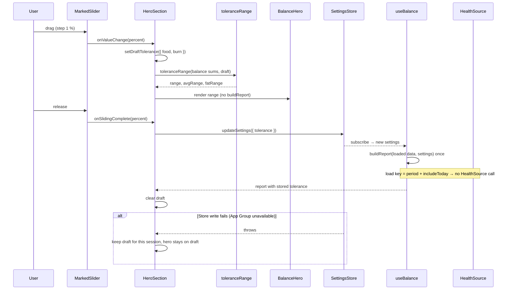
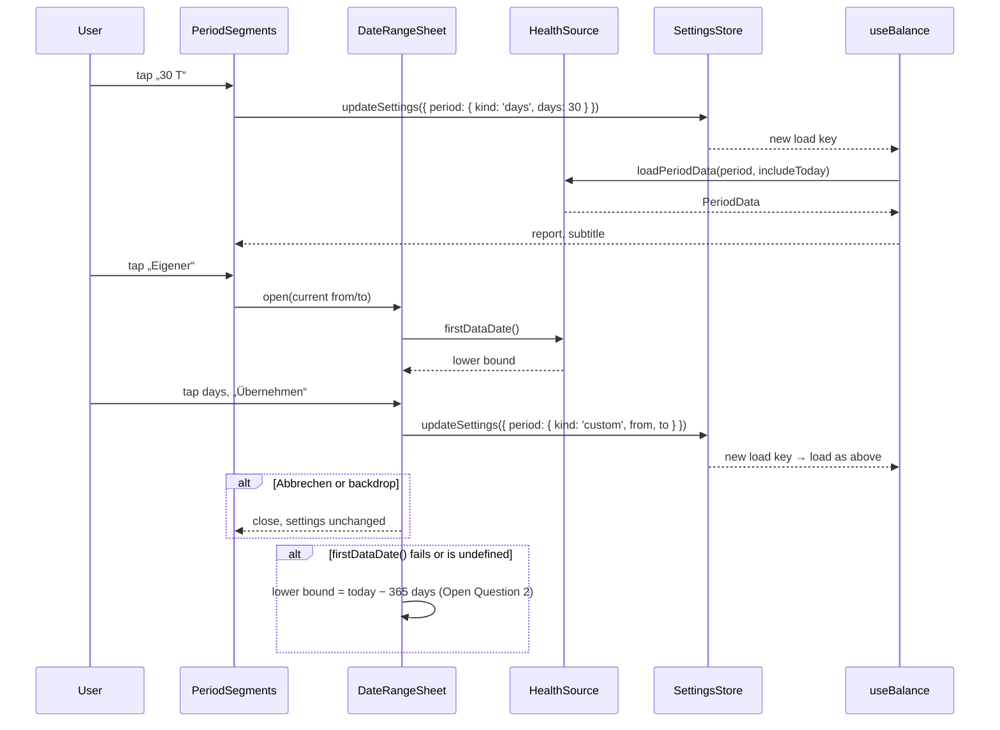

# Homepage oben: Zeitraum, Hero, Toleranz (P6)

Stand 2026-10-24. In Arbeit auf Branch `feature/home-page-base`. Voraussetzung P2 und P5 sind umgesetzt (Branch `feature/home-page-base`).

## Overview

P6 baut den oberen Teil der Homepage nach dem Hi-Fi-Design (`.claude/design/homepage/Gewichtslinie strukturieren/BilanzScreen.dc.html`). Oben stehen der Titel „Bilanz“, die Segment-Auswahl 7 T · 30 T · 60 T · 90 T · Alles · Eigener mit Datumsbereich-Picker und ein Untertitel mit den Daten des Zeitraums. Darunter folgt der Hero: Einzelwert oder Spanne, der Satz „mehr/weniger gegessen als verbraucht“, Ø pro Tag und Fett-Äquivalent. Die aufklappbare Karte „Messfehler einrechnen“ hat zwei Slider mit markiertem Normbereich. Beim Ziehen rechnet der Hero live mit, nur auf den Periodensummen und ohne HealthKit-Abfrage. Zeitraum und Toleranz landen im `SettingsStore` aus P5. Betroffen: `src/core/format.ts`, `src/core/period-balance.ts`, `src/core/settings.ts`, `src/features/balance/`, `src/components/`, `src/dev/gallery/`, i18n, neue Abhängigkeit `@react-native-community/slider` (neuer Development Build), Bild-Assets für den Slider-Daumen, `CLAUDE.md`.

### Ausgangslage: Anforderungen (wörtlich)

> **P6 Homepage oben: Zeitraum, Hero, Toleranz**
> Inhalt: Segment-Auswahl 7 T · 30 T · 60 T · 90 T · Alles · Eigener mit Datumsbereich-Picker und Untertitel; Hero mit Einzelwert oder Spanne, Worten „mehr/weniger gegessen als verbraucht“, Ø pro Tag, Fett-Äquivalent; aufklappbare Toleranz mit zwei Slidern und markiertem Normbereich, Hero rechnet live mit. Voraussetzung: P2, P5.
> [ ] Zustände 1, 2 und 3 sehen in der Galerie aus wie das Design.
> [ ] Vorzeichen steht immer da, auch bei 0 („±0 kcal“).
> [ ] Slider ziehen ruckelt nicht (Berechnung nur auf Periodensummen, kein Neuladen aus HealthKit).
> [ ] VoiceOver liest „plus 7.000 Kilokalorien, mehr gegessen als verbraucht“.

„Zustände 1, 2 und 3“ = Galerie-Einträge **1a** (30 T ohne Toleranz, Einzelwert), **1c** (Toleranz aufgeklappt, Spanne im Hero) und **1m** („Eigener“ mit Datumsbereich-Picker), siehe Key Decision 1.

### Stand im Code (2026-10-24)

| Anforderung | Vorhanden | Fehlt |
|---|---|---|
| Zeitraum im Store | `Settings.period` (`days` 7/30/60/90, `all`, `custom` mit `from`/`to` als `YYYY-MM-DD`), `PERIOD_PRESETS` in `src/core/period.ts`, `resolvePeriod` (endet gestern bzw. heute mit `includeToday`, `custom` wird auf das Ende gekappt), `updateSettings` im `SettingsStore` | Bedienung auf der Homepage |
| Erster Datenpunkt | `HealthSource.firstDataDate()` (erster Tag mit Nahrung), bisher nur für „Alles“ geladen | Grenze im Picker |
| Untertitel | `periodText` in `src/features/balance/data-rows.ts`: „Letzte 30 Tage, ohne heute“ / „…, inkl. heute“ (`home.period`, `home.periodWithToday`), auf Bilanz- und Daten-Seite | Format des Designs mit Daten („24. Sep – 23. Okt · 30 Tage · ohne heute“) |
| Hero | `BalancePage` zentriert: `numberLarge` mit `formatSigned(roundKcal(kcal))`, „Plus = mehr gegessen als verbraucht“, Fett als `number`, Hinweise zu Null-Tagen und Tagen ohne Grundumsatz, Link „Daten anzeigen“. Text-Variante `hero` (68 pt, 600) existiert, ist ungenutzt | Satz je nach Vorzeichen, Spanne, Ø pro Tag, linksbündiges Layout |
| Vorzeichen | `formatSigned`: „+“, „−“ (U+2212), bei 0 **kein** Zeichen („0“, „0,0“; Test in `format.test.ts`) | „±0“ |
| Spanne | `periodBalance(days, tolerance)` liefert `range`, `avgRange`, `fatRange` (ungerundet) | Rechnung nur aus Summen für das Ziehen |
| Toleranz | `Settings.tolerance` (`foodPercent`, `burnPercent`, ganze Prozent), `TOLERANCE_LIMITS` 20/30, Prüfung beim Lesen | Normbereich als Konstante, Slider, Karte |
| Ohne Neuladen | `useBalance`: Ladeschlüssel nur `period` + `includeToday`; `buildReport` rechnet Tagesbilanzen, Chart, Linien und Analyse bei jeder Einstellungsänderung komplett neu | Ziehen ohne `buildReport` und ohne Schreiben in die App Group pro Schritt |
| Segmente | `SegmentedControl` (`radiogroup`/`radio`, Rand 2 pt, Radius 16, Text `secondary`), genutzt für m/w im Intro | Segmente, die die Breite füllen und umbrechen |
| Galerie | `GalleryUi.tolerance` (1c: 5/10, offen), `GalleryUi.picker` (1m: 18 bis 4 Tage zurück, „Bis“ aktiv); `hasPendingUi` zeigt dafür das Badge „UI-Vorgabe folgt mit der Homepage“ | Vorgaben an die Homepage durchreichen |
| Slider, Kalender | keine Slider-, Gesture-, Animations- oder Datumsbibliothek; keine Komponenten-Tests (nur reine Funktionen mit Jest) | alles |

### Design-Referenz (BilanzScreen, oberer Teil)

| Element | Design |
|---|---|
| Titel | „Bilanz“, 34 pt, 700 |
| Segmente | Rahmen 1,5 pt, Radius 11, Innenabstand 2; Segment min. 32 pt hoch, Radius 8, 14 pt/600, gewählt = Vordergrund gefüllt, Text Hintergrund; Segmente wachsen (`flex: 1 1 auto`) und brechen um |
| Untertitel | 15 pt Nebentext. Preset/Eigener: `{erster Tag} – {letzter Tag} · {n} Tage[ · ohne heute]`; Alles: `seit erstem Datenpunkt {TT.MM.JJJJ} · {n} Tage · ohne heute` |
| Hero einzeln | Zahl 68 pt/600 + „kcal“ 26 pt/600; Satz 20 pt/500; Abstand 8; „Ø {avg} kcal pro Tag“ 15 pt Nebentext; „≈ {fat} kg Körperfett“ 17 pt + „(theoretisch, 7.700 kcal/kg)“ 13 pt Nebentext |
| Hero Spanne | „{min}“ 52 pt/600 · „bis“ 22 pt/500 · „{max}“ 52 pt/600 · „kcal“ 22 pt/600; Satz; „Ø {min} bis {max} kcal pro Tag“; „≈ {min} bis {max} kg Fett (theoretisch)“ |
| Satz | einzeln: B ≥ 0 „mehr gegessen als verbraucht“, sonst „weniger …“; Spanne: min ≥ 0 „mehr …“, max < 0 „weniger …“, sonst „je nach Messfehler Plus oder Minus“ |
| Toleranz-Karte | Rahmen 1,5 pt, Radius 14; Kopf min. 48 pt: „Messfehler einrechnen“ 17 pt, Zusammenfassung 15 pt Nebentext („aus“ bzw. „Nahrung ±5 % · Verbrauch −10 %“), Chevron. Offen: Erklärsatz, zwei Slider (Label 17 pt, Wert 17 pt/600 „5 %“ bzw. „aus“), darunter zwei Nebentexte 13 pt |
| Slider | Spur 2 pt Nebentext 35 %, Normbereich-Band 8 pt Nebentext 35 % (Nahrung ab 25 % = 5/20, Verbrauch ab 33 % = 10/30 bis zum Ende), Füllung 4 pt Vordergrund, Daumen 24 pt Hintergrund mit 2 pt Rand Vordergrund |
| Picker-Sheet | Griff, „Eigener Zeitraum“ 22 pt/700, „Abbrechen“; Felder „Von“/„Bis“ (aktives Feld 2 pt Rand); Monat mit Pfeilen (44 pt); Wochentage Mo–So; Tage 38 pt rund, Start/Ende gefüllt, Band dazwischen Nebentext 20 %, heute gestrichelter Ring, außerhalb der Grenzen 30 % Deckkraft; „{n} Tage · bis gestern“ + „Daten ab {TT.MM.JJJJ} · heute zählt nicht“; Pill-Button „Übernehmen“ |
| Rundung im Design | Einzelwert ungerundet, Spanne auf 50 kcal (`r50`) |

## Key Decisions

| # | Decision | Rationale | Alternatives Considered |
|---|----------|-----------|-------------------------|
| 1 | „Zustände 1, 2 und 3“ = Galerie-Einträge 1a, 1c und 1m; verglichen wird der obere Teil (Titel bis Toleranz-Karte bzw. Picker-Sheet) | Genau die drei Zustände, die P6 betrifft: Einzelwert, Spanne, Picker — Julius 2026-10-24 | 1a, 1b, 1c; alle Einträge mit P6-Teil |
| 2 | `formatSigned` schreibt bei 0 „±“: „±0“, „±0,0“. Das gilt überall (Hero, Ø, Fett, Spanne, Daten-Seite, später Tooltip und Widget). Maßgeblich ist der Wert nach Rundung auf die angezeigten Stellen | Abnahme „Vorzeichen steht immer da, auch bei 0“; eine Stelle statt Sonderfälle — Julius 2026-10-24 | Nur im Hero; nur die Bilanzzahl |
| 3 | Satz bei gerundeter Bilanz 0: „so viel gegessen wie verbraucht“ / „ate as much as you burned“ | „±0 kcal, mehr gegessen als verbraucht“ (Design: B ≥ 0) wäre falsch — Julius 2026-10-24 | Wie Design |
| 4 | Rundung: Einzelwert auf 10 kcal (wie bisher, `roundKcal`), Spanne auf 50 kcal (neu `roundRangeKcal`), Ø pro Tag auf ganze kcal, Fett auf 0,1 kg. Ø und Fett kommen aus den ungerundeten Werten | Spanne ist ohnehin grob, 50 wie im Design; Golden: +7.000 / +2.650 bis +19.350, Ø +233, Fett +0,9 bzw. +0,3 bis +2,5 — Julius 2026-10-24 | Überall 10; überall 50 |
| 5 | Spanne über 0 → dritter Satz „je nach Messfehler Plus oder Minus“ / „plus or minus, depending on measurement error“. Entscheidend sind die gerundeten Grenzen: min ≥ 0 → mehr, max < 0 → weniger, sonst der dritte Satz | Wie im Design — Julius 2026-10-24 | Satz nach der Mitte der Spanne |
| 6 | Slider: `@react-native-community/slider` (nativer `UISlider`), Schritt 1, `minimumValue` 0, `maximumValue` aus `TOLERANCE_LIMITS`. Neuer Development Build nötig | Nativer Slider, VoiceOver „anpassbar“ vom System — Julius 2026-10-24 | Eigener Slider mit `PanResponder` (empfohlen, ohne Abhängigkeit); Gesture Handler + Reanimated |
| 7 | Daumen als `thumbImage`, je Farbschema ein Bild (hell: Fläche #FFFFFF, Rand #0B0B0B; dunkel: Fläche #000000, Rand #F4F4F4; 24 pt, Rand 2 pt, ohne Schatten) in @1x/@2x/@3x. Die Bilder erzeugt ein Skript aus den Tokens, damit V2 sie neu erzeugen kann | Sieht aus wie das Design; Farben stecken dann in Bildern — Julius 2026-10-24 | iOS-Standarddaumen; doch eigener Slider |
| 8 | Normbereich als Konstante `TOLERANCE_NORM = { foodPercent: { min: 5, max: 20 }, burnPercent: { min: 10, max: 30 } }` in `src/core/settings.ts`. Das Band liegt als View hinter dem Slider, Position aus `min / max` des Sliders | Wie `TOLERANCE_LIMITS` eine Stelle; die Erklärseite „Wie wird gerechnet?“ kann es mitnutzen | Zahlen nur in den Texten |
| 9 | Live-Rechnung: Beim Ziehen hält eine gemeinsame Eltern-Komponente von Hero und Karte einen Entwurf `draftTolerance` im lokalen State. Der Hero rechnet daraus mit der neuen reinen Funktion `toleranceRange(sums, tolerance)` nur aus `foodKcal`, `restingKcal + activeKcal` und `countedDays`. Erst `onSlidingComplete` schreibt per `updateSettings({ tolerance })` in den Store; dann baut `buildReport` den Report einmal neu | Abnahme „ruckelt nicht“: pro Schritt weder `buildReport` (Chart, Linien, Analyse) noch ein Schreiben in die App-Group-UserDefaults. Der Ladeschlüssel enthält die Toleranz schon nicht (P5, Key Decision 9) | Jeden Schritt in den Store schreiben; Report pro Schritt neu bauen |
| 10 | `periodBalance` berechnet seine Spanne über dieselbe Funktion `toleranceRange`, damit Ziehen und gespeicherter Wert nie auseinanderlaufen | Eine Formel `Bmin = A(1 − tA) − V`, `Bmax = A(1 + tA) − V(1 − tV)` | Formel doppelt |
| 11 | Ø pro Tag teilt durch die gezählten Tage (`countedDays`, wie der Kern heute), nicht durch die Kalendertage wie das Design (`nD`) | Tage ohne Grundumsatz zählen nicht zur Bilanz; ihr Ø wäre sonst zu klein. Golden und Design-Daten: beide 30 | Kalendertage wie Design |
| 12 | Aufgeklappt/zugeklappt ist lokaler UI-State, nicht im Store; Standard zu. Die Galerie kann ihn vorgeben (1c) | CLAUDE.md erlaubt in `settings.v1` nur Zeitraum, Null-Tage, heute, Toleranz | In `settings.v1` speichern |
| 13 | Datumsbereich-Picker als eigener Kalender wie im Design (1m): transparentes `Modal` mit Abdunklung und Sheet von unten, Raster aus Views, ohne neue Abhängigkeit. Logik als reine Funktionen in `date-range.ts` mit Tests | iOS hat keinen nativen Bereichs-Kalender — Julius 2026-10-24 | Zwei native Datumsfelder (`@react-native-community/datetimepicker`) |
| 14 | Picker-Bedienung wie im Design: Öffnen über „Eigener“ (auch wenn schon gewählt), vorbelegt mit dem gerade gezeigten Zeitraum, „Von“ aktiv. Tipp bei „Von“ aktiv: Start = Tag, Ende = max(Tag, Ende), dann „Bis“ aktiv. Tipp bei „Bis“ aktiv: Tag vor Start → neuer Start (bleibt „Bis“), sonst Ende = Tag. Tipp auf ein Feld macht es aktiv und springt zu seinem Monat. Grenzen: erster Datenpunkt (`firstDataDate`) bis gestern, mit „Heute einrechnen“ bis heute. „Übernehmen“ schreibt `{ kind: 'custom', from, to }`; „Abbrechen“ und Tipp auf die Abdunklung ändern nichts | Design 1m; `resolvePeriod` kappt ohnehin auf das Ende | Bis-Feld zuerst; Picker nur beim ersten Wählen |
| 15 | Titel, Segmente und Untertitel liegen in der Bilanz-Seite und scrollen mit. Die Daten-Seite zeigt weiter nur den Untertitel des gewählten Zeitraums | Wie im Design, später mit Chart und Abgleich in einem Scroll — Julius 2026-10-24 | Fest über dem Pager für beide Seiten |
| 16 | Layout: oben das Design (Titel, Segmente, Untertitel, Hero, Toleranz-Karte) linksbündig wie 1a. Darunter vorläufig die zwei Hinweiszeilen (Null-Tage, Tage ohne Grundumsatz) und „Daten anzeigen“, bis die Datenqualitäts-Zeile (späteres P) sie ersetzt. Die Seitenpunkte sitzen klein rechts neben dem Titel; die Kopfzeile über dem Pager entfällt, die Daten-Seite zeigt ihre Punkte neben ihrer Überschrift | Nichts Funktionierendes geht verloren — Julius 2026-10-24 | Nur Design; Seitenpunkte weg |
| 17 | Leerer Zustand: Segmente bleiben voll sichtbar und tippbar (Abweichung von 1f). Darunter der leere Zustand mit „Health-Berechtigungen öffnen“; Hero und Toleranz-Karte entfallen | „Leer“ heißt nur: kein Nahrungseintrag im Zeitraum. Ausgegraute Segmente würden auf 7 T festhalten — Julius 2026-10-24 | Wie Design; ausgegraut nur ohne jeden Datenpunkt |
| 18 | Untertitel mit eigenen Monatskürzeln aus i18n (DE: Jan, Feb, Mär, Apr, Mai, Jun, Jul, Aug, Sep, Okt, Nov, Dez; EN: Jan … Dec), nicht `Intl` mit `month: 'short'` | `Intl` liefert auf Deutsch „Sept.“ und „Okt.“ mit Punkt, das Design „Sep“, „Okt“. Ganze Daten („26.06.2026“) über `Intl` mit zweistelligen Ziffern | `Intl` und Abweichung hinnehmen |
| 19 | VoiceOver: Zahl, Einheit und Satz im Hero sind ein Element mit eigenem Label, Vorzeichen als Wort: „plus 7.000 Kilokalorien, mehr gegessen als verbraucht“; Spanne „plus 2.650 bis plus 19.350 Kilokalorien, mehr gegessen als verbraucht“; null „plus minus 0 Kilokalorien, so viel gegessen wie verbraucht“. EN „plus 7,000 kilocalories, ate more than you burned“. Ø und Fett sind eigene Elemente („Durchschnitt plus 233 Kilokalorien pro Tag“, „etwa plus 0,9 Kilogramm Körperfett, theoretisch“) | Abnahme wörtlich; VoiceOver liest „−“ (U+2212) und „kcal“ nicht verlässlich | Text vorlesen lassen |

## Implementation Details

### Milestone Map

| Milestone | Delivers | 🟢 Add | 🟠 Change | 🔴 Delete | Depends On |
|-----------|----------|--------|-----------|-----------|------------|
| M1 — Vorzeichen, Rundung, Spanne im Kern | „±0“, Rundung auf 50, `toleranceRange`, Normbereich | 0 | 6 | 0 | — |
| M2 — Hero | Hero-Modell mit Satz und VoiceOver-Labels, Komponente, Texte | 3 | 4 | 0 | M1 |
| M3 — Zeitraum und Seitenaufbau | Segmente, Untertitel, Layout der Bilanz-Seite, Seitenpunkte | 3 | 7 | 0 | M2 |
| M4 — Datumsbereich-Picker | Kalender-Logik mit Tests, Sheet, „Eigener“ | 3 | 3 | 0 | M3 |
| M5 — Toleranz-Karte mit Slidern | Slider-Abhängigkeit, Daumen-Bilder, Slider mit Normbereich, Karte, Live-Rechnung | 5 | 5 | 0 | M2, M3 |
| M6 — Galerie, Abnahme, Doku | 1c/1m-Vorgaben in der Galerie, Screenshots, Gerätetest, CLAUDE.md | 0 | 5 | 0 | M4, M5 |

```
🟢 Add   🟠 Change   🔴 Delete
```

Abnahmekriterien → Milestones:

| Kriterium | Milestone |
|---|---|
| Zustände 1a, 1c, 1m sehen in der Galerie aus wie das Design | M3 (1a), M4 (1m), M5 (1c), M6 (Screenshots) |
| Vorzeichen immer, auch „±0 kcal“ | M1 (Test), M2 (Hero-Test) |
| Slider ziehen ruckelt nicht (nur Periodensummen, kein Neuladen) | M1 (`toleranceRange`), M5 (Entwurf im State, Schreiben erst beim Loslassen), M6 (iPhone) |
| VoiceOver „plus 7.000 Kilokalorien, mehr gegessen als verbraucht“ | M2 (Test des Labels), M6 (VoiceOver am Gerät) |

#### 🔀 Inbound Flow — UI: Toleranz-Slider ziehen



#### 🔀 Inbound Flow — UI: Zeitraum wählen



---

### ✅ Milestone 1 — Vorzeichen, Rundung, Spanne im Kern

> Der Kern kennt „±0“, die Rundung der Spanne, die Spanne aus reinen Summen und den Normbereich, alles getestet und mit dem goldenen Testfall belegt.

**Depends on:** none

#### File Changes

| Color | File | Action |
|-------|------|--------|
| 🟠 | `src/core/format.ts` | `formatSigned`: bei 0 nach Rundung „±“ statt kein Zeichen; neu `roundRangeKcal` (50 kcal) |
| 🟠 | `src/core/__tests__/format.test.ts` | Erwartungen „0“/„0,0“ → „±0“/„±0,0“; Rundungsfälle |
| 🟠 | `src/core/period-balance.ts` | `toleranceRange(sums, tolerance)` exportieren; `periodBalance` nutzt es |
| 🟠 | `src/core/__tests__/period-balance.test.ts` | `toleranceRange` gegen `periodBalance` |
| 🟠 | `src/core/__tests__/golden.test.ts` | Ø-Spanne und Fett-Spanne des goldenen Falls |
| 🟠 | `src/core/settings.ts` | `TOLERANCE_NORM` |

#### To-Dos

- ✅ Change `formatSigned`: when the value rounds to 0 at the given fraction digits, return `±` + magnitude („±0“, „±0,0“); update its comment („Explicit sign: "+", U+2212, "±" for zero“)
- ✅ Update `format.test.ts`: `formatKcal(0)` → „±0“, `formatSignedKg(-0.04)` → „±0,0“, `formatSigned(-0.04, …, 1)` → „±0,0“; add `formatSigned(4)` after `roundKcal` → „±0“ and EN „±0“
- ✅ Add `roundRangeKcal(value)` = `Math.round(value / 50) * 50` with a comment („range ends rounded to 50 kcal, the tolerance is coarse anyway“) and tests (2.650 stays, 2.674 → 2.650, 2.675 → 2.700, negative values)
- ✅ Add `toleranceRange({ foodKcal, burnKcal, countedDays }, tolerance)` → `{ range, avgRange, fatRange }` in `period-balance.ts`; tolerance 0/0 gives `min = max = food − burn`; `periodBalance` builds its fields from it (Key Decision 10)
- ✅ Test: for random-free fixtures `toleranceRange` with the sums of a `PeriodBalance` equals its `range`/`avgRange`/`fatRange`; burn is only lowered (max uses `1 − tV`, min uses the full burn)
- ✅ Extend `golden.test.ts`: range +2.650 to +19.350 kcal, `roundRangeKcal` keeps both; `avgRange` ≈ +88,3 to +645; `fatRange` → `formatSignedKg` „+0,3“ and „+2,5“; single value `formatSigned(roundKcal(7000))` „+7.000“, Ø „+233“, fat „+0,9“
- ✅ Add `TOLERANCE_NORM` to `src/core/settings.ts` next to `TOLERANCE_LIMITS` (Key Decision 8); use it in `calculation-sections.ts` if that page names the usual ranges, otherwise leave the page alone _(die Seite nennt nur die Obergrenzen, bleibt unverändert)_
- ✅ Check every caller of `formatSigned`/`formatKcal`/`formatSignedKg` (`balance-page.tsx`, `data-rows.ts`, intro `big-picture.tsx`, `balance-bars-illustration.tsx`) and their tests for a zero expectation; update tests that expect „0“ _(nur `format.test.ts` erwartete „0“; Aufrufer nutzen keine Nullwerte)_
- ✅ Run `npm run lint`, `npm run typecheck`, `npm test`; all exit 0 (core coverage stays ≥ 90 %)
- ✅ Commit (`feat: show ±0 and compute the tolerance range from period sums`)

#### Notes / Constraints

> - Der Kern rechnet weiter ungerundet; `roundKcal`/`roundRangeKcal` sind Anzeige-Helfer in `format.ts`.
> - Chart-Achsen (späteres P) beschriften die Nulllinie mit „0“ ohne Vorzeichen; sie nutzen dafür nicht `formatSigned`.

---

### Milestone 2 — Hero

> Der Hero zeigt Einzelwert oder Spanne mit Satz, Ø pro Tag und Fett-Äquivalent, wie 1a und 1c, und hat die VoiceOver-Labels aus der Abnahme.

**Depends on:** Milestone 1

#### File Changes

| Color | File | Action |
|-------|------|--------|
| 🟢 | `src/features/balance/hero.ts` | Reines Modell `heroModel(balance, tolerance, locale, t)`: Art, Texte, Satz, VoiceOver-Labels; `balanceWords`; `spokenSigned` |
| 🟢 | `src/features/balance/__tests__/hero.test.ts` | Golden, null, Minus, Spanne über 0, EN, Labels |
| 🟢 | `src/features/balance/components/balance-hero.tsx` | Komponente nach Design (einzeln/Spanne) |
| 🟠 | `src/features/balance/components/balance-page.tsx` | Zahl, „Plus = …“ und Fett-Block durch `BalanceHero` ersetzen |
| 🟠 | `src/theme/typography.ts` | Varianten `heroRange` (52/600), `heroUnit` (26/600), `heroWords` (20/500) |
| 🟠 | `src/i18n/locales/de.ts` | `home.hero.*`, `home.words.*`, `a11y.*` |
| 🟠 | `src/i18n/locales/en.ts` | dasselbe auf Englisch |

#### To-Dos

- 🔲 Create `heroModel(balance, tolerance, locale, t)`: `kind: 'single'` when both percents are 0, else `'range'`; single uses `roundKcal(balance.kcal)`, range uses `roundRangeKcal` on `range.min/max`; Ø from `avgKcal`/`avgRange` rounded to whole kcal; fat from `fatKg`/`fatRange` with one digit; all through `formatSigned`
- 🔲 Create `balanceWords`: single → rounded > 0 `more`, < 0 `less`, = 0 `even`; range → rounded min ≥ 0 `more`, rounded max < 0 `less`, else `either` (Key Decisions 3 and 5)
- 🔲 Create `spokenSigned(value, locale, digits, t)`: „plus 7.000“, „minus 1.250“, „plus minus 0“ (EN „plus 7,000“, „minus 1,250“, „plus minus 0“), magnitude via `formatNumber`
- 🔲 Build the labels: hero „{spoken} Kilokalorien, {words}“ / range „{min} bis {max} Kilokalorien, {words}“; Ø „Durchschnitt {spoken} Kilokalorien pro Tag“ (range „… {min} bis {max} …“); fat „etwa {spoken} Kilogramm Körperfett, theoretisch“ (Key Decision 19)
- 🔲 Add texts DE: `home.hero.kcal` „kcal“, `home.hero.to` „bis“, `home.hero.avg` „Ø {{value}} kcal pro Tag“, `home.hero.avgRange` „Ø {{min}} bis {{max}} kcal pro Tag“, `home.hero.fat` „≈ {{value}} kg Körperfett“, `home.hero.fatNote` „(theoretisch, {{kcalPerKg}} kcal/kg)“, `home.hero.fatRange` „≈ {{min}} bis {{max}} kg Fett“, `home.hero.fatRangeNote` „(theoretisch)“; `home.words.more` „mehr gegessen als verbraucht“, `.less` „weniger gegessen als verbraucht“, `.even` „so viel gegessen wie verbraucht“, `.either` „je nach Messfehler Plus oder Minus“; `a11y.plus` „plus {{value}}“, `a11y.minus` „minus {{value}}“, `a11y.zero` „plus minus {{value}}“, `a11y.heroKcal` „{{value}} Kilokalorien, {{words}}“, `a11y.heroRange` „{{min}} bis {{max}} Kilokalorien, {{words}}“, `a11y.avg` „Durchschnitt {{value}} Kilokalorien pro Tag“, `a11y.avgRange`, `a11y.fat` „etwa {{value}} Kilogramm Körperfett, theoretisch“, `a11y.fatRange`
- 🔲 Add the same keys EN: „kcal“, „to“, „Ø {{value}} kcal per day“, „≈ {{value}} kg body fat“, „(theoretical, {{kcalPerKg}} kcal/kg)“, „≈ {{min}} to {{max}} kg fat“, „(theoretical)“; „ate more than you burned“, „ate less than you burned“, „ate as much as you burned“, „plus or minus, depending on measurement error“; „{{value}} kilocalories, {{words}}“, „average {{value}} kilocalories per day“, „about {{value}} kilograms of body fat, theoretical“
- 🔲 Test `heroModel` with the golden fixture: DE text „+7.000“, words „mehr gegessen als verbraucht“, Ø „Ø +233 kcal pro Tag“, fat „≈ +0,9 kg Körperfett“, label exactly „plus 7.000 Kilokalorien, mehr gegessen als verbraucht“; EN label „plus 7,000 kilocalories, ate more than you burned“
- 🔲 Test golden with 5/10: „+2.650“ / „+19.350“, Ø „Ø +88 bis +645 kcal pro Tag“, „≈ +0,3 bis +2,5 kg Fett“, label „plus 2.650 bis plus 19.350 Kilokalorien, mehr gegessen als verbraucht“
- 🔲 Test zero (balance +4 kcal): „±0“, „so viel gegessen wie verbraucht“, label „plus minus 0 Kilokalorien, so viel gegessen wie verbraucht“; minus case „−1.250“, „weniger gegessen als verbraucht“, label „minus 1.250 …“; range across 0 → `either`
- 🔲 Create `BalanceHero` after the design: number row `hero` variant (68/600) + „kcal“ 26/600 baseline-aligned with wrap; range row 52/600 · „bis“ 22/500 · 52/600 · „kcal“ 22/600 (new text variants `heroRange`, `heroUnit`, `heroWords` in `typography.ts` if no existing one fits); words 20/500; 8 pt gap; Ø `secondary` muted; fat `body` + note `footnote` muted; colors only from tokens
- 🔲 Accessibility: number row + words in one `accessible` View with the hero label; Ø and fat each one element with their labels; all text keeps Dynamic Type (number row wraps, 1i)
- 🔲 Use `BalanceHero` in `BalancePage` with `settings.tolerance` (live draft follows in M5); remove `home.sign`, `home.kcal`, `home.fat`, `home.fatLabel` if nothing else uses them
- 🔲 Run `npm run lint`, `npm run typecheck`, `npm test`; all exit 0
- 🔲 Commit (`feat: show the balance hero with words, average and fat`)

#### Notes / Constraints

> - Der Satz richtet sich nach den gerundeten Zahlen, die auf dem Screen stehen, damit „±0“ nie mit „mehr gegessen“ erscheint.
> - Ø pro Tag teilt durch `countedDays` (Key Decision 11).

#### 📐 Wireframe — BalanceHero (einzeln / Spanne)

```
┌─────────────────────────────────────┐
│  +7.000 kcal                        │  hero 68/600 + unit 26/600
│  mehr gegessen als verbraucht       │  heroWords 20/500
│                                     │
│  Ø +233 kcal pro Tag                │  secondary, muted
│  ≈ +0,9 kg Körperfett (theoretisch, │  body + footnote muted
│    7.700 kcal/kg)                   │
└─────────────────────────────────────┘
┌─────────────────────────────────────┐
│  +2.650 bis +19.350 kcal            │  heroRange 52/600, „bis“ 22/500
│  mehr gegessen als verbraucht       │
│                                     │
│  Ø +88 bis +645 kcal pro Tag        │
│  ≈ +0,3 bis +2,5 kg Fett            │
│    (theoretisch)                    │
└─────────────────────────────────────┘
```

**Component tree:**
BalanceHero
├── View (accessible, label „plus 7.000 Kilokalorien, mehr gegessen als verbraucht“)
│   ├── AppText — number(s) + unit
│   └── AppText — words
├── AppText — Ø pro Tag (accessibilityLabel)
└── AppText — Fett + Hinweis (accessibilityLabel)

#### ⌨️ Keyboard Shortcuts

Keine App-Kürzel: reine Touch-App fürs iPhone (siehe P0/P1-Spec). VoiceOver: Hero als ein Element, Ø und Fett je ein Element.

---

### Milestone 3 — Zeitraum und Seitenaufbau

> Die Bilanz-Seite bekommt den Aufbau von 1a: Titel mit Seitenpunkten, Segmente, Untertitel, Hero; die Segmente schreiben den Zeitraum in den Store.

**Depends on:** Milestone 2

#### File Changes

| Color | File | Action |
|-------|------|--------|
| 🟢 | `src/features/balance/period-subtitle.ts` | `periodSubtitle(...)` im Format des Designs |
| 🟢 | `src/features/balance/__tests__/period-subtitle.test.ts` | Presets, Alles, Eigener, mit heute, Jahreswechsel, EN |
| 🟢 | `src/features/balance/components/period-segments.tsx` | Segmente 7 T · 30 T · 60 T · 90 T · Alles · Eigener, schreiben `updateSettings({ period })` |
| 🟠 | `src/components/segmented-control.tsx` | Option `stretch`: Segmente wachsen und brechen um, Maße wie Design |
| 🟠 | `src/features/balance/components/balance-page.tsx` | Linksbündiger Aufbau nach Key Decision 16; Leerzustand mit Segmenten |
| 🟠 | `src/features/balance/components/home-screen.tsx` | Kopfzeile über dem Pager entfällt; Untertitel aus `periodSubtitle` |
| 🟠 | `src/features/balance/components/data-page.tsx` | Seitenpunkte neben der Überschrift; neuer Untertitel |
| 🟠 | `src/features/balance/data-rows.ts` | `periodText` entfernen |
| 🟠 | `src/features/balance/__tests__/data-rows.test.ts` | Tests von `periodText` nach `period-subtitle.test.ts` |
| 🟠 | `src/i18n/locales/de.ts`, `en.ts` | `home.title`, `home.segments.*`, `home.subtitle.*`, `date.monthsShort` |

#### To-Dos

- 🔲 Create `periodSubtitle({ period, firstDay, lastDay, days, includeToday, today }, locale, t)`: presets and custom „{first} – {last} · {n} Tage“ plus „ · ohne heute“ when the last day is yesterday and `includeToday` is off, „ · inkl. heute“ when it is on; „Alles“ „seit erstem Datenpunkt {TT.MM.JJJJ} · {n} Tage“ with the same suffix; dates „24. Sep“ from `date.monthsShort` (Key Decision 18), with year on both ends when the period crosses a year
- 🔲 Add texts DE: `home.title` „Bilanz“; `home.segments.days` „{{count}} T“, `.all` „Alles“, `.custom` „Eigener“, `.label` „Zeitraum“; spoken segment labels „{{count}} Tage“, „Alles seit erstem Datenpunkt“, „Eigener Zeitraum“; `home.subtitle.range` „{{from}} – {{to}} · {{count}} Tage“ (`_one` „… · 1 Tag“), `.all` „seit erstem Datenpunkt {{date}} · {{count}} Tage“, `.withoutToday` „ohne heute“, `.withToday` „inkl. heute“; `date.monthsShort` Jan…Dez. EN: „Balance“, „{{count}} d“, „All“, „Custom“, „Period“, „{{from}} – {{to}} · {{count}} days“, „since first data point {{date}} · {{count}} days“, „excluding today“, „including today“, months „Jan … Dec“ with EN order „Sep 24“
- 🔲 Test `periodSubtitle`: 30 days ending yesterday → „24. Sep – 23. Okt · 30 Tage · ohne heute“; with today on → ends „23. Okt“… „· inkl. heute“ with today’s date as last day; „Alles“ with first day 26.06.2026 and 120 days → „seit erstem Datenpunkt 26.06.2026 · 120 Tage · ohne heute“; custom ending 4 days ago → no suffix; 1 day; Dec–Jan with years; EN „Sep 24 – Oct 23 · 30 days · excluding today“
- 🔲 Add `stretch` to `SegmentedControl`: border 1,5 pt (`border.thick` stays for m/w unless 1a shows a difference), inner padding 2, group radius 11, segment radius 8, min height 32 + padding to keep a 44 pt touch area per row, label 14/600, `flexGrow: 1`, `flexWrap: 'wrap'` so large Dynamic Type wraps to two rows (1i)
- 🔲 Create `PeriodSegments`: options from `PERIOD_PRESETS`; value from `settings.period`; tap on a preset → `updateSettings({ period: { kind: 'days', days } })` or `{ kind: 'all' }`; tap on „Eigener“ opens the picker (M4; until then it does nothing visible); `accessibilityLabel` per option with the spoken text
- 🔲 Rebuild the top of `BalancePage` left-aligned (Key Decision 16): row with `largeTitle` „Bilanz“ and `PageIndicator` on the right, `PeriodSegments`, subtitle `secondary` muted, then hero; 12 pt between title/segments/subtitle, 28 pt to the hero like the design; horizontal padding 20; below the hero the two hint lines and „Daten anzeigen“ stay
- 🔲 Empty state (Key Decision 17): title, segments and subtitle stay; below the existing empty text with „Health-Berechtigungen öffnen“ left-aligned; no hero, no tolerance card
- 🔲 Loading: title and segments stay; subtitle from `resolvePeriod` when the period is not „Alles“; hero area shows `home.loading` like today
- 🔲 `HomeScreen`: drop the header row above the pager; pass `page` index to both pages for their `PageIndicator`; subtitle via `periodSubtitle` from the report’s first/last `DayBalance.date` or `resolvePeriod` while loading
- 🔲 `DataPage`: `PageIndicator` next to its `Headline`, subtitle from `periodSubtitle`
- 🔲 Remove `periodText` and `home.period*` keys once unused; move their tests
- 🔲 Check in the simulator: gallery 1a top part matches the design (title, segments, subtitle „… · 30 Tage · ohne heute“, hero +7.000 kcal); 1d shows 90 T selected; 1f shows tappable segments above the empty state; tapping 7 T in 1a reloads and shows 7 days
- 🔲 Run `npm run lint`, `npm run typecheck`, `npm test`; all exit 0
- 🔲 Commit (`feat: choose the period on the balance page`)

#### Notes / Constraints

> - Ein Wechsel des Zeitraums lädt neu (Ladeschlüssel); bis dahin zeigt die Seite den Ladezustand wie heute.
> - Die Galerie schreibt in ihren eigenen In-Memory-Store; Segment-Tipps dort ändern nie die echten Einstellungen.

#### 📐 Wireframe — BalancePage (oberer Teil, 1a)

```
┌─────────────────────────────────────┐
│  Bilanz                        ● ○  │  largeTitle + PageIndicator
│ ┌─────────────────────────────────┐ │
│ │[7 T][30 T][60 T][90 T][Alles][Eigener]│  PeriodSegments (30 T gefüllt)
│ └─────────────────────────────────┘ │
│  24. Sep – 23. Okt · 30 Tage ·      │  subtitle, muted
│  ohne heute                         │
│                                     │
│  +7.000 kcal                        │  BalanceHero (M2)
│  mehr gegessen als verbraucht       │
│  Ø +233 kcal pro Tag                │
│  ≈ +0,9 kg Körperfett (theoretisch) │
│ ┌─────────────────────────────────┐ │
│ │ Messfehler einrechnen    aus  ⌄ │ │  ToleranceCard (M5)
│ └─────────────────────────────────┘ │
│  1 Tag ohne Nahrung als Erhaltung   │  hint lines (until data quality row)
│  [ Daten anzeigen › ]               │  LinkButton
└─────────────────────────────────────┘
```

**Component tree:**
HomeScreen
└── Pager (ScrollView horizontal)
    ├── BalancePage
    │   ├── TitleRow (AppText „Bilanz“, PageIndicator)
    │   ├── PeriodSegments
    │   │   └── SegmentedControl (stretch)
    │   ├── AppText — subtitle
    │   ├── HeroSection (M5; in M3 only BalanceHero)
    │   │   ├── BalanceHero
    │   │   └── ToleranceCard
    │   ├── AppText[] — hint lines
    │   └── LinkButton „Daten anzeigen“
    └── DataPage
        └── Headline + PageIndicator

#### 📐 Wireframe — BalancePage (leer)

```
┌─────────────────────────────────────┐
│  Bilanz                        ● ○  │
│ [7 T][30 T][60 T][90 T][Alles][Eigener]│  stays tappable
│  24. Sep – 23. Okt · 30 Tage …      │
│                                     │
│  Noch keine Nahrungseinträge …      │  existing empty text
│  [ Health-Berechtigungen öffnen ]   │  Button
│  Einstellungen › Health › …         │  caption
└─────────────────────────────────────┘
```

**Component tree:**
BalancePage (empty)
├── TitleRow
├── PeriodSegments
├── AppText — subtitle
└── EmptyState (AppText, Button, AppText)

#### ⌨️ Keyboard Shortcuts

Keine App-Kürzel (Touch-App). VoiceOver: Segmente als `radiogroup`/`radio` mit Zustand „ausgewählt“ und gesprochenem Text („30 Tage“).

---

### Milestone 4 — Datumsbereich-Picker

> „Eigener“ öffnet das Sheet aus 1m; die Auswahl-Logik ist eine getestete reine Funktion.

**Depends on:** Milestone 3

#### File Changes

| Color | File | Action |
|-------|------|--------|
| 🟢 | `src/features/balance/date-range.ts` | `pickerBounds`, `calendarMonth`, `pickDay`, `selectionSummary` |
| 🟢 | `src/features/balance/__tests__/date-range.test.ts` | Regeln aus Key Decision 14, Grenzen, Monatsraster |
| 🟢 | `src/features/balance/components/date-range-sheet.tsx` | Sheet nach Design 1m |
| 🟠 | `src/features/balance/components/period-segments.tsx` | „Eigener“ öffnet das Sheet; Übernehmen schreibt den Zeitraum |
| 🟠 | `src/i18n/locales/de.ts` | `picker.*`, `date.months`, `date.weekdaysShort` |
| 🟠 | `src/i18n/locales/en.ts` | dasselbe auf Englisch |

#### To-Dos

- 🔲 Create `pickerBounds(firstDataDate, today, includeToday)` → `{ min, max }` date keys: min = first data day (fallback Open Question 2), max = yesterday or today
- 🔲 Create `pickDay(selection, dayKey)` with `selection = { from, to, editing: 'from' | 'to' }` after Key Decision 14; days outside the bounds are ignored
- 🔲 Create `calendarMonth(year, month, bounds, selection, today)` → leading blanks (week starts Monday) and one cell per day: `selectable`, `isStart`, `isEnd`, `inRange` (band), `isToday`; `canGoBack`/`canGoForward` from the bounds
- 🔲 Create `selectionSummary(selection, bounds, includeToday, locale, t)`: „{n} Tage · bis gestern“ (`_one` „1 Tag …“; suffix only when `to` is yesterday; with today on „· bis heute“), caption „Daten ab {TT.MM.JJJJ} · heute zählt nicht“ (today on: „· heute zählt mit“)
- 🔲 Test: tap with „Von“ active sets start, pushes the end if needed, switches to „Bis“; tap before start with „Bis“ active moves the start; tap after start sets the end; days outside the bounds do nothing; October 2026 grid starts with 3 blanks (1.10.2026 is a Thursday); band cells between start and end; 15 days from 18 to 4 days ago → „15 Tage“ without „bis gestern“
- 🔲 Create `DateRangeSheet` after 1m: transparent `Modal` (`animationType="slide"`), backdrop `Pressable` foreground at 32 % via `withAlpha` (closes), sheet with background, radius 14 on top, grabber 36×5 muted 50 %, title `sectionTitle` „Eigener Zeitraum“, „Abbrechen“; fields „Von“/„Bis“ (caption uppercase muted + `bodyStrong` date, active field 2 pt foreground border, else 1,5 pt muted 50 %); month row with 44 pt arrows (opacity 0,25 at the bound) and „Oktober 2026“; weekday row „Mo … So“; 7-column grid, cells 42 high with 38 pt circle; start/end filled foreground with background text, band `separator`-like muted 20 %, today dashed 1,5 pt ring, outside bounds 30 %; summary row; pill `Button` „Übernehmen“
- 🔲 Load `firstDataDate()` from `useHealthSource()` when the sheet opens; until it resolves the lower bound is open and the back arrow is disabled
- 🔲 Wire `PeriodSegments`: „Eigener“ opens the sheet with the current period’s first/last day and „Von“ active; „Übernehmen“ → `updateSettings({ period: { kind: 'custom', from, to } })` and close; „Abbrechen“/backdrop close without change
- 🔲 Accessibility: sheet `accessibilityViewIsModal`; day cells `button` with label „Donnerstag, 1. Oktober 2026“ and state `selected` for start/end, `disabled` outside the bounds; fields „Von, 6. Oktober 2026, ausgewählt“; arrows „Vorheriger Monat“/„Nächster Monat“
- 🔲 Add texts DE: `picker.title` „Eigener Zeitraum“, `picker.cancel` „Abbrechen“, `picker.from` „Von“, `picker.to` „Bis“, `picker.apply` „Übernehmen“, `picker.days` „{{count}} Tage“, `picker.untilYesterday` „bis gestern“, `picker.untilToday` „bis heute“, `picker.dataFrom` „Daten ab {{date}}“, `picker.todayExcluded` „heute zählt nicht“, `picker.todayIncluded` „heute zählt mit“, `picker.prevMonth`, `picker.nextMonth`; `date.months` Januar…Dezember; `date.weekdaysShort` Mo…So. EN: „Custom period“, „Cancel“, „From“, „To“, „Apply“, „{{count}} days“, „through yesterday“, „through today“, „Data from {{date}}“, „today doesn’t count“, „today counts“, „Previous month“, „Next month“, January…December, Mo…Su
- 🔲 Check in the simulator: choose 6.–20. Okt, apply → segment „Eigener“ selected, subtitle „6. Okt – 20. Okt · 15 Tage“, balance reloaded; cancel keeps the old period; large Dynamic Type keeps the grid usable
- 🔲 Run `npm run lint`, `npm run typecheck`, `npm test`; all exit 0
- 🔲 Commit (`feat: pick a custom period in a calendar sheet`)

#### Notes / Constraints

> - Der Picker rechnet in lokalen Kalendertagen (`toDateKey`/`fromDateKey`, `addDays`), nie in 24-h-Schritten (Sommerzeit).
> - Die Woche beginnt in beiden Sprachen am Montag, wie die ISO-Kalenderwochen im Chart (Open Question 3).

#### 📐 Wireframe — DateRangeSheet (1m)

```
┌─────────────────────────────────────┐
│░░░░░░░░░ backdrop (tap closes) ░░░░░│
├─────────────────────────────────────┤
│               ───                   │  grabber
│  Eigener Zeitraum         Abbrechen │
│ ┌──────────────┐ ┏━━━━━━━━━━━━━━┓   │
│ │ VON          │ ┃ BIS          ┃   │  „Bis“ active
│ │ 06.10.2026   │ ┃ 20.10.2026   ┃   │
│ └──────────────┘ ┗━━━━━━━━━━━━━━┛   │
│  [‹]        Oktober 2026        [›] │
│  Mo  Di  Mi  Do  Fr  Sa  So         │
│              1   2   3   4          │
│  5  (6)▒▒7▒▒▒8▒▒▒9▒▒10▒▒11          │  start filled, band
│ ▒12▒▒13▒▒14▒▒15▒▒16▒▒17▒▒18         │
│ ▒19▒(20) 21  22  23 ┆24┆ 25         │  end filled, today dashed
│  26  27  28  29  30  31             │  after max: 30 %
│  15 Tage        Daten ab 26.06.2026 │
│                 · heute zählt nicht │
│  [         Übernehmen           ]   │  Button (pill)
└─────────────────────────────────────┘
```

**Component tree:**
DateRangeSheet (Modal, transparent)
├── Pressable — backdrop
└── Sheet
    ├── Grabber
    ├── Header (AppText title, LinkButton „Abbrechen“)
    ├── DateField — Von
    ├── DateField — Bis
    ├── MonthHeader (IconButton ‹, AppText month, IconButton ›)
    ├── WeekdayRow (AppText[])
    ├── CalendarGrid
    │   └── DayCell[]
    ├── Summary (AppText, AppText caption)
    └── Button „Übernehmen“

#### ⌨️ Keyboard Shortcuts

Keine App-Kürzel (Touch-App). VoiceOver: Sheet modal, „Abbrechen“ zuerst erreichbar; Zwei-Finger-Wischen (Escape-Geste) schließt das Sheet wie „Abbrechen“ (`onAccessibilityEscape`).

---

### Milestone 5 — Toleranz-Karte mit Slidern

> Die Karte „Messfehler einrechnen“ klappt auf, die zwei nativen Slider zeigen den Normbereich, und der Hero rechnet beim Ziehen live nur aus den Periodensummen.

**Depends on:** Milestone 2, Milestone 3

#### File Changes

| Color | File | Action |
|-------|------|--------|
| 🟠 | `package.json`, `package-lock.json` | `npx expo install @react-native-community/slider` |
| 🟢 | `scripts/make-slider-thumbs.swift` | Erzeugt die Daumen-PNGs aus den Token-Werten (CoreGraphics) |
| 🟢 | `assets/images/slider-thumb-{light,dark}{,@2x,@3x}.png` | Daumen 24 pt, Rand 2 pt, ohne Schatten |
| 🟢 | `src/components/marked-slider.tsx` | `MarkedSlider`: Label, Wert, Slider, Normbereich-Band, zwei Nebentexte |
| 🟢 | `src/features/balance/components/tolerance-card.tsx` | Kopf mit Zusammenfassung und Chevron, offen zwei `MarkedSlider` |
| 🟢 | `src/features/balance/components/hero-section.tsx` | Hält `draftTolerance` und offen/zu; rendert `BalanceHero` und `ToleranceCard` |
| 🟠 | `src/features/balance/hero.ts` | `toleranceSummary(tolerance, t)`; `heroModel` nimmt die Spanne aus `toleranceRange` |
| 🟠 | `src/features/balance/__tests__/hero.test.ts` | Zusammenfassung, Entwurf ergibt dieselbe Spanne wie gespeicherte Toleranz |
| 🟠 | `src/features/balance/components/balance-page.tsx` | `HeroSection` statt `BalanceHero` |
| 🟠 | `src/i18n/locales/de.ts`, `en.ts` | `tolerance.*` |

#### To-Dos

- 🔲 Install `@react-native-community/slider` with `npx expo install` (version from Expo SDK 57), check New Architecture support in its README, rebuild the development build (`npx expo run:ios`); note the new dependency’s license in the dependency list
- 🔲 Create `scripts/make-slider-thumbs.swift`: draws a 24 pt circle, fill = background token, 2 pt stroke = foreground token, transparent outside, for light and dark at 1×/2×/3×; reads the hex values from `src/theme/colors.ts` via arguments; generate the six PNGs into `assets/images/`
- 🔲 Create `MarkedSlider` (`label`, `value`, `max`, `norm: { min, max }`, `valueText`, `captions: [left, right]`, `onChange`, `onComplete`, `accessibilityLabel`): header row label `body` + value `bodyStrong` (wraps at large type); 34 pt slider area with a `separator` band 8 pt high behind it from `norm.min / max` to the end; native `Slider` with `step={1}`, `minimumTrackTintColor` foreground, `maximumTrackTintColor` separator, `thumbImage` per `useColorScheme()`; captions `footnote` muted
- 🔲 Align the band with the native track: the thumb center runs from half the thumb width to width minus that; position the band with the same inset (12 pt) and check it on the device at 0, 5 and 20 % (Open Question 4)
- 🔲 Create `ToleranceCard` (`tolerance`, `open`, `onToggle`, `onChange`, `onComplete`): border 1,5 pt foreground, radius 14; header `Pressable` min 48 pt with „Messfehler einrechnen“, summary muted right-aligned, chevron rotating; `accessibilityRole="button"`, `accessibilityState={{ expanded: open }}`, label „Messfehler einrechnen, aus“ / „…, Nahrung plus minus 5 Prozent, Verbrauch minus 10 Prozent“; open body: explanation `secondary` muted, slider „Nahrung ±“ (max 20, norm 5–20, captions „Tracking-Einträge sind ungenau“ / „typisch 5–20 %“), slider „Verbrauch −“ (max 30, norm 10–30, captions „Uhren überschätzen eher, nur nach unten“ / „typisch 10–30 %“); values „{n} %“ or „aus“ at 0; norm numbers from `TOLERANCE_NORM`
- 🔲 Create `HeroSection` (`balance`, `initialOpen?`): `const [draft, setDraft] = useState<Tolerance>()`, shown tolerance = `draft ?? settings.tolerance`; `onChange` sets the draft only; `onComplete` → `updateSettings({ tolerance })`, then clears the draft; `heroModel` gets the shown tolerance and computes the range via `toleranceRange` from `balance.foodKcal`, `restingKcal + activeKcal`, `countedDays` (Key Decision 9)
- 🔲 Keep `useBalance` and `buildReport` out of the drag path: `HeroSection` is the only component whose state changes while dragging; `HomeScreen`, the pager and `BalancePage` must not re-render per step (check with React DevTools „Highlight updates“ or a temporary render counter)
- 🔲 Add `toleranceSummary`: „aus“ when both are 0; both set → „Nahrung ±{a} % · Verbrauch −{v} %“; only one set → only that side („Nahrung ±5 %“ / „Verbrauch −10 %“, Open Question 5); test all four cases
- 🔲 Test: `heroModel` with a draft 5/10 on the golden balance stored at 0/0 equals `heroModel` with stored 5/10 (same texts and labels)
- 🔲 Accessibility: each slider `accessibilityLabel` „Toleranz Nahrung“ / „Toleranz Verbrauch“, `accessibilityValue` text „5 Prozent“ / „aus“; check that a VoiceOver swipe up/down changes by 1 % (Open Question 1); the hero label updates after each step
- 🔲 Add texts DE: `tolerance.title` „Messfehler einrechnen“, `.off` „aus“, `.summary` „Nahrung ±{{food}} % · Verbrauch −{{burn}} %“, `.summaryFood` „Nahrung ±{{food}} %“, `.summaryBurn` „Verbrauch −{{burn}} %“, `.explain` „Rechnet die Bilanz als Spanne statt als Einzelwert. 0 % heißt aus.“, `.food` „Nahrung ±“, `.foodHint` „Tracking-Einträge sind ungenau“, `.burn` „Verbrauch −“, `.burnHint` „Uhren überschätzen eher, nur nach unten“, `.typical` „typisch {{min}}–{{max}} %“, `.percent` „{{value}} %“, a11y „Toleranz Nahrung“, „Toleranz Verbrauch“, „{{value}} Prozent“. EN: „Include measurement error“, „off“, „Food ±{{food}} % · Burn −{{burn}} %“, „Shows the balance as a range instead of a single value. 0 % means off.“, „Food ±“, „Tracking entries are imprecise“, „Burn −“, „Watches tend to overestimate, downwards only“, „typically {{min}}–{{max}} %“, „Food tolerance“, „Burn tolerance“, „{{value}} percent“
- 🔲 Check in the simulator: 1a → open card, drag food to 5 and burn to 10 → hero shows „+2.650 bis +19.350 kcal“ during the drag; release; close and reopen the gallery entry → the value comes from the entry’s store; dark mode (1b) shows the dark thumb
- 🔲 Run `npm run lint`, `npm run typecheck`, `npm test`; all exit 0
- 🔲 Commit (`feat: add tolerance sliders that update the hero live`)

#### Notes / Constraints

> - `UISlider` zeichnet seine Spur selbst (etwa 4 pt hoch, ohne `trackImage`); das Design hat eine 2-pt-Grundspur und 4-pt-Füllung. Die Grundspur wird damit etwas dicker als im Design; das ist beim Vergleich von 1c hinzunehmen (Concern 7).
> - Farb-Literale stehen nur in `colors.ts` und im Skript-Aufruf; die PNGs sind erzeugte Dateien. V2 (Farbwahl) muss die Bilder neu erzeugen oder auf einen eigenen Daumen wechseln.
> - `onSlidingComplete` feuert auch nach einem Tipp auf die Spur; ein Tipp ist damit ein Schritt mit sofortigem Speichern.

#### 📐 Wireframe — ToleranceCard (offen, 1c)

```
┌─────────────────────────────────────┐
│ Messfehler einrechnen  Nahrung ±5 % │  header (button, expanded)
│                · Verbrauch −10 %  ⌃ │
│ Rechnet die Bilanz als Spanne statt │  explain, muted
│ als Einzelwert. 0 % heißt aus.      │
│                                     │
│ Nahrung ±                       5 % │  MarkedSlider
│ ━━━━━●───[▓▓▓▓▓▓▓▓▓▓▓▓▓▓▓▓▓▓▓▓▓▓▓]  │  fill · thumb · norm band 5–20
│ Tracking-Einträge   typisch 5–20 %  │  captions, muted
│ sind ungenau                        │
│                                     │
│ Verbrauch −                    10 % │  MarkedSlider
│ ━━━━━━━━━●──[▓▓▓▓▓▓▓▓▓▓▓▓▓▓▓▓▓▓▓▓]  │  norm band 10–30
│ Uhren überschätzen  typisch 10–30 % │
│ eher, nur nach unten                │
└─────────────────────────────────────┘
```

**Component tree:**
HeroSection
├── BalanceHero
└── ToleranceCard
    ├── Pressable — header (AppText title, AppText summary, Chevron)
    └── Body (open only)
        ├── AppText — explain
        ├── MarkedSlider — food
        │   ├── HeaderRow (AppText label, AppText value)
        │   ├── NormBand (View)
        │   ├── Slider (@react-native-community/slider)
        │   └── CaptionRow (AppText, AppText)
        └── MarkedSlider — burn

#### ⌨️ Keyboard Shortcuts

Keine App-Kürzel (Touch-App). VoiceOver: Kopf der Karte als Button mit „ausgeklappt/eingeklappt“; Slider „anpassbar“, Wischen hoch/runter ändert um 1 %.

---

### Milestone 6 — Galerie, Abnahme, Doku

> Die Galerie zeigt 1c und 1m mit ihren Vorgaben; Screenshots, Gerätetest und VoiceOver belegen die vier Abnahmekriterien.

**Depends on:** Milestone 4, Milestone 5

#### File Changes

| Color | File | Action |
|-------|------|--------|
| 🟠 | `src/dev/gallery/entries.ts` | `hasPendingUi` ohne `tolerance` und `picker` |
| 🟠 | `src/dev/gallery/entry-screen.tsx` | Toleranz in den Galerie-Store; `initialUi` an `HomeScreen` |
| 🟠 | `src/features/balance/components/home-screen.tsx` | Prop `initialUi?: { toleranceOpen?: boolean; picker?: { from: string; to: string; editing: 'from' \| 'to' } }` bis zu `HeroSection` und `PeriodSegments` |
| 🟠 | `CLAUDE.md` | Vorzeichen „±0“, Rundung Einzelwert 10 / Spanne 50, Slider-Abhängigkeit im Stack |
| 🟠 | `docs/specs/2026-10-24-home-top-period-hero-tolerance.md` | Status, erledigte To-Dos |

#### To-Dos

- 🔲 Gallery: seed the entry’s memory store with `ui.tolerance` (food/burn) next to the period; pass `initialUi.toleranceOpen` from `ui.tolerance.open`; convert `ui.picker` (`fromDaysAgo`, `toDaysAgo`) to date keys relative to today and pass it as `initialUi.picker` (sheet open, „Bis“ active)
- 🔲 Remove `tolerance` and `picker` from `hasPendingUi`
- 🔲 Screenshot gallery 1a, 1c and 1m in the simulator (iPhone 16/17, light) and compare the top part with the design side by side; list visible differences in this spec (expected: native slider track, Concern 7)
- 🔲 Check 1b (dark), 1f (empty, tappable segments) and 1i (AX1: segments in two rows, hero wraps, picker usable)
- 🔲 Check „±0“: test from M1/M2 green; optional demo check with a balance that rounds to 0 is covered by the hero test
- 🔲 On Julius’ iPhone (open for Julius): drag both sliders fast in 90 T and „Alles“; the hero follows without stutter and no loading text appears; the balance below stays
- 🔲 VoiceOver on the device: hero reads „plus 7.000 Kilokalorien, mehr gegessen als verbraucht“ in 1a; with 5/10 „plus 2.650 bis plus 19.350 Kilokalorien, …“; segments, card header, sliders and picker cells read as in M3–M5
- 🔲 Update `CLAUDE.md`: Design „Vorzeichen immer, auch ±0“; Rechenmodell „Anzeige: Einzelwert auf 10 kcal, Spanne auf 50 kcal“; Stack „Slider: `@react-native-community/slider`, Daumen als Bild je Farbschema (`scripts/make-slider-thumbs.swift`)“
- 🔲 Run `npm run lint`, `npm run typecheck`, `npm test`, `npm run check:release-bundle`; all exit 0
- 🔲 Commit (`feat: show tolerance and picker presets in the gallery`, then `docs: record homepage top decisions`)

#### Notes / Constraints

> - `initialUi` ist nur eine Startvorgabe; danach gehört der Zustand der Seite. Die echte App übergibt es nie.

#### ⌨️ Keyboard Shortcuts

Keine App-Kürzel (Touch-App).

---

## Open Questions

| # | Question | Owner | Impact if Unresolved |
|---|----------|-------|----------------------|
| 1 | ❓ Ändert VoiceOver den nativen Slider pro Wischen um genau 1 % (Schritt 1) oder um 10 % des Bereichs (UISlider-Standard)? Falls 10 %: reicht das, oder soll ein eigener `accessibilityActions`-Handler (increment/decrement ±1) her? | Julius / M5 | Beantwortet: pro Wischen genau 1 % — Julius 2026-10-24. Falls der native Slider 10 % springt, eigener `accessibilityActions`-Handler (M5) |
| 2 | ❓ Untergrenze im Picker, wenn Health keinen ersten Datenpunkt liefert (keine Nahrung je, oder Abfrage schlägt fehl): heute − 365 Tage? | Julius | Beantwortet: heute − 365 Tage — Julius 2026-10-24 |
| 3 | ❓ Woche im Kalender auf Englisch auch ab Montag (wie ISO-Wochen im Chart) oder ab Sonntag (US-üblich)? | Julius | Beantwortet: alle Wochen ab Montag, beide Sprachen — Julius 2026-10-24 |
| 4 | ❓ Passt das Normbereich-Band hinter dem nativen Slider pixelgenau zur Spur (Einzug des Daumens)? | M5, am Gerät | Keine Entscheidung nötig; Einzug in M5 im Simulator prüfen und ausgleichen |
| 5 | ❓ Zusammenfassung im Kartenkopf, wenn nur eine Seite aktiv ist: nur die aktive Seite („Nahrung ±5 %“) oder beide („Nahrung ±5 % · Verbrauch −0 %“)? Das Design zeigt nur „aus“ oder beide | Julius | M5 zeigt nur die aktive Seite |

## Concerns & Decisions Log

| # | Type | Concern | Resolution |
|---|------|---------|------------|
| 1 | ⚠️ Concern | „Zustände 1, 2 und 3“ gibt es im Design nicht; es nummeriert 1a–1m, die Galerie auch | 1a, 1c, 1m (Key Decision 1) — Julius 2026-10-24 |
| 2 | ⚠️ Concern | `formatSigned` und das Design zeigen bei 0 kein Vorzeichen; die Abnahme verlangt „±0 kcal“ | „±“ in `formatSigned` für alle Aufrufer (Key Decision 2) — Julius 2026-10-24 |
| 3 | ⚠️ Concern | Das Design schreibt bei B = 0 „mehr gegessen als verbraucht“ | Eigener Satz „so viel gegessen wie verbraucht“ (Key Decision 3) — Julius 2026-10-24 |
| 4 | ⚠️ Concern | Rundung uneinheitlich: App 10 kcal, Design-Einzelwert ungerundet, Design-Spanne 50 kcal | Einzelwert 10, Spanne 50, Ø ganze kcal, Fett 0,1 kg (Key Decision 4) — Julius 2026-10-24 |
| 5 | 💡 Alternative | Die Anforderung nennt nur „mehr/weniger gegessen“; eine Spanne über 0 passt zu keinem der beiden | Dritter Satz aus dem Design (Key Decision 5) — Julius 2026-10-24 |
| 6 | 💡 Alternative | Eigener Slider mit `PanResponder` käme ohne Abhängigkeit, ohne neuen nativen Build und ohne Bilder aus | Nativer `@react-native-community/slider` (Key Decision 6) — Julius 2026-10-24 |
| 7 | ⚠️ Concern | Der native Slider zeichnet Daumen und Spur selbst: Daumen nur als Bild (Farben im PNG, V2-Farbwahl braucht neue Bilder), Spur ohne `trackImage` etwa 4 pt statt 2 pt | Daumen als `thumbImage` je Farbschema, per Skript aus den Tokens (Key Decision 7) — Julius 2026-10-24; Spurdicke als bekannte Abweichung in 1c |
| 8 | ⚠️ Concern | Ausgegraute Segmente im leeren Zustand (1f) halten auf einem leeren Zeitraum fest | Segmente bleiben bedienbar (Key Decision 17) — Julius 2026-10-24 |
| 9 | ⚠️ Concern | Heute baut jede Toleranzänderung den ganzen Report neu (Chart, Linien, Analyse) und schreibt in die App Group; pro Slider-Schritt würde das ruckeln | Entwurf im lokalen State, Hero nur über `toleranceRange`, Speichern beim Loslassen (Key Decision 9) |
| 10 | 💡 Alternative | iOS hat keinen Bereichs-Kalender; zwei native Datumsfelder wären weniger Code | Eigener Kalender wie 1m (Key Decision 13) — Julius 2026-10-24 |
| 11 | ⚠️ Concern | Design teilt Ø durch Kalendertage, der Kern durch gezählte Tage | Kern bleibt (Key Decision 11); gleiche Zahl im goldenen Fall und in den Design-Daten |
| 12 | ⚠️ Concern | `Intl` kürzt deutsche Monate als „Sept.“/„Okt.“, das Design als „Sep“/„Okt“ | Eigene Monatskürzel in i18n (Key Decision 18) |
| 13 | ⚠️ Concern | Mit Titel und Segmenten in der scrollenden Bilanz-Seite passt die feste Kopfzeile mit Seitenpunkten über dem Pager nicht mehr zum Design | Seitenpunkte neben dem Titel jeder Seite, Kopfzeile entfällt (Key Decision 16) |
| 14 | ⚠️ Concern | Das Projekt hat keine Komponenten-Tests (kein React Native Testing Library); „sieht aus wie Design“ und „ruckelt nicht“ sind so nicht automatisch prüfbar | Logik in reinen, getesteten Funktionen (`heroModel`, `toleranceRange`, `periodSubtitle`, `date-range`); Optik per Galerie-Screenshot, Flüssigkeit am iPhone (M6) |
| 15 | ⚠️ Concern | Die Galerie-Badge „UI-Vorgabe folgt mit der Homepage“ hängt an `tolerance` und `picker` | Vorgaben durchreichen, Badge nur noch für Sheet, Tooltip, Abgleich-Teil (M6) |
