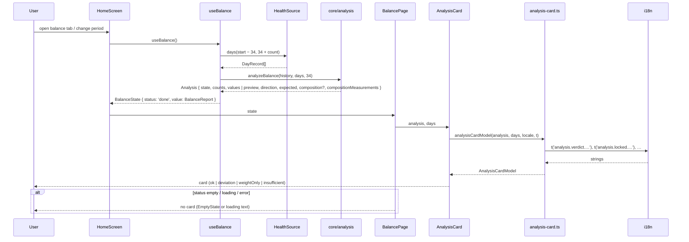
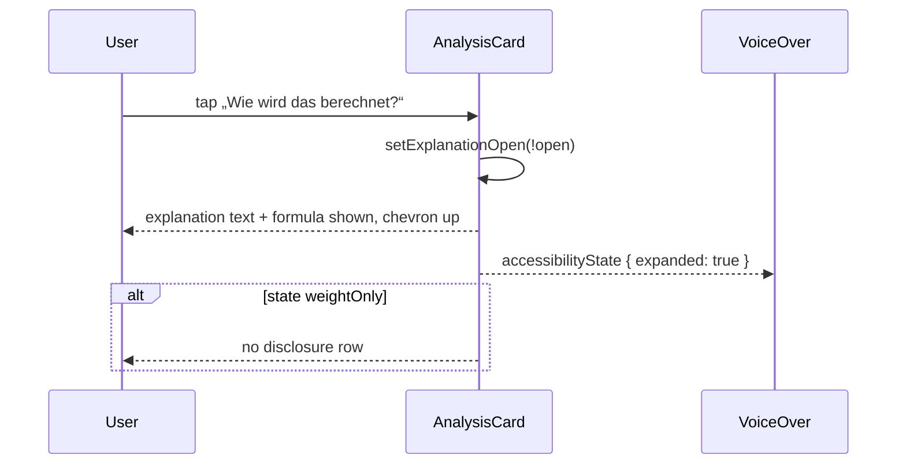
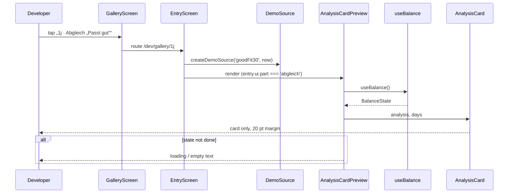

# Abgleich-Karte „Passt die Bilanz zur Waage?“ (P9)

Stand 2026-10-25. In Arbeit auf `feature/chart-lines`. Voraussetzung P3 (`docs/specs/2026-10-24-core-chart-analysis.md`) und P6 (`docs/specs/2026-10-24-home-top-period-hero-tolerance.md`) sind umgesetzt. P9 kann laut Plan parallel zu P8 laufen. Die Karte steht aber unter dem Chart, und `balance-page.tsx` hat sich in P8 geändert. Deshalb geht die Arbeit auf dem aktuellen Branch `feature/chart-lines` weiter, mit Commits nach den P8-Commits (M5–M7). Der PR dieses Branches enthält dann P8 PR 3 und P9 (Key Decision 12).

## Overview

P9 baut die Abgleich-Karte der Bilanz-Seite nach dem Hi-Fi-Design (`.claude/design/homepage/Gewichtslinie strukturieren/BilanzScreen.dc.html`, Einträge 1a, 1e, 1j, 1k, 1l). Sie beantwortet die Frage, ob ein Plus oder Minus in der Bilanz auch auf der Waage ankommt und ob die Kalorien richtig angesetzt sind. Die Karte steht zwischen dem Chart (P8) und dem Link „Daten anzeigen“. Sie zeigt:

- einen Zwei-Spalten-Vergleich „Laut Bilanz“ gegen „Laut Waage“,
- einen Einordnungssatz je Zustand,
- als zweite große Zahl der Seite den „Geschätzten tatsächlichen Verbrauch“ mit Tracker-Wert und Differenz,
- die aufklappbare Erklärung „Wie wird das berechnet?“.

Die vier Zustände `ok`, `deviation`, `weightOnly` und `insufficient` kommen fertig aus `report.analysis` (P3). Die Karte rechnet nichts. Das reine Karten-Modell wählt anhand von Zustand, Richtung, erwarteter Veränderung und Zusammensetzung die i18n-Keys aus und formatiert die Werte. Der Kern bekommt dafür drei Ergänzungen ohne Texte: einen Zähler (`compositionMeasurements` bei `weightOnly`), die erwartete Veränderung (`expected: 'gain' | 'loss' | 'even'`, neutral nahe 0) und die Zusammensetzung der Veränderung (`composition`: Anteil Magermasse oder Fett und Magermasse gegenläufig). `composition` ersetzt `leanShare`. Dazu kommt eine ESLint-Regel, die i18n in `src/core/` verbietet. Betroffen sind `src/core/analysis.ts`, `src/features/balance/` (neues Modell und neue Komponente, `balance-page.tsx`), `src/theme/typography.ts`, `src/components/app-text.tsx`, i18n, `src/dev/gallery/`, `eslint.config.js` und `CLAUDE.md`.

### Ausgangslage: Anforderungen (wörtlich)

> **P9 Abgleich-Karte**
> Inhalt: Karte „Passt die Bilanz zur Waage?“ mit Zwei-Spalten-Vergleich, Einordnungssatz je Zustand, zweite große Zahl „Geschätzter tatsächlicher Verbrauch“, aufklappbare Erklärung; vier Zustände aus P3. Voraussetzung: P3, P6 (kann parallel zu P8).
> [ ] Zustand 5 und alle vier Kartenzustände sehen aus wie das Design.
> [ ] Einordnungssätze kommen aus i18n, nicht aus dem Rechenkern.

„Zustand 5“ wird nach Buchstaben gezählt, wie bei P7 („6 und 7“ = 1f, 1g) und P8 („1, 4, 8“ = 1a, 1d, 1h). Gemeint ist **1e** („7 T · Abgleich gesperrt (zu wenig Messungen)“), die ganze Seite mit gesperrter Karte. Das ist auch der 5. Eintrag in der Reihenfolge der Design-Übersicht. Die „vier Kartenzustände“ sind `deviation` (Karte in 1a), `ok` (1j), `weightOnly` (1k) und `insufficient` (1l), siehe Key Decision 1.

### Stand im Code (2026-10-25)

| Anforderung | Vorhanden | Fehlt |
|---|---|---|
| Abgleich im Kern | `analyzeBalance(records, days, leadInDays)` in `src/core/analysis.ts` gibt `Analysis` zurück: `insufficient` (`days`, `measurements`, `preview?`), `weightOnly` (`balanceFatKg`, `weightChangeKg`), `ok` (`values`), `deviation` (`values`, `direction: 'less' \| 'more'`, `leanShare`). `AnalysisValues`: `balanceKcal`, `balanceFatKg`, `fatChangeKg`, `leanChangeKg`, `bodyFatPointsChange`, `storedKcal`, `foodKcal`, `burnKcal`, `actualBurnPerDay`, `trackerBurnPerDay`, `differencePerDay`. Konstanten `KCAL_PER_KG_FAT_TISSUE = 9400`, `KCAL_PER_KG_LEAN = 1800`, `MIN_ANALYSIS_DAYS = 21`, `MIN_MEASUREMENTS = 6`, `FIT_SHARE`, `FIT_MIN_KCAL`, `LEAN_SHARE_KG = 0.05` | Anzahl der Tage mit Fett- und Magermasse bei `weightOnly` (Key Decision 3); erwartete Veränderung mit neutralem Bereich (Key Decision 5); Zusammensetzung statt `leanShare: boolean` (Key Decision 4) |
| Texte im Kern | keine. Der Kern liefert nur Zustand, Richtung und `leanShare` (P3, M4 Notes: „Texte der Urteile (Design) sind UI“) | Regel, die das absichert (Key Decision 9) |
| Report | `BalanceReport.analysis` (`use-balance.ts`, Zeile 253), `report.days` (Periodentage mit `date`), `TREND_DAYS = 7` in `src/core/body.ts` | — |
| Szenarien | `short7` → `insufficient` (7 Tage, 4 Messungen), `noBodyFat30` → `weightOnly`, `goodFit30` → `ok`, `normal30` → `deviation`/`less`, E gerundet 4.200 (`STORED_NORMAL30`, Design-Rauschen um 4.300) | — |
| Seite | `BalancePage`: `HeroSection`, `QualityRow`, `TodayCard`, `BalanceChart`, darunter Link „Daten anzeigen“ und Fußzeile, Abstand 28. Kommentar „Abgleich (P9) follows below“ | Karte unter dem Chart |
| Bausteine | `Card` (`solid`/`dashed`, Rand 2), `TodayCard` als Vorbild für gestrichelte Karte und Spalten (`overline`, `numberMedium`, `flexBasis`-Umbruch), Chevron mit `accessibilityState={{ expanded }}` in `tolerance-card.tsx`, `colors.separator` (Nebentext 35 %), `border.medium = 1.5`, `touchTarget = 44`, `spokenSigned` (`hero.ts`), `shortDate` (`period-subtitle.ts`), `formatSigned`, `formatSignedKg`, `formatNumber`, `roundKcal` (`src/core/format.ts`) | Typo-Varianten 24/600 und 48/600 (Key Decision 11) |
| i18n | `calculation.analysis` (Einstellungen, „Abgleich mit der Waage“) | Namespace `analysis.*` für die Karte |
| Galerie | `GalleryUi.part?: 'abgleich'` bei 1j (`goodFit30`), 1k (`noBodyFat30`), 1l (`short7`). `hasPendingUi` zeigt dafür das Badge „UI-Vorgabe folgt mit der Homepage“. 1a (`normal30`) und 1e (`short7`) sind ganze Seiten | Ansicht nur mit Karte (Key Decision 10) |
| ESLint | Regeln für Farb-Literale, Rohsamples, App Group, Dev-Code und Chart (`@/core` nur Typen und `format`) | Kein i18n in `src/core/` |

### Design-Referenz (BilanzScreen, Abgleich-Abschnitt, nachgelesen 2026-10-25)

| Element | Design |
|---|---|
| Sichtbarkeit | `showAb: !empty`, also im Leerzustand keine Karte. Seitenaufbau: Hero · Toleranz · Qualitätszeile · Heute bisher · Chart · **Abgleich** · Fußzeile, Abstand 28 |
| Karte | Rand 1,5 pt Vordergrund, durchgezogen, Radius 16, Innenabstand 16, Abstand 16 zwischen den Blöcken |
| Kopf | Titel „Passt die Bilanz zur Waage?“ 22/700, Zeilenhöhe 1,2. Untertitel 13 pt Nebentext, Zeilenhöhe 1,3: „{d. MMM} – {d. MMM} · {n} Messungen“ (`abSub`, n = Tage mit Gewicht). Abstand 2 |
| Gesperrt (`locked = nD < 21 \|\| meas < 6`) | Gestrichelter Kasten 1,5 pt Vordergrund, Radius 12, Innenabstand 12/14, Abstand 4: „Für den Abgleich brauchst du mindestens 21 Tage und 6 Messungen.“ (15 pt, Zeilenhöhe 1,35) und „Bisher: {abSoFar}.“ (15/600). `abSoFar` = „{nD} Tage, {meas} Messungen“, wenn nD < 21, sonst „{meas} Messungen“. Darunter der restliche Inhalt mit Deckkraft 0,3 (`abOp`) |
| Spalten (mit KFA) | Umbrechend, Abstand 16, je Spalte `flex: 1 1 130px`, Linie oben 1,5 pt Vordergrund, 8 pt Innenabstand oben, Abstand 3. Kopf 12/600 Großbuchstaben, Laufweite 0,06 em, Nebentext |
| „Laut Bilanz“ | „{abB} kcal“ 24/600, Laufweite −0,5. „≈ {abBFat} kg Fett“ 15 pt |
| „Laut Waage“ | „≈ {abE} kcal“ 24/600, Laufweite −0,5 (E auf 100 gerundet). „gespeichert“ 13 pt Nebentext, −2 oben. „Fett {abF} kg (Körperfett {abPP} %-Pkt.)“, 15 pt, Klammer 13 pt Nebentext, Zeilenhöhe 1,3. „Magermasse {abL} kg“ 15 pt |
| Einordnungssatz | 15 pt, Zeilenhöhe 1,4. `ok`: „Passt gut. Die Waage zeigt ungefähr den Zuwachs, den die Bilanz erwarten lässt. Einträge und Tracker sind stimmig.“ E < B: „Die Waage zeigt weniger Zuwachs als die Bilanz. Wahrscheinlich verbrauchst du etwas mehr, als der Tracker misst, oder hast weniger gegessen als eingetragen.“, dazu bei ΔL > 0,05 kg „ Ein Teil steckt in Magermasse (z. B. Muskeln oder Wasser).“ E > B: „Die Waage zeigt mehr Zuwachs als die Bilanz. Wahrscheinlich verbrauchst du weniger, als der Tracker misst, oder hast mehr gegessen als eingetragen.“ |
| Trenner | 1 pt, Nebentext 35 % |
| Tatsächlicher Verbrauch | „Geschätzter tatsächlicher Verbrauch“ 15 pt. Zahl 48/600, Laufweite −1,5, Zeilenhöhe 1,05, daneben „kcal/Tag“ 20/600, Grundlinie gemeinsam, umbrechend, Abstand 8. „Tracker: {abTrk} kcal/Tag · Differenz {abDiff}“ 15 pt Nebentext, Zeilenhöhe 1,3. Abstand 4. Verbrauch und Tracker auf 10 gerundet, Differenz = gerundet − gerundet mit Vorzeichen |
| Erklärung | Zeile „Wie wird das berechnet?“ 15/600 + Chevron 7 × 7 (2 pt, `rotate(45deg)` zu, `rotate(-135deg)` offen), min. 32 hoch, Abstand 8. Offen: „Aus deiner eingetragenen Nahrung und der gemessenen Veränderung von Fett- und Magermasse. Stimmt nur, wenn die Nahrung vollständig eingetragen ist.“ (15 pt, Zeilenhöhe 1,4) und „(Nahrung − 9.400 × Δ Fett − 1.800 × Δ Magermasse) ÷ Tage. Start und Ende als 7-Tage-Trend.“ (13 pt Nebentext), Abstand 6. Startet zu |
| Ohne KFA (`nofat`) | Spalten wie oben: „Laut Bilanz“ „≈ {abBFat} kg“ 24/600 + „wenn alles Fett wäre“ 13 pt Nebentext. „Laut Waage“ „{abWt} kg“ 24/600 + „Gewicht, 7-Tage-Trend“ 13 pt Nebentext. Darunter gestrichelter Kasten (wie gesperrt) 15 pt, Zeilenhöhe 1,4: „Keine Körperfett-Daten in Health. Verglichen wird nur das Gewicht. Ob Fett, Muskeln oder Wasser dazugekommen sind, lässt sich so nicht trennen, und der tatsächliche Verbrauch kann nicht geschätzt werden.“ Kein Einordnungssatz, kein Verbrauch, keine Erklärung |
| Einzelansicht (1j, 1k, 1l) | `part="abgleich"`: nur die Karte, Rahmen 1 pt `rgba(0,0,0,.08)`, Radius 18, Innenabstand 20, Größe 392 × 560 bzw. 392 × 360 |
| Dynamic Type | „Karten und Abgleich-Spalten brechen um“ (Übersicht `Kcalwaage Homepage.dc.html`) |

## Key Decisions

| # | Decision | Rationale | Alternatives Considered |
|---|----------|-----------|-------------------------|
| 1 | „Zustand 5“ = **1e** (ganze Seite, 7 T, Karte gesperrt). „Alle vier Kartenzustände“ = `deviation` in **1a**, `ok` in **1j**, `weightOnly` in **1k**, `insufficient` in **1l**. Verglichen wird per Screenshot mit dem Design, hell und dunkel (1b) | Gezählt nach Buchstaben wie P7 und P8; 1e ist auch der 5. Eintrag der Design-Übersicht | 5. Eintrag der Galerie-Liste (ebenfalls 1e) |
| 2 | **Gesperrt (`insufficient`)**: Über dem ausgegrauten Inhalt steht der gestrichelte Hinweis „Für den Abgleich brauchst du mindestens {days} Tage und {measurements} Messungen.“ und „Bisher: …“. Darunter mit Deckkraft 0,3 Spalten und „Geschätzter tatsächlicher Verbrauch“ mit den `preview`-Werten, aber **ohne Einordnungssatz**, weil der Kern bei `insufficient` nicht urteilt. Ohne `preview` (z. B. kein Fett-Trend) steht „–“ statt jeder Zahl, das Layout bleibt gleich. Die Erklärung lässt sich auch ausgegraut aufklappen | Julius 2026-10-25 | Wie im Design mit Satz (Kern bräuchte ein vorläufiges Urteil); immer Platzhalter; nur Hinweis |
| 3 | **`weightOnly` bekommt zwei Hinweistexte.** Der Kern gibt bei `weightOnly` zusätzlich `compositionMeasurements` mit (Tage mit Fett- und Magermasse im Zeitraum). Bei 0 gilt der Designtext „Keine Körperfett-Daten in Health. …“. Bei 1–5 steht „Zu wenige Körperfett-Messungen ({count} von {min}). Verglichen wird nur das Gewicht. …“, der Rest wie im Design | P3 Key Decision 10: `weightOnly` gilt auch bei 1–5 KFA-Messungen, „Keine Körperfett-Daten“ wäre dann falsch — Julius 2026-10-25 | Ein neutraler Text ohne Kernänderung; Designtext immer |
| 4 | **Magermasse im Verhältnis.** Statt des festen Zusatzes „Ein Teil steckt in Magermasse (z. B. Muskeln oder Wasser).“ beschreibt ein Satz, wie sich die Veränderung zusammensetzt. Er steht bei `ok` und `deviation` (beide Richtungen) hinter dem Einordnungssatz. Der Kern liefert dafür `composition` (ersetzt `leanShare: boolean`), nur wenn \|ΔMager\| > `LEAN_SHARE_KG` (0,05 kg): **`shift`**, wenn Fett und Magermasse gegenläufig sind und auch \|ΔFett\| > 0,05 kg, mit `fat: 'loss'` (z. B. Gewicht zu, Fett ab, Muskeln auf) oder `fat: 'gain'`. Sonst **`share`** mit `change` = Richtung von ΔMager und `leanShare` = \|ΔMager\| ÷ (\|ΔFett\| + \|ΔMager\|). Texte: `shift`/`loss` → „Dabei hast du 0,3 kg Fett abgebaut und 0,8 kg Magermasse aufgebaut (z. B. Muskeln oder Wasser).“; `shift`/`gain` → „Dabei hast du 0,3 kg Fett zugelegt und 0,8 kg Magermasse verloren (z. B. Muskeln oder Wasser).“; `share`/`gain` → „Etwa 40 % des Zuwachses sind Magermasse (z. B. Muskeln oder Wasser).“; `share`/`loss` → „Etwa 40 % der Abnahme sind Magermasse (z. B. Muskeln oder Wasser).“ Der Prozentwert wird im Modell auf 10 % gerundet, kg ohne Vorzeichen auf 0,1 | „Soll halt im Verhältnis sein, also evtl. nimmt die Person Gewicht zu, hat aber Fett verloren und Magermasse (Muskeln) aufgebaut“ — Julius 2026-10-25. Ersetzt die erste Fassung („nur bei `less`, wie im Design“) | Fester Zusatz nur bei `less` (erste Fassung, Design); fester Zusatz in beide Richtungen |
| 5 | **Einordnungssätze nach erwarteter Veränderung.** Der Kern liefert bei `ok` und `deviation` `expected`: `even`, wenn \|B\| ≤ `FIT_MIN_KCAL` (400 kcal ≈ 0,04 kg Fett, dieselbe Grenze, ab der die Waage eine Abweichung zeigt), sonst `gain` (B > 0) oder `loss` (B < 0). **`gain`**: Designtexte („Zuwachs“). **`loss`**: `ok` → „Passt gut. Die Waage zeigt ungefähr die Abnahme, die die Bilanz erwarten lässt. Einträge und Tracker sind stimmig.“; `less` (E < B, mehr Abnahme) → „Die Waage zeigt mehr Abnahme als die Bilanz. Wahrscheinlich verbrauchst du etwas mehr, als der Tracker misst, oder hast weniger gegessen als eingetragen.“; `more` (E > B, weniger Abnahme) → „Die Waage zeigt weniger Abnahme als die Bilanz. Wahrscheinlich verbrauchst du weniger, als der Tracker misst, oder hast mehr gegessen als eingetragen.“ **`even`** (neutral): `ok` → „Passt gut. Die Bilanz lässt kaum eine Veränderung erwarten, und die Waage zeigt auch keine. Einträge und Tracker sind stimmig.“; `less` → „Die Bilanz lässt kaum eine Veränderung erwarten, die Waage zeigt aber eine Abnahme. Wahrscheinlich verbrauchst du etwas mehr …“; `more` → „Die Bilanz lässt kaum eine Veränderung erwarten, die Waage zeigt aber einen Zuwachs. Wahrscheinlich verbrauchst du weniger …“. Der Ursache-Halbsatz hängt nur an `direction`. Bei `even` + `deviation` liegt E immer mehr als 400 kcal neben 0, Abnahme und Zuwachs stimmen also. Das Modell wählt nur Keys, die Grenze steht im Kern | Bei einem Defizit läse sich „mehr Zuwachs“ schief — Julius 2026-10-25. „Nahe null passiert ja nix, sollte neutral sein“ — Julius 2026-10-25 | Nur nach Vorzeichen (erste Fassung, „Zuwachs“ ab ±0); neutral nur bei gerundet ±0 wie im Hero; Designtexte immer |
| 6 | **Die Karte rechnet nichts.** Alle Zahlen kommen aus `report.analysis`, Zeitraum und Messungen aus `report.days` und `analysis.measurements`. Ein reines Modell `analysisCardModel(analysis, days, locale, t)` in `src/features/balance/analysis-card.ts` (wie `todayCard`) wählt Keys und formatiert, die Komponente zeichnet nur. Die ESLint-Regel des Charts (`@/core` nur Typen und `format`) gilt auch für `analysis-card.ts` und `components/analysis-card.tsx`. Ausnahme: die Konstanten `KCAL_PER_KG_FAT_TISSUE`, `KCAL_PER_KG_LEAN`, `MIN_ANALYSIS_DAYS`, `MIN_MEASUREMENTS` (`@/core/analysis`) und `TREND_DAYS` (`@/core/body`) für Hinweis und Formel | Gleiches Muster wie P7/P8. Zahlen in Hinweis und Formel bleiben so mit dem Kern synchron | Werte in der Komponente ableiten; feste Zahlen in den Texten |
| 7 | Rundung wie im Design und in P3: „Laut Bilanz“ `roundKcal` + `formatSigned` („+7.000 kcal“, gleiche Zahl wie der Hero). E auf 100 („≈ +4.300 kcal“). kg auf 0,1 mit Vorzeichen (`formatSignedKg`). Δ KFA in %-Punkten auf 0,1 mit Vorzeichen. Tatsächlicher Verbrauch und Tracker `roundKcal` + `formatNumber` („2.760“, „2.670“). Differenz = gerundet − gerundet, `formatSigned` („+90“, „±0“) | Goldener Testfall: +7.000, ≈ +0,9 kg, ≈ +4.300, +0,4 kg, +0,3 kg, 2.760, 2.670, +90 | E auf 10 (CLAUDE.md „Einzelwert auf 10 kcal“) |
| 8 | Erklärung „Wie wird das berechnet?“: Zustand offen/zu lokal in der Karte (`useState`), startet zu, wird **nicht gespeichert** (`settings.v1` hat feste Keys) und bleibt bei einem Zeitraumwechsel erhalten. Trefferfläche mindestens 44 pt (`touchTarget`) statt 32 wie im Design. `accessibilityRole="button"`, `accessibilityState={{ expanded }}`, Chevron wie in `tolerance-card.tsx`. Bei `weightOnly` gibt es keine Erklärung (Design) | HIG-Mindestgröße wie in den übrigen Bedienelementen | Zustand in `settings.v1`; 32 pt wie im Design |
| 9 | **„Einordnungssätze kommen aus i18n“ wird prüfbar.** (a) ESLint verbietet in `src/core/**` Importe von `i18next`, `react-i18next` und `@/i18n*`. (b) Ein Modell-Test mit einem `t`, das Keys zurückgibt, prüft für jeden Zustand, jede Richtung, jedes `expected` und jede `composition` den erwarteten Key unter `analysis.verdict.*` bzw. `analysis.composition.*`. (c) `en.ts` hat dieselben Keys wie `de.ts` (Typprüfung über `i18next.d.ts`) | Abnahmekriterium als Regel, wie beim Chart in P8 | Nur Konvention |
| 10 | Galerie 1j, 1k und 1l zeigen **nur die Karte** wie im Design: eigene Ansicht `AnalysisCardPreview` mit den Providern des Eintrags, die `useBalance` lädt und nur `AnalysisCard` auf dem Hintergrund mit 20 pt Rand zeigt (scrollbar). `hasPendingUi` und das Badge „UI-Vorgabe folgt mit der Homepage“ entfallen. 1a und 1e bleiben ganze Seiten | Screenshot direkt mit 1j/1k/1l vergleichbar — Julius 2026-10-25 | Ganze Seite, zur Karte gescrollt; ganze Seite ungescrollt |
| 11 | Neue Typo-Varianten in `src/theme/typography.ts`: `cardValue` 24/600, Zeilenhöhe 29, Laufweite −0,5 (Spaltenwerte). `burnNumber` 48/600, Zeilenhöhe 50, Laufweite −1,5. `burnUnit` 20/600, Zeilenhöhe 25 („kcal/Tag“). Deckelung in `MAX_FONT_SCALE` (`cardValue` 2, `burnNumber` 1,5, `burnUnit` 1,4), wie bei den übrigen großen Zahlen. Spaltenkopf = `overline`, Titel = `sectionTitle`, Texte = `secondary`/`footnote` | Design-Maße; die vorhandenen `numberMedium` (28/400) und `numberLarge` (48/700) passen nicht | Vorhandene Varianten mit Overrides |
| 12 | Umsetzung direkt auf `feature/chart-lines`, mit Commits nach den P8-Commits. Der PR dieses Branches (P8 PR 3) enthält dann auch P9 | Julius 2026-10-25. Die Karte steht unter dem Chart in `balance-page.tsx` | Eigener Branch `feature/analysis-card` von `feature/chart-lines` (erste Fassung); von `main`, parallel zu P8 |
| 13 | VoiceOver: Kopf ist ein `header` mit „Passt die Bilanz zur Waage? {Zeitraum gesprochen}, {n} Messungen“. Jede Spalte ist ein Element („Laut Bilanz: plus 7.000 Kilokalorien, etwa plus 0,9 Kilogramm Fett“, über `spokenSigned`). Satz und Hinweise sind normaler Text. Verbrauch ist ein Element („Geschätzter tatsächlicher Verbrauch 2.760 Kilokalorien pro Tag. Tracker 2.670, Differenz plus 90.“). Im gesperrten Zustand ist der ausgegraute Inhalt für VoiceOver ausgeblendet (`accessibilityElementsHidden`, `importantForAccessibility="no-hide-descendants"`), vorgelesen wird nur der Hinweis | Vorläufige Zahlen sollen nicht wie ein Ergebnis klingen | Ausgegrauten Inhalt mit Zusatz „Vorschau“ vorlesen |
| 14 | Dynamic Type: Spalten `flexGrow: 1`, `flexBasis: 130`, umbrechend wie im Design. Zahl und „kcal/Tag“ umbrechend mit gemeinsamer Grundlinie. Die Karte wächst mit, nichts wird abgeschnitten (Galerie 1i) | Design „Karten und Abgleich-Spalten brechen um“ | — |
| 15 | Die Karte erscheint nur bei `state.status === 'done'`, nicht im Leerzustand, beim Laden oder bei einem Fehler | Design `showAb: !empty` | — |

## Implementation Details

### Milestone Map

| Milestone | Delivers | 🟢 Add | 🟠 Change | 🔴 Delete | Depends On |
|-----------|----------|--------|-----------|-----------|------------|
| M1 — Kern: Zähler, Erwartung, Zusammensetzung, i18n-Sperre | `compositionMeasurements` bei `weightOnly`, `expected` und `composition` bei `ok`/`deviation` (statt `leanShare`), ESLint ohne i18n in `src/core/`, Tests | 0 | 6 | 0 | — |
| M2 — Karten-Modell und Texte | `analysisCardModel` mit Keys je Zustand/Richtung/Erwartung/Zusammensetzung, Formatierung, a11y-Labels; i18n DE/EN; Tests inkl. goldenem Testfall | 2 | 3 | 0 | M1 |
| M3 — Karte auf der Bilanz-Seite | `AnalysisCard` mit vier Zuständen, Erklärung, VoiceOver, Dynamic Type; Typo-Varianten | 1 | 3 | 0 | M2 |
| M4 — Galerie, Abnahme, Doku | Einzelansicht für 1j/1k/1l, Screenshots 1e, 1a, 1j, 1k, 1l hell und dunkel, CLAUDE.md | 1 | 3 | 0 | M3 |

```
🟢 Add   🟠 Change   🔴 Delete
```

Abnahmekriterien → Milestones:

| Kriterium | Milestone |
|---|---|
| Zustand 5 (1e) und alle vier Kartenzustände (1a, 1j, 1k, 1l) sehen aus wie das Design | M3 (Maße und Zustände), M4 (Einzelansicht, Screenshots hell und dunkel) |
| Einordnungssätze kommen aus i18n, nicht aus dem Rechenkern | M1 (ESLint-Regel für `src/core/`), M2 (Keys im Modell, Test je Zustand), M4 (Lint grün) |

#### 🔀 Inbound Flow — Laden: Abgleich-Karte auf der Bilanz-Seite



#### 🔀 Inbound Flow — UI: „Wie wird das berechnet?“ aufklappen



#### 🔀 Inbound Flow — Galerie: Eintrag 1j/1k/1l



---

### ✅ Milestone 1 — Kern: Zähler, Erwartung, Zusammensetzung, i18n-Sperre

> Der Kern liefert alles, woraus die Karte ihre Sätze wählt (KFA-Zähler, erwartete Veränderung, Zusammensetzung), und kann nachweislich keine Texte erzeugen.

**Depends on:** none

#### File Changes

| Color | File | Action |
|-------|------|--------|
| 🟠 | `src/core/analysis.ts` | `compositionMeasurements: number` bei `weightOnly` (Zählung existiert schon als lokale Variable). `expected: Expected` und `composition?: Composition` bei `ok` und `deviation`; `leanShare: boolean` entfällt. Neue Funktionen `expectedChange(balanceKcal)` und `bodyComposition(fatChangeKg, leanChangeKg)` |
| 🟠 | `src/core/__tests__/analysis.test.ts` | `compositionMeasurements` 0 und 5; `expected` an den Grenzen; `composition` je Fall; die bisherigen `leanShare`-Tests (Zeilen 142–143) auf `composition` umstellen |
| 🟠 | `src/core/__tests__/golden.test.ts` | `leanShare: true` (Zeile 102) → `expected: 'gain'`, `composition: { kind: 'share', change: 'gain', leanShare: ≈ 0,4286 }` |
| 🟠 | `src/dev/demo/__tests__/scenarios.test.ts` | `noBodyFat30` → `weightOnly` mit `compositionMeasurements: 0`; `normal30` → `expected: 'gain'` |
| 🟠 | `eslint.config.js` | Block für `src/core/**/*.{ts,tsx}`: `i18next`, `react-i18next`, `@/i18n`, `@/i18n/*` verboten (mit den bestehenden Pfaden `RAW_SAMPLES`, `APP_GROUP`, `DEV_CODE`, weil ESLint pro Regel und Datei nur einen Block nimmt). Meldung: „The core returns states and numbers; texts come from i18n in the UI.“ |
| 🟠 | `CLAUDE.md` | Rechenmodell, Zustände der Abgleich-Karte: „Hinweis Magermasse ab +0,05 kg“ ersetzen durch `expected` (neutral bei \|B\| ≤ 400 kcal) und `composition` (Anteil oder gegenläufig, ab \|ΔMager\| > 0,05 kg) |

Typen (Skizze):

```ts
// src/core/analysis.ts
// The balance expects no visible change within the fit margin.
export type Expected = 'gain' | 'loss' | 'even';

// How the change splits into fat and lean mass; only when
// |Δ lean| > LEAN_SHARE_KG.
export type Composition =
  // Same direction (or Δ fat too small to count): lean share of the change, 0–1.
  | { kind: 'share'; change: 'gain' | 'loss'; leanShare: number }
  // Opposite directions, e.g. fat lost and lean gained.
  | { kind: 'shift'; fat: 'gain' | 'loss' };

  | (Counts & { state: 'ok'; values: AnalysisValues; expected: Expected; composition?: Composition })
  | (Counts & {
      state: 'deviation';
      values: AnalysisValues;
      direction: 'less' | 'more';
      expected: Expected;
      composition?: Composition;
    })
```

#### To-Dos

- ✅ Add `compositionMeasurements` to the `weightOnly` result in `analyzeBalance`
- ✅ Add `expectedChange`: `even` when |B| ≤ `FIT_MIN_KCAL`, else `gain`/`loss` by sign
- ✅ Add `bodyComposition`: none when |ΔL| ≤ `LEAN_SHARE_KG`; `shift` when signs differ and |ΔF| > `LEAN_SHARE_KG`; else `share` with `change` = sign of ΔL and `leanShare` = |ΔL| ÷ (|ΔF| + |ΔL|)
- ✅ Replace `leanShare: boolean` with `expected` and `composition` in `ok` and `deviation`
- ✅ Test `compositionMeasurements` with 0 and 5 body fat days
- ✅ Test `expected` at B = 400 (`even`), 401 (`gain`), −400 (`even`), −401 (`loss`) _(direkt an `expectedChange` mit ±399/±401 und 0, dazu über `analyzeBalance` B = 390 → `even`)_
- ✅ Test `composition`: ΔF −0,3 / ΔL +0,8 → `shift`/`loss` (Gewicht zu, Fett ab); ΔF +0,3 / ΔL −0,8 → `shift`/`gain`; ΔF +0,4 / ΔL +0,3 → `share`/`gain` ≈ 0,43; ΔF −0,6 / ΔL −0,2 → `share`/`loss` 0,25; ΔF +0,02 / ΔL −0,3 → `share`/`loss`; ΔL 0,05 → none _(dazu ΔL −0,05 → none; über `analyzeBalance` +0,06 kg nur Magermasse → `share`/`gain` 1)_
- ✅ Test `even` + `deviation` always has E on the side of `direction` (E < 0 for `less`, E > 0 for `more`)
- ✅ Update the golden test and the scenario tests
- ✅ Add the ESLint block that forbids i18n imports in `src/core/`
- ✅ Test the rule by hand: a temporary `import i18n from 'i18next'` in `src/core/analysis.ts` fails `npm run lint` (then remove) _(Probe-Datei `src/core/zz-lint-probe.ts` mit `i18next` und `@/i18n/locales/de`: beide gemeldet, dann gelöscht)_
- ✅ Update `CLAUDE.md` (analysis states)
- ✅ Commit (`feat: add expected change and body composition to the analysis`)

#### Notes / Constraints

> - Zustände, Schwellen und Werte bleiben unverändert. Der goldene Testfall bleibt grün (`deviation`/`less`, E ≈ 4.300).
> - `expected` nutzt dieselbe Grenze `FIT_MIN_KCAL` wie das Urteil `ok`. Deshalb liegt bei `even` + `deviation` E sicher mehr als 400 kcal neben 0, und „die Waage zeigt aber eine Abnahme/einen Zuwachs“ stimmt immer.
> - `insufficient.preview` bekommt kein `expected`/`composition`, weil die gesperrte Karte keinen Satz zeigt (Key Decision 2).
> - `leanShare` (`boolean`) hat außer den Tests keine Nutzer (geprüft per `grep`). Der Name lebt als Anteil (Zahl) in `Composition` mit `kind: 'share'` weiter.
> - `src/core/` hat heute keine i18n-Importe (geprüft per `grep`), die Regel bricht also nichts.

#### ⌨️ Keyboard Shortcuts

Keine App-Kürzel (Touch-App, siehe P0/P1-Spec). Keine UI in diesem Milestone.

---

### Milestone 2 — Karten-Modell und Texte

> Ein reines, getestetes Modell macht aus `report.analysis` alle Texte und Zahlen der Karte. Die Komponente muss danach nur noch zeichnen.

**Depends on:** Milestone 1

#### File Changes

| Color | File | Action |
|-------|------|--------|
| 🟢 | `src/features/balance/analysis-card.ts` | `AnalysisCardModel`, `analysisCardModel(analysis, days, locale, t)` |
| 🟢 | `src/features/balance/__tests__/analysis-card.test.ts` | Zustände, Richtungen, Erwartung, Zusammensetzung, Platzhalter, Rundung, goldener Testfall, a11y-Labels |
| 🟠 | `src/i18n/locales/de.ts` | Namespace `analysis.*` (Texte siehe unten) und `a11y.analysis*` |
| 🟠 | `src/i18n/locales/en.ts` | dieselben Keys auf Englisch (Entwurf, Julius prüft im PR) |
| 🟠 | `eslint.config.js` | Chart-Block um `src/features/balance/analysis-card.ts` und `components/analysis-card.tsx` erweitern (`@/core` nur Typen, `format`, die vier Konstanten aus `analysis` und `TREND_DAYS` aus `body`) |

Modell (Skizze):

```ts
// src/features/balance/analysis-card.ts
export type AnalysisColumn = {
  label: string; // „Laut Bilanz“
  value: string; // „+7.000 kcal“, „≈ +4.300 kcal“, „≈ +0,9 kg“, „–“
  lines: { text: string; note?: string; muted?: boolean }[];
  spoken: string;
};

export type AnalysisCardModel = {
  title: string; // „Passt die Bilanz zur Waage?“
  subtitle: string; // „24. Sep – 23. Okt · 18 Messungen“
  headerLabel: string;
  // insufficient only: dashed hint above the dimmed body.
  locked?: { hint: string; soFar: string };
  dimmed: boolean;
  body:
    | {
        kind: 'composition';
        balance: AnalysisColumn;
        scale: AnalysisColumn;
        // Verdict + cause + composition sentence; absent for insufficient.
        verdict?: string;
        burn: { label: string; value: string; unit: string; detail: string; spoken: string };
        explanation: { toggle: string; text: string; formula: string };
      }
    | { kind: 'weightOnly'; balance: AnalysisColumn; scale: AnalysisColumn; note: string };
};
```

i18n-Texte (DE, wörtlich aus dem Design bzw. Key Decisions 3, 4 und 5):

| Key | DE |
|---|---|
| `analysis.title` | Passt die Bilanz zur Waage? |
| `analysis.subtitle` | {{from}} – {{to}} · {{measurements}} (mit `analysis.measurements_one` „{{count}} Messung“, `_other` „{{count}} Messungen“) |
| `analysis.locked.hint` | Für den Abgleich brauchst du mindestens {{days}} Tage und {{measurements}} Messungen. |
| `analysis.locked.soFarDays` | Bisher: {{days}}, {{measurements}}. (Tage plural: „{{count}} Tag“/„{{count}} Tage“) |
| `analysis.locked.soFar` | Bisher: {{measurements}}. |
| `analysis.balance` | Laut Bilanz |
| `analysis.scale` | Laut Waage |
| `analysis.kcal` | {{value}} kcal |
| `analysis.approxKcal` | ≈ {{value}} kcal |
| `analysis.balanceFat` | ≈ {{value}} kg Fett |
| `analysis.stored` | gespeichert |
| `analysis.fat` | Fett {{value}} kg |
| `analysis.fatPoints` | (Körperfett {{value}} %-Pkt.) |
| `analysis.lean` | Magermasse {{value}} kg |
| `analysis.verdict.gain.ok` | Passt gut. Die Waage zeigt ungefähr den Zuwachs, den die Bilanz erwarten lässt. Einträge und Tracker sind stimmig. |
| `analysis.verdict.gain.less` | Die Waage zeigt weniger Zuwachs als die Bilanz. |
| `analysis.verdict.gain.more` | Die Waage zeigt mehr Zuwachs als die Bilanz. |
| `analysis.verdict.loss.ok` | Passt gut. Die Waage zeigt ungefähr die Abnahme, die die Bilanz erwarten lässt. Einträge und Tracker sind stimmig. |
| `analysis.verdict.loss.less` | Die Waage zeigt mehr Abnahme als die Bilanz. |
| `analysis.verdict.loss.more` | Die Waage zeigt weniger Abnahme als die Bilanz. |
| `analysis.verdict.even.ok` | Passt gut. Die Bilanz lässt kaum eine Veränderung erwarten, und die Waage zeigt auch keine. Einträge und Tracker sind stimmig. |
| `analysis.verdict.even.less` | Die Bilanz lässt kaum eine Veränderung erwarten, die Waage zeigt aber eine Abnahme. |
| `analysis.verdict.even.more` | Die Bilanz lässt kaum eine Veränderung erwarten, die Waage zeigt aber einen Zuwachs. |
| `analysis.verdict.cause.less` | Wahrscheinlich verbrauchst du etwas mehr, als der Tracker misst, oder hast weniger gegessen als eingetragen. |
| `analysis.verdict.cause.more` | Wahrscheinlich verbrauchst du weniger, als der Tracker misst, oder hast mehr gegessen als eingetragen. |
| `analysis.composition.shareGain` | Etwa {{percent}} % des Zuwachses sind Magermasse (z. B. Muskeln oder Wasser). |
| `analysis.composition.shareLoss` | Etwa {{percent}} % der Abnahme sind Magermasse (z. B. Muskeln oder Wasser). |
| `analysis.composition.fatLossLeanGain` | Dabei hast du {{fat}} kg Fett abgebaut und {{lean}} kg Magermasse aufgebaut (z. B. Muskeln oder Wasser). |
| `analysis.composition.fatGainLeanLoss` | Dabei hast du {{fat}} kg Fett zugelegt und {{lean}} kg Magermasse verloren (z. B. Muskeln oder Wasser). |
| `analysis.burn.label` | Geschätzter tatsächlicher Verbrauch |
| `analysis.burn.unit` | kcal/Tag |
| `analysis.burn.detail` | Tracker: {{tracker}} kcal/Tag · Differenz {{difference}} |
| `analysis.explanation.toggle` | Wie wird das berechnet? |
| `analysis.explanation.text` | Aus deiner eingetragenen Nahrung und der gemessenen Veränderung von Fett- und Magermasse. Stimmt nur, wenn die Nahrung vollständig eingetragen ist. |
| `analysis.explanation.formula` | (Nahrung − {{fat}} × Δ Fett − {{lean}} × Δ Magermasse) ÷ Tage. Start und Ende als {{trend}}-Tage-Trend. |
| `analysis.weightOnly.balanceFat` | ≈ {{value}} kg |
| `analysis.weightOnly.allFat` | wenn alles Fett wäre |
| `analysis.weightOnly.weight` | {{value}} kg |
| `analysis.weightOnly.trend` | Gewicht, {{trend}}-Tage-Trend |
| `analysis.weightOnly.none` | Keine Körperfett-Daten in Health. Verglichen wird nur das Gewicht. Ob Fett, Muskeln oder Wasser dazugekommen sind, lässt sich so nicht trennen, und der tatsächliche Verbrauch kann nicht geschätzt werden. |
| `analysis.weightOnly.few` | Zu wenige Körperfett-Messungen ({{count}} von {{min}}). Verglichen wird nur das Gewicht. Ob Fett, Muskeln oder Wasser dazugekommen sind, lässt sich so nicht trennen, und der tatsächliche Verbrauch kann nicht geschätzt werden. |

Der Absatz setzt sich so zusammen: `verdict.{expected}.{less|more}` + `verdict.cause.{less|more}` bei `deviation`, nur `verdict.{expected}.ok` bei `ok`. Dahinter folgt bei beiden, wenn `composition` gesetzt ist, der Satz `composition.*`. `expected` kommt aus dem Kern (Key Decision 5), das Modell vergleicht keine Zahlen. Bei `shareGain`/`shareLoss` wird `percent` = `leanShare × 100` auf 10 gerundet („40“), bei `fatLossLeanGain`/`fatGainLeanLoss` werden `fat` und `lean` als Betrag auf 0,1 kg ausgegeben (`formatKg(Math.abs(…))`).

#### To-Dos

- 🔲 Create `analysisCardModel` with subtitle from `days[0].date`/`days.at(-1).date` (`shortDate`) and `analysis.measurements`
- 🔲 Add the locked hint with `MIN_ANALYSIS_DAYS`/`MIN_MEASUREMENTS` and „Bisher“: days and measurements if `days < 21`, else measurements only
- 🔲 Add composition columns: balance `roundKcal` + `formatSigned`, fat `formatSignedKg`; scale E rounded to 100 with „≈“, fat, points (0,1, signed), lean
- 🔲 Add the verdict from i18n keys by state, `direction` and `expected`
- 🔲 Add the composition sentence for `ok` and `deviation` from `composition` (share in 10 % steps, kg as magnitude)
- 🔲 Add the burn block: actual and tracker `roundKcal` + `formatNumber`, difference = rounded − rounded via `formatSigned`
- 🔲 Add the explanation text and formula with `KCAL_PER_KG_FAT_TISSUE`, `KCAL_PER_KG_LEAN` and `TREND_DAYS`
- 🔲 Add `insufficient`: `dimmed: true`, no verdict, `preview` values or „–“ for every number
- 🔲 Add `weightOnly`: „≈ +0,9 kg“ / „wenn alles Fett wäre“, „+0,7 kg“ / „Gewicht, 7-Tage-Trend“, note `none` (0) or `few` (1–5, „{count} von 6“)
- 🔲 Add spoken labels for header, columns and burn via `spokenSigned`
- 🔲 Add the `analysis.*` and `a11y.analysis*` keys to `de.ts` and `en.ts`
- 🔲 Test the golden case: „+7.000 kcal“, „≈ +0,9 kg Fett“, „≈ +4.300 kcal“, „Fett +0,4 kg“, „Magermasse +0,3 kg“, „2.760“, „2.670“, „Differenz +90“, verdict keys `gain.less` + `cause.less` + `composition.shareGain` with „40“
- 🔲 Test every verdict key with a `t` that returns keys: `ok`/`less`/`more` × `gain`/`loss`/`even`
- 🔲 Test every composition key: `shareGain`, `shareLoss`, `fatLossLeanGain` („0,3“/„0,8“, no sign), `fatGainLeanLoss`; none without `composition`; also with `ok` and with `more`
- 🔲 Test `insufficient` with and without `preview` (no verdict, „–“), „Bisher“ for 7 days/4 measurements and 30 days/4 measurements, singular „1 Messung“
- 🔲 Test `weightOnly` with 0 and 3 composition measurements
- 🔲 Test difference „±0“ when both round to the same value
- 🔲 Extend the chart ESLint block to the card model and component
- 🔲 Commit (`feat: build the analysis card texts from the core state`)

#### Notes / Constraints

> - Das Modell bekommt `t` wie `todayCard` und gibt fertige Strings zurück. Keine Zahl wird hier aus Rohwerten berechnet außer Rundung und der Differenz der gerundeten Werte (Design: „Differenz = gerundet − gerundet“).
> - E auf 100 ist ein eigener Rundungsschritt im Modell (`Math.round(E / 100) * 100`). Falls er an einer zweiten Stelle gebraucht wird, kommt er nach `src/core/format.ts` (`roundStoredKcal`).
> - Ein Minuszeichen ist immer U+2212 (`formatSigned`).

#### ⌨️ Keyboard Shortcuts

Keine App-Kürzel (Touch-App). Keine UI in diesem Milestone.

---

### Milestone 3 — Karte auf der Bilanz-Seite

> Unter dem Chart steht die Abgleich-Karte in allen vier Zuständen nach dem Design, mit aufklappbarer Erklärung, VoiceOver und Dynamic Type.

**Depends on:** Milestone 2

#### File Changes

| Color | File | Action |
|-------|------|--------|
| 🟢 | `src/features/balance/components/analysis-card.tsx` | `AnalysisCard({ analysis, days })`: Karte, Kopf, gesperrter Hinweis, Spalten, Satz, Trenner, Verbrauch, Erklärung, `weightOnly`-Hinweis |
| 🟠 | `src/features/balance/components/balance-page.tsx` | `AnalysisCard` nach `BalanceChart` im `done`-Zweig, Kommentar anpassen |
| 🟠 | `src/theme/typography.ts` | `cardValue`, `burnNumber`, `burnUnit` (Key Decision 11) |
| 🟠 | `src/components/app-text.tsx` | `MAX_FONT_SCALE` für die drei Varianten |

#### To-Dos

- 🔲 Create `AnalysisCard`: border 1,5 pt foreground, radius 16, padding 16, gap 16
- 🔲 Add the header: `sectionTitle` + `footnote` muted, gap 2, one `header` element for VoiceOver
- 🔲 Add the locked hint: dashed box 1,5 pt, radius 12, padding 12/14, gap 4, `secondary` + `secondary` 600
- 🔲 Add the dimmed body (opacity 0,3) hidden from VoiceOver when locked
- 🔲 Add the two columns: top line 1,5 pt, padding top 8, gap 3, `overline` muted, `cardValue`, `secondary`/`footnote` lines, `flexBasis: 130`, wrapping, gap 16
- 🔲 Add the verdict (`secondary`, line height 21) and the separator (`colors.separator`, 1 pt)
- 🔲 Add the burn block: label `secondary`, number `burnNumber` + `burnUnit` on one baseline (wrapping, gap 8), detail `secondary` muted, gap 4
- 🔲 Add the disclosure row (min. 44 pt, chevron like `tolerance-card.tsx`, `expanded` state) and the explanation (`secondary` line height 21, formula `footnote` muted, gap 6)
- 🔲 Add the `weightOnly` body: columns and dashed note box, no verdict, no burn, no disclosure
- 🔲 Wire `AnalysisCard` into `BalancePage` after the chart, only for `status === 'done'`
- 🔲 Check 1a, 1e, 1i (AX1) and dark mode in the simulator
- 🔲 Commit (`feat: show the analysis card below the chart`)

#### Notes / Constraints

> - Farben nur über `useColors()` (Vordergrund, Nebentext, `separator`); kein Literal (ESLint).
> - Gestrichelt heißt in der App „vorläufig“. Hinweis bei `insufficient` und Hinweis bei `weightOnly` sind gestrichelt wie im Design, die Karte selbst ist durchgezogen.
> - Deckkraft 0,3 auf einer `View` um den Inhalt, nicht je Text.
> - Der Abstand zwischen Chart und Karte kommt aus dem Seiten-`gap` (28).

#### 📐 Wireframe — AnalysisCard, `deviation` (1a) / `ok` (1j)

```
┌─────────────────────────────────────────┐
│ Passt die Bilanz zur Waage?             │
│ 24. Sep – 23. Okt · 18 Messungen        │
│                                         │
│ ─────────────────   ─────────────────   │
│ LAUT BILANZ         LAUT WAAGE          │
│ +7.000 kcal         ≈ +4.300 kcal       │
│ ≈ +0,9 kg Fett      gespeichert         │
│                     Fett +0,4 kg        │
│                     (Körperfett +0,3 %-Pkt.)
│                     Magermasse +0,3 kg  │
│                                         │
│ Die Waage zeigt weniger Zuwachs als die │
│ Bilanz. Wahrscheinlich verbrauchst du … │
│ Etwa 40 % des Zuwachses sind Mager-     │
│ masse (z. B. Muskeln oder Wasser).      │
│ ─────────────────────────────────────── │
│ Geschätzter tatsächlicher Verbrauch     │
│ 2.760 kcal/Tag                          │
│ Tracker: 2.670 kcal/Tag · Differenz +90 │
│                                         │
│ [ Wie wird das berechnet?  ⌄ ]          │
│   (offen: Text + Formel)                │
└─────────────────────────────────────────┘
```

**Component tree:**
AnalysisCard
├── Header (AppText sectionTitle, AppText footnote)
├── Body
│   ├── Columns
│   │   ├── AnalysisColumn — Laut Bilanz (overline, cardValue, lines[])
│   │   └── AnalysisColumn — Laut Waage (overline, cardValue, lines[])
│   ├── Verdict (AppText secondary)
│   ├── Separator
│   ├── BurnBlock (label, burnNumber + burnUnit, detail)
│   └── Disclosure (Pressable row + Chevron, Explanation text + formula)

#### 📐 Wireframe — AnalysisCard, `insufficient` (1e, 1l)

```
┌─────────────────────────────────────────┐
│ Passt die Bilanz zur Waage?             │
│ 18. Okt – 24. Okt · 4 Messungen         │
│ ┌╌╌╌╌╌╌╌╌╌╌╌╌╌╌╌╌╌╌╌╌╌╌╌╌╌╌╌╌╌╌╌╌╌╌╌╌╌┐ │
│ ╎ Für den Abgleich brauchst du minde- ╎ │
│ ╎ stens 21 Tage und 6 Messungen.      ╎ │
│ ╎ Bisher: 7 Tage, 4 Messungen.        ╎ │
│ └╌╌╌╌╌╌╌╌╌╌╌╌╌╌╌╌╌╌╌╌╌╌╌╌╌╌╌╌╌╌╌╌╌╌╌╌╌┘ │
│ ░ (Deckkraft 0,3, für VoiceOver aus) ░  │
│ ░ LAUT BILANZ       LAUT WAAGE       ░  │
│ ░ +1.630 kcal       ≈ +900 kcal  (–) ░  │
│ ░ ≈ +0,2 kg Fett    gespeichert …    ░  │
│ ░ ───────────────────────────────    ░  │
│ ░ Geschätzter tatsächlicher Verbr.   ░  │
│ ░ 2.780 kcal/Tag            (–)      ░  │
│ ░ Tracker: … · Differenz …           ░  │
│ ░ [ Wie wird das berechnet?  ⌄ ]     ░  │
└─────────────────────────────────────────┘
```

**Component tree:**
AnalysisCard
├── Header
├── LockedHint (dashed View, AppText × 2)
└── Body (opacity 0.3, hidden for VoiceOver)
    ├── Columns (AnalysisColumn × 2, preview values or „–“)
    ├── Separator
    ├── BurnBlock
    └── Disclosure

#### 📐 Wireframe — AnalysisCard, `weightOnly` (1k)

```
┌─────────────────────────────────────────┐
│ Passt die Bilanz zur Waage?             │
│ 24. Sep – 23. Okt · 18 Messungen        │
│                                         │
│ ─────────────────   ─────────────────   │
│ LAUT BILANZ         LAUT WAAGE          │
│ ≈ +0,9 kg           +0,7 kg             │
│ wenn alles Fett     Gewicht, 7-Tage-    │
│ wäre                Trend               │
│ ┌╌╌╌╌╌╌╌╌╌╌╌╌╌╌╌╌╌╌╌╌╌╌╌╌╌╌╌╌╌╌╌╌╌╌╌╌╌┐ │
│ ╎ Keine Körperfett-Daten in Health.   ╎ │
│ ╎ Verglichen wird nur das Gewicht. …  ╎ │
│ ╎ (1–5: „Zu wenige Körperfett-Mes-    ╎ │
│ ╎  sungen (3 von 6). …“)              ╎ │
│ └╌╌╌╌╌╌╌╌╌╌╌╌╌╌╌╌╌╌╌╌╌╌╌╌╌╌╌╌╌╌╌╌╌╌╌╌╌┘ │
└─────────────────────────────────────────┘
```

**Component tree:**
AnalysisCard
├── Header
└── Body
    ├── Columns (AnalysisColumn × 2)
    └── WeightOnlyNote (dashed View, AppText secondary)

#### 📐 Wireframe — BalancePage (Ausschnitt unten)

```
┌─────────────────────────────────────────┐
│ …  Hero · Toleranz · Qualität · Heute   │
├─────────────────────────────────────────┤
│ BalanceChart (P8)                       │
├─────────────────────────────────────────┤  ↕ 28
│ AnalysisCard                            │
├─────────────────────────────────────────┤  ↕ 28
│ [ Daten anzeigen ]                      │
│ Keine medizinische Beratung. Daten …    │
└─────────────────────────────────────────┘
```

**Component tree:**
BalancePage
├── Top (Title, PageIndicator, PeriodSegments, period label)
├── Data (HeroSection, QualityRow)
├── TodayCard
├── BalanceChart
├── AnalysisCard
└── End (LinkButton „Daten anzeigen“, footer)

#### ⌨️ Keyboard Shortcuts

Keine App-Kürzel (Touch-App). VoiceOver: Kopf `header`, Spalten und Verbrauch je ein Element mit gesprochenem Label, Erklärung `button` mit `expanded`, gesperrter Inhalt ausgeblendet (Key Decision 13).

---

### Milestone 4 — Galerie, Abnahme, Doku

> Die Galerie zeigt 1j, 1k und 1l wie das Design als Einzelkarte. Die Screenshots belegen beide Abnahmekriterien, und CLAUDE.md beschreibt die Karte.

**Depends on:** Milestone 3

#### File Changes

| Color | File | Action |
|-------|------|--------|
| 🟢 | `src/dev/gallery/analysis-card-preview.tsx` | `AnalysisCardPreview`: `useBalance()` → nur `AnalysisCard` in `ScrollView`, Rand 20, Hintergrund |
| 🟠 | `src/dev/gallery/entry-screen.tsx` | Bei `entry.ui?.part === 'abgleich'` `AnalysisCardPreview` statt `HomeScreen`; Badge entfernen |
| 🟠 | `src/dev/gallery/entries.ts` | `hasPendingUi` entfernen, Kommentar zu `GalleryUi.part` anpassen |
| 🟠 | `CLAUDE.md` | Features V1: Abgleich-Karte (vier Zustände, Sätze nach erwarteter Veränderung inkl. neutral, Satz zur Zusammensetzung von Fett und Magermasse, `weightOnly`-Hinweis je nach KFA-Messungen); Stand-Datum |

#### To-Dos

- 🔲 Create `AnalysisCardPreview` inside the entry's providers
- 🔲 Wire `part: 'abgleich'` in `EntryScreen` and remove `hasPendingUi` and the badge
- 🔲 Take screenshots of 1e (whole page), 1a (card), 1j, 1k, 1l, light and dark, and compare with the design side by side
- 🔲 Record differences that come from demo noise (e.g. `normal30` E 4.200 instead of 4.300) in this spec
- 🔲 Run `npm run lint`, `npm run typecheck`, `npm test` (core coverage ≥ 90 %)
- 🔲 Update `CLAUDE.md` (features, date)
- 🔲 Update this spec: mark milestones done, add deviations
- 🔲 Commit (`docs: record analysis card acceptance`) on `feature/chart-lines`
- 🔲 Add P9 to the description of the branch's PR (P8 PR 3 + P9) and ask Julius to review the English texts there

#### Notes / Constraints

> - Galerie-Code bleibt Dev-only (ESLint `DEV_CODE`).
> - 1e und 1l nutzen beide `short7`: 1e als ganze Seite (Zustand 5), 1l als Einzelkarte.

#### 📐 Wireframe — Galerie, Einzelkarte (1j/1k/1l)

```
┌─────────────────────────────────────┐
│                                     │
│  ┌───────────────────────────────┐  │
│  │ AnalysisCard                  │  │
│  │ (Zustand des Szenarios)       │  │
│  └───────────────────────────────┘  │
│                                     │
├─────────────────────────────────────┤
│ [ ‹ Galerie ]  1j · Abgleich …      │
└─────────────────────────────────────┘
```

**Component tree:**
EntryScreen
├── HealthSourceProvider
│   └── SettingsStoreProvider
│       └── AnalysisCardPreview
│           └── ScrollView
│               └── AnalysisCard
└── Bar (LinkButton „‹ Galerie“, title)

#### ⌨️ Keyboard Shortcuts

Keine App-Kürzel (Touch-App).

---

## Open Questions

| # | Question | Owner | Impact if Unresolved |
|---|----------|-------|----------------------|
| 1 | ✅ ~~Englische Texte für `analysis.*`: Entwurf kommt in M2 (z. B. „Does the balance match the scale?“, „The scale shows less gain than the balance.“, „Estimated actual burn“). Prüfst du die Formulierungen vor dem Merge?~~ Julius prüft sie im PR — 2026-10-25 | Julius | erledigt |
| 2 | ✅ ~~Magermasse-Zusatz bei Defizit: Nach Key Decision 4 erscheint er bei `less` auch, wenn die Bilanz negativ ist. Liest sich das richtig?~~ Ersetzt durch einen Satz zur Zusammensetzung („soll halt im Verhältnis sein“), Key Decision 4 — Julius 2026-10-25 | Julius | erledigt |
| 3 | ✅ ~~Bei `balanceKcal` nahe 0 wählt die Karte „Zuwachs“. Reicht das, oder soll es eine neutrale Variante geben?~~ Neutral („nahe null passiert ja nix“), Grenze \|B\| ≤ 400 kcal, Key Decision 5 — Julius 2026-10-25 | Julius | erledigt |
| 4 | ❓ Grenze für „neutral“: 400 kcal (`FIT_MIN_KCAL`, ≈ 0,04 kg Fett) über den ganzen Zeitraum, unabhängig von seiner Länge. Bei „Alles“ mit 300 Tagen sind das ≈ 1 kcal/Tag. Passt das, oder soll die Grenze mit den Tagen wachsen (z. B. 15 kcal pro Tag)? Vorschlag: so lassen, weil das Urteil `ok` dieselbe feste Grenze nutzt | Julius | Nur Text bei kleiner Bilanz, M1 |

## Concerns & Decisions Log

| # | Type | Concern | Resolution |
|---|------|---------|------------|
| 1 | ⚠️ Concern | Das Design graut bei „gesperrt“ den ganzen Inhalt inklusive Einordnungssatz aus. Der Kern urteilt bei `insufficient` aber nicht, und `preview` kann fehlen | Vorschau ohne Satz, „–“ ohne `preview` (Key Decision 2) — Julius 2026-10-25 |
| 2 | ⚠️ Concern | Der `weightOnly`-Text „Keine Körperfett-Daten in Health“ ist falsch bei 1–5 KFA-Messungen (P3 Key Decision 10) | Zwei Texte, Kern liefert `compositionMeasurements` (Key Decision 3) — Julius 2026-10-25 |
| 3 | 💡 Alternative | Das Design zeigt 1j/1k/1l als Einzelkarte, die Galerie bisher nur ganze Seiten | Einzelansicht `AnalysisCardPreview` (Key Decision 10) — Julius 2026-10-25 |
| 4 | 💡 Alternative | Der Kern setzt `leanShare` in beide Richtungen, das Design nutzt es nur bei „weniger“ | Zuerst: nur bei `less` — Julius 2026-10-25. Ersetzt: Satz zur Zusammensetzung im Verhältnis bei `ok` und `deviation`, Kern liefert `composition` statt `leanShare` (Key Decision 4) — Julius 2026-10-25 |
| 5 | ⚠️ Concern | „Zuwachs“-Sätze passen nicht zu einer negativen Bilanz | Sätze nach Vorzeichen — Julius 2026-10-25. Ergänzt: neutral bei \|B\| ≤ 400 kcal, Kern liefert `expected` (Key Decision 5) — Julius 2026-10-25 |
| 6 | ⚠️ Concern | CLAUDE.md sagt „Einzelwert auf 10 kcal“, Design und P3 runden E auf 100 | E auf 100 wie Design und P3; „≈“ kennzeichnet den Schätzwert (Key Decision 7) |
| 7 | ⚠️ Concern | Die Erklärungszeile ist im Design nur 32 pt hoch, unter der HIG-Mindestgröße | 44 pt (`touchTarget`), optisch gleich (Key Decision 8) |
| 8 | ⚠️ Concern | Die Demo-Daten weichen leicht vom Design ab (`normal30`: E 4.200 statt 4.300), Screenshots zeigen also andere Zahlen | Wie in P3 akzeptiert; Abweichungen werden in M4 notiert |
| 9 | ⚠️ Concern | P9 soll parallel zu P8 gehen können, die Karte hängt aber an `balance-page.tsx` aus P8 | Zuerst: eigener Branch von `feature/chart-lines`. Ersetzt: direkt auf `feature/chart-lines` (Key Decision 12) — Julius 2026-10-25 |
| 10 | ⚠️ Concern | Die Spec-Konventionen liegen unter `.claude/docs/reference/patterns/docs/`, der Skill nennt `docs/references/patterns/docs/specs.md` | Gelesen aus `.claude/docs/reference/patterns/docs/specs.md` und `doc-building-blocks.md`; Skill-Pfad bei Gelegenheit korrigieren |
| 11 | ⚠️ Concern | Auf `feature/chart-lines` wird der PR des Branches größer: P8 PR 3 (M5–M7) und P9 zusammen. Die P8-Spec plant drei getrennte PRs | Hingenommen (Key Decision 12). P9-Commits beginnen erst nach den P8-Commits, die PR-Beschreibung trennt beide Teile |
| 12 | ⚠️ Concern | Der Satz zur Zusammensetzung weicht vom Design ab (fester Zusatz nur bei „weniger“) und ändert den Kern (`leanShare` → `composition`). Bioimpedanz-Waagen schwanken bei Fett und Magermasse stark | Gewollt (Key Decision 4). Grenze 0,05 kg wie bisher, Prozent auf 10 % gerundet und „etwa“, damit keine falsche Genauigkeit entsteht. Start und Ende sind 7-Tage-Trends |
