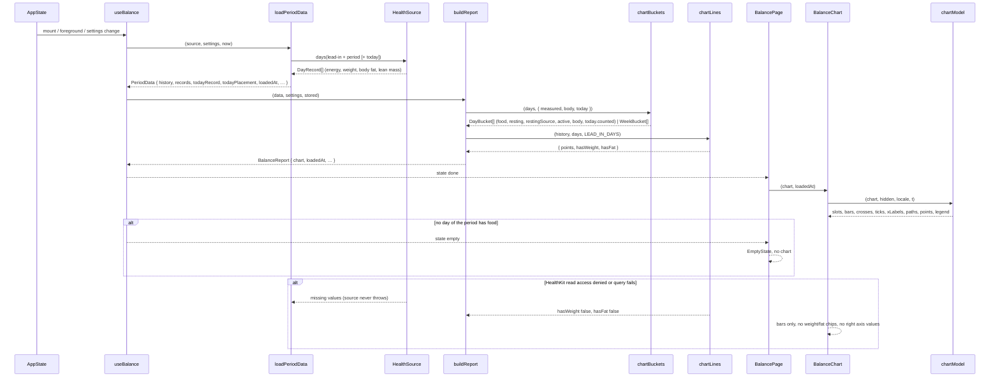
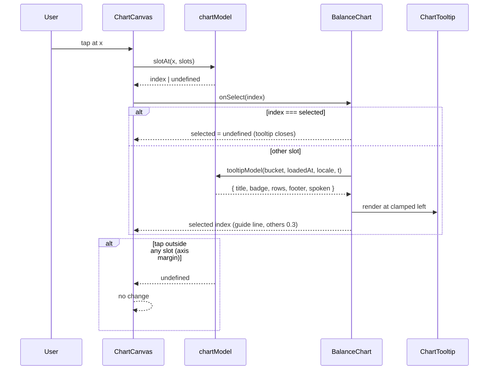
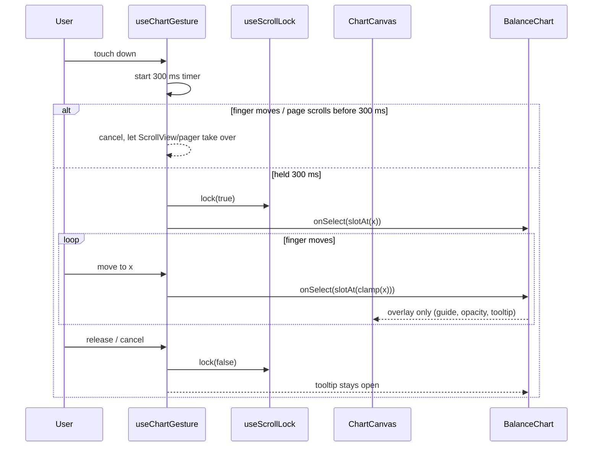
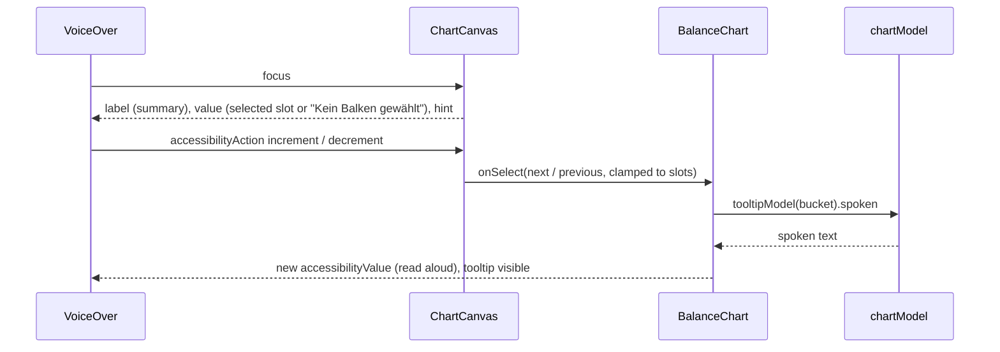

# Chart: Balken, Linien, Tooltip (P8)

Stand 2026-10-25. In Arbeit. Voraussetzung P3 (`docs/specs/2026-10-24-core-chart-analysis.md`) und P7 (`docs/specs/2026-10-25-home-middle-quality-today-empty-footer.md`) sind umgesetzt. Drei PRs: PR 1 = M1 (Spike), PR 2 = M2–M4 (Balken), PR 3 = M5–M7 (Linien und Interaktion). Vorgeschlagene Branches: `spike/chart-library`, `feature/chart-bars`, `feature/chart-lines` (jeweils vom Stand davor).

## Overview

P8 baut den Chart der Bilanz-Seite nach dem Hi-Fi-Design (`.claude/design/homepage/Gewichtslinie strukturieren/BilanzScreen.dc.html`). Er steht zwischen „Heute bisher“ und der Abgleich-Karte (P9). Ein halbtägiger Spike vergleicht zuerst drei Wege: victory-native (Skia), react-native-gifted-charts und ein eigenes SVG mit `react-native-svg`. Julius entscheidet anhand einer kurzen Notiz. Danach kommen die Balken: Nulllinie, Plus oben und Minus unten, Tagesbalken bis 31 Tage, darüber Wochenbalken. Unvollständige Tage sind schraffiert oder gestreift, heute ist ein gestrichelter Umriss, dazu die linke Achse in kcal. Zum Schluss folgen die rechte Achse in Δ kg mit drei Linienarten und hohlen Messpunkten, eine Legende zum Ein- und Ausblenden und ein Tooltip per Tipp oder per langem Drücken und Ziehen. Der Chart rechnet nichts selbst. Alle Werte kommen fertig aus `report.chart` (P3), das dafür um die Tooltip-Werte je Tag erweitert wird. Betroffen sind `src/core/chart.ts`, `src/features/balance/` (`use-balance.ts`, neue Modelle und Komponenten, `balance-page.tsx`, `home-screen.tsx`), `src/dev/gallery/`, i18n, `eslint.config.js`, `docs/spikes/` und `CLAUDE.md`.

### Ausgangslage: Anforderungen (wörtlich)

> **P8 Chart**
> Inhalt in drei Schritten, je ein PR:
> 1. Spike (½ Tag): victory-native (Skia) gegen react-native-gifted-charts mit den harten Anforderungen prüfen: Schraffur, zwei Achsen, gestrichelt/gepunktet, Drag-Tooltip. Ergebnis als kurze Notiz, Entscheidung durch dich. Meine Erwartung: victory-native, weil Muster und Stricharten in Skia einfacher sind.
> 2. Balken: Nulllinie, Plus oben/Minus unten, Tages- und Wochenbalken, Schraffur für unvollständige Tage, Umriss-Balken für heute, linke Achse.
> 3. Linien und Interaktion: rechte Achse Δ kg, drei Linienarten und Messpunkte, Legende zum Ein-/Ausblenden, Tooltip per Tipp/Drag. Voraussetzung: P3, P7.
> [ ] Zustände 1, 4 und 8 sehen aus wie das Design.
> [ ] Die drei Linien sind in Graustufen-Screenshot unterscheidbar.
> [ ] 90 Tage rendern ohne sichtbares Ruckeln auf einem älteren iPhone (z. B. 12).
> [ ] Chart bekommt nur fertige Serien aus P3, rechnet selbst nichts.

„Zustände 1, 4 und 8“ sind nach Buchstaben gezählt wie bei P7 („6 und 7“ = 1f, 1g): **1a** (30 T · ohne Toleranz · hell), **1d** (90 T · Wochenbalken) und **1h** (Chart-Tooltip auf geschätztem Tag), siehe Key Decision 1.

### Stand im Code (2026-10-25)

| Anforderung | Vorhanden | Fehlt |
|---|---|---|
| Buckets | `chartBuckets(days, { measured, today })` in `src/core/chart.ts`: bis `MAX_DAILY_BUCKETS = 31` Tage `DayBucket`, darüber `WeekBucket` (ISO-Woche, erste Woche unter `MIN_FIRST_WEEK_DAYS = 3` angehängt) | Tooltip-Werte je Tag (Nahrung, Ruhe, Quelle, Aktiv, Körperwerte), eingerechneter laufender Tag als „heute“ |
| `DayBucket` | `date`, `kcal?`, `maintenance`, `flags`, `worst?`, `measured`, `today?` (nur angehängter Tag „zählt nicht“) | siehe oben |
| `WeekBucket` | `isoWeek`, `from`, `to`, `days`, `avgKcal?`, `avgFoodKcal?`, `avgBurnKcal?`, `incompleteDays`, `worst?`, `measurements` | — (reicht für den Wochen-Tooltip) |
| Linien | `chartLines(history, days, LEAD_IN_DAYS)` in `src/core/lines.ts`: `LinePoint` je Periodentag mit `weightTrend?`, `weightPoint?`, `fatTrend?`, `theoreticalFat`; `hasWeight`, `hasFat` | — |
| Report | `BalanceReport.chart: { buckets, lines }`, `today: { day, placement }`, `loadedAt` (`use-balance.ts`); `chart.today` nur bei `placement === 'excluded'` | „heute zählt mit“ im Bucket |
| Laufender Tag | `DayBalance.running`, `restingFilledHours`; `RestingSource` = `measured`, `scaled`, `partial`, `source`, `formula`, `missing` | — |
| Muster | `src/components/quality-pattern.tsx`: `QualityPatternDefs`, `qualityFill(flag, prefix)`, `QualityCross`, `QualitySwatch`, `usePatternPrefix`, `QUALITY_MARK` (Schraffur ohne gedrehte Kachel, 7a926a6) | Nutzung im Chart |
| SVG | `react-native-svg` 15.15.4 im Projekt | — |
| Gesten | `ScrollLockContext`/`useScrollLock` (`src/hooks/scroll-lock.ts`): sperrt Pager und Seite, solange ein Slider gezogen wird. `MarkedSlider` übernimmt jede Berührung sofort über das Responder-System. `react-native-gesture-handler` (~2.32) und `react-native-reanimated` (4.5.1) liegen nur transitiv über `expo-router` in `node_modules`, nicht in `package.json` | Lange drücken, dann ziehen |
| Formate | `formatNumber`, `formatSigned` („±0“), `formatSignedKg`, `formatKg`, `roundKcal` (`src/core/format.ts`); `dayLabel` („Mo, 12. Okt“, `quality.ts`); `shortDate` (`period-subtitle.ts`); `formatTime` (`today.ts`); `spokenSigned` (`hero.ts`); i18n `date.weekdaysAbbr`, `date.monthsShort`, `today.formula`/`today.partial` | Chart-Texte (`chart.*`) |
| Seite | `BalancePage`: Kommentar „Chart (P8) and Abgleich (P9) follow below“, Platz zwischen `TodayCard` und Link „Daten anzeigen“ | Chart-Abschnitt |
| Galerie | `GalleryUi.tooltip?: 'lastEstimatedDay'` (1h); `hasPendingUi` zeigt dafür das Badge „UI-Vorgabe folgt mit der Homepage“; Szenarien `normal30` (1a, 1h), `long90` (1d), `gaps30` (L1), L4 „Heute einrechnen“ | Tooltip-Vorgabe durchreichen; Spike-Eintrag |
| Charts-Library | keine | Spike-Entscheidung |

### Design-Referenz (BilanzScreen, Chart-Abschnitt, nachgelesen 2026-10-25)

| Element | Design |
|---|---|
| Kopf | Titel 22/700, Zeilenhöhe 1,2: „Bilanz pro Tag“ bzw. „Bilanz pro Woche“. Untertitel 13 pt Nebentext: „Balken kcal · Linien kg Veränderung seit {d. MMM}“ bzw. „Balken Ø kcal pro Tag der Woche · Linien kg seit {d. MMM}“. Abstand 2 zwischen Titel und Untertitel, 10 zum Chart |
| Achsenkopf | Zeile über dem Chart, 11 pt Nebentext: „kcal“ links, „kg“ rechts, 2 pt Abstand unten |
| Fläche | SVG `viewBox 0 0 350 232`, Breite 100 %, Höhe proportional. Plot x 40–316 (`pl = 40`, `pw = 276`), Nulllinie y = 106, Halbhöhe 92 (Ticks bei y 14, 60, 106, 152, 198). Bei Dynamic Type behält der Chart seine Größe (`zoom: 1/typeScale`) |
| Raster | Linie je Tick, x 40–316, Nebentext mit 35 % Deckkraft, 0,75 pt. Nulllinie Vordergrund 1,25 pt, über den Balken |
| Linke Achse | Labels 10 pt Nebentext, rechtsbündig bei 10,6 % von rechts (x ≈ 37), vertikal zentriert am Tick. Werte `±nice`, `±nice/2`, „0“. Schritt 500 (Tage) bzw. 250 (Wochen), `nice = max(step, ⌈max|v| / step⌉ · step)` über alle Balken |
| Rechte Achse | Labels 10 pt Nebentext ab 92 % (x ≈ 322). Werte mit einer Nachkommastelle `±niceK`, `±niceK/2`, „0“. `niceK = 0,5`, wenn max\|Δ\| ≤ 0,5, sonst `⌈max\|Δ\|⌉`. Max nur über **sichtbare** Linien (Ausblenden skaliert neu) |
| X-Achse | Labels 10 pt Nebentext, zentriert, bei 91,5 % der Höhe (y ≈ 212). Tage: bis 10 Tage Wochentag je Tag („Mo“), sonst jeder 7. Tag „d.m.“ ab dem ersten, nur bis 4 Tage vor Schluss. Dazu „heute“ unter dem Heute-Slot. Wochen: „KW {n}“, bei mehr als 9 Wochen jede zweite, vom Ende her gezählt |
| Tagesbalken | Slotbreite `sw = 276 / (n + Heute-Slot)`, Balkenbreite `min(26, sw · 0,7)`, zentriert im Slot. Höhe \|v\| / nice · 92, mindestens 1,5. Plus nach oben, Minus nach unten |
| Wochenbalken | Tagesbreite `dw = 276 / n`, Slot über die Tage der Woche (`cx = 40 + (start + Tage/2) · dw`), Balkenbreite `min(26, Tage · dw · 0,78)`. Wert Ø kcal/Tag |
| Füllung | vollständig: Vordergrund, kein Rand. Grundumsatz geschätzt: Schraffur-Pattern + 1-pt-Rand. Wenig Nahrung: Streifen-Pattern + 1-pt-Rand. Ohne Nahrung: kein Balken, ✕ 7 × 7 (1,6 pt, runde Enden) auf der Nulllinie. Woche mit unvollständigen Tagen: Schraffur + Rand |
| Heute | gestrichelter Umriss `2.5 2`, 1 pt, keine Füllung, Mindesthöhe 14 (im Prototyp immer nach oben, mit festem Wert +40) |
| Linien | Fett laut Bilanz: 2,2 pt, runde Enden, `dasharray 0.1 4.2` (gepunktet). Fettmasse: 1,8 pt, runde Ecken, `dasharray 6 3.5` (gestrichelt). Gewicht: 2,6 pt, runde Ecken und Enden, durchgezogen. Reihenfolge von unten: Balken, ✕, Nulllinie, Fett laut Bilanz, Fettmasse, Gewicht. Linienpunkte je Tag in der Slot-Mitte (`dayX`), auch bei Wochenbalken |
| Messpunkte | im Prototyp berechnet (`dots`: Messung − Starttrend), aber nicht gezeichnet |
| Auswahl | Tipp auf einen Slot (Trefferfläche = ganze Slotbreite, y 6–206) öffnet den Tooltip, erneuter Tipp schließt. Andere Balken Deckkraft 0,3. Führungslinie senkrecht, Vordergrund 1 pt, `dasharray 2 2`, y 0–200. Zeitraumwechsel und „Bilanz“ ausblenden schließen den Tooltip |
| Tooltip | absolut über dem Chart, `top 14`, Breite 198, links auf Slot-Mitte − 99 geklemmt an 0 … 350 − 198. Hintergrund, Rand 1,5 pt Vordergrund, Radius 12, Innenabstand 10/12, Abstand 4, 13 pt, Zeilenhöhe 1,3, nicht antippbar. Titel 14/600. Badge 10/700 Großbuchstaben, Laufweite 0,05 em, Rand 1 pt, Radius 4, Innenabstand 1/5, linksbündig. Zeilen Schlüssel links, Wert rechts, Abstand 8 (Bilanz-Zeile 600). Fuß 12 pt Nebentext, Trennlinie oben 1 pt Nebentext 35 %, 4 pt Innenabstand oben, 2 pt Abstand |
| Tooltip Tag | Titel „Mo, 12. Okt“. Badge „Grundumsatz geschätzt“ / „Auffällig wenig Nahrung“ / „Ohne Nahrung“ oder keins. Zeilen: Gegessen (`–` ohne Nahrung), Ruhe (+ „ (Formel)“ bei geschätzt), Aktiv, Bilanz („0 (Erhaltung)“ ohne Nahrung, sonst „+233 kcal“). Fuß „Gewicht 82,1 kg · Fett 17,8 kg“ oder „Keine Waage-Messung“ |
| Tooltip Woche | Titel „KW 42 · 12.–18. Okt“ (gleicher Monat) bzw. „KW 40 · 28. Sep – 4. Okt“. Badge „{n} Tag(e) unvollständig“ oder keins. Zeilen: Ø Gegessen, Ø Verbrauch, Ø Bilanz / Tag (600, „+233 kcal“). Fuß „{n} Tage · {m} Messungen“ |
| Tooltip heute | Titel „Heute · bis 14:32“, Badge „Zählt nicht mit“, Zeilen Gegessen, Ruhe, Aktiv, Bilanz, Fuß „Tag läuft noch“ |
| Legende Chips | umbrechend, Abstand 8. Chip min. 32 hoch, Innenabstand 0/11, Rand 1,5 pt Vordergrund, Radius 16, 13 pt, Abstand 7 zum Symbol, ausgeblendet Deckkraft 0,35. „Bilanz“ (Rechteck 7 × 13 Vordergrund), „Gewicht“ (Strich 22 × 8, 2,6 pt, rund), „Fettmasse“ (1,8 pt, `6 3.5`), „Fett laut Bilanz“ (2,2 pt, rund, `0.1 4.2`) |
| Legende Hinweise | umbrechend, Abstand 5/14, 12 pt Nebentext, Zeilenhöhe 1,3: „Linien: 7-Tage-Trend“ · Schraffur 10 × 10 „Grundumsatz geschätzt“ (Wochen: „Woche mit unvollständigen Tagen“) · nur Tage: Streifen „wenig Nahrung“, ✕ 10/700 „ohne Nahrung“, gestricheltes Quadrat 10 × 10 „heute, zählt nicht“ |
| 1h-Vorgabe | Tooltip auf dem **letzten** Slot mit Art „geschätzt“ (`defTip`) |
| Seitenaufbau | Hero · Toleranz · Qualitätszeile · Heute bisher · **Chart** · Abgleich (P9) · Fußzeile, Abstand 28 zwischen den Blöcken. Im Leerzustand kein Chart |
| Muster & Linien (Übersicht `Kcalwaage Homepage.dc.html`) | „Gewicht · 7-T-Trend, 2,6 pt“, „Fettmasse · 7-T-Trend, 1,8 pt gestrichelt“, „Fett laut Bilanz · kumuliert ÷ 7.700, gepunktet“, „Heute / läuft noch · zählt nicht“ (gestricheltes Quadrat). Hinweis: „Dynamic Type: … Chart behält feste Größe.“ |

## Key Decisions

| # | Decision | Rationale | Alternatives Considered |
|---|----------|-----------|-------------------------|
| 1 | „Zustände 1, 4 und 8“ = Galerie-Einträge **1a**, **1d**, **1h**, verglichen per Screenshot mit dem Design | Nach Buchstaben gezählt wie P7 (6, 7 = 1f, 1g). In der Reihenfolge der Galerie wäre Platz 8 der Picker 1m, der gehört nicht zum Chart. 1a, 1d und 1h decken Tagesbalken, Wochenbalken und Tooltip ab | Reihenfolge der Galerie (1a, 1d, 1m) |
| 2 | Der Spike prüft **drei** Kandidaten: victory-native (Skia), react-native-gifted-charts und ein eigenes SVG mit `react-native-svg` | Nur SVG-Wege können `QualityPatternDefs`/`qualityFill` aus P7 direkt nutzen. Das verlangen die P7-Abnahme „Muster sind eine Komponente, die P8 im Chart nutzt“ und CLAUDE.md „der Chart füllt seine Balken mit denselben Mustern“. Skia bräuchte eigene Muster und drei neue native Abhängigkeiten. Das Design ist selbst ein Hand-SVG — Julius 2026-10-25 | Nur die zwei Libraries (Plan); kein Spike, direkt eigenes SVG |
| 3 | Ergebnis des Spikes: Notiz `docs/spikes/2026-10-25-chart-library.md` mit Kriterien-Tabelle je Kandidat und Screenshots, dazu der SVG-Prototyp als Galerie-Einträge „S1 · Chart-Spike · 30 T“ und „S2 · Chart-Spike · 90 T“ im Dev-Menü (S2 für die 90-T-Messung). M4 ersetzt sie. Die Prototypen aller drei Kandidaten liegen auf `spike/chart-candidates` (bb76ddd) und werden nicht gemergt | Julius 2026-10-25 | Wegwerf-Prototyp ohne Galerie; nur Abschnitt in dieser Spec |
| 4 | **Entscheidung: eigenes SVG mit `react-native-svg`, keine Chart-Library.** Geste per Responder-System mit 300-ms-Timer und `useScrollLock`; erweist sie sich am iPhone als hakelig, `react-native-gesture-handler` (`Gesture.Pan().activateAfterLongPress(300)`) als direkte Abhängigkeit. M2–M7 bleiben wie beschrieben | Spike: gifted-charts kann im BarChart nur zwei Linien, keine Messpunkte, kein ✕ und setzt einen Linienpunkt pro Balken (unter Wochenbalken falsch). victory-native erfüllt alles, aber Balken, Muster und ✕ laufen an der Bibliothek vorbei und entstehen in Skia ein zweites Mal; vier neue native Abhängigkeiten — Julius 2026-10-25 | victory-native; gifted-charts |
| 5 | Tages- oder Wochenbalken bestimmt der Kern: bis einschließlich 31 Tage Tagesbalken, ab 32 Wochenbalken (P3, Key Decision 1). Der Design-Prototyp wechselt erst ab 60 Tagen (`daily = nD < 60`) | CLAUDE.md und Kern gelten; 60 Tagesbalken wären auf 276 pt unter 5 pt breit | Design-Grenze 60 |
| 6 | **Wochenbalken** sind schraffiert, sobald die Woche einen unvollständigen Tag hat (`incompleteDays > 0`), wie im Design-Prototyp. Legende dann „Woche mit unvollständigen Tagen“. **Tagesbalken** nach dem schlechtesten Flag: geschätzt = Schraffur, wenig Nahrung = Streifen, ohne Nahrung oder ohne Grundumsatz ohne Wert = nur ✕ auf der Nulllinie. Ein Tag **ohne Nahrung mit Wert** (Null-Tage-Schalter aus, volles Defizit) ist **gefüllt plus ✕** auf der Nulllinie. CLAUDE.md, Feature 7 („Eine Woche erbt das schlechteste Flag ihrer Tage“) wird angepasst; `WeekBucket.worst` bleibt im Kern | Für „ohne Nahrung“ und „ohne Grundumsatz“ gibt es kein Füllmuster, nur das ✕ — Julius 2026-10-25 | Leerer Umriss + ✕; gefüllt + ✕ auch für Wochen |
| 7 | Drei Linien wie im Design: Gewicht (7-Tage-Trend, durchgezogen 2,6 pt), Fettmasse (7-Tage-Trend, gestrichelt 1,8 pt `6 3.5`), Fett laut Bilanz (kumuliert ÷ 7.700, gepunktet 2,2 pt `0.1 4.2`). Keine Magermasse-Linie, kein Einordnungssatz unter dem Chart. Magermasse und Einordnung bleiben in der Abgleich-Karte (P9). CLAUDE.md, Feature 9 wird angepasst | Julius 2026-10-25 | Drei Linien + Einordnungssatz; vier Linien mit Magermasse |
| 8 | Messpunkte = hohle Kreise r = 2,5 pt, Rand 1,25 pt Vordergrund, Füllung Hintergrund, an `weightPoint` (Einzelmessung − Starttrend) auf der rechten Achse, über der Gewichtslinie. Sie verschwinden mit dem Chip „Gewicht“. `weightPoint` zählt für die Skalierung der rechten Achse mit, damit kein Punkt aus der Fläche fällt | Hebt sich auch in Graustufen von den Linien ab — Julius 2026-10-25. Design berechnet die Punkte, zeichnet sie aber nicht | Gefüllte Punkte; keine Punkte |
| 9 | Der laufende Tag ist im Tagesmodus **immer** ein gestrichelter Umriss (`2.5 2`, 1 pt, keine Füllung), auch bei „Heute einrechnen“. Der Kern markiert ihn: `DayBucket.today = { counted: boolean }`, also `counted: true` für den eingerechneten letzten Tag (`DayBalance.running`) und `counted: false` für den angehängten. Tooltip-Badge „Zählt mit“ bzw. „Zählt nicht mit“, Legende „heute, zählt mit“ bzw. „heute, zählt nicht“. Endet „Eigener“ vor gestern, gibt es keinen Heute-Slot und keinen Legenden-Eintrag. Wochenbalken haben keinen Heute-Slot (P3, Key Decision 13). Mit „Heute einrechnen“ steckt heute in der letzten Woche, die normal aussieht | Gestrichelt heißt in der App „vorläufig“ — Julius 2026-10-25 | Eingerechnet normaler Balken |
| 10 | Geste: **Tipp** auf einen Slot zeigt den Tooltip, ein Tipp auf denselben Slot schließt ihn, ein Tipp auf einen anderen wechselt. **Langes Drücken (0,3 s), dann Ziehen** verschiebt die Auswahl Slot für Slot und öffnet den Tooltip, falls er zu ist. Ab dem Auslösen sind Pager und Seite per `useScrollLock` gesperrt, nach dem Loslassen wieder frei. Der Tooltip bleibt dann offen. Ohne langes Drücken scrollt und blättert alles normal, auch über dem Chart | Die Seite scrollt senkrecht in einem waagerechten Pager (Wischen zur Daten-Seite) — Julius 2026-10-25, wie der Aktien-Chart in iOS | Tipp, dann ziehen ohne Halten; sofort ziehen (blockiert das Blättern) |
| 11 | VoiceOver: Die Zeichenfläche ist **ein** Element mit `accessibilityRole="adjustable"`. Label = Zusammenfassung („Bilanz pro Tag, 30 Balken. Gewicht plus 0,7 Kilogramm seit 25. September.“), Wert = Inhalt des gewählten Slots wie im Tooltip, gesprochen über `spokenSigned` („Montag, 12. Oktober. Grundumsatz geschätzt. Gegessen 2.900, Ruhe 1.750 Formel, Aktiv 850, Bilanz plus 300 Kilokalorien. Gewicht 82,1 Kilogramm.“), ohne Auswahl „Kein Balken gewählt“. Wischen nach oben oder unten (`increment`/`decrement`) springt einen Slot weiter und zeigt den Tooltip auch sichtbar. Hinweis „Nach oben oder unten wischen, um die Balken durchzugehen.“ Chips sind `switch` mit `checked`. Achsen-Labels und Muster sind für VoiceOver ausgeblendet | Julius 2026-10-25 | Nur Zusammenfassung; ein Element je Balken |
| 12 | **Der Chart rechnet nichts.** Alle Werte (Bilanz, Ø, Nahrung, Ruhe, Aktiv, Δ kg, Körperwerte) kommen aus `report.chart` und `report.loadedAt`. Dafür bekommt `DayBucket` im Kern die Tooltip-Werte (M2). Das Chart-Modell (M3) macht nur Geometrie (Skalen, Positionen, Pfade, Trefferflächen) und Formatierung (Rundung zur Anzeige, Texte). Eine ESLint-Regel erzwingt das: In `src/features/balance/chart-*.ts` und `components/chart-*.tsx`/`balance-chart.tsx` sind aus `@/core/*` nur Typ-Importe und `@/core/format` erlaubt | Abnahme „Chart bekommt nur fertige Serien aus P3, rechnet selbst nichts“ als prüfbare Regel, wie die bestehenden Regeln für Rohsamples und App Group | Tageswerte im Chart über `report.days` nachschlagen; nur Konvention ohne Lint |
| 13 | Geometrie wie im Design: Koordinaten in `viewBox 0 0 350 232`, Plot x 40–316, Nulllinie y 106, Halbhöhe 92. Die Fläche skaliert auf die Inhaltsbreite (Seite − 2 × 20 pt), Höhe = Breite × 232/350. Achsen-Labels sind SVG-Text in fester Größe (10 pt, Achsenkopf 11 pt), Nebentext, ohne Dynamic Type. Titel, Untertitel, Chips, Legenden-Hinweise und Tooltip wachsen mit Dynamic Type. Die Tooltip-Breite ist `min(Chart-Breite − 16, 198 × fontScale)` | Design: „Chart behält feste Größe“; der Rest bricht um wie die übrigen Karten | Ganzer Chart skaliert mit der Schrift |
| 14 | Achsen wie im Design. Links: Schritt 500 kcal (Tage) bzw. 250 (Wochen), `nice` über alle Balken inklusive Heute-Slot. Rechts: `niceK` über die sichtbaren Linien inklusive Messpunkte. Beide teilen die Nulllinie, 5 Ticks (±1, ±½, 0). Die linke Achse bleibt auch, wenn „Bilanz“ ausgeblendet ist. Sind alle Linien aus oder fehlen sie, entfallen rechte Labels und „kg“. Tick-Labels links über `formatSigned` auf ganze kcal („+1.000“, „−500“), rechts über `formatSignedKg` („+0,5“). An der Nulllinie steht wie im Design „0“ ohne „±“ (Achsenwert, kein Ergebnis — Julius 2026-10-25) | Design `ticks` | Feste Skala; getrennte Nulllinien |
| 15 | X-Labels wie im Design. Der laufende Tag heißt immer „heute“ (auch eingerechnet und bei bis zu 10 Tagen statt des Wochentags). Wochen-Label DE „KW {n}“, EN „W{n}“ | Design `xl`; „heute“ klar benennen, wenn der Slot gestrichelt ist | Wochentag auch für heute |
| 16 | Legende: Chips „Bilanz“, „Gewicht“, „Fettmasse“, „Fett laut Bilanz“. Ein Chip erscheint nur, wenn seine Linie Daten hat (`hasWeight`, `hasFat`; „Fett laut Bilanz“ und „Bilanz“ immer). Der Ein-/Aus-Zustand lebt im `BalanceChart`, bleibt bei einem Zeitraumwechsel erhalten und wird **nicht gespeichert** (`settings.v1` hat feste Keys laut CLAUDE.md). „Bilanz“ aus blendet Balken und ✕ aus und schließt den Tooltip, wie im Design. Der Hinweis „Linien: 7-Tage-Trend“ steht nur, wenn eine Trendlinie (Gewicht oder Fett) Daten hat. Muster-Hinweise wie im Design (Tage: geschätzt, wenig Nahrung, ohne Nahrung, heute; Wochen: „Woche mit unvollständigen Tagen“), „heute“ nur mit Heute-Slot | CLAUDE.md „Fett- und Magermasse-Linien … nur mit Messungen“, P3 „Ohne Messungen werden die Linien ausgeblendet“ | Zustand in `settings.v1`; Chips ohne Daten ausgegraut |
| 17 | Tooltip-Inhalte wie im Design, mit diesen Regeln: kcal-Einzelwerte `roundKcal` (10 kcal) + `formatNumber`. Bilanz `formatSigned` + „kcal“, also „±0 kcal“ bei 0. Ø-Werte der Woche auf ganze kcal (CLAUDE.md). kg auf 0,1. Ruhe-Zusatz nach `restingSource`: `formula` „(Formel)“, `source` „(geschätzt)“, `partial` „(teils Formel)“ (wie P7). Ohne Grundumsatz: Ruhe „–“, Bilanz „zählt nicht“, Badge „Ohne Grundumsatz“. Null-Tag (`maintenance`): Bilanz „0 (Erhaltung)“. Tag ohne Nahrung mit Wert: Gegessen „–“, Bilanz „−2.600 kcal“. Fuß: Gewicht und Fett → „Gewicht 82,1 kg · Fett 17,8 kg“, nur Gewicht → „Gewicht 82,1 kg“, sonst „Keine Waage-Messung“. Heute: Titel „Heute · bis {formatTime(loadedAt)}“, Fuß „Tag läuft noch“ | Einheitlich mit P6/P7 | Rohe Werte wie im Prototyp |
| 18 | Heute-Balken: echte Höhe aus dem Wert, Richtung nach dem Vorzeichen (± 0 nach oben), Mindesthöhe 14 wie im Design, damit der gestrichelte Umriss lesbar bleibt — Julius 2026-10-25 | Der Prototyp zeichnet heute immer nach oben mit festem Wert +40. Morgens ist die Bilanz oft negativ | Immer nach oben; Mindesthöhe 1,5 |
| 19 | Performance: Die statische Ebene (Raster, Balken, ✕, Linien, Punkte, Labels) ist ein `memo`-Baustein und hängt nur von Report, Breite, Farben und Sichtbarkeit ab. Auswahl, Führungslinie, Deckkraft 0,3 und Tooltip liegen in einer eigenen Ebene darüber, damit Ziehen nur sie neu zeichnet. Die Deckkraft wirkt per Maske bzw. als halbtransparentes Rechteck über den nicht gewählten Slots oder per Opacity je Balken; was schneller ist, klärt M6 auf dem Gerät. Gemessen wird im Release-Build auf dem älteren iPhone | Abnahme „90 Tage ohne sichtbares Ruckeln“; im Dev-Build ist JS langsamer | Alles in einem Baum neu zeichnen |
| 20 | Drei PRs, je einer pro Schritt: PR 1 = M1, PR 2 = M2–M4, PR 3 = M5–M7. Die Abnahme „1a/1d sehen aus wie das Design“ gilt für die Balken schon in PR 2, vollständig (mit Linien und 1h) in PR 3 | Anforderung „je ein PR“ | Ein PR |

## Implementation Details

### Milestone Map

| Milestone | Delivers | 🟢 Add | 🟠 Change | 🔴 Delete | Depends On |
|-----------|----------|--------|-----------|-----------|------------|
| M1 — Spike: drei Kandidaten (PR 1) | Notiz mit Kriterien, Screenshots; SVG-Prototyp als Galerie-Einträge S1/S2 | 6 | 3 | 0 | — |
| M2 — Kern: Tooltip-Werte und Heute im Bucket (PR 2) | `DayBucket` mit Nahrung, Ruhe, Quelle, Aktiv, Körperwerten, `today.counted`; Tests | 0 | 5 | 0 | M1 |
| M3 — Chart-Modell (PR 2) | Reines Modell: Slots, Balken, Skalen, Ticks, X-Labels, Pfade, Trefferflächen, Tooltip-Texte; Tests; ESLint-Regel | 4 | 3 | 0 | M2 |
| M4 — Balken auf der Bilanz-Seite (PR 2) | `BalanceChart` mit Kopf, Nulllinie, Tages-/Wochenbalken, Mustern, ✕, Heute-Umriss, linker Achse, X-Labels, Muster-Hinweisen; S1/S2 entfernt | 3 | 3 | 3 | M3 |
| M5 — Linien, rechte Achse, Legende (PR 3) | Drei Linien, Messpunkte, rechte Achse, Chips zum Ein-/Ausblenden | 0 | 3 | 0 | M4 |
| M6 — Tooltip, langes Drücken, VoiceOver (PR 3) | Tooltip per Tipp, Long-Press-Drag mit Scroll-Sperre, adjustable-Element, 1h-Vorgabe | 2 | 6 | 0 | M5 |
| M7 — Abnahme und Doku (PR 3) | Screenshots 1a/1d/1h, Graustufen-Prüfung, Messung 90 T auf dem iPhone, CLAUDE.md | 0 | 3 | 0 | M6 |

```
🟢 Add   🟠 Change   🔴 Delete
```

Abnahmekriterien → Milestones:

| Kriterium | Milestone |
|---|---|
| Zustände 1, 4 und 8 (1a, 1d, 1h) sehen aus wie das Design | M4 (Balken 1a/1d), M5 (Linien), M6 (Tooltip 1h), M7 (Screenshots hell und dunkel) |
| Die drei Linien sind im Graustufen-Screenshot unterscheidbar | M5 (Strichstärke und -art je Linie, hohle Punkte), M7 (Screenshot in Graustufen umgewandelt, hell und dunkel) |
| 90 Tage rendern ohne sichtbares Ruckeln auf einem älteren iPhone (z. B. 12) | M1 (Messung je Kandidat), M4/M6 (statische Ebene getrennt, Key Decision 19), M7 (Messung im Release-Build) |
| Chart bekommt nur fertige Serien aus P3, rechnet selbst nichts | M2 (Tooltip-Werte im Kern), M3 (Modell nur Geometrie und Format, ESLint-Regel), M7 (Lint grün) |

#### 🔀 Inbound Flow — Laden: Chart-Serien im Report



#### 🔀 Inbound Flow — UI: Balken antippen



#### 🔀 Inbound Flow — UI: Lange drücken und ziehen



#### 🔀 Inbound Flow — UI: VoiceOver anpassen



---

### ✅ Milestone 1 — Spike: drei Kandidaten (PR 1)

> Ein halber Tag, der klärt, womit der Chart gebaut wird. Ergebnis ist die Notiz für Julius' Entscheidung und ein Galerie-Prototyp des Gewinners.

**Depends on:** none

#### File Changes

| Color | File | Action |
|-------|------|--------|
| 🟢 | `docs/spikes/2026-10-25-chart-library.md` | Notiz: Kriterien-Tabelle je Kandidat, Screenshots, Empfehlung, Entscheidung Julius |
| 🟢 | `docs/spikes/2026-10-25-chart-library/*.png` | Screenshots S1/S2 |
| 🟢 | `src/dev/spike/spike-data.ts` | Flache Serien aus `report.chart` nur für den Prototyp |
| 🟢 | `src/dev/spike/svg-chart.tsx` | SVG-Prototyp mit Responder-Geste |
| 🟢 | `src/dev/spike/chart-spike.tsx` | Pager mit Scrollseite um den SVG-Prototyp (Tagesbalken mit Mustern, Heute-Umriss, ✕, zwei Achsen, drei Linien, langes Drücken mit Tooltip) |
| 🟠 | `src/dev/gallery/entries.ts` | Einträge `S1` (30 T) und `S2` (90 T), `GalleryUi.part: 'chartSpike'` |
| 🟠 | `src/dev/gallery/entry-screen.tsx` | `part: 'chartSpike'` rendert `ChartSpike` mit dem Report des Szenarios |
| 🟠 | `CLAUDE.md` | Stack → Chart: eigenes SVG |

#### To-Dos

- ✅ Create branch `spike/chart-library`; timebox ½ Tag
- ✅ Add each candidate's dependencies on the spike branch only, read their docs for peer dependencies, SDK 57 and New Architecture support, license; new dev build per candidate where native code changes _(ein Dev-Build mit allen; victory-native 42.0.1, weil 43.x neueres Skia als SDK 57 verlangt; Abhängigkeiten danach wieder entfernt)_
- ✅ Build the same prototype per candidate with `normal30` und `long90` (`report.chart`): day bars with hatch and stripes (eigenes SVG und gifted-charts über `QualityPatternDefs`/`qualityFill`; Skia mit eigenem Shader/Pfad-Muster), ✕ on the zero line, dashed today outline (`2.5 2`), left axis kcal and right axis Δ kg on one zero line, weight solid 2,6 / fat dashed `6 3.5` / theoretical dotted `0.1 4.2`, long press 0,3 s then drag tooltip inside the pager with `useScrollLock` _(geprüft im Simulator per Screenshot; Gesten nicht, Simulator nicht bedienbar)_
- 🔲 🛑 Measure each candidate on the older iPhone in a release build: 90 T (Wochenbalken + 90 Linienpunkte) und „Alles“ mit 365 Tagen; first render time, FPS (Perf Monitor UI/JS) while dragging and while switching 30 ↔ 90 T _(blocked: Gerät, Open Question 1; nur noch für SVG über S1/S2, Julius)_
- ✅ Fill the criteria table (Key Decision 3), one row per criterion, one column per candidate: Schraffur (Muster aus P7 wiederverwendbar?), zwei Achsen mit gemeinsamer Nulllinie, gestrichelt/gepunktet, Drag-Tooltip mit langem Drücken im Pager, Messpunkte als hohle Kreise, VoiceOver `adjustable` möglich, 90 T flüssig, neue native Abhängigkeiten / neuer Dev-Build, Lizenz, Pflegezustand, Aufwand für M4–M6
- ✅ Add screenshots of every prototype (light, dark) to the note _(nur hell: S1 alle, S1 victory, S2 alle)_
- ✅ Move the winner's prototype to `src/dev/spike/chart-spike.tsx` and add gallery entry `S1` _(dazu S2 für 90 T; Kandidaten auf `spike/chart-candidates`)_
- 🔲 Open PR 1 with the note and S1/S2 only _(nach Rückfrage zu Push und Basis-Branch, siehe Abschluss)_
- ✅ Record Julius' decision as Key Decision 4 in this spec, adjust the M4–M6 file lists if a library wins, update CLAUDE.md „Stack → Charts“ _(SVG, Dateilisten unverändert)_

#### Notes / Constraints

> - Harte Anforderungen aus dem Auftrag (wörtlich): „Schraffur, zwei Achsen, gestrichelt/gepunktet, Drag-Tooltip“. Erwartung im Plan: „victory-native, weil Muster und Stricharten in Skia einfacher sind.“ Die Notiz nimmt dazu Stellung.
> - victory-native braucht nach seiner Doku `@shopify/react-native-skia`, `react-native-reanimated` und `react-native-gesture-handler` als direkte Abhängigkeiten. Die Muster aus P7 (`react-native-svg`) lassen sich in Skia nicht verwenden. Die Notiz prüft die genauen Peer-Abhängigkeiten aller Kandidaten selbst, die Spec legt keine Versionen fest.
> - Lizenzen der Abhängigkeiten prüfen (CLAUDE.md, Recht und Geschäft).
> - Für den Weg „eigenes SVG“ gibt es zwei Gesten-Varianten: das Responder-System mit 300-ms-Timer (wie `MarkedSlider`, ohne neue Abhängigkeit) oder `react-native-gesture-handler` mit `Gesture.Pan().activateAfterLongPress(300)` (direkte Abhängigkeit, `GestureHandlerRootView`). Der Spike wählt eine Variante.

#### 📐 Wireframe — Galerie S1 · Chart-Spike

```
┌─────────────────────────────────────┐
│  ChartSpike (Gewinner)              │
│  kcal                          kg   │
│ +1.000 ┄┄┄┄┄┄┄┄┄┄┄┄┄┄┄┄┄┄┄┄┄  +1,0  │
│   +500 ┄┄▆┄┄┄┄▆┄┄┄┄┄┄▆┄┄┄┄┄  +0,5  │
│      0 ━━█▆▨━━█━✕━▤━━█━━┊┊━━━  0    │
│   −500 ┄┄┄┄▆┄┄┄┄┄┄▆┄┄┄┄┄┄┄┄  −0,5  │
│        25.9.  2.10.  9.10.  heute   │
├─────────────────────────────────────┤
│  ‹ Galerie   S1 · Chart-Spike       │
└─────────────────────────────────────┘
```

**Component tree:**
EntryScreen
├── ChartSpike
│   ├── Svg (Kandidat)
│   └── Tooltip
└── GalleryBar (LinkButton, Titel)

#### ⌨️ Keyboard Shortcuts

Keine App-Kürzel: reine Touch-App fürs iPhone (siehe P0/P1-Spec).

---

### ✅ Milestone 2 — Kern: Tooltip-Werte und Heute im Bucket (PR 2)

> Der Kern liefert alles, was Balken und Tooltip anzeigen, damit der Chart nichts nachschlagen oder rechnen muss.

**Depends on:** Milestone 1

#### File Changes

| Color | File | Action |
|-------|------|--------|
| 🟠 | `src/core/chart.ts` | `DayBucket` um `food?`, `resting?`, `restingSource`, `active`, `body?: BodyValues` erweitern; `today?: true` → `today?: { counted: boolean }`; Option `body` |
| 🟠 | `src/core/__tests__/golden.test.ts` | Goldener Fall: 30 Tagesbalken, Σ kcal = Bilanz |
| 🟠 | `src/features/balance/__tests__/use-balance.test.ts` | Heute-Bucket `{ counted }` |
| 🟠 | `src/core/__tests__/chart.test.ts` | Tests für neue Felder, eingerechneten und angehängten Heute-Tag, Wochen unverändert |
| 🟠 | `src/features/balance/use-balance.ts` | `chartBuckets(days, { measured, body: records.map(bodyValues), today })` |

#### To-Dos

- ✅ Add `food`, `resting`, `restingSource`, `active` from `DayBalance` to `DayBucket`
- ✅ Add `body?: BodyValues` (weight, fat, lean of that day's measurement, from `bodyValues(record)`, only on days with a measurement) and option `body?: readonly BodyValues[]` to `chartBuckets`
- ✅ Change `DayBucket.today` to `{ counted: boolean }`: `counted: true` for a period day with `running`, `counted: false` for the appended running day
- ✅ Update the today slot callers (`use-balance.ts`, tests, demo) to the new shape _(Demo-Szenario-Test nachgezogen; Spike prüft nur `bucket.today` auf Wahrheit)_
- ✅ Test: golden fixture buckets keep their `kcal`; a `formula` day carries `restingSource: 'formula'`; a measured day carries weight and fat kg; „Heute einrechnen“ marks the last day `{ counted: true }`, period until yesterday appends `{ counted: false }`, „Eigener“ before yesterday has no today; weeks have no today
- ✅ Keep `src/core/` coverage ≥ 90 %

#### Notes / Constraints

> - Rein additive Felder; die Wochen-Buckets bleiben, wie sie sind (`avgFoodKcal`, `avgBurnKcal`, `incompleteDays`, `measurements` reichen für den Tooltip).
> - Keine Rundung im Kern (CLAUDE.md).

#### ⌨️ Keyboard Shortcuts

Keine App-Kürzel (Touch-App). Keine UI in diesem Milestone.

---

### ✅ Milestone 3 — Chart-Modell (PR 2)

> Ein reines, getestetes Modell übersetzt `report.chart` in Koordinaten und Texte. Komponenten zeichnen nur noch.

**Depends on:** Milestone 2

#### File Changes

| Color | File | Action |
|-------|------|--------|
| 🟢 | `src/features/balance/chart-model.ts` | `chartModel(chart, hidden, locale, t)`: Slots, Balken, ✕, Ticks, X-Labels, Titel/Untertitel, Linienpfade, Messpunkte, Legende; `slotAt(x)` |
| 🟢 | `src/features/balance/chart-tooltip.ts` | `tooltipModel(bucket, loadedAt, locale, t)`: Titel, Badge, Zeilen, Fuß, gesprochener Text; `chartSummary` für VoiceOver |
| 🟢 | `src/features/balance/__tests__/chart-model.test.ts` | Tests Geometrie, Skalen, Labels, Sichtbarkeit |
| 🟢 | `src/features/balance/__tests__/chart-tooltip.test.ts` | Tests Tooltip-Varianten, Rundung, DE/EN |
| 🟠 | `src/i18n/locales/de.ts` | Namespace `chart.*` |
| 🟠 | `src/i18n/locales/en.ts` | Namespace `chart.*` |
| 🟠 | `eslint.config.js` | Regel „Chart rechnet nichts“ (Key Decision 12) |

#### To-Dos

- ✅ Create constants from the design _(X-Label-Grundlinie 221 aus top 91,5 % + 10-pt-Schrift)_: `VIEW = { width: 350, height: 232 }`, `PLOT = { left: 40, width: 276, zeroY: 106, half: 92 }`, bar width factors 0,7 (Tage) / 0,78 (Wochen), max 26, min height 1,5, today min height 14, cross size 7
- ✅ Create day slots (`sw = 276 / (n + todaySlot)`) and week slots (`dw = 276 / Tage`, Slot über die Tage der Woche); `dayX(k)` for line points in both modes
- ✅ Create bars: y/height from `kcal`/`avgKcal` and `nice`; kind `full` | `hatch` | `stripes` | `today` per Key Decision 6/9; week `hatch` when `incompleteDays > 0`; day without value → no bar; day `noFood`/`noResting` → cross on the zero line (also when it has a value)
- ✅ Create left scale (step 500/250, `nice`) and right scale (`niceK` over visible lines incl. points); 5 ticks with labels (Key Decision 14)
- ✅ Create x labels (≤ 10 Tage Wochentag, sonst jeder 7. Tag „d.m.“ bis 4 vor Schluss, „heute“; Wochen „KW n“, > 9 jede zweite vom Ende)
- ✅ Create title and subtitle (`chart.titleDay`/`titleWeek`, `subtitleDay`/`subtitleWeek` mit `shortDate` des ersten Tags)
- ✅ Create line paths per series as segments over defined points (a gap where `undefined`), points for `weightPoint`
- ✅ Create legend model: chips with `available`/`visible`, hints (Key Decision 16)
- ✅ Create `slotAt(x)` (hit area = full slot width; outside plot → `undefined`; clamped variant for dragging)
- ✅ Create `tooltipModel` for day, week, today (Key Decision 17) and `spoken` text; `chartSummary` (Key Decision 11)
- ✅ Add i18n keys DE/EN: titles, subtitles, `kcal`/`kg`, `today`, `week`, chips, hints, tooltip rows, badges, footers, a11y label/hint/value
- ✅ Add ESLint rule _(`@typescript-eslint/no-restricted-imports` mit `allowTypeImports`; Tests liegen in `__tests__` und dürfen den Kern nutzen)_: files `src/features/balance/chart-*.ts`, `src/features/balance/components/chart-*.tsx`, `balance-chart.tsx` may import from `@/core/*` only types and `@/core/format`
- ✅ Test _(mit synthetischen Zeiträumen statt Demo-Szenarien; Datumslabels „d.m.“ / EN „m/d“)_: 1a-Szenario 30 Tagesbalken + Heute-Slot, 1d 13/14 Wochen-Slots; nice 500/1000/…; niceK 0,5 / 1 / 2; hiding lines rescales right axis; points inside plot; x labels for 7, 30, 90 T; today negative points down with min height 14; tooltip golden day values rounded to 10 kcal, week Ø whole kcal, „±0 kcal“, „0 (Erhaltung)“, „(Formel)“, „(teils Formel)“, „Keine Waage-Messung“; EN texts

#### Notes / Constraints

> - Geometrie und Formatierung sind kein „Rechnen“ im Sinne der Abnahme: keine Summen, Mittel, Deltas oder Bilanzen im Modell, nur Skalen und Positionen aus fertigen Werten.
> - Modell unabhängig von der Library-Entscheidung (Key Decision 4).

#### ⌨️ Keyboard Shortcuts

Keine App-Kürzel (Touch-App). Keine UI in diesem Milestone.

---

### ✅ Milestone 4 — Balken auf der Bilanz-Seite (PR 2)

> Der Chart-Abschnitt erscheint auf der Bilanz-Seite mit Balken, Mustern, Heute-Umriss und linker Achse; 1a und 1d sehen bei den Balken aus wie das Design.

**Depends on:** Milestone 3

#### File Changes

| Color | File | Action |
|-------|------|--------|
| 🟢 | `src/features/balance/components/balance-chart.tsx` | Abschnitt: Titel, Untertitel, Achsenkopf, `ChartCanvas`, Muster-Hinweise; Zustand `hidden`/`selected` vorbereitet |
| 🟢 | `src/features/balance/components/chart-legend.tsx` | Muster-Hinweise unter dem Chart (Chips folgen in M5) |
| 🟢 | `src/features/balance/components/chart-canvas.tsx` | SVG: `QualityPatternDefs`, Raster, Balken, ✕ (`QualityCross`), Nulllinie, linke Achse, X-Labels; statische Ebene als `memo` |
| 🟠 | `src/features/balance/components/balance-page.tsx` | `BalanceChart` zwischen `TodayCard` und Link, Abstand 28; nicht im Leerzustand und beim Laden |
| 🟠 | `src/dev/gallery/entries.ts` | `S1` entfernen |
| 🟠 | `src/dev/gallery/entry-screen.tsx` | `part: 'chartSpike'` entfernen |
| 🔴 | `src/dev/spike/chart-spike.tsx`, `spike-data.ts`, `svg-chart.tsx` | Prototyp aus M1 |

#### To-Dos

- ✅ Create `BalanceChart` header _(Breite per `onLayout`, Modell per `useMemo`, damit die `memo`-Fläche nicht neu zeichnet; Hinweis „Linien: 7-Tage-Trend“ bis M5 ausgeblendet)_: title 22/700, subtitle 13 muted, gap 2; 10 to the chart
- ✅ Create axis header row „kcal“ (and in M5 „kg“) 11 muted
- ✅ Create `ChartCanvas` with `Svg` width = content width, height = width × 232/350, `viewBox 0 0 350 232`, patterns via `usePatternPrefix` + `QualityPatternDefs`
- ✅ Draw grid lines (separator, 0,75), bars (full: plus/minus token by sign; hatch/stripes: `qualityFill` + 1-pt foreground border; today: dashed `2.5 2`, no fill), crosses (`QualityCross` 7, 1,6), zero line (foreground 1,25) in design order
- ✅ Draw left tick labels and x labels as SVG text 10 pt muted, `textAnchor` end/middle, hidden from VoiceOver
- ✅ Create pattern hints row under the chart _(als `ChartLegend`)_ (12 muted): `QualitySwatch` 10 for hatch/stripes, cross, dashed 10 × 10 square for today; weekly only „Woche mit unvollständigen Tagen“
- ✅ Wire `BalanceChart` into `BalancePage` (order Hero · Toleranz · Qualität · Heute · Chart · [Abgleich P9] · Link · Fußzeile)
- ✅ Remove gallery entry `S1` and the spike prototype _(auch S2; P7-Beispiel im Schriftmuster bleibt als Muster-Nachweis unverändert)_
- ✅ Compare 1a and 1d bars with the design (light, dark); check 7 T, 60 T, „Alles“, L1 (gaps), L4 (Heute einrechnen), Null-Tage aus _(1a, 1d hell im Simulator verglichen; dunkel und die übrigen Fälle per Modell-Tests, Gerät in M7)_
- 🔲 🛑 Measure 90 T on the older iPhone (release build) after this milestone _(blocked: Gerät, Open Question 1)_

#### Notes / Constraints

> - Plus- und Minus-Balken nutzen die Tokens `plus`/`minus` (in V1 = Vordergrund), Raster `separator`, Labels `muted`; keine Farb-Literale (ESLint).
> - Bei Dynamic Type bleibt die Fläche gleich groß (Key Decision 13).

#### 📐 Wireframe — BalanceChart, Tagesbalken (1a)

```
┌─────────────────────────────────────┐
│  Bilanz pro Tag                     │
│  Balken kcal · Linien kg            │
│  Veränderung seit 25. Sep           │
│  kcal                               │
│ +1.000 ┄┄┄┄┄┄┄┄┄┄┄┄┄┄┄┄┄┄┄┄┄┄┄┄┄┄   │
│   +500 ┄┄█┄┄┄┄█┄┄┄┄┄┄█┄┄┄┄█┄┄┄┄┄┄   │
│      0 ━━█▨━█━█━━✕━▤━━█━━█━█━━┊┊━   │
│   −500 ┄┄┄┄┄█┄┄┄┄█┄┄┄┄┄┄┄█┄┄┄┄┄┄┄   │
│ −1.000 ┄┄┄┄┄┄┄┄┄┄┄┄┄┄┄┄┄┄┄┄┄┄┄┄┄┄   │
│         25.9.  2.10.  9.10.  heute  │
│  ▨ Grundumsatz geschätzt  ▤ wenig   │
│  Nahrung  ✕ ohne Nahrung            │
│  ┊┊ heute, zählt nicht              │
└─────────────────────────────────────┘
```

**Component tree:**
BalanceChart
├── AppText (Titel, Untertitel)
├── AxisHeader (kcal)
├── ChartCanvas
│   ├── QualityPatternDefs
│   ├── GridLines[]
│   ├── Bar[] (full | hatch | stripes | today)
│   ├── QualityCross[]
│   ├── ZeroLine
│   ├── TickLabel[] (links)
│   └── XLabel[]
└── PatternHints
    ├── QualitySwatch[]
    └── DashedSquare (heute)

#### 📐 Wireframe — BalanceChart, Wochenbalken (1d)

```
┌─────────────────────────────────────┐
│  Bilanz pro Woche                   │
│  Balken Ø kcal pro Tag der Woche ·  │
│  Linien kg seit 27. Jul             │
│  kcal                               │
│   +500 ┄┄┄┄┄┄┄┄┄┄┄┄┄┄┄┄┄┄┄┄┄┄┄┄┄┄   │
│   +250 ┄██┄┄┄┄██┄▨▨┄┄██┄┄┄┄██┄┄┄┄   │
│      0 ━██━▨▨━██━▨▨━━██━██━━██━██   │
│   −250 ┄┄┄┄┄┄┄┄┄┄┄┄┄┄┄┄┄┄┄┄┄┄┄┄┄┄   │
│   −500 ┄┄┄┄┄┄┄┄┄┄┄┄┄┄┄┄┄┄┄┄┄┄┄┄┄┄   │
│        KW 31  KW 33  KW 35 … KW 43  │
│  ▨ Woche mit unvollständigen Tagen  │
└─────────────────────────────────────┘
```

**Component tree:**
BalanceChart
├── AppText (Titel, Untertitel)
├── AxisHeader (kcal)
├── ChartCanvas
│   ├── QualityPatternDefs
│   ├── GridLines[]
│   ├── Bar[] (full | hatch)
│   ├── ZeroLine
│   ├── TickLabel[]
│   └── XLabel[] (KW)
└── PatternHints
    └── QualitySwatch (Woche unvollständig)

#### ⌨️ Keyboard Shortcuts

Keine App-Kürzel (Touch-App). VoiceOver in diesem Milestone: Fläche vorläufig ein Element mit Zusammenfassung (`chartSummary`), adjustable folgt in M6; Achsen-Labels und Muster ausgeblendet.

---

### ✅ Milestone 5 — Linien, rechte Achse, Legende (PR 3)

> Gewicht, Fettmasse und Fett laut Bilanz liegen als drei unterscheidbare Linien auf der rechten Achse; die Legende blendet Balken und Linien ein und aus.

**Depends on:** Milestone 4

#### File Changes

| Color | File | Action |
|-------|------|--------|
| 🟠 | `src/features/balance/components/chart-legend.tsx` | Chips (Bilanz, Gewicht, Fettmasse, Fett laut Bilanz) als Schalter; Hinweis „Linien: 7-Tage-Trend“ wieder an |
| 🟠 | `src/features/balance/components/chart-canvas.tsx` | Linien in Design-Reihenfolge, Messpunkte, rechte Tick-Labels |
| 🟠 | `src/features/balance/components/balance-chart.tsx` | Zustand `hidden`, „kg“ im Achsenkopf, Legende |

#### To-Dos

- ✅ Draw theoretical fat _(Strichdefinitionen als `LINE_STROKE` in `chart-canvas.tsx`, auch für die Chip-Symbole)_ (2,2, round cap, `0.1 4.2`), fat trend (1,8, round join, `6 3.5`), weight trend (2,6, round join and cap) as `Polyline`/`Path` segments, foreground, no fill
- ✅ Draw measurement points: `Circle` r 2,5, stroke 1,25 foreground, fill background, above the weight line
- ✅ Draw right tick labels (10 muted, `textAnchor` start at x 322) and „kg“ in the axis header; hide both without visible lines
- ✅ Create `ChartLegend` chips: min height 32, padding 0/11, border 1,5 foreground, radius 16, 13 pt, icon gap 7, opacity 0,35 when hidden; icons as small `Svg` (bar 7 × 13; line samples 22 × 8 with the same stroke specs)
- ✅ Show chips only for available series; „Bilanz“ off hides bars and crosses and closes the tooltip; keep `hidden` across period changes, not persisted
- ✅ Show hint „Linien: 7-Tage-Trend“ only with a trend line
- ✅ Check lines with weight starting mid-period (line starts at first trend value), `noBodyFat30` (no fat chip), no weight at all (only „Fett laut Bilanz“) _(per Modell-Tests; 1a im Simulator)_
- ✅ Take a grayscale screenshot of 1a (light and dark) and check the three lines are distinguishable _(hell hier, Graustufen-Umwandlung und dunkel in M7)_

#### Notes / Constraints

> - Linien liegen bei Wochenbalken weiter je Tag (`dayX`), wie im Design.
> - Mit „Heute einrechnen“ endet die Linie am laufenden Tag; ohne endet sie gestern (der Heute-Slot hat keinen Linienpunkt).

#### 📐 Wireframe — BalanceChart mit Linien und Legende (1a)

```
┌─────────────────────────────────────┐
│  Bilanz pro Tag                     │
│  Balken kcal · Linien kg …          │
│  kcal                          kg   │
│ +1.000 ┄┄┄┄┄┄┄┄┄┄┄┄┄┄┄┄┄┄┄┄┄┄  +1,0  │
│   +500 ┄┄█┄┄┄┄█┄┄┄┄━━━○━━━━┄  +0,5  │
│      0 ━━█▨━█━█━━✕━▤━━█━━█━┊┊   0   │
│   −500 ┄┄┄┄┄█┄┄┄┄█┄┄┄┄┄┄┄┄┄┄  −0,5  │
│ −1.000 ┄┄┄┄┄┄┄┄┄┄┄┄┄┄┄┄┄┄┄┄┄┄  −1,0  │
│         25.9.  2.10.  9.10.  heute  │
│  [▮ Bilanz] [━ Gewicht]             │
│  [╌ Fettmasse] [··· Fett laut Bil.] │
│  Linien: 7-Tage-Trend  ▨ Grundums.  │
│  geschätzt  ▤ wenig Nahrung  ✕ …    │
└─────────────────────────────────────┘
```

**Component tree:**
BalanceChart
├── AppText (Titel, Untertitel)
├── AxisHeader (kcal, kg)
├── ChartCanvas
│   ├── StaticLayer (memo)
│   │   ├── QualityPatternDefs
│   │   ├── GridLines[]
│   │   ├── Bar[]
│   │   ├── QualityCross[]
│   │   ├── ZeroLine
│   │   ├── LinePath (Fett laut Bilanz)
│   │   ├── LinePath (Fettmasse)
│   │   ├── LinePath (Gewicht)
│   │   ├── MeasurementPoint[]
│   │   ├── TickLabel[] (links, rechts)
│   │   └── XLabel[]
│   └── SelectionLayer (M6)
└── ChartLegend
    ├── LegendChip[] (Bilanz, Gewicht, Fettmasse, Fett laut Bilanz)
    └── PatternHints

#### ⌨️ Keyboard Shortcuts

Keine App-Kürzel (Touch-App). VoiceOver: Chips sind `switch` mit `checked` und Label des Chips.

---

### ✅ Milestone 6 — Tooltip, langes Drücken, VoiceOver (PR 3)

> Ein Tipp oder langes Drücken und Ziehen zeigt die Werte eines Tages, einer Woche oder von heute; VoiceOver geht die Balken einzeln durch.

**Depends on:** Milestone 5

#### File Changes

| Color | File | Action |
|-------|------|--------|
| 🟢 | `src/features/balance/components/chart-tooltip.tsx` | Tooltip-Karte nach Design aus `tooltipModel` |
| 🟢 | `src/features/balance/use-chart-gesture.ts` | Tipp und langes Drücken (0,3 s) → Ziehen, `useScrollLock` |
| 🟠 | `src/features/balance/components/chart-canvas.tsx` | Auswahl-Ebene: Führungslinie, Deckkraft 0,3, Trefferfläche, `accessibilityRole="adjustable"` |
| 🟠 | `src/features/balance/components/balance-chart.tsx` | Zustand `selected`, Reset bei Zeitraumwechsel und „Bilanz“ aus, `initialSelection` |
| 🟠 | `src/features/balance/components/home-screen.tsx` | `HomeUi.tooltip` durchreichen |
| 🟠 | `src/features/balance/components/balance-page.tsx` | `initialTooltip`, `loadedAt` an `BalanceChart` |
| 🟠 | `src/dev/gallery/entry-screen.tsx` | `ui.tooltip` als `initialUi.tooltip` |
| 🟠 | `src/dev/gallery/entries.ts` | `tooltip` aus `hasPendingUi` entfernen (Badge nur noch für `part`) |

#### To-Dos

- ✅ Create `ChartTooltip`: absolute, top 14, width per Key Decision 13, left = clamp(slot centre − width/2, 0, chart width − width); background, border 1,5 foreground, radius 12, padding 10/12, gap 4; title 14/600; badge 10/700 uppercase, letter spacing 0,05 em, border 1, radius 4, padding 1/5; rows key/value 13 pt (balance row 600); footer 12 muted with top separator; `pointerEvents="none"`
- ✅ Draw selection layer: guide line foreground 1 pt `2 2` from y 0 to 200 at the slot centre; non-selected bars at 0,3 opacity (method per Key Decision 19, measured) _(Opacity je Balken; die Fläche ist in memoisierte Ebenen Raster · Balken · Vordergrund geteilt, eine Auswahl zeichnet nur Balken und Führungslinie neu; Messung am Gerät offen)_
- ✅ Create `useChartGesture`: tap → toggle/switch selection via `slotAt`; hold 300 ms without moving → `lockScroll(true)`, select under finger, move → clamped `slotAt`, release/cancel → `lockScroll(false)`; movement before 300 ms hands over to scroll/pager
- ✅ Reset selection on period change and when „Bilanz“ is hidden; keep it across a reload with the same buckets only if the slot still exists _(Schlüssel = erster Tag + Anzahl Balken)_
- ✅ Add `accessibilityRole="adjustable"`, label `chartSummary`, value `tooltipModel(...).spoken` or „Kein Balken gewählt“, hint, `accessibilityActions` increment/decrement moving the selection
- ✅ Add `HomeUi.tooltip: 'lastEstimatedDay'` → initial selection = last slot whose bar is hatch (design `defTip`); wire gallery 1h; remove `tooltip` from `hasPendingUi`
- ✅ Compare 1h with the design (light, dark); check tooltip on week (1d), today (excluded and included), maintenance day, no-food day with switch off, day without resting energy _(1h hell im Simulator; Varianten per Tooltip-Tests; Ruhe heißt bei Schätzung der Quelle „(geschätzt)“ statt „(Formel)“ wie im Prototyp, Regel aus P7)_
- 🔲 🛑 Check on the iPhone: vertical scroll and page swipe still work over the chart without holding; dragging after holding never moves the page _(blocked: Simulator nicht bedienbar, Julius am Gerät)_

#### Notes / Constraints

> - Die Geste ist für den Weg „eigenes SVG“ beschrieben. Ob Responder-System oder Gesture Handler, entscheidet M1.
> - Ziehen ändert nur die Auswahl-Ebene, die statische Ebene zeichnet nicht neu (Key Decision 19).

#### 📐 Wireframe — BalanceChart mit Tooltip (1h)

```
┌─────────────────────────────────────┐
│  Bilanz pro Tag                     │
│  kcal          ┌──────────────────┐ │
│ +1.000 ┄┄┄┄┄┄┄ │ Do, 15. Okt      │ │
│   +500 ┄┄░┄┄┄┄ │ [GRUNDUMSATZ GE- │ │
│      0 ━━░░━░━ │  SCHÄTZT]        │ │
│   −500 ┄┄┄┄┄░┄ │ Gegessen   2.900 │ │
│                │ Ruhe  1.750 (F.) │ │
│                │ Aktiv        850 │ │
│                │ Bilanz  +300 kcal│ │
│                │ ──────────────── │ │
│                │ Gewicht 82,1 kg ·│ │
│                │ Fett 17,8 kg     │ │
│                └──────────────────┘ │
│  gewählter Balken ▨, Rest 0,3,      │
│  ┊ Führungslinie                    │
│  [▮ Bilanz] [━ Gewicht] …           │
└─────────────────────────────────────┘
```

**Component tree:**
BalanceChart
├── AppText (Titel, Untertitel)
├── AxisHeader
├── ChartCanvas (adjustable)
│   ├── StaticLayer (memo)
│   └── SelectionLayer
│       ├── GuideLine
│       ├── DimOverlay / Bar opacity
│       └── HitArea (useChartGesture)
├── ChartTooltip
│   ├── Title
│   ├── Badge
│   ├── Row[]
│   └── Footer
└── ChartLegend

#### ⌨️ Keyboard Shortcuts

Keine App-Kürzel (Touch-App). VoiceOver: Fläche `adjustable`, nach oben/unten wischen wechselt den Balken und liest den Tooltip; Chips `switch`.

---

### Milestone 7 — Abnahme und Doku (PR 3)

> Die vier Abnahmekriterien sind am Gerät und per Screenshot belegt, CLAUDE.md und Spec sind nachgezogen.

**Depends on:** Milestone 6

#### File Changes

| Color | File | Action |
|-------|------|--------|
| 🟠 | `CLAUDE.md` | Stack → Charts (Entscheidung aus M1), Feature 7 (Wochen schraffiert bei unvollständigen Tagen, ✕-Regeln), Feature 9 (drei Linien, Magermasse in P9), Messpunkte, Geste |
| 🟠 | `docs/specs/2026-10-25-chart.md` | Status, erledigte To-Dos, Abweichungen |
| 🟠 | `docs/spikes/{Datum}-chart-library.md` | Messwerte der fertigen Umsetzung ergänzen |

#### To-Dos

- 🔲 Take screenshots of 1a, 1d, 1h (light, dark) from the gallery and compare side by side with the design
- 🔲 Convert the 1a screenshot to grayscale (e.g. `sips` mit Generic Gray Profile) in light and dark and confirm the three lines and the points are distinguishable
- 🔲 Measure 90 T and „Alles“ on the older iPhone in a release build: no visible stutter while scrolling the page, switching 30 ↔ 90 T and dragging the tooltip; note FPS in the spike note
- 🔲 Run `npm run lint`, `typecheck`, `test:coverage` (core ≥ 90 %)
- 🔲 Check VoiceOver on the device: summary, swipe up/down through slots, chips as switches
- 🔲 Check Dynamic Type AX1 (1i): chart keeps size, legend and tooltip wrap
- 🔲 Update CLAUDE.md and mark this spec implemented

#### Notes / Constraints

> - CLAUDE.md nennt „Drei Screens (Bilanz, Analyse-Chart, Einstellungen)“. Laut Design und P7 steht der Chart auf der Bilanz-Seite, die Formulierung wird angepasst (Concern 12).

#### ⌨️ Keyboard Shortcuts

Keine App-Kürzel (Touch-App).

---

## Open Questions

| # | Question | Owner | Impact if Unresolved |
|---|----------|-------|----------------------|
| 1 | ❓ Welches ältere iPhone steht für die Messung bereit (iPhone 12 oder ein anderes)? | Julius | Abnahme „90 Tage ohne sichtbares Ruckeln“ nicht prüfbar (M1, M7) |
| 2 | ✅ Spike-Ergebnis: eigenes SVG (Key Decision 4) — Julius 2026-10-25 | Julius | — |
| 3 | ✅ An der Nulllinie „0“ wie im Design (Key Decision 14) — Julius 2026-10-25 | Julius | — |
| 4 | ✅ Heute-Balken nach Vorzeichen, Mindesthöhe 14 (Key Decision 18) — Julius 2026-10-25 | Julius | — |

## Concerns & Decisions Log

| # | Type | Concern | Resolution |
|---|------|---------|------------|
| 1 | ⚠️ Concern | victory-native zeichnet mit Skia und kann die SVG-Muster aus P7 (`QualityPatternDefs`) nicht nutzen; P7-Abnahme und CLAUDE.md verlangen dieselben Muster im Chart; dazu drei neue native Abhängigkeiten | Spike mit drei Kandidaten inkl. eigenem SVG (Key Decision 2) — Julius 2026-10-25 |
| 2 | 💡 Alternative | Eigenes SVG mit `react-native-svg`: Design ist selbst ein Hand-SVG, keine neue Abhängigkeit, 90 T sind ~13 Balken + 3 × 90 Punkte | Als dritter Kandidat im Spike (Key Decision 2) — Julius 2026-10-25 |
| 3 | ⚠️ Concern | Design-Prototyp wechselt erst ab 60 Tagen auf Wochenbalken, Kern und CLAUDE.md ab 32 | Kern gilt (Key Decision 5, P3 Key Decision 1) |
| 4 | ⚠️ Concern | Design berechnet Messpunkte (`dots`), zeichnet sie aber nicht; P8 verlangt Messpunkte | Hohle Kreise r 2,5 (Key Decision 8) — Julius 2026-10-25 |
| 5 | ⚠️ Concern | CLAUDE.md, Feature 9 nennt „Fett- und Magermasse-Linien mit Einordnungssatz“, Design und P8 haben drei Linien ohne Magermasse | Drei Linien wie Design, Magermasse/Einordnung in P9, CLAUDE.md anpassen (Key Decision 7) — Julius 2026-10-25 |
| 6 | ⚠️ Concern | Drag im Chart kollidiert mit senkrechtem Scrollen und dem waagerechten Pager zur Daten-Seite; `MarkedSlider` übernimmt jede Berührung sofort | Langes Drücken 0,3 s, dann Ziehen mit `useScrollLock` (Key Decision 10) — Julius 2026-10-25 |
| 7 | ⚠️ Concern | „Woche erbt das schlechteste Flag“: für „ohne Nahrung“/„ohne Grundumsatz“ gibt es kein Füllmuster (`qualityFill` = `undefined`); dasselbe für einen Tag ohne Nahrung mit vollem Defizit | Wochen schraffiert bei unvollständigen Tagen (wie Prototyp), Tag ohne Nahrung mit Wert gefüllt + ✕; CLAUDE.md Feature 7 anpassen (Key Decision 6) — Julius 2026-10-25 |
| 8 | ⚠️ Concern | Prototyp zeichnet den Heute-Balken immer nach oben mit festem +40 und Mindesthöhe 14; echte Werte sind morgens oft negativ | Richtung nach Vorzeichen, Mindesthöhe 14 (Key Decision 18) — Julius 2026-10-25 |
| 9 | ⚠️ Concern | `DayBucket` hat keine Nahrung/Ruhe/Aktiv/Körperwerte; der Tooltip müsste sie sonst aus `report.days` nachschlagen oder rechnen (Fett = Gewicht × KFA) | Kern erweitert `DayBucket` (M2), ESLint-Regel (Key Decision 12) |
| 10 | ⚠️ Concern | „Zustand 8“ ist mehrdeutig: nach Buchstaben 1h, nach Galerie-Reihenfolge 1m (Picker, kein Chart) | 1h, Zählung wie P7 (Key Decision 1) |
| 11 | 💡 Alternative | Plan erwartet victory-native („Muster und Stricharten in Skia einfacher“) | Spike: Erwartung nicht bestätigt, eigenes SVG (Key Decision 4) — Julius 2026-10-25 |
| 12 | ⚠️ Concern | CLAUDE.md nennt „Analyse-Chart“ als eigenen Screen; Design und P7 setzen den Chart auf die Bilanz-Seite | Chart auf der Bilanz-Seite wie P7; CLAUDE.md-Formulierung in M7 anpassen — bitte bestätigen |
| 13 | ⚠️ Concern | Achsen-Null „0“ (Design) gegen Regel „Vorzeichen immer, auch bei 0“ | „0“ an Achsen; die Regel gilt für angezeigte Werte — Julius 2026-10-25 |
| 14 | ⚠️ Concern | Skill verweist auf `docs/references/patterns/docs/specs.md`; die Datei liegt unter `.claude/docs/reference/patterns/docs/specs.md` (gelesen, ebenso `doc-building-blocks.md`) | Pfad im Skill bei Gelegenheit korrigieren |
