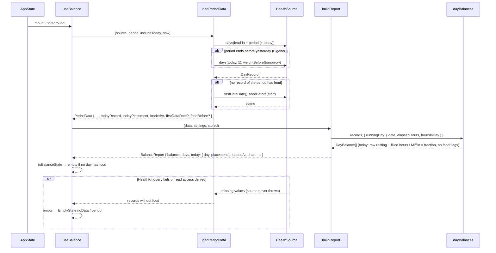
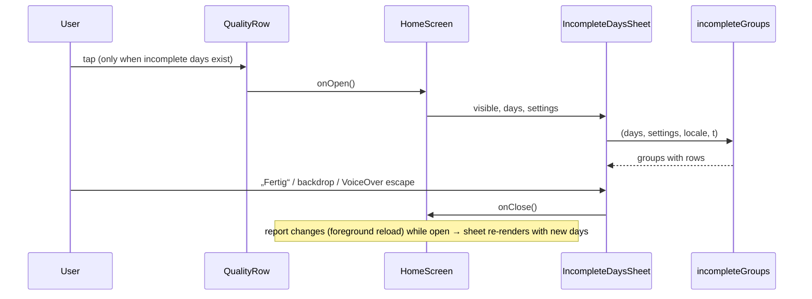

# Homepage Mitte: Datenqualität, Heute bisher, Leerzustand, Fußzeile (P7)

Stand 2026-10-25. Umgesetzt auf Branch `feature/home-page-base` (M1–M6, M7 bis auf die Gerätetests). Offen für Julius am iPhone: Qualitätszeile antippen, Sheet schließen („Fertig“, Abdunklung, VoiceOver-Escape), Link „Körperdaten eintragen ›“ in L5, Schriftmuster mit Chart-Beispiel, 1i (AX), VoiceOver, Sync-Verzögerung der Watch (Open Question 5). Branch: `feature/home-page-base` (oder Folge-Branch). Voraussetzung P2 (Rechenkern) und P6 (Homepage oben) sind umgesetzt.

## Overview

P7 baut den mittleren Teil der Homepage nach dem Hi-Fi-Design (`.claude/design/homepage/Gewichtslinie strukturieren/BilanzScreen.dc.html`). Unter der Toleranz-Karte steht die Qualitätszeile „X von N Tagen vollständig“ mit den Mustern je Flag. Ein Tipp öffnet das Sheet „Unvollständige Tage“ mit einer Gruppe je Flag und einer Zeile je Tag. Darunter folgt die gestrichelte Karte „Heute bisher“ mit Bilanz, Gegessen, Verbraucht und „Stand {Uhrzeit}“. Am Ende stehen der Link „Daten anzeigen“ und die Fußzeile „Keine medizinische Beratung. Daten bleiben auf deinem iPhone.“ Der Leerzustand bekommt die Texte und den gefüllten Button aus 1f, dazu Varianten für „ältere Daten vorhanden“ und „erster Tag“. Die Muster (Schraffur, Streifen, ✕) sind eine SVG-Komponente auf Basis von `react-native-svg`, die P8 im Chart wiederverwendet. Im Kern rechnet der laufende Tag künftig immer „bis jetzt“ (keine Hochrechnung auf 24 h) und bekommt keine Nahrungs-Flags. Betroffen: `package.json` (react-native-svg, neuer Dev-Build), `src/core/` (`resting.ts`, `day-balance.ts`), `src/health/` (`source.ts`, `healthkit-source.ts`), `src/features/balance/` (`use-balance.ts`, neue Modelle und Komponenten, `balance-page.tsx`, `home-screen.tsx`), `src/components/`, `src/dev/` (Demo, Galerie), i18n, `CLAUDE.md`.

### Ausgangslage: Anforderungen (wörtlich)

> **P7 Homepage Mitte: Datenqualität, Heute bisher, Leerzustand, Fußzeile**
> Inhalt: Qualitätszeile mit Sheet „Unvollständige Tage“ und den drei Symbolen/Mustern als wiederverwendbare Komponente; Karte „Heute bisher“ mit Uhrzeit; Leerzustand mit Button zu den Health-Berechtigungen; Fußzeile. Voraussetzung: P2, P6.
> [ ] Zustände 6 und 7 sehen aus wie das Design.
> [ ] Die Qualitäts-Muster sind eine Komponente, die P8 im Chart nutzt.
> [ ] „Heute bisher“ erscheint auch, wenn heute nicht in der Periode zählt, und ist optisch klar abgesetzt.

„Zustände 6 und 7“ sind der 6. und 7. Eintrag der Design-Übersicht: **1f** (Leerer Zustand · keine Health-Daten) und **1g** (Sheet „Unvollständige Tage“), siehe Key Decision 1.

### Stand im Code (2026-10-25)

| Anforderung | Vorhanden | Fehlt |
|---|---|---|
| Flags je Tag | `DayFlag` = `restingEstimated`, `noFood`, `lowFood`, `noResting` in `src/core/day-balance.ts`; `DAY_FLAGS` in Anzeige-Reihenfolge; `LOW_FOOD_SHARE = 0.5`; `isComplete` | Anzeige |
| Zähler | `PeriodBalance.completeDays`, `flagCounts` (ein Tag mit zwei Flags zählt in beiden), `maintenanceDays`, `excludedDays` | Qualitätszeile, Sheet |
| Schwerstes Flag | `FLAG_SEVERITY` (lowFood > noFood > noResting > restingEstimated), `worstFlag` in `src/core/chart.ts` | für P8 |
| Hinweise unter dem Hero | `BalanceSummary` in `balance-page.tsx`: `home.daysWithoutFood`, `home.daysWithoutResting` (vorläufig, P6 Key Decision 16), `LinkButton` „Daten anzeigen“ | Ersatz durch Qualitätszeile |
| Muster | Intro zeichnet Schraffur aus gedrehten Views (`month-grid-illustration.tsx`, Intro-Spec Key Decision 21); kein `react-native-svg` im Projekt | SVG-Muster als Komponente |
| Laufender Tag | `loadPeriodData` lädt `todayRecord` nur, wenn der Zeitraum gestern endet und „Heute einrechnen“ aus ist; `buildReport` rechnet daraus `chart.today` | Heute bei „Heute einrechnen“ als eigener Wert, heute bei „Eigener“ mit Ende vor gestern, Ladezeit |
| Teiltag | `measuredResting` rechnet ab 6 h Abdeckung auf 24 h hoch (`MIN_SCALED_COVERAGE`), sonst Mifflin für den ganzen Tag. Gilt auch für den laufenden Tag: um 14:32 werden aus 1.090 kcal Ruhe etwa 1.800 | „bis jetzt“ für heute |
| Leerzustand | `toBalanceState`: `empty`, wenn `flagCounts.noFood === days`; `EmptyState` mit `home.empty` („Keine Nahrungsdaten in den letzten {n} Tagen …“), `Button variant="secondary"` „Berechtigungen prüfen“, `common.permissionsPath`; `openHealthApp()` (`x-apple-health://`, sonst Einstellungen) | Design 1f, Varianten |
| Erster/letzter Eintrag | `HealthSource.firstDataDate()` (erste Nahrung), nur für „Alles“ geladen; `weightBefore(date)` als Muster für eine Abfrage „letzter Eintrag vor“ | `foodBefore(date)` |
| Fußzeile | `settings.footer` „Keine medizinische Beratung · v{{version}}“ nur in den Einstellungen | Fußzeile der Bilanz-Seite |
| Sheet | `DateRangeSheet` (P6): transparentes `Modal` `fade`, `scrim`, Radius 14 oben, Griff, max. 92 % Höhe, `accessibilityViewIsModal`, `onAccessibilityEscape` | Sheet „Unvollständige Tage“ |
| Galerie | `GalleryUi.sheet: 'incompleteDays'` (1g); `hasPendingUi` zeigt dafür das Badge „UI-Vorgabe folgt mit der Homepage“; Demo `TODAY_SO_FAR = { food: 1420, resting: 1090, active: 290 }` (wie Design) | Vorgabe an die Homepage durchreichen; Szenarien erster Tag, ältere Daten, ohne Grundumsatz |
| Tokens | `foreground`, `background`, `muted`, abgeleitet `separator` (muted 35 %), `band`, `scrim`; `border.thin/medium/thick`; ESLint verbietet Farb-Literale außerhalb `src/theme/colors.ts` | — |

### Design-Referenz (BilanzScreen, mittlerer Teil und 1f/1g)

| Element | Design |
|---|---|
| Qualitätszeile | Karte Rahmen 1,5 pt Vordergrund, Radius 14, Innenabstand 12/14, Abstand 12 zum Chevron. Titel „{X} von {N} Tagen vollständig“ 17/600. Darunter umbrechende Zeile (Abstand 5/14) 13 pt Nebentext: je Eintrag Muster 11 × 11 + 6 pt + „{n} Grundumsatz geschätzt“, „{n} ohne Nahrung“, „{n} auffällig wenig Nahrung“. Chevron rechts 8 × 8, 2 pt, nach rechts zeigend. Ganze Karte tippbar → Sheet |
| Muster | Grundumsatz geschätzt: Quadrat mit 1-pt-Rahmen, Schraffur 45° (Vordergrund 1,4–1,5 pt, Lücke Hintergrund, Raster 3,6). Wenig Nahrung: Quadrat mit 1-pt-Rahmen, waagerechte Streifen (1,2–1,3 pt Vordergrund, Raster 3,4). Ohne Nahrung: „✕“ 11/700 Vordergrund ohne Rahmen. Im Chart: Balken mit SVG-`pattern` gefüllt und 1-pt-Rahmen; ohne Nahrung kein Balken, sondern ✕ (7 × 7, 1,6 pt) auf der Nulllinie; heute gestrichelter Rahmen `2.5 2` |
| Heute bisher | Karte Rahmen 1,5 pt **gestrichelt**, Radius 16, Innenabstand 14/16, Abstand 10. Kopf: „Heute bisher“ 17/600 links, „Stand 14:32“ 15 pt Nebentext rechts (umbrechend). Raster mit drei Spalten (`auto-fit`, min. 92 pt, Abstand 12), darüber Trennlinie 1 pt `separator`, 12 pt Abstand. Je Spalte: Label 12/600 Großbuchstaben, Laufweite 0,06 em, Nebentext („BILANZ“, „GEGESSEN“, „VERBRAUCHT“); Wert 28 pt, Laufweite −0,5 (Bilanz 600, sonst 400) („+40“, „1.420“, „1.380“); darunter 13 pt Nebentext („kcal“, „kcal“, „Ruhe 1.090 + Aktiv 290“). Fuß 13 pt Nebentext „Tag läuft noch, Verbrauch steigt bis Mitternacht. Zählt nicht zur Bilanz oben.“ |
| Reihenfolge | Hero · Toleranz-Karte · Qualitätszeile (Abstand 14 innerhalb des Datenblocks) · Heute bisher · Chart (P8) · Abgleich (P9) · Fußzeile (Abstand 28 zwischen den Blöcken) |
| Fußzeile | „Keine medizinische Beratung. Daten bleiben auf deinem iPhone.“ 12 pt Nebentext, zentriert, Zeilenhöhe 1,4, seitlich 12 pt |
| Leerzustand (1f) | Mindesthöhe 440, vertikal zentriert, Abstand 12, seitlich 4. Gestricheltes Quadrat 44 × 44, 1,5 pt, Radius 12. „Noch keine Daten.“ 24/700. „Prüfe in Health, ob Kcalwaage lesen darf.“ 17 pt. „iOS zeigt Apps nicht an, ob ein Zugriff abgelehnt wurde. Fehlen Einträge, synchronisiert vermutlich deine Tracking- oder Waage-App nicht mit Health.“ 15 pt Nebentext. Gefüllter Pill-Button „Health-Berechtigungen öffnen“, min. 50 hoch, Radius 25, 17/600, 12 pt Abstand darüber. Segmente im Design ausgegraut (P6 Key Decision 17: bleiben bedienbar). Keine Qualitätszeile, keine Heute-Karte, kein Chart; Abgleich-Karte entfällt (`showAb: !empty`); Fußzeile bleibt |
| Sheet (1g) | Abdunklung `rgba(0,0,0,.32)`, Tipp schließt. Sheet ab 64 pt von oben bis unten, Radius 14 oben, Griff 36 × 5 Nebentext 50 %. Kopf (10/20/12): „Unvollständige Tage“ 22/700 und darunter „{n} von {N} Tagen · {erster} – {letzter}“ 15 pt Nebentext; rechts „Fertig“ 17/600. Scrollender Inhalt (4/20/30, Abstand 24): je Gruppe Kopfzeile Muster 13 × 13 + Titel 17/600 + Anzahl 17 pt Nebentext rechts; Beschreibung 13 pt Nebentext; Liste mit Trennlinien oben/unten 1 pt `separator`, Zeilen 10 pt vertikal: Datum „Mo, 12. Okt“ 15/600, Detail 14 pt Nebentext. Am Ende 13 pt Nebentext „Fehlende Einträge in Yazio, MyFitnessPal oder der Waage-App nachtragen. Health synchronisiert, Kcalwaage rechnet beim nächsten Öffnen neu.“ |
| Sheet-Gruppen | Reihenfolge Grundumsatz geschätzt · Ohne Nahrung · Auffällig wenig Nahrung; nur Gruppen mit Tagen. Beschreibungen: „Keine Ruheenergie in Health, z. B. ohne Apple Watch. Geschätzt nach Mifflin-St Jeor.“ · „Nichts eingetragen. Zählt als Erhaltungstag mit Bilanz 0.“ · „Unter 50 % des Verbrauchs, vermutlich nicht vollständig getrackt.“ Zeilen: „Ruhe {R} (Formel) · Aktiv {K} · Bilanz {B}“ · „Gegessen – · Verbraucht {V} · zählt als 0“ · „Gegessen {A} von {V} verbraucht ({p} %) · Bilanz {B}“ |

## Key Decisions

| # | Decision | Rationale | Alternatives Considered |
|---|----------|-----------|-------------------------|
| 1 | „Zustände 6 und 7“ = Galerie-Einträge **1f** (Leerzustand) und **1g** (Sheet „Unvollständige Tage“), verglichen per Screenshot mit dem Design | 6. und 7. Eintrag der Design-Übersicht, genau die zwei P7-Zustände — Julius 2026-10-25 | Zusätzlich 1a-Mitte; zusätzlich 1b/1i |
| 2 | Muster als SVG mit `react-native-svg` (neue native Abhängigkeit, neuer Dev-Build). Eine Datei `src/components/quality-pattern.tsx` exportiert `QualityPatternDefs` (`<Pattern>` für Schraffur und Streifen, Farben aus den Tokens), `qualityFill(flag, idPrefix)` (`url(#…)` oder `undefined`), `QualitySwatch` (Legenden-Quadrat in wählbarer Größe, 10/11/13 pt) und `QualityCross` (✕ als zwei Linien, für Legende und Nulllinie im Chart). P8 legt `QualityPatternDefs` in sein Chart-SVG und füllt Balken über `qualityFill` | P8 braucht für Linien ohnehin SVG; gifted-charts setzt `react-native-svg` voraus und kann Balken mit SVG-Pattern füllen. Eine Implementierung für Zeile, Sheet, Legende und Chart — Julius 2026-10-25 | Views wie im Intro (Chart-Balken müssten dann Views sein); Views jetzt und SVG in P8 (zwei Implementierungen) |
| 3 | Zuordnung Flag → Muster an einer Stelle (`QUALITY_MARK`): `restingEstimated` → Schraffur 45°, `lowFood` → waagerechte Streifen, `noFood` → ✕, `noResting` → ✕ (dasselbe Symbol wie „ohne Nahrung“) | Beide Fälle haben im Chart keinen Balken. „Ohne Grundumsatz“ ist selten, braucht kein eigenes Symbol, „aber wenn, dann das gleiche wie keine Nahrung“ — Julius 2026-10-25 | Eigenes viertes Symbol; nur Text |
| 4 | „Ohne Grundumsatz“ erscheint in Zeile („✕ {n} ohne Grundumsatz“) und Sheet (eigene Gruppe, zuletzt) nur, wenn es solche Tage gibt | Tritt nur auf, wenn eine Watch die Ruheenergie liefert (Intro fragt dann keine Körperdaten ab), sie an einzelnen Tagen nicht getragen wird und Health weder Größe noch Geschlecht kennt. Dann zählt der Tag nicht; das muss sichtbar sein, ersetzt die bisherige Hinweiszeile | Gar nicht zeigen (Tag fehlte dann unerklärt in der Bilanz) |
| 5 | Qualitätszeile zeigt nur Einträge mit Anzahl > 0. Sind alle Tage vollständig: Karte „{N} von {N} Tagen vollständig“ ohne Muster-Zeile, ohne Chevron, nicht tippbar, kein Sheet | Keine „0 ohne Nahrung“-Einträge; das Sheet hätte nichts zu zeigen — Julius 2026-10-25 | Immer alle drei; Karte ganz weglassen |
| 6 | „Heute bisher“ zeigt echte Werte von 0 Uhr bis zum Laden: Nahrung, Ruhe und Aktiv als Health-Summen ohne Hochrechnung auf 24 h. Ohne gemessene Ruheenergie: Mifflin-St Jeor anteilig (`kcal × vergangener Tagesanteil`), gekennzeichnet „(Formel)“. Mit gemessener Ruhe, aber Stunden ohne Messung (Watch erst spät angelegt): diese Stunden mit Mifflin pro Stunde auffüllen (Key Decision 22), gekennzeichnet „(teils Formel)“. Ohne Ruhe und ohne Körperdaten: Verbraucht und Bilanz „–“ | Passt zu „Tag läuft noch, Verbrauch steigt bis Mitternacht“; 1.090 statt hochgerechnet ≈ 1.800 — Julius 2026-10-25 | Prognose wie der Kern; roh ohne Schätzung |
| 7 | Der Kern rechnet den laufenden Tag immer „bis jetzt“ (Key Decision 6), auch in der Bilanz mit „Heute einrechnen“ und im Heute-Balken des Charts (P8). Neue Option `runningDay: { date, elapsedHours, hoursInDay }` für `dayBalances`; `dayResting` nimmt für diesen Tag gemessene Ruhe ungeskaliert plus aufgefüllte Stunden (Quelle `'partial'`, Key Decision 22), ohne Messung Mifflin × `elapsedHours / hoursInDay` | Sonst stünden oben ≈ 1.800 kcal Ruhe und in der Karte 1.090, die Karte sagt aber „Zählt zur Bilanz oben mit“ (um 14:32 rund −700 kcal Unterschied). Eine Rechnung, überall dieselbe Zahl — Julius 2026-10-25 | Kern bleibt Hochrechnung; später entscheiden |
| 8 | Der laufende Tag bekommt nie `noFood` oder `lowFood`; `restingEstimated` (Mifflin anteilig) und `noResting` bleiben. Bei „Heute einrechnen“ zählt heute zu N und zu „X von N vollständig“. Ohne Nahrung zählt heute nach dem Null-Tage-Schalter (B = 0 oder volles Defizit bis jetzt) | Morgens hätte heute fast immer „wenig Nahrung“ oder „ohne Nahrung“; der Tag läuft noch — Julius 2026-10-25 | Heute ganz außen vor; wie andere Tage |
| 9 | „Heute bisher“ erscheint immer, außer im Leerzustand (Ausnahme erster Tag, Key Decision 13). Fußsatz je Fall: heute nicht gezählt → „Tag läuft noch, Verbrauch steigt bis Mitternacht. Zählt nicht zur Bilanz oben.“; „Heute einrechnen“ an und heute im Zeitraum → „… Zählt zur Bilanz oben mit.“; „Eigener“ endet vor gestern → „… Nicht im gewählten Zeitraum.“ Dafür lädt die App heute immer: im Zeitraum (letzter Tag), direkt danach (wie bisher `todayRecord`) oder mit einem eigenen `source.days(heute, 1)` | Abnahme „erscheint auch, wenn heute nicht in der Periode zählt“ — Julius 2026-10-25 | Nur wenn heute nicht zählt; immer mit einem Satz |
| 10 | „Stand {Uhrzeit}“ = Zeitpunkt des letzten Ladens aus Health (`PeriodData.loadedAt`), das „jetzt“ der Rechnung bis jetzt. Format `Intl.DateTimeFormat(locale, { hour: '2-digit', minute: '2-digit' })` (DE „14:32“, EN „2:32 PM“). Dieselbe Zeit steht auf der Daten-Seite als eigene Zeile unter dem Untertitel („Stand 14:32“) — Julius 2026-10-25 | Die App lädt bei Start und Rückkehr in den Vordergrund; die Zahl gilt genau bis dahin — Julius 2026-10-25 | Neuester Health-Eintrag (Rohsample-Abfrage); Minutentakt |
| 11 | Optische Abgrenzung von „Heute bisher“ wie im Design: gestrichelter Rahmen 1,5 pt (`borderStyle: 'dashed'`), Radius 16, eigener Kopf mit Uhrzeit. Gestrichelt heißt in der ganzen App „vorläufig“ (Design-Formensprache, Chart-Balken heute) | Abnahme „optisch klar abgesetzt“; Hero und Qualitätszeile sind durchgezogen | Graue Fläche; eigene Überschrift ohne Rahmen |
| 12 | Leerzustand in drei Varianten, Auswahl über die reine Funktion `emptyKind`: **`noData`** (`firstDataDate` leer): Texte, Quadrat und Button wie 1f. **`period`** (ältere/neuere Daten vorhanden): Titel „Keine Nahrung in diesem Zeitraum.“ und „Letzter Eintrag davor: {TT.MM.JJJJ}. Wähle einen längeren Zeitraum oder prüfe in Health, ob Kcalwaage lesen darf.“ (ohne Eintrag davor: „Erster Eintrag: {TT.MM.JJJJ}. …“), derselbe Button. **`firstDay`** siehe Key Decision 13. Unter dem Button jeweils `common.permissionsPath` („In Health: Profilbild → Apps → Kcalwaage …“) | „Leer“ heißt nur: keine Nahrung im Zeitraum. Bei 7 T können ältere Daten da sein; „Noch keine Daten.“ wäre dann falsch — Julius 2026-10-25 | Immer wie Design; Design ohne Pfad-Hinweis |
| 13 | **Erster Tag** (`firstDataDate` ist heute, Zeitraum ohne Nahrung): Titel „Deine Bilanz beginnt morgen.“, Satz „Heute läuft noch und zählt erst ab morgen. ‚Heute einrechnen‘ in den Einstellungen nimmt ihn sofort mit.“, darunter die Karte „Heute bisher“. Kein Berechtigungs-Button, kein Quadrat | Typischer erster Start: Daten kommen an, nur der Zeitraum endet gestern — Julius 2026-10-25 | Leerzustand + Heute-Karte; nur Leerzustand |
| 14 | `empty` heißt künftig: kein Tag des Zeitraums hat einen Nahrungseintrag (`days.every((day) => day.food === undefined)`), nicht mehr `flagCounts.noFood === days` | Mit Key Decision 8 hat heute ohne Nahrung kein `noFood`; „Heute einrechnen“ mit leerem Zeitraum wäre sonst nicht mehr leer | Zählung beibehalten und heute abziehen |
| 15 | Neue Methode `HealthSource.foodBefore(date): Promise<Date \| undefined>` (Start des letzten Nahrungs-Samples vor `date`), in `healthkit-source.ts` wie `weightBefore` über `queryQuantitySamples` mit `limit: 1`, absteigend (ESLint erlaubt Rohsamples dort, „letzter Eintrag“). `firstDataDate()` und `foodBefore(start)` lädt `loadPeriodData` nur, wenn der Zeitraum keine Nahrung hat | Für die Leerzustand-Varianten, ohne zusätzliche Abfragen im Normalfall | Datum aus `days()` über ein Jahr zurück suchen |
| 16 | Hinweiszeilen `home.daysWithoutFood`/`home.daysWithoutResting` fallen weg (Qualitätszeile ersetzt sie). Der Link „Daten anzeigen ›“ steht direkt über der Fußzeile am Seitenende | Wischen bleibt der Hauptweg, die Seitenpunkte neben dem Titel deuten ihn an — Julius 2026-10-25 | Link ins Sheet; Link weg |
| 17 | Fußzeile „Keine medizinische Beratung. Daten bleiben auf deinem iPhone.“ als letztes Element der Bilanz-Seite, in allen Zuständen (auch leer und beim Laden); `caption` (12 pt) Nebentext zentriert | Design; Hinweis „Keine medizinische Beratung“ ist Pflicht für den Store | Nur in den Einstellungen |
| 18 | Sheet „Unvollständige Tage“ als eigenes transparentes `Modal` wie `DateRangeSheet` (P6): `fade`, `scrim`, Radius 14 oben, Griff, Kopf mit „Fertig“, Inhalt als `ScrollView`; feste Oberkante 64 pt unter der Safe Area. Zustand offen/zu in `HomeScreen`, Galerie-Vorgabe `initialUi.sheet` | Gleiches Verhalten wie der Picker, keine neue Abhängigkeit | Natives `pageSheet`-Modal (andere Optik als 1g) |
| 19 | Sheet-Inhalt als reines Modell `incompleteGroups(days, settings, locale, t)`: Gruppen in `DAY_FLAGS`-Reihenfolge (geschätzt · ohne Nahrung · wenig Nahrung · ohne Grundumsatz), nur nicht leere; Tage in Datumsreihenfolge; ein Tag mit zwei Flags steht in beiden Gruppen (wie `flagCounts`). Zeile „ohne Nahrung“ je Null-Tage-Schalter: an „Gegessen – · Verbraucht {V} · zählt als 0“ und Beschreibung wie Design; aus „Gegessen – · Verbraucht {V} · Bilanz {−V}“ und „Nichts eingetragen. Zählt mit vollem Defizit, weil ‚Null-Tage = Erhaltung‘ aus ist.“ Ruhe-Kennzeichen: Mifflin „(Formel)“, Schätzung der Quelle „(geschätzt)“. Die Gruppe „Ohne Grundumsatz“ hat einen Link „Körperdaten eintragen ›“, der das Sheet schließt und `/settings/resting-estimate` öffnet — Julius 2026-10-25 | Text richtet sich nach dem, was die Bilanz wirklich rechnet; der Link führt direkt zur Lösung | Immer Design-Text; ohne Link |
| 20 | Zahlen in Zeile, Sheet und Karte: kcal-Einzelwerte über `roundKcal` (10 kcal) und `formatNumber`, Bilanzen über `formatSigned` (also „±0“ bei 0), Prozent ganzzahlig; Datum im Sheet „Mo, 12. Okt“ aus neuen `date.weekdaysAbbr` (DE Mo … So, EN Mon … Sun) und `date.monthsShort` | Einheitlich mit P6 (Key Decisions 2, 4, 18) | Rohe Werte wie im Design-Prototyp |
| 21 | VoiceOver: Qualitätszeile ein `button` mit Label „24 von 30 Tagen vollständig“, Wert „3 Grundumsatz geschätzt, 1 ohne Nahrung, 2 auffällig wenig Nahrung“, Hinweis „Zeigt die unvollständigen Tage“; Muster `accessible={false}`. Heute-Karte: Kopf als `header` „Heute bisher, Stand 14:32“; je Spalte ein Element („Bilanz plus 40 Kilokalorien“, „Gegessen 1.420 Kilokalorien“, „Verbraucht 1.380 Kilokalorien, Ruhe 1.090 plus Aktiv 290“, Vorzeichen über `spokenSigned`). Sheet `accessibilityViewIsModal`, `onAccessibilityEscape` = Fertig, Gruppentitel `header` mit Anzahl, jede Tageszeile ein Element | Wie P6 (Key Decision 19), Muster sind Dekoration neben dem Text | Muster mit eigenem Label |
| 22 | Auffüllen fehlender Ruhe-Stunden am laufenden Tag, nicht zu früh: Es zählen nur Stunden **ganz ohne** Ruhe-Sample, nie Stunden mit niedrigen Werten (die Ruheenergie darf an einem Tag einfach niedrig sein). Die letzten `RUNNING_DAY_SYNC_LAG_HOURS = 2` Stunden vor dem Laden bleiben außen vor, weil die Watch verzögert synchronisiert. Fehlende Stunden = max(0, volle vergangene Stunden − 2 − Stunden mit Messung); Stunden mit Messung = `restingCoverage × hoursInDay`. Aufgefüllt wird mit Mifflin ÷ `hoursInDay` je Stunde (Gewicht und Alter des Tages wie sonst). Unbekannte Abdeckung (Stunden-Abfrage fehlgeschlagen) oder keine Körperdaten: nicht auffüllen, Ruhe roh. Ab einer aufgefüllten Stunde trägt der Tag `restingEstimated` | Watch erst um 13 Uhr angelegt: sonst stünden um 14:32 nur ≈ 120 kcal Ruhe da — Julius 2026-10-25: „mit Mifflin auffüllen, aber nicht zu früh, evtl. ist die Ruheenergie auch einfach niedrig“ | Roh lassen; ab 6 h fehlender Stunden auffüllen; nach Werten statt nach Stunden |
| 23 | Keine App-Namen in Texten: Der Sheet-Hinweis lautet „Fehlende Einträge nachtragen. Sobald sie in Health stehen, rechnet Kcalwaage beim nächsten Öffnen neu.“ statt „… in Yazio, MyFitnessPal oder der Waage-App …“ | Die App liest nur Health; aus welcher App die Daten kommen, ist egal — Julius 2026-10-25 | Wie Design mit App-Namen |

## Implementation Details

### Milestone Map

| Milestone | Delivers | 🟢 Add | 🟠 Change | 🔴 Delete | Depends On |
|-----------|----------|--------|-----------|-----------|------------|
| M1 — Laufender Tag „bis jetzt“ im Kern | `runningDay` in `dayBalances`, keine Nahrungs-Flags heute, Tests | 0 | 5 | 0 | — |
| M2 — Laden: heute, Uhrzeit, Leer-Infos | Heute immer laden, `loadedAt`, `report.today`, `empty` nach Nahrung, `foodBefore`, Demo-Szenarien | 0 | 8 | 0 | M1 |
| M3 — Muster-Komponente | `react-native-svg`, `QualityPatternDefs`, `qualityFill`, `QualitySwatch`, `QualityCross`, Schriftmuster | 1 | 3 | 0 | — |
| M4 — Qualitätszeile und Sheet | Modelle `qualityRow`/`incompleteGroups` mit Tests, `QualityRow`, `IncompleteDaysSheet` | 4 | 5 | 0 | M2, M3 |
| M5 — Heute bisher | Modell `todayCard` mit Tests, `TodayCard`, „Stand“ auf der Daten-Seite | 3 | 6 | 0 | M2 |
| M6 — Leerzustand, Fußzeile, Seitenaufbau | `emptyKind`, drei Varianten, Fußzeile, Link, Hinweiszeilen weg | 3 | 5 | 0 | M4, M5 |
| M7 — Galerie, Abnahme, Doku | 1g-Vorgabe, neue L-Einträge, Screenshots 1f/1g, Gerät, CLAUDE.md | 0 | 6 | 0 | M6 |

```
🟢 Add   🟠 Change   🔴 Delete
```

Abnahmekriterien → Milestones:

| Kriterium | Milestone |
|---|---|
| Zustände 6 und 7 (1f, 1g) sehen aus wie das Design | M4 (1g), M6 (1f), M7 (Screenshots) |
| Qualitäts-Muster sind eine Komponente, die P8 im Chart nutzt | M3 (Komponente mit `QualityPatternDefs`/`qualityFill` für SVG-Balken, Schriftmuster mit Beispielbalken) |
| „Heute bisher“ erscheint auch, wenn heute nicht zählt, und ist klar abgesetzt | M2 (heute immer geladen), M5 (Karte, gestrichelt, Fußsatz je Fall), M7 (Galerie 1a, L4, „Eigener“) |

#### 🔀 Inbound Flow — Laden mit laufendem Tag



#### 🔀 Inbound Flow — UI: Qualitätszeile antippen



---

### ✅ Milestone 1 — Laufender Tag „bis jetzt“ im Kern

> Der Kern rechnet den laufenden Tag ohne Hochrechnung und ohne Nahrungs-Flags, getestet; der goldene Testfall bleibt unverändert.

**Depends on:** none

#### File Changes

| Color | File | Action |
|-------|------|--------|
| 🟠 | `src/core/resting.ts` | `RestingSource` um `'partial'`; `RUNNING_DAY_SYNC_LAG_HOURS`; `dayResting(…, running?: { elapsedHours, hoursInDay })`: gemessen ungeskaliert plus aufgefüllte Stunden, sonst Mifflin × Anteil |
| 🟠 | `src/core/day-balance.ts` | Option `runningDay?: { date: string; elapsedHours: number; hoursInDay: number }`; für diesen Tag keine `noFood`/`lowFood`; `DayBalance.restingFilledHours` |
| 🟠 | `src/core/dates.ts` | `elapsedDayHours(now)` → `{ elapsedHours, hoursInDay }` (Sommerzeit: Tag 23/25 h) |
| 🟠 | `src/core/__tests__/resting.test.ts` | Fälle laufender Tag |
| 🟠 | `src/core/__tests__/day-balance.test.ts` | Flags und Bilanz des laufenden Tags |

#### To-Dos

- ✅ Add `elapsedDayHours(now)` _(Test in `period.test.ts` bei `isoWeek`)_ → `{ elapsedHours: (now − local midnight) in h, hoursInDay: (next midnight − local midnight) in h }`; test 14:32 → 14,53 / 24, DST days in Europe/Berlin (23 h / 25 h)
- ✅ Add `'partial'` to `RestingSource` with comment („running day: measured so far, not scaled“); `isEstimatedResting('partial')` is false
- ✅ Add `RUNNING_DAY_SYNC_LAG_HOURS = 2` to `resting.ts` with comment („a watch syncs late; the last hours before loading are never filled“)
- ✅ Extend `dayResting` with `running?: { elapsedHours: number; hoursInDay: number }` (Key Decision 22): source estimate stays `'source'`; measured resting → `missing = max(0, floor(elapsedHours) − LAG − round(restingCoverage × hoursInDay))`; with coverage known, missing ≥ 1 and an estimate possible → `kcal = resting + mifflin / hoursInDay × missing`, else `kcal = resting`; source `'partial'`, return `filledHours`; without measured resting → Mifflin × `elapsedHours / hoursInDay` with source `'formula'`; else `'missing'`
- ✅ `dayFlags`: running day with `filledHours ≥ 1` gets `restingEstimated`; add `restingFilledHours` to `DayBalance` (0 otherwise) for the card text _(`running: true` und `restingFilledHours` nur am laufenden Tag gesetzt, sonst fehlen beide, damit bestehende Erwartungen gleich bleiben)_
- ✅ Add `runningDay` to `DayBalanceOptions`; the record with `date === runningDay.date` uses `running`; `dayFlags` skips `noFood` and `lowFood` for it (Key Decision 8); `maintenance` still follows `zeroDaysAsMaintenance`
- ✅ Test: running day at 14:32 with resting 1.090 and 14 hours with data (coverage 14/24), active 290, food 1.420 → nothing filled (14 − 2 − 14 < 0), resting 1.090, kcal +40, flags `[]`; watch from 13:00 (2 hours with data, resting 150) → 14 − 2 − 2 = 10 hours filled with Mifflin ÷ 24 each, flag `restingEstimated`, `restingFilledHours` 10; low resting with all hours present → nothing filled; coverage unknown → raw; without resting and with profile → Mifflin × 0,606, flag `restingEstimated`; without resting and without profile → `noResting`, kcal undefined; without food and switch on → kcal 0, maintenance, no `noFood`; switch off → kcal −burn so far; food < 50 % → no `lowFood`
- ✅ Test: other days unchanged (scaled partial day still scaled, golden test green without `runningDay`)
- ✅ Run `npm run lint`, `npm run typecheck`, `npm test`; all exit 0, core coverage ≥ 90 %
- ✅ Commit (`feat: count the running day only up to now`)

#### Notes / Constraints

> - Der Kern bekommt den Anteil als Zahl, nie `new Date()`; `buildReport` reicht `loadedAt` durch (M2).
> - Aufgefüllt wird nur nach Stunden ohne Sample, nie nach der Höhe der Werte (Key Decision 22).
> - `restingCoverage` des laufenden Tags teilt durch die Stunden des ganzen Tags (`daily-energy.ts`); daraus ergeben sich die Stunden mit Messung, ohne neue Abfrage.
> - Die Rechnung kennt nur die Anzahl der Stunden mit Messung, nicht welche. Liegen die gemessenen Stunden am Ende (Watch ab 13 Uhr), füllt sie bis zu 2 Stunden zu wenig auf. Das ist gewollt vorsichtig („nicht zu früh“) und kommt ohne neue Abfrage aus.

---

### ✅ Milestone 2 — Laden: heute, Uhrzeit, Leer-Infos

> `useBalance` liefert immer den laufenden Tag mit Platzierung und Ladezeit, erkennt „leer“ an fehlender Nahrung und bringt für den Leerzustand ersten und letzten Eintrag mit.

**Depends on:** Milestone 1

#### File Changes

| Color | File | Action |
|-------|------|--------|
| 🟠 | `src/health/source.ts` | `foodBefore(date)` im Interface |
| 🟠 | `src/health/healthkit-source.ts` | `foodBefore` per `queryQuantitySamples` (limit 1, absteigend, `strictEndDate`) |
| 🟠 | `src/health/__tests__/healthkit-source.test.ts` | Test `foodBefore` |
| 🟠 | `src/features/balance/use-balance.ts` | heute immer laden, `todayPlacement`, `loadedAt`, `runningDay`, `report.today`, `emptyInfo`, `toBalanceState` nach Nahrung |
| 🟠 | `src/features/balance/__tests__/use-balance.test.ts` | Fälle unten |
| 🟠 | `src/dev/demo/demo-source.ts` | `foodBefore`; `firstDataDate` je Szenario |
| 🟠 | `src/dev/demo/scenarios.ts` | Szenarien `firstDay`, `stale30`, `noProfileGaps30` |
| 🟠 | `src/dev/demo/__tests__/scenarios.test.ts` | neue Szenarien |

#### To-Dos

- ✅ Add `foodBefore(date)` to `HealthSource` („start of the newest food sample before `date`, for the empty state“); implement in `healthkit-source.ts` like `weightBefore` with `safe(…, [])`; test with a mocked query
- ✅ `PeriodData`: add `loadedAt: Date`, `todayRecord` for all three placements, `todayPlacement: 'excluded' | 'included' | 'outside'`, `todayWeightBeforeKg` (for the outside case), `firstDataDate?`, `foodBefore?`
- ✅ `loadPeriodData`: `included` when the period ends today (today is the last record); `excluded` when it ends yesterday (as today); else `outside` with an extra `source.days(startOfDay(now), 1)` and `weightBefore(tomorrow)`; when no period record has food, also `firstDataDate()` (if not loaded yet) and `foodBefore(start)`
- ✅ `buildReport`: pass `runningDay: { date: today, ...elapsedDayHours(loadedAt) }` to every `dayBalances` call; add `today: { day: DayBalance; placement }` and `loadedAt` to `BalanceReport`; `chart.today` only for `excluded` (unchanged for P8); add `empty: { firstDataDate?, foodBefore? }` _(Feld heißt `emptyInfo`, nicht `empty`, damit es nicht mit dem Status `empty` verwechselt wird; `estimateSummary` lässt den laufenden Tag aus, sein Mifflin-Wert ist nur ein Tagesanteil)_
- ✅ `toBalanceState`: `empty` when `days.every((day) => day.food === undefined)` (Key Decision 14); update the existing test names
- ✅ Test: period ending yesterday → today `excluded`, not in `balance.days`; `includeToday` → `included`, today is the last day, counted with raw resting; custom ending 5 days ago → `outside`, one extra `days(today, 1)` call; `loadedAt` equals the passed `now`; empty period with older food → `foodBefore` set; no food at all → both undefined; `includeToday` with empty period and today without food → still `empty`
- ✅ Demo source: `foodBefore(date)` = last series day with food before `date`; `firstDataDate` = today for `firstDay`
- ✅ Add scenarios: `firstDay` (series empty, today `TODAY_SO_FAR`, `firstDataDate` today); `stale30` (last 30 days without any value, older days from the base series); `noProfileGaps30` (`gaps30` series, profile without height and sex, so the holiday days get `noResting`); test them in `scenarios.test.ts` _(Szenarien haben dafür `today` und `profile`; die Demo-Quelle leitet `firstDataDate`, `foodBefore` und die Quellen aus den Daten ab statt aus der Szenario-ID. In `noProfileGaps30` zählen die Urlaubstage ohne Nahrung als Null-Tage, also `noResting` 3, aber `excludedDays` 0)_
- ✅ Run `npm run lint`, `npm run typecheck`, `npm test`; all exit 0
- ✅ Commit (`feat: load the running day for every period`) _(c522c96)_

#### Notes / Constraints

> - Ladeschlüssel bleibt `period` + `includeToday`; die Uhrzeit ändert sich nur mit einem neuen Laden (Start, Vordergrund).
> - Im Fall `outside` braucht die Mifflin-Schätzung für heute ein Gewicht: letzte Messung bis heute (`weightBefore(morgen)`), sonst Profilgewicht.

---

### ✅ Milestone 3 — Muster-Komponente

> Die drei Muster sind eine SVG-Komponente aus den Tokens, die Zeile, Sheet und später der Chart (P8) nutzen.

**Depends on:** none

#### File Changes

| Color | File | Action |
|-------|------|--------|
| 🟠 | `package.json` | `react-native-svg` per `npx expo install` (Version passend zu Expo SDK 57) |
| 🟢 | `src/components/quality-pattern.tsx` | `QUALITY_MARK`, `QualityPatternDefs`, `qualityFill`, `QualitySwatch`, `QualityCross` |
| 🟠 | `src/features/settings/components/type-specimen.tsx` | Muster und ein Beispiel-SVG mit drei gefüllten Balken (Nachweis für P8) |
| 🟠 | `CLAUDE.md` | Stack: `react-native-svg` für Muster und Chart |

#### To-Dos

- ✅ Install `react-native-svg` with `npx expo install react-native-svg`; check the license (MIT); rebuild the dev client (`npx expo run:ios`); note in the commit that a new build is needed _(15.15.4 per `npx expo install`, MIT; Dev-Build steht noch aus, siehe Simulator-Check)_
- ✅ Create `QUALITY_MARK: Record<DayFlag, 'hatch' | 'stripes' | 'cross'>` (Key Decision 3)
- ✅ Create `QualityPatternDefs({ idPrefix })`: `<Defs>` with `<Pattern id="{prefix}-hatch" patternUnits="userSpaceOnUse" width={3.6} height={3.6} patternTransform="rotate(45)">` (rect background + rect width 1,5 foreground) and `<Pattern id="{prefix}-stripes" width={4} height={3.4}>` (rect background + rect height 1,3 foreground); colors from `useColors()`
- ✅ Create `qualityFill(flag, idPrefix)` → `url(#{prefix}-hatch)` / `url(#{prefix}-stripes)` / `undefined` for cross flags; comment: „P8 fills chart bars with this inside its own <Svg> after QualityPatternDefs“
- ✅ Create `QualitySwatch({ flag, size = 11 })`: own `<Svg>` with unique `idPrefix` (`useId`), square with 1-pt foreground border and pattern fill; for cross flags `QualityCross`; `accessible={false}`
- ✅ Create `QualityCross({ size, strokeWidth })`: two lines foreground, round caps; usable standalone (legend) and as `<G>` inside a chart (`x`, `y` props for the zero line)
- ✅ Add to the type specimen (settings, dev only): swatches 10/11/13 pt, cross, and a 120 × 60 SVG with an `ok` bar (filled), a `restingEstimated` bar, a `lowFood` bar (pattern + 1-pt border) and a cross on the zero line, light and dark _(160 × 88 statt 120 × 60, damit das ✕ daneben passt; dazu die neuen Schrift-Varianten `detail`, `overline`, `numberMedium`, `emptyTitle`)_
- ✅ Check in the simulator light and dark: stripes visible at 11 pt, no color literals (ESLint), dark mode inverts _(1g, 1a hell und 1b dunkel auf iPhone 16 Pro: Streifen und ✕ bei 11/13 pt klar. Schraffur zeigte zuerst Dreiecke, weil `react-native-svg` eine gedrehte Kachel (`patternTransform`) abschneidet; jetzt nahtlose Diagonal-Kachel 3,6 × √2 ohne Drehung, Fix 7a926a6. Dev-Build mit `npx expo run:ios` neu gebaut)_
- ✅ Run `npm run lint`, `npm run typecheck`, `npm test`; all exit 0
- ✅ Commit (`feat: draw data quality patterns in SVG`) _(c038383)_

#### Notes / Constraints

> - Muster-IDs müssen je SVG eindeutig sein (mehrere Swatches auf einer Seite); `useId` liefert Doppelpunkte, die in SVG-`url(#…)` stören können, daher bereinigen.
> - Größe der Swatches bleibt bei Dynamic Type fest (wie Design: Symbole wachsen nicht mit).

#### 📐 Wireframe — QualitySwatch / Chart-Beispiel

```
 ▨ 11 pt  restingEstimated   (hatch 45°, 1-pt border)
 ▤ 11 pt  lowFood            (horizontal stripes, 1-pt border)
 ✕ 11 pt  noFood / noResting (two lines, no border)

 Chart sample (type specimen):
   █   ▨   ▤
 ──█───▨───▤───✕──   zero line
```

**Component tree:**
quality-pattern.tsx
├── QUALITY_MARK
├── QualityPatternDefs (Defs > Pattern hatch, Pattern stripes)
├── qualityFill(flag, idPrefix)
├── QualitySwatch (Svg > QualityPatternDefs, Rect | QualityCross)
└── QualityCross (G > Line, Line)

#### ⌨️ Keyboard Shortcuts

Keine App-Kürzel: reine Touch-App fürs iPhone (siehe P0/P1-Spec). Muster sind für VoiceOver ausgeblendet.

---

### ✅ Milestone 4 — Qualitätszeile und Sheet

> Die Qualitätszeile zeigt „X von N Tagen vollständig“ mit Mustern und öffnet das Sheet „Unvollständige Tage“ wie 1g.

**Depends on:** Milestone 2, Milestone 3

#### File Changes

| Color | File | Action |
|-------|------|--------|
| 🟢 | `src/features/balance/quality.ts` | `qualityRow(balance, t)`, `incompleteGroups(days, settings, locale, t)`, `dayLabel(date, locale, t)` |
| 🟢 | `src/features/balance/__tests__/quality.test.ts` | Golden-ähnliche Daten, Null-Tage an/aus, zwei Flags, alles vollständig, EN |
| 🟢 | `src/features/balance/components/quality-row.tsx` | Karte nach Design, tippbar nur mit unvollständigen Tagen |
| 🟢 | `src/features/balance/components/incomplete-days-sheet.tsx` | Sheet nach 1g, Link „Körperdaten eintragen ›“ in der Gruppe „Ohne Grundumsatz“ |
| 🟠 | `src/features/balance/components/home-screen.tsx` | Sheet-State, `initialUi.sheet` |
| 🟠 | `src/features/balance/components/balance-page.tsx` | `QualityRow` unter `HeroSection`, `onOpenQuality` |
| 🟠 | `src/theme/typography.ts` | Variante `detail` (14/19) für die Tageszeilen, falls keine passt |
| 🟠 | `src/i18n/locales/de.ts` | `quality.*`, `incomplete.*`, `date.weekdaysAbbr` |
| 🟠 | `src/i18n/locales/en.ts` | dasselbe auf Englisch |

#### To-Dos

- ✅ Create `qualityRow(balance, t)` → `{ title, entries: { flag, text }[], tappable, a11yLabel, a11yValue }`: title from `completeDays`/`days`; entries in `DAY_FLAGS` order, only counts > 0; `tappable = completeDays < days` (Key Decision 5) _(liefert `spokenEntries` als VoiceOver-Wert, Label ist der Titel)_
- ✅ Create `incompleteGroups(days, { zeroDaysAsMaintenance }, locale, t)` → `{ subtitle, groups: { flag, title, count, description, rows: { date, label, detail }[] }[] }` after Key Decision 19; percent in `lowFood` = `round(food / (resting + active) × 100)`; numbers per Key Decision 20 _(heißt `incompleteDays` und liefert `{ subtitle, groups }`; Untertitel-Plural über die Anzahl Tage, `incomplete` als eigener Wert)_
- ✅ Create `dayLabel` „Mo, 12. Okt“ / „Mon, Oct 12“ (`date.weekdaysAbbr`, `date.monthsShort`)
- ✅ Test with a fixture of 30 days ending 2026-10-24 (now 2026-10-25; numbers below are examples, take them from the fixture) with 3 estimated, 1 without food, 2 low → title „24 von 30 Tagen vollständig“, entries „3 Grundumsatz geschätzt“, „1 ohne Nahrung“, „2 auffällig wenig Nahrung“; sheet subtitle „6 von 30 Tagen · 25. Sep – 24. Okt“; estimated row „Ruhe 1.750 (Formel) · Aktiv 870 · Bilanz +420“; none row with switch on „Gegessen – · Verbraucht 2.650 · zählt als 0“, switch off „… · Bilanz −2.650“ and the other description; low row „Gegessen 1.060 von 2.650 verbraucht (40 %) · Bilanz −1.590“; day with two flags in both groups; `noResting` group last with „Gegessen 2.100 · Aktiv 640 · zählt nicht“; all complete → no entries, not tappable; EN texts
- ✅ Create `QualityRow`: `Pressable` card border 1,5 pt foreground, radius 14, padding 12/14, title `bodyStrong`, entries row `flexWrap` gap 5/14, each `QualitySwatch` 11 + `footnote` muted; chevron 8 × 8 (2 pt, `rotate(-45deg)`) only when tappable; pressed state opacity like `LinkButton`; a11y after Key Decision 21
- ✅ Create `IncompleteDaysSheet` (`visible`, `days`, `settings`, `onClose`): transparent `Modal` `fade`, backdrop `Pressable` with `scrim`, sheet from top 64 pt (below safe area) to bottom, radius 14 top, grabber 36 × 5 muted 50 %; header title `sectionTitle`, subtitle `secondary` muted, „Fertig“ `bodyStrong` as button; `ScrollView` content padding 4/20/30, gap 24; group header `QualitySwatch` 13 + `bodyStrong` title + count muted right; description `footnote` muted; list with `separator` hairlines (1 pt) top and between rows, row padding 10, date 15/600 (`secondary` + weight 600), detail 14 pt muted (new variant `detail` 14/19 in `typography.ts` if none fits); closing note `footnote` muted (text without app names, Key Decision 23); in the `noResting` group a `LinkButton` „Körperdaten eintragen ›“ under the description: `onClose()`, then `router.push('/settings/resting-estimate')` _(ohne `visible`-Prop: `HomeScreen` rendert es nur offen und nur, solange es unvollständige Tage gibt; Variante `detail` 14/19 neu)_
- ✅ Accessibility of the sheet: `accessibilityViewIsModal`, `onAccessibilityEscape` → `onClose`, „Fertig“ first in focus order after the title, group titles `header`
- ✅ `HomeScreen`: `const [qualityOpen, setQualityOpen] = useState(initialUi?.sheet === 'incompleteDays')`; pass `onOpenQuality` to `BalancePage`; render the sheet with `state.value.days` while `done`
- ✅ Add texts DE: `quality.complete_one` „{{complete}} von {{count}} Tag vollständig“, `quality.complete_other` „{{complete}} von {{count}} Tagen vollständig“, `quality.restingEstimated` „{{count}} Grundumsatz geschätzt“, `quality.noFood` „{{count}} ohne Nahrung“, `quality.lowFood` „{{count}} auffällig wenig Nahrung“, `quality.noResting` „{{count}} ohne Grundumsatz“, `quality.openHint` „Zeigt die unvollständigen Tage“; `incomplete.title` „Unvollständige Tage“, `.subtitle` „{{count}} von {{days}} Tagen · {{from}} – {{to}}“, `.done` „Fertig“, `.restingEstimated.title` „Grundumsatz geschätzt“, `.restingEstimated.body` „Keine Ruheenergie in Health, z. B. ohne Apple Watch. Geschätzt nach Mifflin-St Jeor.“, `.noFood.title` „Ohne Nahrung“, `.noFood.bodyMaintenance` „Nichts eingetragen. Zählt als Erhaltungstag mit Bilanz 0.“, `.noFood.bodyDeficit` „Nichts eingetragen. Zählt mit vollem Defizit, weil ‚Null-Tage = Erhaltung‘ aus ist.“, `.lowFood.title` „Auffällig wenig Nahrung“, `.lowFood.body` „Unter {{percent}} % des Verbrauchs, vermutlich nicht vollständig getrackt.“, `.noResting.title` „Ohne Grundumsatz“, `.noResting.body` „Keine Ruheenergie in Health und keine Körperdaten für die Schätzung. Zählt nicht zur Bilanz.“; rows `.row.estimated` „Ruhe {{resting}} {{mark}} · Aktiv {{active}} · Bilanz {{balance}}“ with `.mark.formula` „(Formel)“, `.mark.source` „(geschätzt)“, `.row.noFoodMaintenance` „Gegessen – · Verbraucht {{burn}} · zählt als 0“, `.row.noFoodDeficit` „Gegessen – · Verbraucht {{burn}} · Bilanz {{balance}}“, `.row.lowFood` „Gegessen {{food}} von {{burn}} verbraucht ({{percent}} %) · Bilanz {{balance}}“, `.row.noResting` „Gegessen {{food}} · Aktiv {{active}} · zählt nicht“; `.noResting.link` „Körperdaten eintragen ›“, `.note` „Fehlende Einträge nachtragen. Sobald sie in Health stehen, rechnet Kcalwaage beim nächsten Öffnen neu.“; `date.weekdaysAbbr` „Mo,Di,Mi,Do,Fr,Sa,So“
- ✅ Add the same keys EN: „{{complete}} of {{count}} day complete“ / „{{complete}} of {{count}} days complete“, „{{count}} resting energy estimated“, „{{count}} without food“, „{{count}} unusually little food“, „{{count}} without resting energy“, „Shows the incomplete days“; „Incomplete days“, „{{count}} of {{days}} days · {{from}} – {{to}}“, „Done“, „Resting energy estimated“, „No resting energy in Health, e.g. without an Apple Watch. Estimated after Mifflin-St Jeor.“, „Without food“, „Nothing logged. Counts as a maintenance day with balance 0.“, „Nothing logged. Counts with the full deficit because ‘Zero days = maintenance’ is off.“, „Unusually little food“, „Below {{percent}} % of the burn, probably not fully tracked.“, „Without resting energy“, „No resting energy in Health and no body data for the estimate. Not counted in the balance.“; rows „Resting {{resting}} {{mark}} · Active {{active}} · Balance {{balance}}“, „(formula)“, „(estimated)“, „Eaten – · Burned {{burn}} · counts as 0“, „Eaten – · Burned {{burn}} · Balance {{balance}}“, „Eaten {{food}} of {{burn}} burned ({{percent}} %) · Balance {{balance}}“, „Eaten {{food}} · Active {{active}} · not counted“; „Enter body data ›“, „Add the missing entries. Once they are in Health, Kcalwaage recalculates the next time you open it.“; weekdays „Mon,Tue,Wed,Thu,Fri,Sat,Sun“
- ✅ Check in the simulator: 1a shows the row under the tolerance card as in the design; tap opens the sheet; L5: „Körperdaten eintragen ›“ closes the sheet and opens the resting estimate page; 1g opens with the sheet as in the design; „Fertig“ and backdrop close; large Dynamic Type: entries wrap, sheet scrolls _(1a: Zeile unter der Toleranz-Karte wie im Design; 1g öffnet mit Sheet wie im Design; L5 zeigt „✕ 3 ohne Grundumsatz“. Antippen, „Fertig“, Abdunklung und der Link „Körperdaten eintragen ›“ gehen im Simulator ohne Tipp-Werkzeug nicht, offen für Julius am iPhone)_
- ✅ Run `npm run lint`, `npm run typecheck`, `npm test`; all exit 0
- ✅ Commit (`feat: show data quality with a sheet of incomplete days`) _(c5f9d66; alle DE/EN-Texte für M4–M6 hier, `HomeScreen` mit dem Sheet erst in M6. Achtung: c5f9d66 und b2573a2 bestehen den Typecheck allein nicht (2 Fehler: die alte `BalancePage` nutzt die hier entfernten `home.empty*`/`home.checkPermissions`), ab f45023c wieder fehlerfrei)_

#### Notes / Constraints

> - `LOW_FOOD_SHARE` liefert die 50 % im Text, keine Zahl doppelt.
> - Kommt beim offenen Sheet ein neues Laden (Rückkehr aus der Tracking-App), zeigt das Sheet die neuen Tage; ohne unvollständige Tage schließt es sich.

#### 📐 Wireframe — QualityRow (1a)

```
┌─────────────────────────────────────┐
│ 24 von 30 Tagen vollständig       › │  bodyStrong, chevron
│ ▨ 3 Grundumsatz geschätzt           │  footnote muted, wraps
│ ✕ 1 ohne Nahrung  ▤ 2 auffällig     │
│   wenig Nahrung                     │
└─────────────────────────────────────┘
┌─────────────────────────────────────┐
│ 30 von 30 Tagen vollständig         │  all complete: no chevron, not a button
└─────────────────────────────────────┘
```

**Component tree:**
QualityRow (Pressable, button)
├── AppText — title
├── View (wrap)
│   └── Entry[] (QualitySwatch, AppText)
└── Chevron (only when tappable)

#### 📐 Wireframe — IncompleteDaysSheet (1g)

```
┌─────────────────────────────────────┐
│░░░░░░░░ backdrop (tap closes) ░░░░░░│  top 64 pt
├─────────────────────────────────────┤
│               ───                   │  grabber
│  Unvollständige Tage         Fertig │  sectionTitle, bodyStrong
│  6 von 30 Tagen · 25. Sep – 24. Okt │  secondary muted
│                                     │
│  ▨ Grundumsatz geschätzt          3 │  group header
│  Keine Ruheenergie in Health, z. B. │  footnote muted
│  ohne Apple Watch. Geschätzt nach … │
│ ─────────────────────────────────── │
│  Mi, 30. Sep                        │  15/600
│  Ruhe 1.750 (Formel) · Aktiv 870 ·  │  14 muted
│  Bilanz +420                        │
│ ─────────────────────────────────── │
│  …                                  │
│  ✕ Ohne Nahrung                   1 │
│  Nichts eingetragen. Zählt als …    │
│ ─────────────────────────────────── │
│  Sa, 10. Okt                        │
│  Gegessen – · Verbraucht 2.650 ·    │
│  zählt als 0                        │
│ ─────────────────────────────────── │
│  ▤ Auffällig wenig Nahrung        2 │
│  …                                  │
│  Fehlende Einträge nachtragen. …    │  footnote muted, no app names
└─────────────────────────────────────┘
```

**Component tree:**
IncompleteDaysSheet (Modal, transparent)
├── Pressable — backdrop
└── Sheet
    ├── Grabber
    ├── Header (AppText title, AppText subtitle, Pressable „Fertig“)
    └── ScrollView
        ├── Group[] (QualitySwatch, AppText title, AppText count, AppText description, LinkButton „Körperdaten eintragen“ [noResting only], Row[])
        └── AppText — note

#### ⌨️ Keyboard Shortcuts

Keine App-Kürzel (Touch-App). VoiceOver: Zeile als Button mit Wert und Hinweis; Sheet modal, Zwei-Finger-Wischen (Escape-Geste) schließt wie „Fertig“.

---

### ✅ Milestone 5 — Heute bisher

> Die gestrichelte Karte zeigt den laufenden Tag bis zum Laden, mit Uhrzeit und einem Fußsatz je nachdem, ob heute zählt.

**Depends on:** Milestone 2

#### File Changes

| Color | File | Action |
|-------|------|--------|
| 🟢 | `src/features/balance/today.ts` | `todayCard(today, loadedAt, locale, t)` |
| 🟢 | `src/features/balance/__tests__/today.test.ts` | Design-Werte, Formel, ohne Ruhe, ohne Nahrung, drei Fußsätze, EN-Uhrzeit |
| 🟢 | `src/features/balance/components/today-card.tsx` | Karte nach Design |
| 🟠 | `src/features/balance/components/balance-page.tsx` | `TodayCard` unter der Qualitätszeile |
| 🟠 | `src/features/balance/components/data-page.tsx` | Zeile „Stand {Uhrzeit}“ unter dem Untertitel |
| 🟠 | `src/theme/typography.ts` | Varianten `overline` (12/600, Laufweite 0,72) und `numberMedium` (28/34, Laufweite −0,5) |
| 🟠 | `src/features/settings/components/type-specimen.tsx` | neue Varianten im Schriftmuster |
| 🟠 | `src/i18n/locales/de.ts` | `today.*`, `a11y.today*` |
| 🟠 | `src/i18n/locales/en.ts` | dasselbe auf Englisch |

#### To-Dos

- ✅ Create `todayCard({ day, placement }, loadedAt, locale, t)` → `{ asOf, balance, food, burn, burnDetail, unitNote, note, labels }`: balance `formatSigned(roundKcal(kcal))` or „–“ when undefined; food `formatNumber(roundKcal(food))` or „–“; burn `roundKcal(resting + active)` or „–“ without resting; detail „Ruhe {R} + Aktiv {K}“, with Mifflin „Ruhe {R} (Formel) + Aktiv {K}“, with filled hours „Ruhe {R} (teils Formel) + Aktiv {K}“; unit note under the balance „kcal“, maintenance „kcal · als Erhaltung“; note by placement (Key Decision 9); `asOf` per Key Decision 10 _(Uhrzeit über `timeStyle: 'short'`: DE „08:05“, EN „2:32 PM“)_
- ✅ Test: `TODAY_SO_FAR` at 14:32 → „Stand 14:32“, „+40“, „1.420“, „1.380“, „Ruhe 1.090 + Aktiv 290“, note „Tag läuft noch, Verbrauch steigt bis Mitternacht. Zählt nicht zur Bilanz oben.“; `included` → „… Zählt zur Bilanz oben mit.“; `outside` → „… Nicht im gewählten Zeitraum.“; without resting with profile → Mifflin × fraction with „(Formel)“; with `restingFilledHours` > 0 → „(teils Formel)“; without resting and profile → „–“; without food, switch on → „±0“ and „kcal · als Erhaltung“; EN „As of 2:32 PM“; labels „Bilanz plus 40 Kilokalorien“, „Verbraucht 1.380 Kilokalorien, Ruhe 1.090 plus Aktiv 290“
- ✅ Create `TodayCard`: border 1,5 pt foreground **dashed**, radius 16, padding 14/16, gap 10; header row `bodyStrong` „Heute bisher“ (`header`) + `secondary` muted „Stand …“, wrapping; grid: hairline top `separator` (1 pt) + 12 pt padding, three columns `flexBasis` 92 with `flexGrow: 1`, `flexWrap: 'wrap'`, gap 12; label new variant `overline` (12/600, uppercase via text, `letterSpacing` 0,72) muted; value new variant `numberMedium` (28/34, `letterSpacing` −0,5; balance weight 600, others 400); unit `footnote` muted; note `footnote` muted
- ✅ Add `overline` and `numberMedium` to `typography.ts` (the Abgleich card in P9 uses them too) and to the type specimen
- ✅ Accessibility after Key Decision 21: header element, three column elements with labels, note readable
- ✅ `DataPage`: under the `Headline` with the period subtitle a `secondary` muted line `today.asOf` from `report.loadedAt` (Key Decision 10); export the time formatter from `today.ts` so both pages use one
- ✅ Add texts DE: `today.title` „Heute bisher“, `.asOf` „Stand {{time}}“, `.balance` „Bilanz“, `.food` „Gegessen“, `.burn` „Verbraucht“, `.unit` „kcal“, `.maintenance` „kcal · als Erhaltung“, `.burnDetail` „Ruhe {{resting}} + Aktiv {{active}}“, `.burnDetailFormula` „Ruhe {{resting}} (Formel) + Aktiv {{active}}“, `.burnDetailPartial` „Ruhe {{resting}} (teils Formel) + Aktiv {{active}}“, `.running` „Tag läuft noch, Verbrauch steigt bis Mitternacht.“, `.excluded` „Zählt nicht zur Bilanz oben.“, `.included` „Zählt zur Bilanz oben mit.“, `.outside` „Nicht im gewählten Zeitraum.“; `a11y.todayHeader` „Heute bisher, Stand {{time}}“, `a11y.todayBalance` „Bilanz {{value}} Kilokalorien“, `a11y.todayFood` „Gegessen {{value}} Kilokalorien“, `a11y.todayBurn` „Verbraucht {{value}} Kilokalorien, Ruhe {{resting}} plus Aktiv {{active}}“
- ✅ Add the same keys EN: „Today so far“, „As of {{time}}“, „Balance“, „Eaten“, „Burned“, „kcal“, „kcal · as maintenance“, „Resting {{resting}} + Active {{active}}“, „Resting {{resting}} (formula) + Active {{active}}“, „Resting {{resting}} (partly formula) + Active {{active}}“, „The day is still running; burn rises until midnight.“, „Not counted in the balance above.“, „Counted in the balance above.“, „Not in the chosen period.“; „Today so far, as of {{time}}“, „Balance {{value}} kilocalories“, „Eaten {{value}} kilocalories“, „Burned {{value}} kilocalories, resting {{resting}} plus active {{active}}“
- ✅ Check in the simulator: 1a shows the card under the quality row like the design; with „Heute einrechnen“ on the note changes and the hero contains today’s raw values; custom period ending earlier shows „Nicht im gewählten Zeitraum.“; large Dynamic Type: columns wrap _(1a: Karte wie im Design „+40 / 1.420 / 1.380, Ruhe 1.090 + Aktiv 290“; L4: „Zählt zur Bilanz oben mit.“, Hero +7.090 mit heute; „Nicht im gewählten Zeitraum.“ ist per Test belegt (`use-balance.test.ts`, `today.test.ts`), im Simulator nicht ohne Tippen erreichbar)_
- ✅ Run `npm run lint`, `npm run typecheck`, `npm test`; all exit 0
- ✅ Commit (`feat: show today so far in a dashed card`) _(b2573a2)_

#### Notes / Constraints

> - Die Karte rechnet nicht selbst: Werte kommen aus `report.today.day` (Kern, M1), damit Karte, Bilanz mit „Heute einrechnen“ und Heute-Balken (P8) gleich sind.
> - Die drei Fußsätze bestehen aus `today.running` + Satz je Platzierung.

#### 📐 Wireframe — TodayCard (1a)

```
┌ ─ ─ ─ ─ ─ ─ ─ ─ ─ ─ ─ ─ ─ ─ ─ ─ ─ ─ ┐
  Heute bisher           Stand 14:32     bodyStrong · secondary muted
│ ─────────────────────────────────── │  separator
  BILANZ      GEGESSEN    VERBRAUCHT     overline muted
│ +40         1.420       1.380       │  numberMedium (600 / 400)
  kcal        kcal        Ruhe 1.090 +   footnote muted
│                         Aktiv 290   │
  Tag läuft noch, Verbrauch steigt bis   footnote muted
│ Mitternacht. Zählt nicht zur Bilanz │
  oben.
└ ─ ─ ─ ─ ─ ─ ─ ─ ─ ─ ─ ─ ─ ─ ─ ─ ─ ─ ┘  dashed 1.5 pt, radius 16
```

**Component tree:**
TodayCard (View, dashed border)
├── Header (AppText title [header], AppText asOf)
├── Grid
│   ├── Column — Bilanz (AppText label, AppText value, AppText unit)
│   ├── Column — Gegessen
│   └── Column — Verbraucht
└── AppText — note

#### ⌨️ Keyboard Shortcuts

Keine App-Kürzel (Touch-App). VoiceOver: Kopf als Überschrift, je Spalte ein Element.

---

### ✅ Milestone 6 — Leerzustand, Fußzeile, Seitenaufbau

> Die Bilanz-Seite hat die Reihenfolge des Designs, den Leerzustand aus 1f mit zwei Varianten und die Fußzeile in allen Zuständen.

**Depends on:** Milestone 4, Milestone 5

#### File Changes

| Color | File | Action |
|-------|------|--------|
| 🟢 | `src/features/balance/empty.ts` | `emptyKind(report, now)` und Texte je Variante |
| 🟢 | `src/features/balance/__tests__/empty.test.ts` | drei Varianten, Eintrag davor / erster Eintrag |
| 🟢 | `src/features/balance/components/empty-state.tsx` | Leerzustand nach 1f, Varianten |
| 🟠 | `src/features/balance/components/balance-page.tsx` | Reihenfolge, Hinweiszeilen weg, Link über der Fußzeile, Fußzeile, `EmptyState` ausgelagert |
| 🟠 | `src/components/button.tsx` | falls nötig: Pill-Variante min. 50 hoch, 17/600 (sonst bestehende `primary`) _(nicht nötig, unverändert)_ |
| 🟠 | `src/theme/typography.ts` | Variante `emptyTitle` (24/29/700) |
| 🟠 | `src/i18n/locales/de.ts` | `empty.*`, `home.footer`; alte Schlüssel entfernen |
| 🟠 | `src/i18n/locales/en.ts` | dasselbe auf Englisch |

#### To-Dos

- ✅ Create `emptyKind({ empty, today }, now)` → `'firstDay'` when `firstDataDate` is today, `'noData'` when it is undefined, else `'period'` with `date` = `foodBefore` (text „Letzter Eintrag davor“) or `firstDataDate` (text „Erster Eintrag“); test all four cases
- ✅ Create `EmptyState` (Key Decisions 12, 13): `noData` and `period`: dashed square 44 × 44 (1,5 pt, radius 12), title 24/700 (new text variant `emptyTitle` 24/29/700 in `typography.ts`), body `body`, explanation `secondary` muted, 12 pt gap, filled pill button „Health-Berechtigungen öffnen“ → `openHealthApp`, caption `common.permissionsPath` muted; min height 440, vertically centred; `firstDay`: title and body only, then `TodayCard` _(eigene Datei `empty-state.tsx`; der bestehende gefüllte `Button` (Pill, 52 hoch, 17/600) passt, `button.tsx` bleibt unverändert; Ladefehler zeigt `noData`)_
- ✅ Rebuild `BalancePage` order: top (P6) · data block (gap 14: `HeroSection`, `QualityRow`) · `TodayCard` · [chart P8] · [Abgleich P9] · `LinkButton` „Daten anzeigen ›“ · footer; empty: top · `EmptyState` · link · footer; loading: top · loading text · footer
- ✅ Remove `home.daysWithoutFood*`, `home.daysWithoutResting*`, `home.empty*`, `home.checkPermissions` when nothing else uses them (check `data-page.tsx`, intro) _(nur `home.empty*` und `home.checkPermissions` entfernt; `home.daysWithout*` nutzt die Daten-Seite weiter in `data-rows.ts`)_
- ✅ Footer: `AppText variant="caption" tone="muted"` centred, padding 12 sides (Key Decision 17)
- ✅ Add texts DE: `empty.noData.title` „Noch keine Daten.“, `.noData.body` „Prüfe in Health, ob Kcalwaage lesen darf.“, `.explain` „iOS zeigt Apps nicht an, ob ein Zugriff abgelehnt wurde. Fehlen Einträge, synchronisiert vermutlich deine Tracking- oder Waage-App nicht mit Health.“, `.period.title` „Keine Nahrung in diesem Zeitraum.“, `.period.lastBefore` „Letzter Eintrag davor: {{date}}. Wähle einen längeren Zeitraum oder prüfe in Health, ob Kcalwaage lesen darf.“, `.period.first` „Erster Eintrag: {{date}}. Wähle einen anderen Zeitraum oder prüfe in Health, ob Kcalwaage lesen darf.“, `.firstDay.title` „Deine Bilanz beginnt morgen.“, `.firstDay.body` „Heute läuft noch und zählt erst ab morgen. ‚Heute einrechnen‘ in den Einstellungen nimmt ihn sofort mit.“, `.open` „Health-Berechtigungen öffnen“; `home.footer` „Keine medizinische Beratung. Daten bleiben auf deinem iPhone.“
- ✅ Add the same keys EN: „No data yet.“, „Check in Health whether Kcalwaage may read.“, „iOS doesn’t tell apps whether access was denied. If entries are missing, your tracking or scale app probably doesn’t sync with Health.“, „No food in this period.“, „Last entry before: {{date}}. Choose a longer period or check in Health whether Kcalwaage may read.“, „First entry: {{date}}. Choose another period or check in Health whether Kcalwaage may read.“, „Your balance starts tomorrow.“, „Today is still running and counts from tomorrow. ‘Include today’ in Settings counts it right away.“, „Open Health permissions“; „No medical advice. Your data stays on your iPhone.“
- ✅ Check in the simulator: 1f matches the design (except tappable segments, P6 Key Decision 17); L2 shows „Deine Bilanz beginnt morgen.“ with today card; L3 shows „Keine Nahrung in diesem Zeitraum.“ with the last date; footer at the end of 1a and 1f _(1f wie im Design, Segmente bedienbar; L2 „Deine Bilanz beginnt morgen.“ mit Heute-Karte; L3 „Letzter Eintrag davor: 24.09.2026.“; Fußzeile in 1a, 1f, L2, L3)_
- ✅ Run `npm run lint`, `npm run typecheck`, `npm test`, `npm run check:release-bundle`; all exit 0
- ✅ Commit (`feat: show the empty state and footer from the design`) _(f45023c, mit `HomeScreen`)_

#### Notes / Constraints

> - Fehler beim Laden (`error`) zeigt weiter den Leerzustand `noData` (iOS meldet Verweigerung als leere Daten, P4).
> - Platz für Chart (P8) und Abgleich (P9) bleibt zwischen Heute-Karte und Link; keine Platzhalter auf der Seite.

#### 📐 Wireframe — BalancePage (Mitte und Ende, 1a)

```
┌─────────────────────────────────────┐
│  … Titel, Segmente, Untertitel (P6) │
│  +7.000 kcal                        │  HeroSection (P6)
│  …                                  │
│ ┌─────────────────────────────────┐ │
│ │ Messfehler einrechnen   aus   ⌄ │ │
│ └─────────────────────────────────┘ │
│ ┌─────────────────────────────────┐ │
│ │ 24 von 30 Tagen vollständig   › │ │  QualityRow
│ │ ▨ 3 … ✕ 1 … ▤ 2 …               │ │
│ └─────────────────────────────────┘ │
│ ┌ ─ ─ ─ ─ ─ ─ ─ ─ ─ ─ ─ ─ ─ ─ ─ ─ ┐ │
│   Heute bisher        Stand 14:32   │  TodayCard
│ │ BILANZ  GEGESSEN  VERBRAUCHT    │ │
│   +40     1.420     1.380           │
│ └ ─ ─ ─ ─ ─ ─ ─ ─ ─ ─ ─ ─ ─ ─ ─ ─ ┘ │
│  [Chart P8] [Abgleich P9]           │
│  Daten anzeigen ›                   │  LinkButton
│   Keine medizinische Beratung.      │  footer, caption muted, centred
│   Daten bleiben auf deinem iPhone.  │
└─────────────────────────────────────┘
```

**Component tree:**
BalancePage (ScrollView)
├── Top (TitleRow, PeriodSegments, AppText subtitle) — P6
├── DataBlock
│   ├── HeroSection (BalanceHero, ToleranceCard) — P6
│   └── QualityRow
├── TodayCard
├── LinkButton „Daten anzeigen“
└── AppText — footer

#### 📐 Wireframe — EmptyState (1f / Zeitraum / erster Tag)

```
┌─────────────────────────────────────┐  noData (1f)
│  Bilanz                        ● ○  │
│ [7 T][30 T][60 T][90 T][Alles][Eigener]│  stays tappable
│  25. Sep – 24. Okt · 30 Tage · …    │
│                                     │
│  ┌ ─ ┐                              │  dashed square 44
│  └ ─ ┘                              │
│  Noch keine Daten.                  │  24/700
│  Prüfe in Health, ob Kcalwaage      │  body
│  lesen darf.                        │
│  iOS zeigt Apps nicht an, ob ein …  │  secondary muted
│  ( Health-Berechtigungen öffnen )   │  filled pill button
│  In Health: Profilbild → Apps → …   │  caption muted
│  Daten anzeigen ›                   │
│   Keine medizinische Beratung. …    │  footer
└─────────────────────────────────────┘
┌─────────────────────────────────────┐  period
│  Keine Nahrung in diesem Zeitraum.  │
│  Letzter Eintrag davor: 12.09.2026. │
│  Wähle einen längeren Zeitraum …    │
│  ( Health-Berechtigungen öffnen )   │
└─────────────────────────────────────┘
┌─────────────────────────────────────┐  firstDay
│  Deine Bilanz beginnt morgen.       │
│  Heute läuft noch und zählt erst ab │
│  morgen. „Heute einrechnen“ …       │
│ ┌ ─ Heute bisher ─ ─ Stand 14:32 ─┐ │  TodayCard
│ └ ─ ─ ─ ─ ─ ─ ─ ─ ─ ─ ─ ─ ─ ─ ─ ─ ┘ │
└─────────────────────────────────────┘
```

**Component tree:**
EmptyState
├── View — dashed square (noData, period)
├── AppText — title
├── AppText — body
├── AppText — explanation (noData, period)
├── Button „Health-Berechtigungen öffnen“ (noData, period)
├── AppText — permissions path (noData, period)
└── TodayCard (firstDay)

#### ⌨️ Keyboard Shortcuts

Keine App-Kürzel (Touch-App). VoiceOver: Titel des Leerzustands als `header`, Button vor dem Pfad-Hinweis.

---

### Milestone 7 — Galerie, Abnahme, Doku

> Die Galerie zeigt 1g mit offenem Sheet und die neuen Fälle; Screenshots und Gerätetest belegen die drei Abnahmekriterien.

**Depends on:** Milestone 6

#### File Changes

| Color | File | Action |
|-------|------|--------|
| 🟠 | `src/dev/gallery/entries.ts` | `hasPendingUi` ohne `sheet`; Einträge L2–L5; `GalleryUi.includeToday` |
| 🟠 | `src/dev/gallery/entry-screen.tsx` | `initialUi.sheet`; `includeToday` in den Galerie-Store |
| 🟠 | `src/features/balance/components/home-screen.tsx` | `HomeUi.sheet?: 'incompleteDays'` |
| 🟠 | `CLAUDE.md` | Rechenmodell: laufender Tag „bis jetzt“, heute ohne Nahrungs-Flags; Stack: `react-native-svg`; Design: Muster-Komponente, Fußzeile |
| 🟠 | `docs/specs/2026-10-21-data-page.md` | Hinweis, falls die Daten-Seite heute erwähnt (Werte jetzt „bis jetzt“) |
| 🟠 | `docs/specs/2026-10-25-home-middle-quality-today-empty-footer.md` | Status, erledigte To-Dos |

#### To-Dos

- ✅ Pass `ui.sheet` as `initialUi.sheet`; remove `sheet` from `hasPendingUi` (badge only for tooltip and Abgleich part)
- ✅ Add entries: `L2` „Erster Tag (nicht im Design)“ → `firstDay`; `L3` „Zeitraum leer, ältere Daten (nicht im Design)“ → `stale30`; `L4` „Heute einrechnen (nicht im Design)“ → `normal30` with `ui.includeToday: true`; `L5` „Ohne Grundumsatz (nicht im Design)“ → `noProfileGaps30`
- ✅ Screenshot 1f and 1g (iPhone 16 Pro, light) and compare side by side with the design; list visible differences here (expected: segments in 1f not greyed, P6 Key Decision 17; sheet note without app names, Key Decision 23; numbers from the demo series) _(iPhone 16 Pro, hell, per Deep Link: 1f und 1g wie im Design. Unterschiede: Segmente in 1f nicht ausgegraut (P6 Key Decision 17), Sheet-Hinweis ohne App-Namen (Key Decision 23), Zahlen aus der Demo-Reihe (z. B. „Verbraucht 2.530“))_
- ✅ Screenshot 1a middle part (quality row, today card, link, footer) and compare; check 1b (dark: patterns inverted, dashed border visible) and 1i (AX: entries and columns wrap, sheet scrolls) _(1a Mitte wie im Design; 1b dunkel: Muster und gestrichelter Rahmen invertiert. 1i (AX-Stufe am Gerät) noch offen)_
- ✅ Check L4: note „Zählt zur Bilanz oben mit.“, hero includes today with raw resting; custom period ending a week ago: card with „Nicht im gewählten Zeitraum.“; L5: entry „✕ … ohne Grundumsatz“ and its sheet group _(L4 wie erwartet; L5 Eintrag und Zeile vorhanden, Sheet-Gruppe per Test (`quality.test.ts`))_
- 🔲 Check that the type specimen shows the chart sample with pattern bars (criterion 2) _(Beispiel ist eingebaut (`type-specimen.tsx`, Einstellungen, nur Dev); liegt am Seitenende und ist im Simulator ohne Scrollen nicht erreichbar, offen für Julius)_
- 🔲 On Julius’ iPhone (open for Julius): tap the quality row, scroll the sheet, close with „Fertig“, backdrop and VoiceOver escape; „Heute bisher“ shows real values and the time of the last opening; empty state button opens Health
- 🔲 VoiceOver on the device: quality row reads title, counts and hint; today card reads header and three columns
- ✅ Update `CLAUDE.md`: Rechenmodell „Laufender Tag: nie hochgerechnet, Ruhe bis jetzt; Stunden ohne Messung (außer den letzten 2) mit Mifflin pro Stunde aufgefüllt, ohne Messung Mifflin anteilig; keine Nahrungs-Flags“; Datenqualität „ohne Grundumsatz mit ✕ wie ohne Nahrung“; Stack „`react-native-svg` für Muster (`src/components/quality-pattern.tsx`) und Chart“; Design „Fußzeile ‚Keine medizinische Beratung. Daten bleiben auf deinem iPhone.‘“ und „keine App-Namen in Texten, die App liest nur Health“
- ✅ Run `npm run lint`, `npm run typecheck`, `npm test`, `npm run check:release-bundle`; all exit 0 
- ✅ Commit (`feat: show the incomplete days sheet in the gallery`, then `docs: record homepage middle decisions`) _(0dfca2b, Fix 7a926a6, Doku im Anschluss)_

#### Notes / Constraints

> - Die Galerie schreibt `includeToday` nur in ihren In-Memory-Store; echte Einstellungen bleiben unberührt.

#### ⌨️ Keyboard Shortcuts

Keine App-Kürzel (Touch-App).

---

## Open Questions

| # | Question | Owner | Impact if Unresolved |
|---|----------|-------|----------------------|
| 1 | ❓ Laufender Tag mit kurzer Tragezeit (Watch z. B. erst um 13 Uhr angelegt): Ruhe roh (nur 1,5 h) oder fehlende Stunden bis jetzt mit Mifflin anteilig auffüllen? | Julius | Beantwortet: auffüllen, aber nicht zu früh, die Ruheenergie kann auch einfach niedrig sein — Julius 2026-10-25 → Key Decision 22 |
| 2 | ❓ Soll die Gruppe „Ohne Grundumsatz“ im Sheet einen Link „Körperdaten eintragen ›“ zur Seite Grundumsatz-Schätzung (`/settings/resting-estimate`) bekommen? | Julius | Beantwortet: ja — Julius 2026-10-25 → Key Decision 19, M4 |
| 3 | ❓ App-Namen „Yazio, MyFitnessPal“ im Sheet-Hinweis (wie Design)? | Julius | Beantwortet: keine App-Namen, die App bezieht sich nur auf Health — Julius 2026-10-25 → Key Decision 23 |
| 4 | ❓ Gilt die Ladezeit „Stand …“ auch für die Daten-Seite? | Julius | Beantwortet: ja — Julius 2026-10-25 → Key Decision 10, M5 |
| 5 | ❓ Reichen 2 Stunden Sync-Verzögerung (`RUNNING_DAY_SYNC_LAG_HOURS`)? Am iPhone prüfen: wie spät erscheinen Ruhe-Samples der Watch in Health? | M7 / Julius | Bei längerer Verzögerung wird zu früh aufgefüllt; Konstante anpassen |

## Concerns & Decisions Log

| # | Type | Concern | Resolution |
|---|------|---------|------------|
| 1 | ⚠️ Concern | „Zustände 6 und 7“ gibt es im Design nicht als Nummern; es nummeriert 1a–1m | 6. und 7. Eintrag der Übersicht = 1f und 1g (Key Decision 1) — Julius 2026-10-25 |
| 2 | ⚠️ Concern | Das Projekt hat kein `react-native-svg`; Muster aus Views ließen sich in einem SVG-Chart (P8) nicht wiederverwenden | `react-native-svg` jetzt, Muster als SVG-Komponente (Key Decision 2) — Julius 2026-10-25 |
| 3 | ⚠️ Concern | Der Kern kennt vier Flags, Design zeigt drei; „ohne Grundumsatz“ fehlt | Selten (Watch-Nutzer ohne Größe/Geschlecht in Health, Intro fragt dann nicht), aber möglich: ✕ wie „ohne Nahrung“, nur bei > 0 (Key Decisions 3, 4) — Julius 2026-10-25 |
| 4 | ⚠️ Concern | Der Kern rechnet den laufenden Tag ab 6 h auf 24 h hoch; „Heute bisher“ zeigte dann ≈ 1.800 statt 1.090 Ruhe | Karte zeigt echte Werte bis jetzt (Key Decision 6) — Julius 2026-10-25 |
| 5 | ⚠️ Concern | Mit „Heute einrechnen“ stünde oben die Hochrechnung, in der Karte „bis jetzt“, obwohl sie „Zählt zur Bilanz oben mit“ sagt (≈ −700 kcal Unterschied um 14:32) | Kern rechnet heute immer „bis jetzt“ (Key Decision 7) — Julius 2026-10-25 |
| 6 | ⚠️ Concern | Heute wird nur geladen, wenn der Zeitraum gestern endet; bei „Eigener“ mit früherem Ende fehlte die Karte | Heute immer laden, Fußsatz je Platzierung (Key Decision 9) — Julius 2026-10-25 |
| 7 | ⚠️ Concern | Mit „Heute einrechnen“ hätte heute morgens fast immer „wenig Nahrung“ oder „ohne Nahrung“ | Keine Nahrungs-Flags für den laufenden Tag (Key Decision 8) — Julius 2026-10-25 |
| 8 | ⚠️ Concern | Key Decision 8 ändert `flagCounts.noFood`; `toBalanceState` erkennt „leer“ bisher daran | `empty` nach fehlender Nahrung (Key Decision 14) |
| 9 | ⚠️ Concern | „Noch keine Daten.“ ist falsch, wenn nur der gewählte Zeitraum leer ist (z. B. 7 T nach einer Pause) | Varianten `noData`/`period` (Key Decision 12) — Julius 2026-10-25 |
| 10 | 💡 Alternative | Beim ersten Start mit Einträgen nur von heute zeigte die App den Leerzustand mit Berechtigungs-Button, obwohl Daten ankommen | Variante „Deine Bilanz beginnt morgen.“ mit Heute-Karte (Key Decision 13) — Julius 2026-10-25 |
| 11 | ⚠️ Concern | Die vorläufigen Hinweiszeilen und der Link „Daten anzeigen“ (P6 Key Decision 16) stehen nicht im Design | Hinweiszeilen weg, Link über der Fußzeile (Key Decision 16) — Julius 2026-10-25 |
| 12 | ⚠️ Concern | Design-Text „Zählt als Erhaltungstag mit Bilanz 0“ stimmt nicht, wenn der Null-Tage-Schalter aus ist | Text und Zeile je Schalter (Key Decision 19) |
| 13 | ⚠️ Concern | „Stand 14:32“ könnte die Zeit des letzten Health-Eintrags meinen; die bräuchte eine weitere Rohsample-Abfrage | Zeit des letzten Ladens (Key Decision 10) — Julius 2026-10-25 |
| 14 | ⚠️ Concern | `react-native-svg` ist eine native Abhängigkeit: neuer Dev-Build, und EAS-Build und Release-Bundle-Check müssen grün bleiben | Installation über `npx expo install`, Build in M3, `check:release-bundle` in M6/M7 |
| 15 | ⚠️ Concern | Wie in P6 gibt es keine Komponenten-Tests; „sieht aus wie Design“ ist nicht automatisch prüfbar | Logik in reinen Funktionen (`qualityRow`, `incompleteGroups`, `todayCard`, `emptyKind`, Kern) mit Tests; Optik per Galerie-Screenshot (M7) |
| 16 | ⚠️ Concern | Rohe Ruhe am laufenden Tag ist viel zu niedrig, wenn die Watch erst spät angelegt wurde; Auffüllen nach niedrigen Werten würde aber echte niedrige Tage verfälschen, zu frühes Auffüllen die Sync-Verzögerung | Nur Stunden ganz ohne Sample, ohne die letzten 2 Stunden, mit Mifflin pro Stunde (Key Decision 22) — Julius 2026-10-25 |
| 17 | 💡 Alternative | Design nennt im Sheet „Yazio, MyFitnessPal oder der Waage-App“ | Keine App-Namen (Key Decision 23) — Julius 2026-10-25 |
| 18 | ⚠️ Concern | Umsetzung M3: `react-native-svg` schneidet eine per `patternTransform="rotate(45)"` gedrehte Kachel ab, die Schraffur zeigte Dreiecke | Nahtlose Diagonal-Kachel 3,6 × √2 ohne Drehung (7a926a6); P8 nutzt dieselben Defs |
