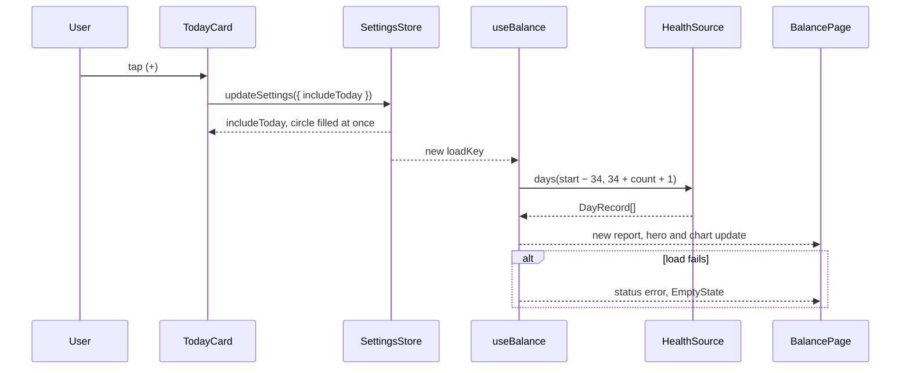
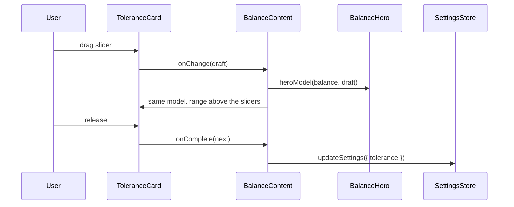
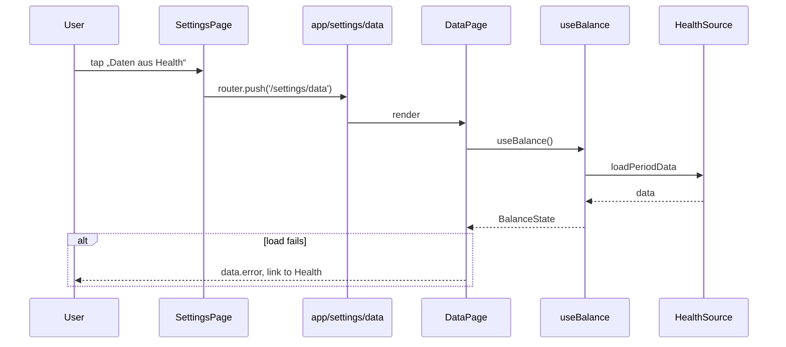

# UI-Refresh der Bilanz-Seite

Stand 2026-11-02. Umgesetzt auf `feature/ui-refresh` (M1–M6). Offen sind nur die am Gerät nötigen Prüfungen (🔲): Dynamic Type, Profiler, Slider-Sperre, restliche Galerie-Einträge. Branch `feature/ui-refresh`.

## Overview

Der UI-Refresh macht die Bilanz-Seite luftiger: Daten werden ausgeblendet, verschoben oder eingeklappt, die Reihenfolge ändert sich, und die Abgleich-Karte wird zu „Dein tatsächlicher Verbrauch“ mit Balken und Differenz-Linie. Die Rechenlogik bleibt bis auf zwei kleine Ergänzungen gleich: Heute zählt zusätzlich zum Zeitraum, und der Kern liefert die Balkenanteile. Betroffen sind `src/features/balance/`, `src/features/settings/`, `src/core/period.ts`, `src/core/analysis.ts`, `src/storage/parse.ts`, `src/app/`, i18n, die Galerie, `eslint.config.js` und `CLAUDE.md`.

### Ausgangslage: Anforderungen (wörtlich)

> Ich möchte gerne die UI refreshen, es sollte sich dabei nicht zuviel an der logik ändern, es ändert sich hauptsächlich die reihenfolge und dass einige dinge nicht mehr angezeigt werden.
>
> Wir brauchen keine option "alles" mehr für den zeitraum, das macht in der praxis keinen Sinn.
>
> Das design soll luftiger werden, daten werden nicht angezeigt oder verschoben, eingeklappt, siehe screenshot.
>
> Today Balance - wird eine einklappbare card weiter oben die eine checkbox bekommt mit einem plus zeichen ob sie in die bilanz von oben mit reinzählen soll
>
> geschätzer tastächlicher verbauch bekommt ein make over siehe zweiten screenshot, mit so balken und eine rlinie der differenz
>
> der rest verschiebt sich einfach nur nach unten in der reihenfolge.

> Die Datenseite sollte auf die settingsseite verschoben werden. Reihenfolge erstmal egal.
>
> "theoretisch" ist einfach zu lang, vorgelesen könnte weiterhin werden ca berechnet oder so, aber zum lesen wäre es gut wenn es kurz wäre

### Design-Referenz

| Datei | Zeigt |
|---|---|
| `.claude/design/ui-refresh/page-deviation.png` | Ganze Seite, Karte im Zustand `deviation` (goldener Testfall) |
| `.claude/design/ui-refresh/card-ok.png` | Nur die Karte, Zustand `ok`, Differenz 0 |

Seitenaufbau laut Screenshot, von oben nach unten:

1. Titel „Bilanz“
2. Segmente 7 T · 30 T · 60 T · 90 T · Eigener
3. Hero, zentriert: „+7.000“, „kcal mehr gegessen als verbraucht“, „ca. +0,9 kg Körperfett“
4. Heute, gestrichelt und eingeklappt: (+) Heute, Stand 14:32, +40 kcal, Chevron
5. Karte „Dein tatsächlicher Verbrauch“
6. Chart „Bilanz pro Tag“ mit Chips und Hinweisen
7. Qualitätszeile „24 von 30 Tagen vollständig“, Einträge untereinander
8. „Messfehler einrechnen“, eingeklappt
9. Fußzeile

Elemente der neuen Karte:

| Element | `deviation` (Goldener Testfall) | `ok`, Differenz 0 |
|---|---|---|
| Titel | Dein tatsächlicher Verbrauch | gleich |
| Untertitel | aus Bilanz und Waage · 24. Sep – 23. Okt · 30 Tage · 19 Messungen | gleich |
| Große Zahl | 2.760 kcal/Tag | 2.670 kcal/Tag |
| Differenz | „+90 kcal/Tag“ über der Linie; hohler Punkt „Tracker 2.670“ links, gefüllter Punkt „tatsächlich 2.760“ rechts | Zielscheibe (Kreis mit Punkt), darunter „Tracker 2.670 kcal“ |
| Abschnitt | „Bilanz vs. Waage“, „Waage zeigt 61 % der Bilanz“ | „Bilanz vs. Waage“, „ungefähr gleich“ |
| Balken Bilanz | +7.000 kcal, voll | +7.000 kcal, voll |
| Balken Waage | ≈ +4.300 kcal: Fett gefüllt, Magermasse schraffiert, Lücke gestrichelt | ≈ +6.900 kcal, gleiches Muster |
| Legende | Fett +0,4 kg · Magermasse +0,3 kg · Lücke 2.700 kcal | Fett +0,7 kg · Magermasse +0,1 kg · Lücke 100 kcal |
| Satz mit Chevron | Du verbrauchst etwas mehr, als dein Tracker misst. | Bilanz und Waage passen gut zusammen. |

### Stand im Code (2026-11-02)

| Bereich | Heute | Änderung |
|---|---|---|
| Seite | `BalancePage`: `HeroSection` (Hero + Toleranz), `QualityRow`, `TodayCard`, Chart, `AnalysisCard`, Link, Fußzeile. Die uncommitted Änderung in `balance-page.tsx` setzt `TodayCard` über den Hero | Reihenfolge laut Screenshot, also Heute unter dem Hero (Key Decision 1) |
| Zeitraum | `Period` mit `all`, `PERIOD_PRESETS`, `periodSpan(…, loadedDays)`, `firstDataDate` in `loadPeriodData` | `all` entfällt. `HealthSource.firstDataDate()` bleibt für Picker und Leerzustand |
| Heute | `includeToday` verschiebt das Fenster, der älteste Tag fällt raus. Schalter in den Einstellungen. `TodayPlacement` je Zeitraum | Heute zählt zusätzlich (Key Decision 2), Plus in der Karte statt Schalter |
| Neu laden | `useForegroundRefresh` behält beim Laden den alten Stand, es gibt kein Flackern. `TodayCard` bleibt gemountet | — |
| Toleranz-Entwurf | `HeroSection` hält den Slider-Entwurf; nur sie rendert beim Ziehen neu | Entwurf muss Hero und Karte erreichen, die nun weit auseinander stehen (Key Decision 3) |
| Daten-Seite | Zweite Seite im horizontalen Pager von `HomeScreen`, teilt sich `useBalance` | Eigene Route in den Einstellungen (Key Decision 6) |
| Karte | `analysisCardModel` mit Spalten; `AnalysisValues` kennt `storedKcal`, `fatChangeKg`, `leanChangeKg` | Neues Layout, Kern liefert Balkenanteile (Key Decision 8) |

## Key Decisions

| # | Decision | Rationale | Alternatives Considered |
|---|----------|-----------|-------------------------|
| 1 | **Reihenfolge wie im Screenshot:** Heute steht direkt unter dem Hero. Die uncommitted Änderung, die `TodayCard` über den Hero setzt, wird dabei ersetzt | Screenshot ist die Vorgabe; „weiter oben“ ist damit erfüllt, weil die Karte über Chart und Abgleich rückt | Über dem Hero wie im aktuellen Diff |
| 2 | **Heute zählt obendrauf.** Mit Plus: „30 T“ = die 30 Tage bis gestern plus heute, also 31 Tage, und aus +7.000 wird +7.040. Der Zeitraum verliert keinen Tag. Eigener Zeitraum: Endet er gestern oder später, kommt heute dazu. Endet er früher, ist heute `outside`: kein Plus, nur der Hinweis „Nicht im gewählten Zeitraum.“ | Julius 2026-11-02. Die Änderung am Hero entspricht so dem Wert auf der Karte | Fenster verschieben wie bisher (keine Logikänderung, aber der Hero springt um heute minus den herausgefallenen Tag) |
| 3 | **Toleranz unten, Spanne in der Karte.** „Messfehler einrechnen“ steht am Seitenende. Aufgeklappt zeigt die Karte über den Slidern live die Spanne und die Fettspanne aus `heroModel`. Der Hero rechnet weiter mit. Der Entwurf liegt in einem neuen `BalanceContent`; Chart, Karten und Qualitätszeile werden mit `memo` umschlossen, damit beim Ziehen nur Hero und Toleranz neu rendern | Julius 2026-11-02. Beim Ziehen ist der Hero nicht im Bild und die Seite gesperrt | Nur Hero oben; Karte unter dem Hero |
| 4 | **Balken im Sonderfall mit Nulllinie in der Mitte.** Normalfall (`aligned`) wie im Screenshot. Sind Bilanz und Waage gegenläufig oder Fett und Magermasse gegenläufig (`diverging`), laufen die Balken von einer Mittellinie nach links (minus) und rechts (plus), Fett und Magermasse getrennt, ohne Lücken-Segment | Julius 2026-11-02. Nach Betrag sähen gegenläufige Werte passend aus | Keine Balken im Sonderfall; immer nach Betrag |
| 5 | **Unter dem Chevron steht alles Erklärende:** langer Einordnungssatz mit zweiter Ursache, Satz zur Zusammensetzung, Erklärung und Formel. Die eigene Zeile „Wie wird das berechnet?“ entfällt. Startet zu, nicht gespeichert. Körperfett-%-Punkte und „≈ kg Fett“ der alten Spalten werden nicht mehr gezeigt | Julius 2026-11-02. Der Kurzsatz nennt nur eine Ursache, die zweite („oder hast weniger gegessen als eingetragen“) bleibt so erreichbar | Nur Berechnung; zusätzlich %-Punkte |
| 6 | **Daten-Seite zieht in die Einstellungen.** Neue Route `/settings/data`, Zeile im Abschnitt „Daten“ der Einstellungen. Der horizontale Pager, die Seitenpunkte und der Link „Woher kommt die Zahl?“ entfallen. Die Seite lädt beim Öffnen selbst über `useBalance`. Position der Zeile: „Reihenfolge erstmal egal“, sie kommt an den Anfang des Abschnitts | Julius 2026-11-02 | Pager behalten; Link über der Fußzeile |
| 7 | **Hero kurz.** „ca. +0,9 kg Körperfett“, Spanne „ca. +0,3 bis +2,5 kg Körperfett“. „theoretisch“ und „7.700 kcal/kg“ entfallen sichtbar. VoiceOver liest „etwa plus 0,9 Kilogramm Körperfett, berechnet“. „Ø pro Tag“ zieht auf die Daten-Seite (Zeile „= Bilanz“). Der Zeitraum-Untertitel erscheint nur bei „Eigener“. Die Herleitung bleibt in `calculation.fat` | Julius 2026-11-02: „theoretisch ist einfach zu lang“. Ohne Datum wäre ein eigener Zeitraum nirgends erkennbar | „theoretisch“ behalten; Untertitel immer |
| 8 | **Balkenanteile kommen aus dem Kern.** Neue reine Funktion `comparisonBars(values)` in `src/core/analysis.ts`; das Modell darf sie importieren (`allowImportNames`). Komponente und Modell rechnen weiterhin nichts außer Rundung | Regel „die Karte rechnet nichts“ (Analyse-Spec, Key Decision 6) und Abdeckung ≥ 90 % im Kern | Berechnung im Modell |
| 9 | **Schalter „Heute einrechnen“ entfällt in den Einstellungen.** Das Plus ist die einzige Stelle. Der gespeicherte Wert `includeToday` bleibt in `settings.v1` | Zwei Schalter für denselben Wert sind unnötig | Beide behalten |
| 10 | **Leerzustand behält Heute.** `EmptyState` zeigt `TodayCard` am ersten Tag (wie bisher) und neu bei „Daten nur außerhalb des Zeitraums“, wenn heute nicht `outside` ist. Ohne jede Health-Daten gibt es keine Karte. Sonst käme man nicht mehr ans Plus, weil der Schalter wegfällt. _(Erste Fassung auf der Seite zeigte die Karte am ersten Tag doppelt, im Simulator gefunden)_ | Folge aus 9. Text von `firstDay` passt sich an | Plus am ersten Tag nicht erreichbar |
| 11 | **„Alles“ entfällt ohne Migration.** Ein gespeichertes `{ kind: 'all' }` ergibt in `parseSettings` wie jeder ungültige Wert den Standard 30 T | Julius 2026-11-02; die Fallback-Regel existiert schon | Letzte Periode umrechnen |
| 12 | **Differenz-Anzeige ohne Maßstab.** Die Linie hat feste Länge, der kleinere Wert steht links. Tracker ist immer hohl, „tatsächlich“ immer gefüllt und fett. Bei gerundeter Differenz 0 steht die Zielscheibe (`card-ok.png`), unabhängig vom Zustand. `ok` mit Differenz ≠ 0 zeigt die Linie | Screenshot zeigt +90 über die ganze Breite, ein Maßstab wäre also nicht lesbar | Länge proportional |
| 13 | **Rechter Satz neben „Bilanz vs. Waage“:** `ok` → „ungefähr gleich“. `deviation`, gleiches Vorzeichen, `expected` nicht `even` → „Waage zeigt {p} % der Bilanz“ (auf ganze Prozent). `expected` = `even` → „Waage zeigt mehr“ bzw. „weniger“, weil Prozent einer Bilanz nahe 0 nichts aussagen. Gegenläufig → „Waage zeigt in die andere Richtung“ | Prozent sind nur bei gleichem Vorzeichen und nennenswerter Bilanz sinnvoll | Prozent immer |
| 14 | **Gesperrt und nur Gewicht.** `insufficient`: gleicher Titel, gestrichelter Hinweis wie heute, darunter das neue Layout mit Deckkraft 0,3 und `preview`-Werten oder „–“ und leeren Balken, Chevron-Zeile „Wie wird das berechnet?“. `weightOnly`: kein tatsächlicher Verbrauch möglich, deshalb Titel „Bilanz vs. Waage“, keine große Zahl, zwei durchgehende Balken in kg („wenn alles Fett wäre“, „Gewicht, 7-Tage-Trend“), gestrichelter Hinweis wie heute, kein Chevron | Screenshots zeigen nur `deviation` und `ok`; Inhalte bleiben, nur das Layout folgt | Karte in diesen Zuständen im alten Layout lassen |
| 15 | **Plus-Knopf:** Kreis mit Plus, 44 pt Trefferfläche, Rolle `checkbox`. Aus: hohl. An: gefüllt mit Vordergrund, Plus in Hintergrundfarbe. Plus und Auf/Zu sind Geschwister, nicht verschachtelt, damit VoiceOver beide einzeln erreicht und ein Tipp aufs Plus nicht aufklappt | Eigene Bedienelemente aus Views wie `switch-row.tsx`, nur Tokens | Natives Häkchen statt Plus |
| 16 | Keine Tastenkürzel | Touch-App, keine App-Kürzel wie in den bisherigen Specs. Tastatur-Bedienung ist Offener Punkt 5 in `CLAUDE.md` | — |

## Implementation Details

### Milestone Map

| Milestone | Delivers | 🟢 Add | 🟠 Change | 🔴 Delete | Depends On |
|-----------|----------|--------|-----------|-----------|------------|
| M1 — Zeitraum: „Alles“ weg, Heute obendrauf | Kern, Laden, Segmente, Picker, Tests | 0 | 13 | 0 | — |
| M2 — Daten-Seite in die Einstellungen | Route, Einstellungszeile, Pager raus, Schalter raus | 1 | 8 | 0 | M1 |
| M3 — Seite: Hero, Heute, Reihenfolge, Toleranz | Neuer Aufbau bis auf die Karte | 1 | 10 | 1 | M2 |
| M4 — Karte: Kern und Modell | `comparisonBars`, neues Modell, Texte | 0 | 6 | 0 | — |
| M5 — Karte: Komponente | Balken, Differenz-Linie, Chevron, alle Zustände | 2 | 3 | 0 | M3, M4 |
| M6 — Galerie, Abnahme, Doku | Szenario, Einträge, Screenshots, `CLAUDE.md` | 0 | 6 | 0 | M5 |

```
🟢 Add   🟠 Change   🔴 Delete
```

#### 🔀 Inbound Flow — UI: Plus bei „Heute“



#### 🔀 Inbound Flow — UI: Toleranz ziehen



#### 🔀 Inbound Flow — UI: Daten-Seite öffnen



---

### ✅ Milestone 1 — Zeitraum: „Alles“ weg, Heute obendrauf

> Die einzige Änderung an der Zeitraum-Logik kommt zuerst und allein, damit ihre Tests vor dem Umbau grün sind.

**Depends on:** none

#### File Changes

| Color | File | Action |
|-------|------|--------|
| 🟠 | `src/core/period.ts` | `all` raus aus `Period`, `PeriodSegment`, `PERIOD_PRESETS`, `PeriodOptions`. `resolvePeriod` nach Key Decision 2 |
| 🟠 | `src/core/__tests__/period.test.ts` | „Alles“-Fälle raus, neue Fälle für obendrauf und eigene Zeiträume |
| 🟠 | `src/features/balance/use-balance.ts` | `firstDataDate` nur noch für `emptyInfo`, Kommentar anpassen |
| 🟠 | `src/features/balance/__tests__/use-balance.test.ts` | „Alles“ raus, 30 T mit Heute = 31 Tage, Hero = Summe + heute |
| 🟠 | `src/features/balance/period-subtitle.ts` | `all`-Zweige und `loadedDays`-Parameter raus |
| 🟠 | `src/features/balance/__tests__/period-subtitle.test.ts` | „Alles“ raus |
| 🟠 | `src/features/balance/components/period-segments.tsx` | `all`-Zweig raus |
| 🟠 | `src/features/balance/date-range.ts` | `pickerBounds` endet immer gestern, Parameter `includeToday` raus. `selectionSummary` behält den Hinweis |
| 🟠 | `src/features/balance/components/date-range-sheet.tsx` | Aufruf von `pickerBounds` anpassen |
| 🟠 | `src/features/balance/__tests__/date-range.test.ts` | Grenze immer gestern |
| 🟠 | `src/storage/parse.ts` | `case 'all'` raus |
| 🟠 | `src/storage/__tests__/settings-store.test.ts` | `{ kind: 'all' }` → 30 T |
| 🟠 | `src/i18n/locales/de.ts`, `en.ts` | `home.segments.all`, `allSpoken`, `home.subtitle.all` raus |

`resolvePeriod` (Skizze):

```ts
const midnight = startOfDay(today);
const end = addDays(midnight, includeToday ? 1 : 0);
switch (period.kind) {
  case 'days': {
    const start = addDays(midnight, -period.days);
    return { start, days: daysBetween(start, end) };
  }
  case 'custom': {
    // …first, last as before
    // Ends yesterday or later: follows the plus. Ends earlier: fixed.
    const stop = last >= addDays(midnight, -1) ? end : addDays(last, 1);
    return first < stop ? { start: first, days: daysBetween(first, stop) } : empty;
  }
}
```

#### To-Dos

- ✅ Remove `all` from the period types and presets
- ✅ Update `resolvePeriod`: presets keep their days and add today on top
- ✅ Update `resolvePeriod`: a custom period ending yesterday or later follows `includeToday`, an earlier end stays fixed and today is `outside`
- ✅ Test 30 T without and with today (30 and 31 days, same start), 7 T + today, custom ending yesterday/today/earlier
- ✅ Test that the golden case (30 days, without today) stays unchanged
- ✅ Test `loadBalance`: hero with today = hero without today + today's balance
- ✅ Simplify `loadPeriodData` and `periodSpan`
- ✅ Remove the `includeToday` parameter from `pickerBounds`; the picker ends yesterday
- ✅ Test that a stored `{ kind: 'all' }` parses to the default 30 T
- ✅ Remove the `all` texts from `de.ts` and `en.ts`
- ✅ Commit (`feat: count today on top of the period and drop the all period`)

#### Notes / Constraints

> - Ein eigener Zeitraum mit genau 31 Tagen springt mit dem Plus auf 32 Tage und damit auf Wochenbalken. Das ist die bestehende Regel „ab 32 Tagen“ und bleibt so. Die Presets bleiben auf ihrer Seite der Grenze (31, 61, 91 Tage, 8 Tage).
> - `LEAD_IN_DAYS` und die Platzierung `included`/`excluded`/`outside` in `loadPeriodData` funktionieren unverändert, weil sie nur `start` und `days` lesen.
> - Die Analyse behandelt den laufenden Tag wie bisher, wenn er mitzählt.

#### ⌨️ Keyboard Shortcuts — Global

Keine App-Kürzel (Key Decision 16).

---

### ✅ Milestone 2 — Daten-Seite in die Einstellungen

> Die Bilanz-Seite wird eine einfache Scroll-Seite, bevor ihr Inhalt umgebaut wird.

**Depends on:** Milestone 1

#### File Changes

| Color | File | Action |
|-------|------|--------|
| 🟢 | `src/app/settings/data.tsx` | Route wie `settings/calculation.tsx` |
| 🟠 | `src/app/_layout.tsx` | `Stack.Screen name="settings/data"` |
| 🟠 | `src/features/settings/components/settings-page.tsx` | `NavRow` zur Daten-Seite im Abschnitt „Daten“; Schalter „Heute einrechnen“ raus (Key Decision 9) |
| 🟠 | `src/features/balance/components/data-page.tsx` | Lädt selbst per `useBalance`, Zurück wie auf den anderen Unterseiten, `PageIndicator` und `pageCount` raus, `Ø {{value}} kcal pro Tag` als Detail der Zeile „= Bilanz“ |
| 🟠 | `src/features/balance/data-rows.ts` | `detail` für `total` aus `balance.avgKcal`, bei aktiver Toleranz unverändert der Einzelwert |
| 🟠 | `src/features/balance/components/home-screen.tsx` | Pager raus, `ScrollLockContext` bleibt für die Seite, Kommentar anpassen |
| 🟠 | `src/features/balance/components/balance-page.tsx` | `pageCount`, `onShowData`, Link und `PageIndicator` raus |
| 🟠 | `src/features/balance/use-chart-gesture.ts` | Kommentar ohne Pager |
| 🟠 | `src/i18n/locales/de.ts`, `en.ts` | `data.showData`, `settings.includeToday*` raus; `settings.dataPage` = „Daten aus Health“; `calculation.today.body` und `empty.firstDay.body` ohne „in den Einstellungen“ (Texte unten) |

| Key | DE |
|---|---|
| `calculation.today.body` | Der laufende Tag zählt standardmäßig nicht, weil Essen und Verbrauch noch fehlen. Das Plus bei „Heute“ nimmt ihn zusätzlich mit. |
| `empty.firstDay.body` | Heute läuft noch und zählt erst ab morgen. Das Plus bei „Heute“ nimmt ihn sofort mit. |

#### To-Dos

- ✅ Create the route `/settings/data` and register it in the stack
- ✅ Add the row „Daten aus Health“ to the section „Daten“ in the settings
- ✅ Update `DataPage` to load through `useBalance` and build its period label itself
- ✅ Add `Ø pro Tag` to the total line of the data page (key `data.avgTotal`) and test it with the golden case („Ø +233 kcal pro Tag“)
- ✅ Remove the pager, page dots and data link from the home screen and the balance page
- ✅ Remove the switch „Heute einrechnen“ from the settings
- ✅ Update the texts in `de.ts` and `en.ts`; check `calculation.zeroDays.body` („steht unter der Bilanz“) and point it to the data page
- 🔲 Test by hand: slider drag still locks the page scroll; chart gesture still scrolls the page _(am Gerät, offen für M6)_
- ✅ Commit (`feat: move the data page into the settings`)

#### Notes / Constraints

> - Die Daten-Seite lädt nun unabhängig von der Bilanz-Seite. Beide nennen ihren Stand, kleine Abweichungen zwischen zwei Ladezeitpunkten sind möglich. Der Kommentar „Both pages read the same load“ entfällt.
> - `PageIndicator` bleibt als Komponente, das Intro nutzt sie.

#### 📐 Wireframe — SettingsPage

```
┌─────────────────────────────────────┐
│ Einstellungen                       │
│ BERECHNUNG                          │
│ Null-Tage = Erhaltung        [ ◉ ]  │
│ DATEN                               │
│ [ Daten aus Health             › ]  │
│ [ Grundumsatz-Schätzung  ≈ …   › ]  │
│ [ Health-Berechtigungen        ↗ ]  │
│ INFO                                │
│ …                                   │
└─────────────────────────────────────┘
```

**Component tree:**
SettingsPage
├── Section — Berechnung
│   └── SwitchRow (zeroDays)
├── Section — Daten
│   ├── NavRow — Daten aus Health
│   ├── NavRow — Grundumsatz-Schätzung
│   └── NavRow — Health-Berechtigungen
└── Section — Info
    └── NavRow[]

#### ⌨️ Keyboard Shortcuts — SettingsPage

Keine App-Kürzel (Key Decision 16).

---

### ✅ Milestone 3 — Seite: Hero, Heute, Reihenfolge, Toleranz

> Die Seite bekommt ihren neuen Aufbau; die Abgleich-Karte zieht zunächst unverändert über den Chart.

**Depends on:** Milestone 2

#### File Changes

| Color | File | Action |
|-------|------|--------|
| 🟢 | `src/features/balance/components/balance-content.tsx` | Reihenfolge laut Screenshot, hält den Toleranz-Entwurf (ersetzt `HeroSection`) |
| 🟠 | `src/features/balance/components/balance-page.tsx` | Rendert `BalanceContent`; Untertitel nur bei `period.kind === 'custom'` |
| 🟠 | `src/features/balance/components/empty-state.tsx` | Heute auch im Zustand `period` (Key Decision 10) |
| 🔴 | `src/features/balance/components/hero-section.tsx` | Geht in `balance-content.tsx` auf |
| 🟠 | `src/features/balance/components/balance-hero.tsx` | Zentriert, ohne `kcal` neben der Zahl, ohne Ø, ohne Fett-Hinweis |
| 🟠 | `src/features/balance/hero.ts` | `avg`, `avgLabel`, `fatNote` raus; `words` aus `home.heroWords`; `label` weiter aus `home.words` |
| 🟠 | `src/features/balance/components/today-card.tsx` | Einklappbar, Plus, Kopfzeile, offen wie heute |
| 🟠 | `src/features/balance/today.ts` | `canInclude` (`placement !== 'outside'`), `collapsedBalance`, Labels für Plus und Auf/Zu |
| 🟠 | `src/features/balance/components/tolerance-card.tsx` | Prop `preview`: Spanne und Fettspanne über den Slidern, nur wenn offen und mindestens eine Seite an |
| 🟠 | `src/features/balance/components/quality-row.tsx` | Einträge untereinander |
| 🟠 | `src/features/balance/__tests__/` (Hero, Today) | Neue Felder und Texte |
| 🟠 | `src/i18n/locales/de.ts`, `en.ts` | Texte unten |

| Key | DE |
|---|---|
| `home.heroWords.more` | kcal mehr gegessen als verbraucht |
| `home.heroWords.less` | kcal weniger gegessen als verbraucht |
| `home.heroWords.even` | kcal, so viel gegessen wie verbraucht |
| `home.heroWords.either` | kcal, je nach Messfehler Plus oder Minus |
| `home.hero.fat` | ca. {{value}} kg Körperfett |
| `home.hero.fatRange` | ca. {{min}} bis {{max}} kg Körperfett |
| `a11y.fat` | etwa {{value}} Kilogramm Körperfett, berechnet |
| `a11y.fatRange` | etwa {{min}} bis {{max}} Kilogramm Körperfett, berechnet |
| `today.title` | Heute |
| `today.include` | Heute in die Bilanz einrechnen |
| `a11y.todayHeader` | Heute, Stand {{time}}, {{balance}} _(statt `today.toggle`, Gesprochenes liegt unter `a11y`)_ |
| `tolerance.range` | {{min}} bis {{max}} kcal _(🆕 für die Spanne in der Karte)_ |

#### To-Dos

- ✅ Create `BalanceContent` with the order: hero, today, analysis card, chart, quality row, tolerance, and the tolerance draft
- ✅ Wrap chart, cards and quality row in `memo` so a slider drag renders only hero and tolerance
- 🔲 Verify with the React profiler that the chart doesn't render during a drag _(am Gerät, offen; `memo` ist gesetzt)_
- ✅ Update the hero: centered, words with „kcal“, range without unit, „ca.“ line
- ✅ Remove `avg`, `avgLabel` and `fatNote` from `heroModel` and their keys (`home.hero.avg*`, `home.hero.fatNote`, `home.hero.fatRangeNote`, `a11y.avg*`); `toleranceRange` in the core stays unchanged
- ✅ Keep the spoken label free of a doubled unit
- ✅ Update `TodayCard`: dashed collapsed row with plus, title, „Stand“, balance, chevron
- ✅ Add the plus as `checkbox` with 44 pt target next to, not inside, the toggle (Key Decision 15)
- ✅ Hide the plus when today is `outside`; the note stays in the open card
- ✅ Keep the three columns and the note in the open card
- ✅ Show `TodayCard` in `EmptyState` for `period` when today isn't `outside`
- ✅ Show the period label only for a custom period
- ✅ Add the live range to the open `ToleranceCard`
- ✅ Stack the quality entries vertically
- ✅ Test `todayCard` with each placement and the unknown balance („–“)
- ✅ Test `heroModel` with the golden case: „+7.000“, „ca. +0,9 kg Körperfett“, range „+2.650“/„+19.350“, „ca. +0,3 bis +2,5 kg Körperfett“
- 🔲 Check large Dynamic Type: hero wraps, today's row wraps, nothing is cut off _(am Gerät, offen)_
- ✅ Commit (`feat: rebuild the balance page in the new order`)

#### Notes / Constraints

> - Die Heute-Karte ist gestrichelt, solange heute nicht zählt, und durchgezogen, sobald das Plus an ist, eingeklappt wie offen (Julius 2026-11-02). Ohne Plus (`outside`) bleibt sie gestrichelt. Offen zeigt sie nach Julius' Vorlage vom 2026-11-02 Zeilen statt Spalten: „Gegessen +1.420 kcal“, „Verbraucht −1.380 kcal“, „Ruhe 1.090 · Aktiv 290“, Hinweis. Mit Plus an steht ein Häkchen im gefüllten Kreis. Ohne Eintrag steht „Ohne Eintrag als Erhaltung gezählt.“ im Hinweis.
> - Der Offen-Zustand von Heute und Toleranz ist lokal, startet zu und wird nicht gespeichert (`settings.v1` hat feste Keys).
> - `hero`-Typo (68/600) bleibt; bei großen Werten bricht die Spanne um.
> - Luftiger entsteht durch weniger Inhalt und zentrierten Hero. Seitenabstand 28 und Karten-Innenabstände bleiben, außer die Screenshots verlangen im Vergleich etwas anderes (M6).

#### 📐 Wireframe — BalancePage

```
┌─────────────────────────────────────┐
│ Bilanz                              │
│ [ 7 T ][30 T][60 T][90 T][ Eigener ]│
│ (nur Eigener: 1. Okt – 20. Okt · …) │
│                                     │
│              +7.000                 │
│  kcal mehr gegessen als verbraucht  │
│       ca. +0,9 kg Körperfett        │
│                                     │
│ ┌╌╌╌╌╌╌╌╌╌╌╌╌╌╌╌╌╌╌╌╌╌╌╌╌╌╌╌╌╌╌╌╌╌┐ │
│ ╎[+] Heute Stand 14:32  +40 kcal ⌄╎ │
│ └╌╌╌╌╌╌╌╌╌╌╌╌╌╌╌╌╌╌╌╌╌╌╌╌╌╌╌╌╌╌╌╌╌┘ │
│ ┌ AnalysisCard ───────────────────┐ │
│ │ siehe Milestone 5               │ │
│ └─────────────────────────────────┘ │
│ Bilanz pro Tag                      │
│ [ Chart ]                           │
│ (Bilanz)(Gewicht)(Fettmasse)        │
│ (Fett laut Bilanz)(Messpunkte)      │
│ Hinweise                            │
│ ┌ QualityRow ─────────────────────┐ │
│ │ 24 von 30 Tagen vollständig   › │ │
│ │ ▨ 3 Grundumsatz geschätzt       │ │
│ │ ✕ 1 ohne Nahrung                │ │
│ │ ▤ 2 auffällig wenig Nahrung     │ │
│ └─────────────────────────────────┘ │
│ ┌ ToleranceCard ──────────────────┐ │
│ │ Messfehler einrechnen     aus ⌄ │ │
│ └─────────────────────────────────┘ │
│ Keine medizinische Beratung. …      │
└─────────────────────────────────────┘
```

**Component tree:**
BalancePage
├── Title (AppText largeTitle)
├── PeriodSegments (SegmentedControl)
├── AppText — period label, custom only
├── BalanceContent
│   ├── BalanceHero
│   ├── TodayCard (PlusCheckbox, Toggle, Columns[])
│   ├── AnalysisCard
│   ├── BalanceChart (ChartCanvas, ChartLegend, ChartTooltip)
│   ├── QualityRow (QualitySwatch[])
│   └── ToleranceCard (Range preview, MarkedSlider[])
├── EmptyState + TodayCard — empty only
└── AppText — footer

#### 📐 Wireframe — TodayCard, offen

```
┌╌╌╌╌╌╌╌╌╌╌╌╌╌╌╌╌╌╌╌╌╌╌╌╌╌╌╌╌╌╌╌╌╌╌╌╌╌┐
╎ [+] Heute  Stand 14:32  +40 kcal ⌃ ╎
╎ ─────────────────────────────────  ╎
╎ BILANZ      GEGESSEN    VERBRAUCHT ╎
╎ +40         1.420       1.380      ╎
╎ kcal        kcal        Ruhe + Akt.╎
╎ Tag läuft noch, Verbrauch steigt … ╎
╎ Zählt nicht zur Bilanz oben.       ╎
└╌╌╌╌╌╌╌╌╌╌╌╌╌╌╌╌╌╌╌╌╌╌╌╌╌╌╌╌╌╌╌╌╌╌╌╌╌┘
```

**Component tree:**
TodayCard
├── PlusCheckbox (nur wenn nicht `outside`)
├── Toggle (Pressable: Titel, Stand, Bilanz, Chevron)
└── Body (Column[], Note)

#### ⌨️ Keyboard Shortcuts — BalancePage

Keine App-Kürzel (Key Decision 16).

---

### ✅ Milestone 4 — Karte: Kern und Modell

> Kern und Modell liefern alle Zahlen und Texte der neuen Karte, getestet am goldenen Testfall, bevor gezeichnet wird.

**Depends on:** none

#### File Changes

| Color | File | Action |
|-------|------|--------|
| 🟠 | `src/core/analysis.ts` | Neue reine Funktion `comparisonBars(values)` |
| 🟠 | `src/core/__tests__/analysis.test.ts` | Alle Layouts und Grenzfälle |
| 🟠 | `src/features/balance/analysis-card.ts` | Neues `AnalysisCardModel` |
| 🟠 | `src/features/balance/__tests__/analysis-card.test.ts` | Auf das neue Modell umstellen |
| 🟠 | `src/i18n/locales/de.ts`, `en.ts` | Texte unten, nicht mehr genutzte Keys raus |
| 🟠 | `eslint.config.js` | `comparisonBars` und `weightBars` in `allowImportNames` des Karten-Blocks |

Kern und Modell (Skizze):

```ts
// src/core/analysis.ts
// Bar lengths as shares of the longest bar, signed; for the card.
export type ComparisonBars = {
  // aligned: bars from the left edge. diverging: from a center line, because
  // balance and scale, or fat and lean mass, go in opposite directions.
  layout: 'aligned' | 'diverging';
  opposite: boolean; // balance and scale differ in sign
  balance: number;
  fat: number;
  lean: number;
  // Only aligned: the part of the shorter bar that is missing.
  gapOnBalance: number;
  gapOnScale: number;
};
export function comparisonBars(values: AnalysisValues): ComparisonBars;
// weightOnly has no AnalysisValues: two plain bars in kg, same layouts.
export function weightBars(
  balanceFatKg: number,
  weightChangeKg: number,
): Pick<ComparisonBars, 'layout' | 'opposite' | 'balance'> & { scale: number };

// src/features/balance/analysis-card.ts
type ComparisonLegend = { fat: string; lean: string; gap: string };
export type BurnDifference =
  | { kind: 'line'; difference: string; lower: BurnPoint; upper: BurnPoint }
  | { kind: 'match'; tracker: string };
```

🆕 `ComparedDays` bekommt `days` für den Untertitel. `ComparisonRow.segments` statt der Skizze: das Modell gibt der Komponente Segmente mit Art und Anteil.

Rechnung `comparisonBars`, Goldener Testfall: Bilanz 7.000, E = 3.760 Fett + 540 Magermasse = 4.300. Längster Balken 7.000. Ergebnis `balance` 1, `fat` ≈ 0,537, `lean` ≈ 0,077, `gapOnScale` ≈ 0,386.

| Fall | Layout | Regel |
|---|---|---|
| Gleiches Vorzeichen, Fett und Magermasse gleichläufig | `aligned` | Maßstab = max(\|B\|, \|E\|). Lücke am kürzeren Balken. E > B: Waage voll, Lücke an der Bilanz |
| Fett und Magermasse gegenläufig, beide \|Δ\| > `LEAN_SHARE_KG` (wie `bodyComposition` `shift`) | `diverging` | Maßstab = max(\|B\|, \|Fett\|, \|Mager\|), Segmente vorzeichenbehaftet |
| Bilanz und Waage gegenläufig, beide ungleich 0 | `diverging`, `opposite` | wie oben |
| Winziges gegenläufiges Segment (\|Δ\| ≤ 0,05 kg) | `aligned` | Segment fällt weg, Summe trägt das andere |
| B = 0 und E = 0 | `aligned` | Alles 0, kein Teilen durch 0 |

| Key | DE |
|---|---|
| `analysis.title` | Dein tatsächlicher Verbrauch |
| `analysis.subtitle` | aus Bilanz und Waage · {{from}} – {{to}} · {{days}} · {{measurements}} |
| `analysis.burn.tracker` | Tracker |
| `analysis.burn.actual` | tatsächlich |
| `analysis.burn.difference` | {{value}} kcal/Tag |
| `analysis.burn.matchTracker` | Tracker {{value}} kcal |
| `analysis.compare.title` | Bilanz vs. Waage |
| `analysis.compare.equal` | ungefähr gleich |
| `analysis.compare.share` | Waage zeigt {{percent}} % der Bilanz |
| `analysis.compare.more` | Waage zeigt mehr |
| `analysis.compare.less` | Waage zeigt weniger |
| `analysis.compare.opposite` | Waage zeigt in die andere Richtung |
| `analysis.balance` | Bilanz |
| `analysis.scale` | Waage |
| `analysis.legend.fat` | Fett {{value}} kg |
| `analysis.legend.lean` | Magermasse {{value}} kg |
| `analysis.legend.gap` | Lücke {{value}} kcal |
| `analysis.short.ok` | Bilanz und Waage passen gut zusammen. |
| `analysis.short.less` | Du verbrauchst etwas mehr, als dein Tracker misst. |
| `analysis.short.more` | Du verbrauchst etwas weniger, als dein Tracker misst. |
| `analysis.titleWeightOnly` | Bilanz vs. Waage |

Unverändert bleiben `analysis.verdict.*`, `analysis.composition.*`, `analysis.explanation.*`, `analysis.locked.*`, `analysis.weightOnly.*`; sie stehen nun unter dem Chevron bzw. im Hinweis. Englische Texte sind ein Entwurf, Julius prüft sie im PR.

#### To-Dos

- ✅ Add `comparisonBars` to the core
- ✅ Add `weightBars` for `weightOnly` and test same and opposite directions
- ✅ Test the golden case: 1, ≈ 0,537, ≈ 0,077, gap on scale ≈ 0,386
- ✅ Test E > B (gap on balance), negative balance and scale (aligned), opposite signs, `shift`, tiny opposite segment, both zero
- ✅ Update the model: title, subtitle with days, big number, difference, comparison, legend, short sentence, details
- ✅ Add the difference: `line` ordered by value, `match` when the rounded difference is 0, for `ok` and `deviation`
- ✅ Add the comparison label by Key Decision 13 and test every branch
- ✅ Round the percentage to whole percent; take the gap from the rounded balance and rounded stored value
- ✅ Add `insufficient`: same model with `preview` or „–“ and no sentence; `weightOnly`: bars in kg, no big number, no chevron
- ✅ Update spoken labels: burn, comparison, legend; „Differenz“ with `spokenSigned`
- ✅ Test the golden case: „2.760“, „+90 kcal/Tag“, Tracker 2.670, „Waage zeigt 61 % der Bilanz“, „+7.000 kcal“, „≈ +4.300 kcal“, „Fett +0,4 kg“, „Magermasse +0,3 kg“, „Lücke 2.700 kcal“
- ✅ Test the screenshot `card-ok`: difference 0 gives `match`, label „ungefähr gleich“
- ✅ Update the `analysis.*` keys in `de.ts` and `en.ts`
- ✅ Commit _(zusammen mit M5 in `feat: redesign the analysis card as actual burn`: das neue Modell bricht die alte Komponente, einzeln wäre der Commit rot)_

#### Notes / Constraints

> - Zustände, Schwellen und Werte der Analyse bleiben unverändert. Der goldene Testfall bleibt grün.
> - Die Karte zeigt weiter die verglichenen Tage (`compared`). Bei Teilabdeckung kann ihre Bilanz vom Hero abweichen; der Untertitel nennt dann die Tage (Analyse-Spec, Key Decision 16). Tage kommen aus `compared`, gesperrt aus dem Zeitraum.
> - Die Hero-Spanne wirkt nicht auf die Karte, wie bisher.
> - E bleibt auf 100 gerundet. Lücke = \|gerundete Bilanz − gerundetes E\|, dadurch passen die sichtbaren Zahlen zusammen (7.000 − 4.300 = 2.700).

#### ⌨️ Keyboard Shortcuts — Global

Keine App-Kürzel (Key Decision 16). Keine UI in diesem Milestone.

---

### ✅ Milestone 5 — Karte: Komponente

> Die neue Karte steht in allen Zuständen auf der Seite, hell und dunkel, ohne Farb-Literale.

**Depends on:** Milestone 3, Milestone 4

#### File Changes

| Color | File | Action |
|-------|------|--------|
| 🟢 | `src/features/balance/components/comparison-bars.tsx` | Balken `aligned` und `diverging`, Legende. SVG mit `QualityPatternDefs`, Lücke gestrichelt |
| 🟢 | `src/features/balance/components/burn-difference.tsx` | Linie mit zwei Punkten oder Zielscheibe |
| 🟠 | `src/features/balance/components/analysis-card.tsx` | Neues Layout, Spalten und Trenner raus, Chevron-Zeile |
| — | `src/theme/typography.ts`, `src/components/app-text.tsx` | Nicht nötig: `burnUnit` trägt auch den Titel „Bilanz vs. Waage“ |

#### To-Dos

- ✅ Create `ComparisonBars` with the label row, value row, bar and legend; the aligned scale from the screenshots
- ✅ Add the `diverging` layout with the center line; hide the gap swatch but keep its number
- ✅ Use `qualityFill` hatch for lean mass and the dashed outline for the gap
- ✅ Create `BurnDifference`: hollow and filled circle on a fixed line, target when equal
- ✅ Update `AnalysisCard`: header, big number centered, difference, comparison, short sentence with chevron
- ✅ Put verdict, composition, explanation and formula below the chevron
- ✅ Add the `insufficient` body dimmed at 0,3 and hidden from VoiceOver; keep the dashed hint
- ✅ Add the `weightOnly` body: two solid bars in kg and the dashed note
- ✅ Make each bar group one accessibility element with its spoken text; hide the SVG itself
- ✅ Set `accessibilityRole="button"` and `expanded` on the chevron row, 44 pt
- 🔲 Check large Dynamic Type: values wrap under the label, the card grows, nothing is cut off _(am Gerät, offen)_
- ✅ Commit (`feat: redesign the analysis card as actual burn`)

#### Notes / Constraints

> - Farben nur über `useColors()`; kein Literal (ESLint). Die Balken unterscheiden sich über Füllung, Schraffur und Strich, nicht über Farbe.
> - Sehr kleine Segmente (unter 2 pt) werden auf 2 pt gezeichnet, damit sie sichtbar bleiben; die Zahlen stehen in der Legende.
> - Komponenten rechnen nichts außer Prozent zu Pixeln (ESLint-Block der Karte gilt auch für die neuen Dateien).

#### 📐 Wireframe — AnalysisCard, `deviation`

```
┌─────────────────────────────────────┐
│ Dein tatsächlicher Verbrauch        │
│ aus Bilanz und Waage · 24. Sep –    │
│ 23. Okt · 30 Tage · 19 Messungen    │
│                                     │
│         2.760 kcal/Tag              │
│           +90 kcal/Tag              │
│     ○────────────────────●          │
│  Tracker              tatsächlich   │
│   2.670                  2.760      │
│                                     │
│ Bilanz vs. Waage                    │
│ Waage zeigt 61 % der Bilanz         │
│ Bilanz               +7.000 kcal    │
│ ███████████████████████████████     │
│ Waage              ≈ +4.300 kcal    │
│ █████████████▨▨▨╌╌╌╌╌╌╌╌╌╌╌╌╌╌╌     │
│ ■ Fett +0,4 kg  ▨ Magermasse +0,3 kg│
│ ┆ Lücke 2.700 kcal                  │
│                                     │
│ [ Du verbrauchst etwas mehr, als  ⌄]│
│ [ dein Tracker misst.              ]│
│   (offen: Einordnung, Zusammen-     │
│    setzung, Erklärung, Formel)      │
└─────────────────────────────────────┘
```

**Component tree:**
AnalysisCard
├── Header (AppText sectionTitle, AppText footnote)
├── Locked hint (nur `insufficient`)
├── BurnNumber (burnNumber, burnUnit)
├── BurnDifference (Line, Circle[], AppText[])
├── ComparisonBars (Label row, Bar[], Legend)
└── Disclosure (Pressable: Kurzsatz + Chevron; Verdict, Composition, Explanation, Formula)

#### 📐 Wireframe — AnalysisCard, `ok` mit Differenz 0

```
┌─────────────────────────────────────┐
│ Dein tatsächlicher Verbrauch        │
│ aus Bilanz und Waage · …            │
│         2.670 kcal/Tag              │
│               (◉)                   │
│         Tracker 2.670 kcal          │
│ Bilanz vs. Waage     ungefähr gleich│
│ Bilanz               +7.000 kcal    │
│ ███████████████████████████████     │
│ Waage              ≈ +6.900 kcal    │
│ █████████████████████████████▨╌     │
│ ■ Fett +0,7 kg  ▨ Magermasse +0,1 kg│
│ ┆ Lücke 100 kcal                    │
│ [ Bilanz und Waage passen gut     ⌄]│
│ [ zusammen.                        ]│
└─────────────────────────────────────┘
```

**Component tree:** wie `deviation`, `BurnDifference` als Zielscheibe.

#### 📐 Wireframe — ComparisonBars, `diverging`

```
Bilanz vs. Waage
Waage zeigt in die andere Richtung
Bilanz                     +2.000 kcal
                 │█████████████████
Waage                    ≈ −1.400 kcal
████████████████│▨▨▨▨▨▨▨▨▨▨▨▨
■ Fett −0,3 kg   ▨ Magermasse +0,8 kg
Lücke 3.400 kcal
```

Nulllinie: eine durchgehende Linie mit „0“ durch beide Zeilen, hinter den Balken. Die Balken enden 2,5 pt davor, damit sie neben gefüllten Balken sichtbar bleibt (Julius 2026-11-02).

**Component tree:**
ComparisonBars
├── Label row
├── ZeroLine
├── Bar[] (Segment[])
└── Legend (ohne Muster bei der Lücke)

#### 📐 Wireframe — AnalysisCard, `weightOnly`

```
┌─────────────────────────────────────┐
│ Bilanz vs. Waage                    │
│ aus Bilanz und Waage · …            │
│ Bilanz                   ≈ +0,9 kg  │
│ wenn alles Fett wäre                │
│ ███████████████████████████████     │
│ Waage                      +0,7 kg  │
│ Gewicht, 7-Tage-Trend               │
│ ████████████████████████            │
│ ┌╌╌╌╌╌╌╌╌╌╌╌╌╌╌╌╌╌╌╌╌╌╌╌╌╌╌╌╌╌╌╌╌╌┐ │
│ ╎ Keine Körperfett-Daten in Health…╎ │
│ └╌╌╌╌╌╌╌╌╌╌╌╌╌╌╌╌╌╌╌╌╌╌╌╌╌╌╌╌╌╌╌╌╌┘ │
└─────────────────────────────────────┘
```

**Component tree:**
AnalysisCard
├── Header
├── ComparisonBars (Bar[], ohne Legende)
└── Note (dashed)

#### 📐 Wireframe — AnalysisCard, `insufficient`

```
┌─────────────────────────────────────┐
│ Dein tatsächlicher Verbrauch        │
│ aus Bilanz und Waage · …            │
│ ┌╌╌╌╌╌╌╌╌╌╌╌╌╌╌╌╌╌╌╌╌╌╌╌╌╌╌╌╌╌╌╌╌╌┐ │
│ ╎ Für den Abgleich brauchst du …  ╎ │
│ ╎ Bisher: 7 Tage, 4 Messungen.    ╎ │
│ └╌╌╌╌╌╌╌╌╌╌╌╌╌╌╌╌╌╌╌╌╌╌╌╌╌╌╌╌╌╌╌╌╌┘ │
│ (Deckkraft 0,3)                     │
│         –  kcal/Tag                 │
│     ○────────────────────●          │
│ Bilanz vs. Waage                    │
│ Bilanz                     – kcal   │
│ Waage                    ≈ – kcal   │
│ [ Wie wird das berechnet?         ⌄]│
└─────────────────────────────────────┘
```

**Component tree:**
AnalysisCard
├── Header
├── Locked hint (dashed)
├── Dimmed body (BurnNumber, BurnDifference, ComparisonBars)
└── Disclosure

#### ⌨️ Keyboard Shortcuts — AnalysisCard

Keine App-Kürzel (Key Decision 16).

---

### ✅ Milestone 6 — Galerie, Abnahme, Doku

> Alle Zustände sind in der Galerie erreichbar, per Screenshot gegen die Vorlage geprüft, und die Projekt-Doku stimmt wieder.

**Depends on:** Milestone 5

#### File Changes

| Color | File | Action |
|-------|------|--------|
| 🟠 | `src/dev/demo/scenarios.ts` | Szenarien `shift30` (Fett ab, Magermasse auf), `opposite30` (Waage gegenläufig), `match30` (Zielscheibe) |
| 🟠 | `src/dev/demo/__tests__/scenarios.test.ts` | Neue Szenarien |
| 🟠 | `src/dev/gallery/entries.ts` | Einträge für `diverging`, Heute offen, Heute `outside`; Titel an die neue Karte anpassen |
| 🟠 | `src/dev/gallery/entry-screen.tsx` | Start-Zustände, falls nötig |
| 🟠 | `CLAUDE.md` | Features 2, 4, 11, 12, Rechenmodell (Heute obendrauf, Körperfett „ca.“), Einstellungen, Plan |
| 🟠 | `docs/specs/2026-11-02-ui-refresh.md` | Status und To-Dos |

#### To-Dos

- ✅ Add the scenario with fat loss and lean gain and one with balance and scale in opposite directions
- ✅ Add gallery entries for the new states
- 🔲 Compare `normal30` with `page-deviation.png` and `goodFit30` with `card-ok.png`, light and dark _(Karte `normal30` hell und dunkel und Zielscheibe `match30` (L10) hell im Simulator geprüft; Chart-Mitte offen; bitte selbst abnehmen)_
- 🔲 Check gallery 1c, 1e, 1f, 1h, 1i, 1j, 1k, 1l, L2, L4 after the rebuild _(im Simulator gesehen: 1a, 1b, 1c, 1j, 1k, 1l, L2, L3, L7–L10; offen: 1e, 1f, 1h, 1i, L4)_
- ✅ Update `CLAUDE.md`
- ✅ Run `npm run lint`, `npm run typecheck` and the tests, coverage in `src/core/` ≥ 90 %
- ✅ Commit (`feat: add gallery states for the ui refresh`)

#### Notes / Constraints

> - Die Demo-Werte können von den Screenshots abweichen: `normal30` hat E gerundet 4.200 statt 4.300 (Analyse-Spec), und `goodFit30` ergibt eventuell keine Differenz 0. Verglichen wird dann das Layout. Für die Zielscheibe bekommt die Galerie bei Bedarf ein eigenes Szenario, `goodFit30` bleibt unverändert.
> - Das externe Spec-Dokument „Feature-Spec & Langzeitplan“ gilt laut `CLAUDE.md` bei Widersprüchen. Es nennt noch „Alles“ und die Daten-Seite per Wischen und muss von Julius nachgezogen werden.

#### ⌨️ Keyboard Shortcuts — Global

Keine App-Kürzel (Key Decision 16). Keine UI in diesem Milestone.

---

## Open Questions

| # | Question | Owner | Impact if Unresolved |
|---|----------|-------|----------------------|
| 1 | ❓ Keine offen. Annahmen stehen in Key Decisions 9, 10, 13, 14 und 15 und im Log | Julius | — |

## Concerns & Decisions Log

| # | Type | Concern | Resolution |
|---|------|---------|------------|
| 1 | ⚠️ Concern | `includeToday` verschiebt das Fenster; der Hero ändert sich dadurch nicht um den Wert auf der Karte | Heute obendrauf — Julius 2026-11-02 (Key Decision 2) |
| 2 | ⚠️ Concern | Toleranz am Seitenende: Hero beim Ziehen außer Sicht, Seite gesperrt | Spanne in der Karte — Julius 2026-11-02 (Key Decision 3) |
| 3 | ⚠️ Concern | Screenshot-Balken funktionieren nicht bei gegenläufigen Werten | Nulllinie in der Mitte — Julius 2026-11-02 (Key Decision 4) |
| 4 | ⚠️ Concern | Der Kurzsatz nennt nur eine Ursache und verschweigt „oder hast weniger gegessen als eingetragen“ | Langer Satz bleibt unter dem Chevron — Julius 2026-11-02 (Key Decision 5) |
| 5 | ⚠️ Concern | `CLAUDE.md` verlangt die Beschriftung „theoretisch“, der Screenshot zeigt „ca.“ | Sichtbar „ca.“, gesprochen „berechnet“, `CLAUDE.md` wird angepasst — Julius 2026-11-02 (Key Decision 7) |
| 6 | ⚠️ Concern | Ohne Pager, Punkte und Link wäre die Daten-Seite nicht auffindbar | Zieht in die Einstellungen — Julius 2026-11-02 (Key Decision 6) |
| 7 | ⚠️ Concern | Screenshot zeigt keinen Chip „Messpunkte“, `CLAUDE.md` Feature 8 verlangt ihn | Chip bleibt — Julius 2026-11-02 |
| 8 | ⚠️ Concern | Screenshot zeigt keinen Zeitraum-Untertitel, bei „Eigener“ wäre der Zeitraum dann nicht erkennbar | Untertitel nur bei „Eigener“ — Julius 2026-11-02 |
| 9 | ⚠️ Concern | Uncommitted Änderung setzt Heute über den Hero, der Screenshot darunter | Screenshot gilt; bitte widersprechen, falls der Diff die neuere Absicht ist (Key Decision 1) |
| 10 | ⚠️ Concern | Ohne Schalter in den Einstellungen wäre das Plus bei „Daten nur außerhalb des Zeitraums“ nicht erreichbar (der erste Tag hatte die Karte schon) | Heute-Karte auch dort (Key Decisions 9, 10), Annahme |
| 11 | ⚠️ Concern | Die Skill-Vorlage verlangt Sub-Agents, Tastenkürzel und nennt Pfade `docs/references/…`, die es nicht gibt | Muster aus `.claude/docs/reference/patterns/docs/` gelesen (`specs.md`, `doc-building-blocks.md`). Spec ohne Sub-Agents geschrieben. Touch-App ohne Kürzel, wie die bisherigen Specs |
| 12 | ⚠️ Concern | Der Screenshot `card-ok.png` hat 0,7 kg × 9.400 + 0,1 kg × 1.800 = 6.760 kcal, zeigt aber ≈ 6.900. Das passt nur mit ungerundeten kg | Kein Fehler: Werte sind gerundet angezeigt. Bei der Abnahme zählt das Layout, nicht diese Zahl |
