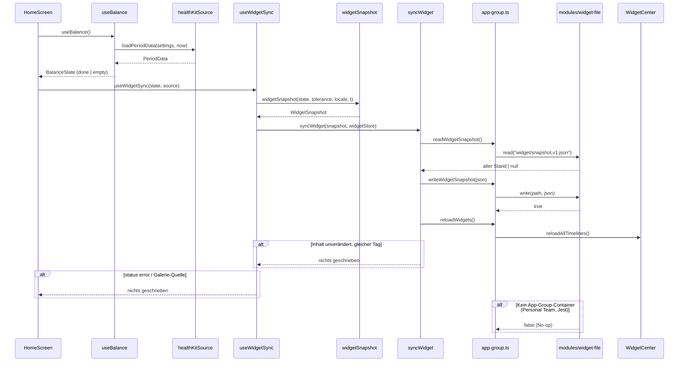
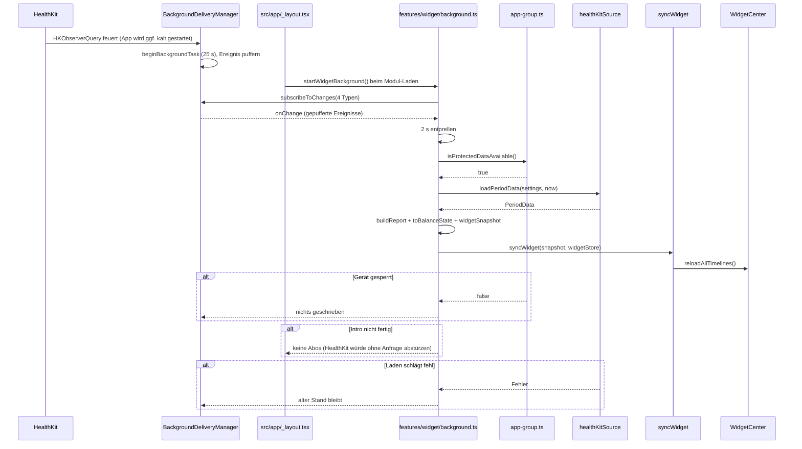
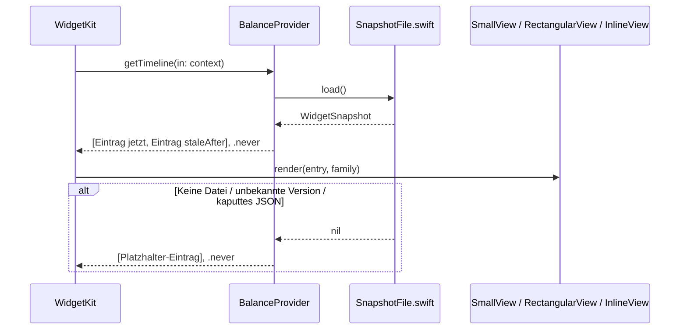

# Widget: Bilanz auf Home- und Sperrbildschirm

Stand 2026-11-03. In Umsetzung auf `feature/widget` (abgezweigt von `feature/a11y-wcag`, das noch nicht in `main` ist). Plan-Schritt 9.

## Overview

Das Widget zeigt die Bilanz des in der App gewählten Zeitraums und darunter das Fett-Äquivalent („ca. +0,9 kg Körperfett“). Es gibt drei Formen: klein auf dem Homescreen (wie im Bild) sowie rechteckig und inline auf dem Sperrbildschirm. Die App rechnet wie bisher und legt fertige Anzeigetexte als JSON-Datei in den App-Group-Container. Die Datei ist vom Backup ausgenommen und auch bei gesperrtem Gerät lesbar. Das Widget (SwiftUI, WidgetKit) liest nur diese Datei und fragt HealthKit nie selbst ab. Neue Zahlen kommen beim Laden in der App und per HealthKit Background Delivery. Betroffen sind:
- neu: `modules/widget-file/` (Swift), `targets/widget/` und `src/features/widget/`
- `src/storage/app-group.ts`, `src/features/balance/components/home-screen.tsx`, `src/app/_layout.tsx` und `src/app/intro/health.tsx`
- `app.json`, `eslint.config.js`, i18n, `CLAUDE.md` und der WCAG-Bericht

### Ausgangslage: Anforderungen (wörtlich)

> let us make a new feature
> I want to create a widget on the iphone (see picture)
> please create a plan how to implement this.
> it shows the balance of the choosen time period in the app.
> it shows the below the "ca. kg fat"

> Ich denke Option B ist am saubersten, außerdem möchte ich auch im gespeerten preview bildschirm ein kleines widget haben, dafür muss ich ja aufjedenfall daten speichern

### Design-Referenz

| Datei | Zeigt |
|---|---|
| `.claude/design/widget/small-1b.png` | Kleines Widget „1b · 30 Tage“, hell, auf grauem Homescreen |

Inhalt des Bildes, von oben nach unten, linksbündig:

1. „30 Tage“ (fett)
2. „24. Sep – 23. Okt“ (Nebentext)
3. „+7.000“ (sehr groß)
4. „kcal“ (fett)
5. „≈ +0,9 kg Körperfett“ (Nebentext). Laut Key Decision 4 steht hier „ca.“ statt „≈“.

Das ältere Wireframe (`.claude/design/homepage/…/Kcalwaage Wireframes.dc.html`, Gruppe ⑤, 1n–1q) zeigte noch eine Uhrzeit, Fett in g und ein mittleres Widget. Es gilt nicht mehr, wo es dem Bild oder den Key Decisions widerspricht.

### Stand im Code (2026-11-03)

| Bereich | Vorhanden | Fehlt |
|---|---|---|
| App Group | Entitlement `group.com.scully98.calorieweightbalancer` in `app.json`; `src/storage/app-group.ts` schreibt die Einstellungen über `ExtensionStorage` (`@bacons/apple-targets` 5.0.0) in die UserDefaults; `ExtensionStorage.reloadWidget()` ruft `WidgetCenter.reloadAllTimelines()` | Schreiben einer Datei, Ausnahme vom Backup, Abfrage `isProtectedDataAvailable` |
| Widget-Target | `@bacons/apple-targets` ist als Plugin eingetragen; `targets/` gibt es nicht | alles |
| Rechnen | `loadPeriodData` + `buildReport` (`src/features/balance/use-balance.ts`), `heroModel` (`hero.ts`), `periodSpan`/`shortDate` (`period-subtitle.ts`), `emptyKind` (`empty.ts`), `formatSigned`/`roundKcal`/`roundRangeKcal` (`src/core/format.ts`) | Modell für das Widget |
| HealthKit-Hintergrund | `@kingstinct/react-native-healthkit` 16.0.0 bringt `configureBackgroundTypes(types, UpdateFrequency)` und `subscribeToChanges` mit. Der native `BackgroundDeliveryManager` registriert die Observer beim Kaltstart, puffert Ereignisse bis JS bereit ist und hält 25 s Hintergrundzeit offen. In `app.json` steht `background: false`, und `authorization.test.ts` prüft das | Aufruf, Entitlement |
| Fehlerbild gesperrtes Gerät | `src/health/safe.ts` macht jeden HealthKit-Fehler zu „keine Daten“ | Schutz davor, im Hintergrund einen leeren Stand zu schreiben |
| Personal Team | `app.config.ts` entfernt bei `APPLE_PERSONAL_TEAM_ID` das App-Group-Entitlement; laut README bekommt das Widget dann keine Daten | — |
| iOS-Ziel | `IPHONEOS_DEPLOYMENT_TARGET = 16.4` | `containerBackground` gibt es erst ab iOS 17 |

## Key Decisions

| # | Decision | Rationale | Alternatives Considered |
|---|----------|-----------|-------------------------|
| 1 | Drei Formen: klein (`systemSmall`, Homescreen), rechteckig (`accessoryRectangular`, Sperrbildschirm unter der Uhr), inline (`accessoryInline`, Sperrbildschirm über der Uhr). Kein mittleres Widget in V1; `CLAUDE.md` Feature 10 wird angepasst | Bild zeigt nur klein — Julius 2026-11-03; Sperrbildschirm „rechteckig“ und „inline“ — Julius 2026-11-03 | Klein + mittel (Wireframes 1p/1q); rund (`accessoryCircular`) |
| 2 | Klein mit Toleranz: Die große Zahl bleibt der Einzelwert, darunter klein „+2.650 bis +19.350“, und die Fettzeile wird zur Spanne „ca. +0,3 bis +2,5 kg Körperfett“. Der Hero der App zeigt dagegen nur die Spanne | Die Spanne passt in großer Schrift nicht in ~155 pt — Julius 2026-11-03 | Nur Spanne zweizeilig; Toleranz ignorieren |
| 3 | Sperrbildschirm ignoriert die Toleranz: rechteckig immer Einzelwert + Fett, inline immer Einzelwert | Nur drei Zeilen — Julius 2026-11-03 | Spanne statt Fett; nur Spanne |
| 4 | Fett mit „ca.“ wie im Hero: `home.hero.fat` / `home.hero.fatRange` („ca. +0,9 kg Körperfett“), VoiceOver `a11y.fat` / `a11y.fatRange` („etwa … berechnet“). Rechteckig kürzer: neu `widget.lockFat` „ca. +0,9 kg Fett“ / „approx. +0.9 kg fat“ | Ein Wortlaut in App und Widget — Julius 2026-11-03 | „≈“ wie im Bild nur im Widget; „≈“ überall |
| 5 | Titel = Anzahl der gerechneten Tage, `home.subtitle.days`: „30 Tage“; mit „heute“ „31 Tage“; Eigener „15 Tage“. Darunter die Datumsspanne wie im Bild, nur die Daten (`home.subtitle.range` mit `shortDate`, mit Jahr bei Jahreswechsel), ohne „· 30 Tage · ohne heute“ | Ehrlich in jedem Fall; die Spanne zeigt, welche Tage — Julius 2026-11-03 | „30 Tage + heute“ / „Eigener Zeitraum“ |
| 6 | Stand nur, wenn alt: Der Datensatz hat `staleAfter` = nächste lokale Mitternacht nach dem Laden, wenn der Zeitraum mitwandert (Preset, oder Eigener mit Ende gestern oder später), sonst `null`. Ab `staleAfter` zeigt das Widget zusätzlich „Stand 23. Okt, 21:14“. Die Datumsspanne bleibt die gerechnete | Nach Mitternacht verschiebt sich „30 Tage“ — Julius 2026-11-03 | Uhrzeit immer; nie |
| 7 | Speicher: JSON-Datei `widget/snapshot.v1.json` im App-Group-Container, nicht UserDefaults. Der Ordner `widget/` ist `isExcludedFromBackup`, die Datei hat Schutzklasse `completeUntilFirstUserAuthentication` und wird atomar geschrieben. Dazu ein eigenes lokales Expo-Modul `modules/widget-file` (Swift) | Guideline 5.1.3 (ii): keine Health-Daten in iCloud; UserDefaults landen im iCloud-Backup und lassen sich nicht ausnehmen — Julius 2026-11-03 („Option B ist am saubersten“). Die Schutzklasse hält die Datei auch bei gesperrtem Gerät lesbar, was der Sperrbildschirm braucht | A: UserDefaults über `ExtensionStorage`; C: Widget fragt HealthKit selbst; D: kein Widget |
| 8 | Der Datensatz enthält nur fertige Anzeige- und VoiceOver-Texte plus Zeitstempel, keine Rohzahlen und keine Tageswerte. Gerundet und formatiert wird in TypeScript mit denselben Funktionen wie im Hero (`heroModel`, `formatSigned`, i18n) | Eine Rechen- und Formatierungsstelle; so wenig abgeleitete Health-Daten wie möglich auf der Platte. Ersetzt in `CLAUDE.md` „Bilanz, Spanne, Fett in g“ | Rohzahlen und Formatierung in Swift; beides |
| 9 | Swift lokalisiert nur, was ohne Datensatz gebraucht wird: Name und Beschreibung in der Widget-Galerie und den Platzhalter „Öffne die App, um deine Bilanz zu sehen.“ (`Localizable.xcstrings`, de/en) | Ohne Datei gibt es keine Texte aus TypeScript | Alles in Swift |
| 10 | Background Delivery gleich mit, ohne getrennten Spike: `configureBackgroundTypes` für `dietaryEnergyConsumed`, `basalEnergyBurned`, `activeEnergyBurned`, `bodyMass` mit `UpdateFrequency.hourly`; Plugin `background: true` | Julius 2026-11-03. Genau die Typen, von denen Bilanz und Fett im Widget abhängen (Gewicht für Mifflin-St Jeor); `hourly`, weil iOS Aktivenergie ohnehin höchstens stündlich weckt und das Reload-Budget des Widgets (etwa 40–70 pro Tag) geschont wird | Erst Vordergrund, dann Hintergrund; nur Vordergrund; `immediate` |
| 11 | Im Hintergrund schreibt die App nichts, wenn `isProtectedDataAvailable()` falsch ist (Gerät gesperrt), die Intro nicht fertig ist oder das Laden fehlschlägt | Gesperrt liefert HealthKit Fehler, `safe()` macht daraus „keine Daten“, und das Widget zeigte sonst „Noch keine Daten.“ | Leeren Stand schreiben |
| 12 | Im Vordergrund schreibt `useWidgetSync` in `HomeScreen` nach jedem fertigen Report (`done` oder `empty`), nur mit `healthKitSource` (nicht in der Galerie mit Demo-Daten) und nur, wenn sich der Inhalt ohne Zeitstempel geändert hat oder der Tag gewechselt hat. `error` überschreibt nichts | Ein Load, keine doppelte HealthKit-Abfrage; Reload-Budget; Demo-Daten nie im echten Widget | Eigener Load im Root-Layout |
| 13 | Leer-Zustände wie auf der Bilanz-Seite (`emptyKind`): `noData` „Noch keine Daten.“, `period` „Keine Nahrung in diesem Zeitraum.“, `firstDay` „Deine Bilanz beginnt morgen.“ (bestehende Keys `empty.*.title`). Ohne Datei (App nie geöffnet, Intro offen, Personal Team, nach Backup-Wiederherstellung) zeigt das Widget den Swift-Platzhalter | Gleiche Sätze wie in der App; Tippen öffnet die App, dort steht die Erklärung mit „Berechtigungen prüfen“ | Eigene Widget-Texte |
| 14 | Farben: Homescreen aus den Tokens über `colors` in `targets/widget/expo-target.config.js` (`foreground`, `muted`, `$widgetBackground` = `background`, je hell/dunkel); ein Jest-Test vergleicht sie mit `src/theme/colors.ts`. Sperrbildschirm mit den System-Stilen `.primary`/`.secondary`, weil iOS ihn selbst einfärbt | Keine Akzentfarbe, Dark Mode invertiert; V2 kann die Tokens für App und Widget wählbar machen | Swift-Literale ohne Test |
| 15 | Tippen öffnet die Bilanz: `widgetURL(calorieweightbalancer:///)` | Einziger sinnvoller Ziel-Screen | Daten-Seite |
| 16 | Timeline mit zwei Einträgen: jetzt und `staleAfter` (falls gesetzt), Policy `.never`. Neue Zahlen kommen nur über `reloadAllTimelines()` aus der App | Das Widget rechnet nichts; die einzige zeitabhängige Änderung ist die Stand-Zeile | `.atEnd` mit stündlichem Neuladen ohne neue Daten |
| 17 | Mindestziel des Widgets wie die App 16.4; `containerBackground(for: .widget)` ab iOS 17 per `#available`, darunter `.background` | Ab iOS 17 Pflicht, sonst zeigt iOS den Hinweis „Please adopt containerBackground API“ | Ziel auf 17 anheben |
| 18 | Keine Tastenkürzel. Jedes Widget ist ein einziges Accessibility-Element mit kombiniertem Label (Zeitraum, Daten, Vorzeichen gesprochen, Spanne beim kleinen Widget, Fett, Stand falls sichtbar) und skaliert mit Dynamic Type (Textstile + `minimumScaleFactor`) | Plan-Schritt 9; Touch-App ohne Kürzel wie die bisherigen Specs | — |
| 19 | Akku vor Aktualität im Hintergrund: höchstens ein Weckruf pro Stunde und Typ (`hourly`), nur vier Typen, mehrere Ereignisse in 2 s ergeben ein Laden, kein Laden bei gesperrtem Gerät, kein Schreiben und kein Widget-Reload bei unverändertem Inhalt, kein Nachladen, Warten oder Wiederholen bei Fehlern. Ziel am Gerät: Laden bis Schreiben unter 5 s, gemessen per Log. Die 25 s sind nur die Obergrenze von iOS | Julius 2026-11-03: im Hintergrund vor allem akkuschonend. Den meisten Aufwand kostet der Start von Hermes, nicht die Statistik-Abfragen | `immediate`; zusätzlicher Background-App-Refresh-Task |

## Implementation Details

### Milestone Map

| Milestone | Delivers | 🟢 Add | 🟠 Change | 🔴 Delete | Depends On |
|-----------|----------|--------|-----------|-----------|------------|
| M1 — Datei-Modul | Swift-Modul: Datei schreiben/lesen/löschen, Backup-Ausnahme, Schutzklasse, `isProtectedDataAvailable` | 6 | 2 | 0 | — |
| M2 — Widget-Modell | Reine Funktion Report → `WidgetSnapshot`, i18n, Golden-Test | 3 | 2 | 0 | — |
| M3 — Schreiben aus der App | `syncWidget`, `useWidgetSync` in `HomeScreen` | 3 | 1 | 0 | M1, M2 |
| M4 — Widget-Target | SwiftUI: klein, rechteckig, inline, Platzhalter, Stand, Farben | 9 | 1 | 0 | M1, M2 |
| M5 — Background Delivery | Observer, Entitlement, Aktualisieren im Hintergrund | 2 | 4 | 0 | M3 |
| M6 — Doku und Abnahme | `CLAUDE.md`, WCAG-Bericht, README, Geräteprüfung | 0 | 3 | 0 | M4, M5 |

🟢 Add   🟠 Change   🔴 Delete

#### 🔀 Inbound Flow — UI: Bilanz-Seite lädt (Vordergrund)



#### 🔀 Inbound Flow — Background Delivery: neuer Health-Eintrag



#### 🔀 Inbound Flow — WidgetKit: Timeline



---

### Milestone 1 — Datei-Modul

> Ein kleines lokales Expo-Modul schreibt den Datensatz als Datei in den App-Group-Container, außerhalb des Backups und bei gesperrtem Gerät lesbar. Damit ist Option B unabhängig vom Widget testbar.

**Depends on:** none

#### File Changes

| Color | File | Action |
|-------|------|--------|
| 🟢 | `modules/widget-file/expo-module.config.json` | Lokales Expo-Modul, nur `apple` |
| 🟢 | `modules/widget-file/ios/WidgetFileModule.swift` | `write(path, contents) -> Bool`, `read(path) -> String?`, `remove(path)`, `isProtectedDataAvailable() -> Bool` |
| 🟢 | `modules/widget-file/ios/WidgetFile.podspec` | Podspec für Autolinking |
| 🟢 | `modules/widget-file/index.ts` | `requireOptionalNativeModule('WidgetFile')`; ohne Modul (Jest) `null` |
| 🟢 | `modules/widget-file/README.md` | Zweck, Schutzklasse, Backup-Ausnahme, kurz auf Englisch |
| 🟢 | `src/storage/__tests__/app-group-file.test.ts` | No-op ohne natives Modul; Pfad und Inhalt kommen an |
| 🟠 | `src/storage/app-group.ts` | `appGroupFile { read, write, remove }`, `reloadWidgets()` (über `ExtensionStorage.reloadWidget()`), `isProtectedDataAvailable()` |
| 🟠 | `eslint.config.js` | `modules/widget-file` darf nur `src/storage/app-group.ts` importieren (wie `APP_GROUP`) |

#### To-Dos

- ✅ Create local Expo module `modules/widget-file` _(von Hand nach dem Muster von `ExtensionStorage`, ohne Beispielcode; App Group als Argument, damit die ID nur in `app-group.ts` steht)_
- ✅ Implement `write`: container via `FileManager.containerURL(forSecurityApplicationGroupIdentifier: "group.com.scully98.calorieweightbalancer")`, create `widget/` if missing, set `isExcludedFromBackup = true` on `widget/` on every write, write with `[.atomic, .completeFileProtectionUntilFirstUserAuthentication]`; return `false` without container
- ✅ Implement `read` (UTF-8 string or `nil`) and `remove`
- ✅ Implement `isProtectedDataAvailable` via `UIApplication.shared.isProtectedDataAvailable` on the main thread _(als `AsyncFunction` mit `runOnQueue(.main)`, `runOnQueue` gibt es nur für asynchrone Funktionen; JS bekommt ein `Promise<boolean>`)_
- ✅ Add `appGroupFile`, `reloadWidgets`, `isProtectedDataAvailable` to `src/storage/app-group.ts`; without native module: `read` → `null`, `write` → `false`, `isProtectedDataAvailable` → `true`
- ✅ Add ESLint restriction for `**/modules/widget-file*` outside `src/storage/app-group.ts` _(Probe-Import in `src/health/` meldet den Fehler)_
- ✅ Test the JS wrapper without native module _(dazu mit gemocktem Modul: Gruppe, Pfad, Inhalt)_
- 🔲 Verify in the simulator (dev build) _(zusammen mit dem Build in M4)_: file exists under the App Group container, `xattr`/`URLResourceValues` shows `isExcludedFromBackup` on `widget/`
- ✅ Run `npm run lint`, `npm run typecheck`, `npm test`

#### Notes / Constraints

> - Der Ordner wird ausgenommen, nicht die Datei: Ein atomares Schreiben legt eine neue Datei an, und ein Attribut auf der Datei ginge dabei verloren.
> - `Library/Caches` im Container wäre zwar auch ohne Backup, iOS darf es aber bei wenig Speicher leeren, und dann wäre das Widget leer.
> - Die Schutzklasse `complete` würde das Sperrbildschirm-Widget genau dann leer lassen, wenn man es sieht. `completeUntilFirstUserAuthentication` ist nach dem ersten Entsperren seit dem Neustart lesbar.
> - Personal Team (`APPLE_PERSONAL_TEAM_ID`): kein App-Group-Entitlement, also `containerURL` gleich `nil` und `write` gleich `false`. Die App läuft normal weiter.
> - `CLAUDE.md` „In die App Group schreibt nur `src/storage/app-group.ts`“ gilt weiter. Dazu kommt das Modul, das nur dort importiert wird.

#### ⌨️ Keyboard Shortcuts — Global

Keine App-Kürzel (Key Decision 18). Keine UI in diesem Milestone.

---

### ✅ Milestone 2 — Widget-Modell

> Eine reine Funktion macht aus Report, Einstellungen und Zeit den fertigen Datensatz. Sie ist vollständig per Unit-Test prüfbar, auch am goldenen Testfall.

**Depends on:** none

#### File Changes

| Color | File | Action |
|-------|------|--------|
| 🟢 | `src/features/widget/snapshot.ts` | Typ `WidgetSnapshot`, `widgetSnapshot(state, tolerance, locale, t)`, `SNAPSHOT_VERSION = 1` |
| 🟢 | `src/features/widget/__tests__/snapshot.test.ts` | Golden, Toleranz, Vorzeichen ±/−, Titel, Daten, `staleAfter`, Leer-Zustände, Labels de/en |
| 🟢 | `src/features/widget/__fixtures__/snapshot-golden.json` | Erwarteter Datensatz zum goldenen Testfall (de), auch Eingabe für die Swift-Previews in M4 |
| 🟠 | `src/i18n/locales/de.ts` | `widget.*` |
| 🟠 | `src/i18n/locales/en.ts` | `widget.*` |

#### Datensatz

```ts
export type WidgetSnapshot = {
  version: 1;
  // ISO 8601 in UTC; when Health was asked (report.loadedAt).
  loadedAt: string;
  // Next local midnight after loadedAt for a period that moves along, else null.
  staleAfter: string | null;
  title: string; // „30 Tage“
  dates: string; // „24. Sep – 23. Okt“
  stale: string; // „Stand 23. Okt, 21:14“, shown from staleAfter on
  staleLabel: string; // „Stand 23. Oktober, 21:14 Uhr“
  content:
    | {
        kind: 'balance';
        kcal: string; // „+7.000“ (roundKcal, formatSigned)
        unit: string; // „kcal“
        range: string | null; // „+2.650 bis +19.350“ with tolerance
        fat: string; // „ca. +0,9 kg Körperfett“ / „ca. +0,3 bis +2,5 kg Körperfett“
        lockFat: string; // „ca. +0,9 kg Fett“, always the single value
        inline: string; // „+7.000 kcal · 30 T“
        label: string; // small widget, VoiceOver
        lockLabel: string; // lock screen, without range
      }
    | {
        kind: 'empty';
        message: string; // empty.<kind>.title
        inline: string; // „Bilanz: noch keine Daten“
        label: string;
      };
};
```

Beispiel (goldener Testfall, Toleranz 5 % / 10 %, de, geladen am 24. Okt um 08:14 in Berlin; gleich `snapshot-golden.json`):

```json
{
  "version": 1,
  "loadedAt": "2026-10-24T06:14:00.000Z",
  "staleAfter": "2026-10-24T22:00:00.000Z",
  "title": "30 Tage",
  "dates": "24. Sep – 23. Okt",
  "stale": "Stand 24. Okt, 08:14",
  "staleLabel": "Stand 24. Oktober, 08:14 Uhr",
  "content": {
    "kind": "balance",
    "kcal": "+7.000",
    "unit": "kcal",
    "range": "+2.650 bis +19.350",
    "fat": "ca. +0,3 bis +2,5 kg Körperfett",
    "lockFat": "ca. +0,9 kg Fett",
    "inline": "+7.000 kcal · 30 T",
    "label": "30 Tage, 24. September bis 23. Oktober. plus 7.000 Kilokalorien, mehr gegessen als verbraucht. Mit Messfehler plus 2.650 bis plus 19.350 Kilokalorien, mehr gegessen als verbraucht. etwa plus 0,3 bis plus 2,5 Kilogramm Körperfett, berechnet",
    "lockLabel": "30 Tage. plus 7.000 Kilokalorien, mehr gegessen als verbraucht. etwa plus 0,9 Kilogramm Körperfett, berechnet"
  }
}
```

#### Neue i18n-Keys

| Key | de | en |
|---|---|---|
| `widget.unit` | `kcal` | `kcal` |
| `widget.range` | `{{min}} bis {{max}}` | `{{min}} to {{max}}` |
| `widget.lockFat` | `ca. {{value}} kg Fett` | `approx. {{value}} kg fat` |
| `widget.inline` | `{{kcal}} kcal · {{days}} T` | `{{kcal}} kcal · {{days}} d` |
| `widget.inlineEmpty` | `Bilanz: noch keine Daten` | `Balance: no data yet` |
| `widget.stale` | `Stand {{date}}, {{time}}` | `As of {{date}}, {{time}}` |
| `widget.a11y.dates` | `{{from}} bis {{to}}` | `{{from}} to {{to}}` |
| `widget.a11y.range` | `Mit Messfehler {{range}}` | `With measurement error {{range}}` |
| `widget.a11y.stale` | `Stand {{date}}, {{time}} Uhr` | `As of {{date}}, {{time}}` |

Wiederverwendet werden `home.subtitle.days`, `home.subtitle.range`, `home.hero.fat`, `home.hero.fatRange`, `a11y.heroKcal`, `a11y.heroRange`, `a11y.fat`, `a11y.fatRange`, `empty.noData.title`, `empty.period.title`, `empty.firstDay.title`, `date.monthsShort`, `date.months` und `date.dayMonth`.

#### To-Dos

- ✅ Create `WidgetSnapshot` type and `SNAPSHOT_VERSION`
- ✅ Implement `widgetSnapshot`: single value from `heroModel(balance, {0, 0}, …)`, range and fat range from `heroModel(balance, tolerance, …)` when a tolerance is on
- ✅ Build `title` from the counted days, `dates` with `shortDate` (with year across a year change), without „ohne heute“ _(beides aus `report.days`, nicht aus den Einstellungen: so passt es immer zum gerechneten Stand; `lockFat` direkt mit `formatSigned`)_
- ✅ Compute `staleAfter`: next local midnight after `loadedAt` for presets and for custom periods ending yesterday or later, else `null` (DST-safe via `addDays(startOfDay(...), 1)`)
- ✅ Map `empty` state via `emptyKind` to `empty.<kind>.title`
- ✅ Add `widget.*` keys in de and en
- ✅ Test golden case: „+7.000“, „ca. +0,9 kg Körperfett“; with 5 %/10 %: range „+2.650 bis +19.350“, „ca. +0,3 bis +2,5 kg Körperfett“, `lockFat` stays „ca. +0,9 kg Fett“
- ✅ Test signs: „±0“ at zero, „−1.250“ with U+2212
- ✅ Test titles: preset 30 → „30 Tage“, with today → „31 Tage“, custom 15 days → „15 Tage“, custom ending last month → `staleAfter` null
- ✅ Test the three empty kinds and English texts _(dazu Jahreswechsel und Zeitumstellung am 25. Okt)_
- ✅ Write `snapshot-golden.json` from the test (snapshot fixture, checked in) _(Test vergleicht; nach gewollter Änderung das Objekt aus der Fehlermeldung übernehmen)_
- ✅ Run `npm run lint`, `npm run typecheck`, `npm test`

#### Notes / Constraints

> - Das Modell rechnet nicht, es wählt und formatiert. Es liegt in `src/features/` statt `src/core/`, weil es Texte erzeugt (ESLint: `src/core/` ohne i18n).
> - `stale` wird immer mitgeschrieben. Ob es sichtbar ist, entscheidet das Widget anhand von `staleAfter`.
> - Die Sprache ist die der App zum Zeitpunkt des Schreibens. Wechselt jemand die Sprache in den iOS-Einstellungen, zeigt das Widget die alte Sprache, bis die App wieder rechnet.

#### ⌨️ Keyboard Shortcuts — Global

Keine App-Kürzel (Key Decision 18). Keine UI in diesem Milestone.

---

### Milestone 3 — Schreiben aus der App

> Jedes Laden der Bilanz-Seite aktualisiert das Widget. Danach zeigt das Widget immer den Stand, den man zuletzt in der App gesehen hat.

**Depends on:** Milestone 1, Milestone 2

#### File Changes

| Color | File | Action |
|-------|------|--------|
| 🟢 | `src/features/widget/sync.ts` | `syncWidget(snapshot, store)`: vergleicht ohne `loadedAt`/`staleAfter`/`stale*`, schreibt bei Änderung oder neuem Tag, dann `reloadWidgets()`; `WidgetStore`-Interface + `appWidgetStore` + `createMemoryWidgetStore()` für Tests |
| 🟢 | `src/features/widget/use-widget-sync.ts` | `useWidgetSync(state)`: Effekt bei `done`/`empty`, nur mit `healthKitSource` |
| 🟢 | `src/features/widget/__tests__/sync.test.ts` | Schreibt beim ersten Mal, nicht bei gleichem Inhalt, wieder bei neuem Tag oder neuer Einstellung; `error` schreibt nicht; Reload nur nach Schreiben |
| 🟠 | `src/features/balance/components/home-screen.tsx` | `useWidgetSync(state)` aufrufen |

#### To-Dos

- 🔲 Create `WidgetStore` interface (`read(): string | null`, `write(json): boolean`, `reload(): void`) with app and memory variants
- 🔲 Implement `syncWidget` with content comparison and day change check
- 🔲 Implement `useWidgetSync`: skip when `useHealthSource() !== healthKitSource`, skip `loading`/`error`
- 🔲 Call `useWidgetSync` in `HomeScreen`
- 🔲 Test `syncWidget` with the memory store
- 🔲 Check in the simulator: change period, zero days, tolerance → file content changes once per release of the slider
- 🔲 Run `npm run lint`, `npm run typecheck`, `npm test`

#### Notes / Constraints

> - Beim Ziehen der Toleranz-Slider wird nicht geschrieben. Gespeichert wird erst beim Loslassen (`settings.v1`), und erst dann ändert sich der Report.
> - `HomeScreen` bleibt in den Tabs gemountet. Änderungen auf der Einstellungen-Seite (Null-Tage, Körperdaten) kommen deshalb auch an.
> - Die Galerie (`src/dev/`) nutzt `HealthSourceProvider` mit Demo-Daten und schreibt deshalb nie.

#### ⌨️ Keyboard Shortcuts — Global

Keine App-Kürzel (Key Decision 18). Keine sichtbare UI-Änderung.

---

### Milestone 4 — Widget-Target

> Das SwiftUI-Widget mit drei Formen liest den Datensatz und zeigt ihn wie im Bild, in hell und dunkel, mit Dynamic Type und VoiceOver.

**Depends on:** Milestone 1, Milestone 2

#### File Changes

| Color | File | Action |
|-------|------|--------|
| 🟢 | `targets/widget/expo-target.config.js` | `type: 'widget'`, `name: 'widget'`, `displayName`, `deploymentTarget: '16.4'`, `colors` (`foreground`, `muted`, `$widgetBackground` hell/dunkel), App Group wird aus `app.json` gespiegelt |
| 🟢 | `targets/widget/index.swift` | `@main WidgetBundle` mit `BalanceWidget` |
| 🟢 | `targets/widget/BalanceWidget.swift` | `StaticConfiguration`, Familien `.systemSmall`, `.accessoryRectangular`, `.accessoryInline`; `widgetURL`; `containerBackground` per `#available` |
| 🟢 | `targets/widget/BalanceProvider.swift` | `TimelineProvider`: `placeholder`, `getSnapshot`, `getTimeline` (Key Decision 16) |
| 🟢 | `targets/widget/SnapshotFile.swift` | `Codable` `WidgetSnapshot`, Laden aus dem Container, `nil` bei fehlender Datei, Version ≠ 1 oder kaputtem JSON |
| 🟢 | `targets/widget/BalanceViews.swift` | `SmallView`, `RectangularView`, `InlineView`, `PlaceholderView` |
| 🟢 | `targets/widget/Localizable.xcstrings` | Name, Beschreibung, Platzhalter de/en |
| 🟢 | `targets/widget/Preview.swift` | SwiftUI-Previews mit `snapshot-golden.json`-Werten: mit/ohne Toleranz, Stand, leer, Platzhalter, hell/dunkel |
| 🟢 | `src/theme/__tests__/widget-colors.test.ts` | Farben in `expo-target.config.js` = Tokens in `src/theme/colors.ts` |
| 🟠 | `app.json` | `ios.appleTeamId` mit der Team-ID von Julius' Developer Account |

#### 📐 Wireframe — SmallView, Einzelwert (Bild)

```
┌──────────────────────┐
│ 30 Tage              │  title      .headline, foreground
│ 24. Sep – 23. Okt    │  dates      .subheadline, muted
│                      │
│ +7.000               │  kcal       .system(size: 44, .semibold), 1 Zeile, minimumScaleFactor 0.5
│ kcal                 │  unit       .headline, foreground
│                      │
│ ca. +0,9 kg Körperf. │  fat        .footnote, muted, 2 Zeilen
└──────────────────────┘
```

**Component tree:**
BalanceWidget (systemSmall)
└── SmallView
    ├── Text — title
    ├── Text — dates
    ├── Spacer
    ├── Text — kcal
    ├── Text — unit
    ├── Text — range (nur mit Toleranz)
    ├── Text — fat
    └── Text — stale (nur ab staleAfter)

#### 📐 Wireframe — SmallView, mit Toleranz

```
┌──────────────────────┐
│ 30 Tage              │
│ 24. Sep – 23. Okt    │
│ +7.000               │
│ kcal                 │
│ +2.650 bis +19.350   │  range  .footnote, foreground
│ ca. +0,3 bis +2,5 kg │  fat    .footnote, muted
│ Körperfett           │
└──────────────────────┘
```

#### 📐 Wireframe — SmallView, Stand alt

```
┌──────────────────────┐
│ 30 Tage              │
│ 24. Sep – 23. Okt    │
│ +7.000               │
│ kcal                 │
│ ca. +0,9 kg Körperf. │
│ Stand 23. Okt, 21:14 │  stale  .caption2, muted
└──────────────────────┘
```

#### 📐 Wireframe — SmallView, leer

```
┌──────────────────────┐
│ 30 Tage              │
│ 24. Sep – 23. Okt    │
│                      │
│ Keine Nahrung in     │  message  .subheadline, foreground
│ diesem Zeitraum.     │
└──────────────────────┘
```

#### 📐 Wireframe — PlaceholderView (keine Datei)

```
┌──────────────────────┐
│ Bilanz               │
│                      │
│ Öffne die App, um    │  Localizable.xcstrings
│ deine Bilanz zu      │
│ sehen.               │
└──────────────────────┘
```

Die Widget-Galerie (`placeholder(in:)`) zeigt das Layout „Einzelwert“ mit den Werten des goldenen Testfalls und `.redacted(reason: .placeholder)`.

#### 📐 Wireframe — RectangularView (Sperrbildschirm)

```
┌──────────────────────┐
│ 30 Tage              │  title    .headline, .primary
│ +7.000 kcal          │  kcal+unit .title3 semibold, minimumScaleFactor 0.6
│ ca. +0,9 kg Fett     │  lockFat  .caption, .secondary
└──────────────────────┘
Stand alt: Zeile 1 → „30 Tage · Stand 23. Okt“ (.secondary für den Stand)
Leer:      Zeile 2–3 → message
```

**Component tree:**
BalanceWidget (accessoryRectangular)
└── RectangularView
    ├── Text — title (+ stale)
    ├── Text — kcal + unit
    └── Text — lockFat

#### 📐 Wireframe — InlineView (Sperrbildschirm über der Uhr)

```
Di. 3. Nov   +7.000 kcal · 30 T
Leer:        Bilanz: noch keine Daten
```

**Component tree:**
BalanceWidget (accessoryInline)
└── InlineView
    └── Text — inline

#### To-Dos

- 🔲 Create `targets/widget/` via `npx create-target widget`, remove sample code
- 🔲 Set `expo-target.config.js` (name, display name, deployment target 16.4, colors from tokens)
- 🔲 Test that widget colors match `src/theme/colors.ts`
- 🔲 Implement `SnapshotFile.load()` with `containerURL` + `widget/snapshot.v1.json`, version check
- 🔲 Implement `BalanceProvider` with two entries and `.never`
- 🔲 Implement `SmallView`, `RectangularView`, `InlineView`, `PlaceholderView` per wireframes
- 🔲 Make every view one accessibility element: `.accessibilityElement(children: .ignore)` + `label`/`lockLabel` (+ `staleLabel` when shown)
- 🔲 Set `widgetURL(URL(string: "calorieweightbalancer:///"))`
- 🔲 Add `containerBackground(for: .widget) { Color("$widgetBackground") }` behind `#available(iOS 17, *)`
- 🔲 Add `Localizable.xcstrings` (name „Bilanz“/„Balance“, description „Deine Kalorienbilanz im gewählten Zeitraum.“/„Your calorie balance for the chosen period.“, placeholder)
- 🔲 Add previews for all states, light and dark
- 🔲 Write step-by-step instructions for Julius when the device build is next: read the Team ID, register the App Group `group.com.scully98.calorieweightbalancer` for app and widget bundle IDs (Xcode automatic signing or `eas credentials`), set `ios.appleTeamId`
- 🔲 Run `npx expo prebuild --clean`, build the dev client, add all three widgets in the simulator
- 🔲 Compare small widget with `.claude/design/widget/small-1b.png` (golden demo values, light)
- 🔲 Check dark mode (inverted), Dynamic Type from XS to AX5 (number shrinks, no clipping), VoiceOver label, tap opens the balance page
- 🔲 Check iOS 18 tinted home screen: still readable
- 🔲 Run `npm run lint`, `npm run typecheck`, `npm test`

#### Notes / Constraints

> - Linksbündig wie im Bild, nicht zentriert wie der Hero der App.
> - Der Text „kcal“ steht unter der Zahl (Bild), nicht „kcal mehr gegessen als verbraucht“ wie im Hero. Die Bedeutung des Vorzeichens steht im VoiceOver-Label. Sichtbar erklärt die App sie, wenn man aufs Widget tippt.
> - Swift kennt keine Rechenregeln. Bekommt das Widget einen Datensatz mit unbekannter Version, zeigt es den Platzhalter.
> - `@bacons/apple-targets` warnt ohne `ios.appleTeamId`. Für Simulator-Builds hat das keine Folgen, für Gerät und EAS braucht es die Team-ID des Accounts (Log 16).

#### ⌨️ Keyboard Shortcuts — Widget

| Shortcut | Action | Scope |
|----------|--------|-------|
| Tab / Pfeile (Full Keyboard Access) | Widget fokussieren | Global (iOS) |
| Leertaste | App auf der Bilanz-Seite öffnen | Component level (iOS) |

Beides steuert iOS selbst, die App definiert keine Kürzel (Key Decision 18).

---

### Milestone 5 — Background Delivery

> Neue Health-Einträge (z. B. ein Sync der Tracking-App) aktualisieren das Widget, ohne dass man die App öffnet, solange das Gerät entsperrt ist.

**Depends on:** Milestone 3

#### File Changes

| Color | File | Action |
|-------|------|--------|
| 🟢 | `src/features/widget/background.ts` | `WIDGET_BACKGROUND_TYPES`, `enableWidgetBackground()` (`configureBackgroundTypes(..., UpdateFrequency.hourly)`), `startWidgetBackground()` (Abos + 2 s Entprellen), `refreshWidgetInBackground(now)` |
| 🟢 | `src/features/widget/__tests__/background.test.ts` | Ohne Intro keine Abos; gesperrt kein Schreiben; Fehler kein Schreiben; mehrere Ereignisse → ein Laden |
| 🟠 | `app.json` | HealthKit-Plugin `background: true` |
| 🟠 | `src/health/__tests__/authorization.test.ts` | Erwartet `background: true`, weiterhin keine Schreibrechte |
| 🟠 | `src/app/_layout.tsx` | `startWidgetBackground()` auf Modulebene nach `@/i18n` |
| 🟠 | `src/app/intro/health.tsx` | Nach erfolgreicher Anfrage `enableWidgetBackground()` |

#### To-Dos

- 🔲 Set `background: true` in `app.json`, update the authorization test
- 🔲 Implement `enableWidgetBackground` for food, resting, active, body mass with `hourly`; call after `requestReadAccess` succeeds and on start when the intro is completed (idempotent)
- 🔲 Implement `startWidgetBackground`: only when `appSettingsStore.isIntroCompleted()`, else subscribe as soon as the intro completes (`appSettingsStore.subscribe`)
- 🔲 Implement `refreshWidgetInBackground`: check `isProtectedDataAvailable`, `loadPeriodData(healthKitSource, settings, now)` → `buildReport(..., appSettingsStore.getProfile())` → `toBalanceState` → `widgetSnapshot` → `syncWidget`; catch every error
- 🔲 Call `startWidgetBackground()` in `src/app/_layout.tsx`
- 🔲 Test with mocked HealthKit and memory store
- 🔲 Write step-by-step instructions for Julius: HealthKit Background Delivery capability on the App ID (automatic with EAS/Xcode signing), install the build on the iPhone, where to read the Console log
- 🔲 Log the duration from observer event to written file (`console.log` with ms, visible in Console.app); target under 5 s (Key Decision 19)
- 🔲 Verify on the device: add a food entry in Health while the app is closed, widget updates within an hour; with the device locked nothing is written; Console log `com.kingstinct.healthkit` / `BackgroundDelivery`
- 🔲 Run `npm run lint`, `npm run typecheck`, `npm test`

#### Notes / Constraints

> - `subscribeToChanges` darf erst nach der HealthKit-Anfrage laufen, sonst stürzt die App ab (README der Bibliothek). Deshalb gibt es ohne fertiges Intro keine Abos.
> - Der native Manager registriert die Observer beim Kaltstart selbst (`BackgroundLaunchHook.mm`) und puffert Ereignisse, bis JS abonniert. Die Abos müssen deshalb beim Modul-Laden des Root-Layouts entstehen, nicht in einem Effekt.
> - Die 25 s sind nur das Zeitfenster, das iOS im Hintergrund gewährt, inklusive Hermes-Start. Der Nutzer wartet nie darauf. Beim Öffnen der App gibt es keine neue Wartezeit, weil das Widget erst nach dem fertigen Report schreibt. Ziel ist, das Fenster kaum zu nutzen (unter 5 s), damit der Akku geschont wird (Key Decision 19).
> - Bei gesperrtem Gerät feuern Observer zwar, HealthKit ist aber verschlüsselt. Das Widget behält den letzten Stand, und nach Mitternacht zeigt es „Stand …“.
> - Läuft die App im Vordergrund, feuern die Abos auch dort und schreiben das Widget. Die Bilanz-Seite lädt dadurch nicht neu, sie bleibt bei ihrem Verhalten (Vordergrund-Wechsel).
> - App Review: Background Delivery ist mit Leserechten erlaubt. Das Datenschutz-Label bleibt „Keine Daten erfasst“, weil nichts das Gerät verlässt.

#### ⌨️ Keyboard Shortcuts — Global

Keine App-Kürzel (Key Decision 18). Keine UI in diesem Milestone.

---

### Milestone 6 — Doku und Abnahme

> Die Projektregeln, der WCAG-Bericht und das README beschreiben das Widget so, wie es gebaut ist.

**Depends on:** Milestone 4, Milestone 5

#### File Changes

| Color | File | Action |
|-------|------|--------|
| 🟠 | `CLAUDE.md` | Feature 10, Stack (Datei statt UserDefaults, Backup, Schutzklasse, Texte statt Rohzahlen), Rahmenbedingungen (Datei `widget/snapshot.v1.json` neben den Keys), Hintergrund-Update |
| 🟠 | `docs/accessibility/wcag-2.2-aa.md` | Abschnitt Widget: Label, Dynamic Type, Kontrast der Tokens |
| 🟠 | `README.md` | Widget im Simulator hinzufügen; Personal Team: Widget zeigt Platzhalter |

#### To-Dos

- 🔲 Update `CLAUDE.md` Feature 10: „Widget klein (Homescreen) sowie rechteckig und inline (Sperrbildschirm): Zeitraum (Tage, Datumsspanne), Bilanz, ca. kg Körperfett; klein mit Spanne, wenn Toleranz aktiv; Sperrbildschirm immer Einzelwert“
- 🔲 Update `CLAUDE.md` Stack: file in App Group container, excluded from backup, `completeUntilFirstUserAuthentication`, finished texts instead of „Bilanz, Spanne, Fett in g“; Background Delivery for four types, hourly; „Stand …“ only when the data is from an earlier day
- 🔲 Update `CLAUDE.md` Rahmenbedingungen: the only stored derived Health values are the widget texts in `widget/snapshot.v1.json`
- 🔲 Add widget section to the WCAG report
- 🔲 Add widget notes to the README
- 🔲 Commit per milestone (e.g. `feat: add the widget file module`, `feat: add the widget snapshot`, `feat: write the widget snapshot from the app`, `feat: add the home and lock screen widget`, `feat: update the widget in the background`, `docs: describe the widget`)

#### Notes / Constraints

> - Plan-Schritt 9 ist erst erledigt, wenn M5 am Gerät geprüft ist.

#### ⌨️ Keyboard Shortcuts — Global

Keine App-Kürzel (Key Decision 18). Keine UI in diesem Milestone.

---

## Open Questions

| # | Question | Owner | Impact if Unresolved |
|---|----------|-------|----------------------|
| 1 | ❓ Keine offen. Developer Account ist da (Log 16), die Hintergrundzeit ist geklärt (Log 17) | Julius | — |

## Concerns & Decisions Log

| # | Type | Concern | Resolution |
|---|------|---------|------------|
| 1 | ⚠️ Concern | `CLAUDE.md` Feature 10 nennt klein und mittel, das Bild zeigt nur klein | Nur klein, dazu Sperrbildschirm rechteckig und inline — Julius 2026-11-03 (Key Decision 1) |
| 2 | ⚠️ Concern | Die Spanne passt im kleinen Widget nicht in großer Schrift | Einzelwert groß, Spanne klein darunter — Julius 2026-11-03 (Key Decision 2) |
| 3 | ⚠️ Concern | Background Delivery ist der aufwändigste und nur am Gerät testbare Teil | Gleich mit, ohne getrennten Spike — Julius 2026-11-03 (Key Decision 10). Gerätetest als Abnahme in M5 |
| 4 | ⚠️ Concern | Das Bild hat keinen Stand, nach Mitternacht wären die Zahlen aber vom alten Zeitraum | „Stand …“ nur, wenn der Datensatz von einem früheren Tag ist — Julius 2026-11-03 (Key Decision 6) |
| 5 | ⚠️ Concern | Das Bild schreibt „≈“, die Anforderung „ca.“ und der Hero „ca.“ | „ca.“ wie im Hero — Julius 2026-11-03 (Key Decision 4) |
| 6 | ⚠️ Concern | Der Titel „30 Tage“ ist bei „heute einrechnen“ und bei „Eigener“ nicht eindeutig | Anzahl der gerechneten Tage — Julius 2026-11-03 (Key Decision 5) |
| 7 | ⚠️ Concern | Guideline 5.1.3 (ii) verbietet Health-Daten in iCloud; UserDefaults der App Group landen im iCloud-Backup | Option B: Datei, Ordner vom Backup ausgenommen — Julius 2026-11-03 (Key Decision 7) |
| 8 | ⚠️ Concern | Das Sperrbildschirm-Widget braucht die Daten bei gesperrtem Gerät; mit Schutzklasse `complete` wäre die Datei dann unlesbar | `completeUntilFirstUserAuthentication` (Key Decision 7) |
| 9 | ⚠️ Concern | Sperrbildschirm rechteckig hat nur drei Zeilen; was bei Toleranz? | Immer Einzelwert + Fett — Julius 2026-11-03 (Key Decision 3). Abweichung von `CLAUDE.md` Feature 10 („Spanne, wenn Toleranz aktiv“), wird in M6 angepasst |
| 10 | ⚠️ Concern | `safe()` macht HealthKit-Fehler bei gesperrtem Gerät zu „keine Daten“; der Hintergrund würde sonst „Noch keine Daten.“ ins Widget schreiben | `isProtectedDataAvailable` aus dem neuen Modul, kein Schreiben bei Fehlern (Key Decision 11) |
| 11 | ⚠️ Concern | `CLAUDE.md` nennt „Fett in g“ im Datensatz, Bild und App zeigen kg | kg wie im Bild; Datensatz enthält fertige Texte (Key Decision 8) |
| 12 | ⚠️ Concern | Die Galerie nutzt Demo-Daten über `useBalance`; ein Schreiben dort zeigte Demo-Werte im echten Widget | Schreiben nur mit `healthKitSource` (Key Decision 12) |
| 13 | ⚠️ Concern | Die Skill-Vorlage verlangt Sub-Agents, Web-Tastenkürzel und nennt Pfade `docs/references/…`, die es nicht gibt | Muster aus `.claude/docs/reference/patterns/docs/` gelesen (`specs.md`, `doc-building-blocks.md`). Spec ohne Sub-Agents geschrieben, wie die bisherigen Specs. Touch-App und Widget ohne eigene Kürzel |
| 14 | 💡 Alternative | Rohzahlen in den Datensatz, damit V2 (Widget-Konfiguration, Farben) mehr damit anfangen kann | Nicht in V1: so wenig abgeleitete Health-Werte wie möglich. V2 kann die Version erhöhen (Key Decision 8) |
| 15 | ⚠️ Concern | Nach einem Restore aus dem Backup fehlt die Datei | Widget zeigt den Platzhalter, bis die App einmal rechnet (Key Decision 13). Gewollte Folge von Option B |
| 16 | ⚠️ Concern | Gerät, App Group und EAS brauchen den bezahlten Developer Account | Account ist da — Julius 2026-11-03. Claude gibt die Schritte im Portal bzw. in Xcode/EAS vor, wenn sie dran sind (To-Dos „Anleitung für Julius“ in M4 und M5) |
| 17 | ⚠️ Concern | „Reichen 25 s?“ Gemeint ist nur das Zeitfenster, das iOS der App im Hintergrund gibt, nicht eine Wartezeit für den Nutzer | Wartezeit beim Öffnen: keine neue, das Widget schreibt nach dem fertigen Report. Im Hintergrund zählt vor allem der Akku — Julius 2026-11-03 (Key Decision 19) |
