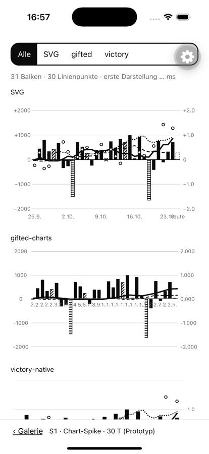
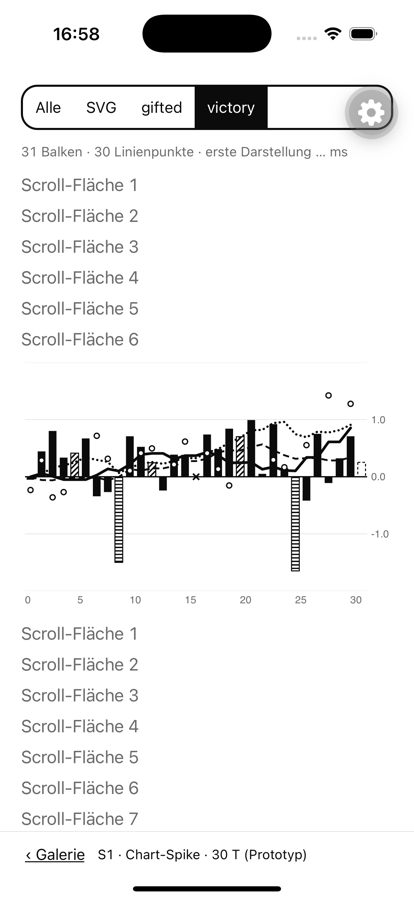
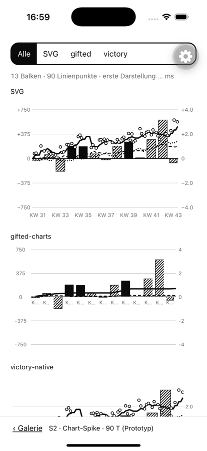

# Spike: Chart-Library für P8

Stand 2026-10-25. Spike zu P8 M1 (`docs/specs/2026-10-25-chart.md`). Branch `spike/chart-library`. Zeitrahmen ½ Tag.

**Entscheidung Julius:** _offen_

## Frage

Womit bauen wir den Chart der Bilanz-Seite? Harte Anforderungen aus dem Auftrag (wörtlich): „Schraffur, zwei Achsen, gestrichelt/gepunktet, Drag-Tooltip“. Erwartung im Plan: „victory-native, weil Muster und Stricharten in Skia einfacher sind.“ Geprüft wurden drei Kandidaten (Spec, Key Decision 2):

| Kandidat                   | Version                                       | Neue Abhängigkeiten                                                                                                                                           |
| -------------------------- | --------------------------------------------- | ------------------------------------------------------------------------------------------------------------------------------------------------------------- |
| Eigenes SVG                | `react-native-svg` 15.15.4 (schon im Projekt) | keine                                                                                                                                                         |
| react-native-gifted-charts | 1.4.81 (MIT)                                  | `expo-linear-gradient` ~57.0.2 (Peer, nativ), `gifted-charts-core`                                                                                            |
| victory-native             | 42.0.1 (MIT)                                  | `@shopify/react-native-skia` 2.6.2, `react-native-reanimated` 4.5.1, `react-native-worklets` 0.10.1, `react-native-gesture-handler` ~2.32.0 (alle nativ, MIT) |

victory-native 43.x verlangt `react-native-skia` ≥ 2.15.1 (neuer Paketname) und passt nicht zu SDK 57, das `@shopify/react-native-skia` 2.6.2 festlegt. 42.0.1 ist die neueste Version für SDK 57.

## Vorgehen

Gleicher Prototyp je Kandidat (`src/dev/spike/`). Die Daten kommen aus `report.chart` der Demo-Szenarien `normal30` (S1) und `long90` (S2): Tagesbalken mit Schraffur und Streifen, ✕ auf der Nulllinie, gestrichelter Heute-Balken, linke Achse in kcal und rechte in Δ kg auf derselben Nulllinie, Gewicht durchgezogen 2,6, Fett gestrichelt `6 3.5`, Fett laut Bilanz gepunktet `0.1 4.2`, hohle Messpunkte. Dazu langes Drücken (0,3 s), dann Ziehen für den Tooltip, in einem Pager mit senkrecht scrollender Seite wie auf der Bilanz-Seite. Geprüft habe ich im Simulator (iPhone 16 Pro, iOS 18.3, Debug) per Screenshot. Den Simulator konnte ich nicht antippen, deshalb sind Gesten und Messwerte nicht geprüft (siehe „Offen“).

## Ergebnis

| Kriterium                                | Eigenes SVG                                                                                             | gifted-charts                                                                                                                 | victory-native                                                                                                            |
| ---------------------------------------- | ------------------------------------------------------------------------------------------------------- | ----------------------------------------------------------------------------------------------------------------------------- | ------------------------------------------------------------------------------------------------------------------------- |
| Schraffur / Streifen                     | ✅ `QualityPatternDefs` + `qualityFill` aus P7 direkt                                                   | ✅ über `barBackgroundPattern` mit `QualityPatternDefs` (je Balken ein eigenes `Svg`)                                         | ⚠️ von Hand auf der Skia-Canvas gemalt (Clip + Pfad); P7-Muster nicht nutzbar, zweite Implementierung                     |
| ✕ auf der Nulllinie                      | ✅ `QualityCross`                                                                                       | ❌ keine eigenen Marken im Plot; nur über ein Overlay                                                                         | ✅ von Hand (zwei Skia-Linien)                                                                                            |
| Heute gestrichelt                        | ✅ `strokeDasharray`                                                                                    | ⚠️ Balken sind Views; `borderStyle: 'dashed'` (Strichmuster nicht steuerbar)                                                  | ✅ `DashPathEffect`                                                                                                       |
| Zwei Achsen, gemeinsame Nulllinie        | ✅ eigene Skalen                                                                                        | ✅ `secondaryYAxis` mit `mostNegativeValue`; Labels brauchen eigenes Format („1.000“ statt „1,0“)                             | ⚠️ mehrere `yAxis` möglich; Balken laufen ohnehin an der Bibliothek vorbei, linke Achse im Prototyp noch nicht verdrahtet |
| Drei Linienarten                         | ✅                                                                                                      | ❌ BarChart kann nur zwei Linien (`lineData`, `lineData2`), „Fett laut Bilanz“ fehlt                                          | ✅ `Line` + `DashPathEffect`                                                                                              |
| Linien pro Tag unter Wochenbalken (1d)   | ✅                                                                                                      | ❌ ein Linienpunkt pro Balken: bei 13 Wochen nur die ersten 13 von 90 Tagen (S2)                                              | ✅                                                                                                                        |
| Hohle Messpunkte                         | ✅ `Circle`                                                                                             | ❌ nur Datenpunkte auf einer der zwei Linien                                                                                  | ✅ zwei `Circle` je Punkt                                                                                                 |
| X-Labels wie im Design                   | ✅ frei                                                                                                 | ⚠️ ein Label je Balken, bei 31 Tagen überlappend; müsste je Balken ausgedünnt werden                                          | ⚠️ Zahlen-Achse; Labels per Formatter                                                                                     |
| Langes Drücken, dann Ziehen              | ⚠️ Responder-System mit 300-ms-Timer + `useScrollLock` (wie `MarkedSlider`); im Simulator nicht prüfbar | ⚠️ `pointerConfig.activatePointersOnLongPress` + `activatePointersDelay`; Tooltip über `pointerLabelComponent`; nicht geprüft | ✅ eingebaut: `chartPressConfig.pan.activateAfterLongPress` (Gesture Handler); Tipp nicht eingebaut; nicht geprüft        |
| VoiceOver `adjustable`                   | ✅ eigene View mit `accessibilityActions`                                                               | ⚠️ nur um die ganze Komponente herum                                                                                          | ⚠️ nur um die Canvas herum                                                                                                |
| 90 T ohne Ruckeln (iPhone 12)            | offen                                                                                                   | offen                                                                                                                         | offen                                                                                                                     |
| Design-Geometrie (viewBox 350 × 232) 1:1 | ✅                                                                                                      | ❌ eigenes Layout (Abstände, Achsenbreiten)                                                                                   | ⚠️ Padding/Bounds der Bibliothek                                                                                          |
| Neue native Abhängigkeiten / Dev-Build   | ✅ keine                                                                                                | ⚠️ eine (`expo-linear-gradient`)                                                                                              | ❌ vier, darunter Skia (`libs/ios` 210 MB in `node_modules`); Release-Größe nicht gemessen                                |
| Lizenz                                   | —                                                                                                       | MIT                                                                                                                           | MIT (alle)                                                                                                                |
| Aufwand M4–M6                            | mittel: Achsen, Labels, Geste selbst                                                                    | hoch: Lücken (dritte Linie, ✕, Punkte, Wochenlinien) per Overlay                                                              | mittel: Balken, Muster, ✕ ohnehin selbst; Achsen und Geste geschenkt                                                      |

Screenshots (Simulator, hell):

- 30 T, alle drei untereinander (SVG, gifted, victory abgeschnitten): 
- 30 T, victory-native: 
- 90 T Wochenbalken, alle drei (gifted-Linien enden nach 13 Punkten): 

## Bewertung

- **gifted-charts** scheidet aus. Drei harte Punkte gehen nicht ohne eigenes Overlay: dritte Linie, Messpunkte, Linien pro Tag unter Wochenbalken. Mit Overlay bliebe von der Bibliothek kaum etwas übrig.
- **victory-native** erfüllt alles. Balken, Muster und ✕ laufen aber an der Bibliothek vorbei und müssen in Skia ein zweites Mal entstehen, neben den SVG-Mustern aus P7 für Zeile, Sheet und Legende. Was die Bibliothek wirklich liefert, sind Achsen und die Long-Press-Geste. Dafür kommen vier native Abhängigkeiten dazu, darunter Skia. Die Erwartung „Muster in Skia einfacher“ hat sich nicht bestätigt: Die Schraffur ist in beiden Welten ein Pfad mit Clip, in SVG gibt es sie aus P7 aber schon fertig.
- **Eigenes SVG** erfüllt alle sichtbaren Anforderungen mit dem kleinsten Code und ohne neue Abhängigkeit. Es übernimmt die Design-Geometrie 1:1 und nutzt die P7-Muster wie in CLAUDE.md vorgesehen. Offen sind die Geste und die Leistung, beide nur am Gerät prüfbar.

**Empfehlung: eigenes SVG.** Für die Geste das Responder-System mit Timer, ohne neue Abhängigkeit. Erweist sich das am iPhone als hakelig, ist `react-native-gesture-handler` (`Gesture.Pan().activateAfterLongPress(300)`) die Rückfalloption. Es ist schon transitiv über `expo-router` vorhanden und müsste nur direkt eingebunden werden.

## Offen (am iPhone, Julius)

1. S1 öffnen (Galerie): lange drücken, ziehen, loslassen. Bleibt der Tooltip, ruckelt nichts, lässt sich ohne Halten weiter scrollen und blättern?
2. Release-Build auf dem älteren iPhone (Open Question 1 der Spec): S2 (90 T) scrollen, ziehen, FPS im Perf Monitor.
3. Entscheidung oben eintragen.
